# sub_00885634

- RVA: `0x00885634`–`0x008857B2` (길이 `382` bytes)
- VA: `0x0000000140885634`
- 실행 섹션: `PAGE`
- PDB 이름 있음: `아니요`; PDB Function 태그: `아니요`
- unwind 정보 RVA: `0x0007C928`
- 디코드: `90`개 명령, `382/382` bytes 표시
- 미해석 바이트: `0` (있으면 어셈블리에 `.byte`로 보존)

> 이 문서는 커널 이미지의 기계어와 PDB 기호를 분석해 생성했습니다. 4번과 5번은 함수 원형과 자료형을 바이너리 사용 방식에서 추정한 C 해석이며 원본 소스 복구 결과는 아닙니다.

## 1. Dependencies

- 직접 호출 지점: **9**; 고유 호출 대상: **8**
- 직접 호출자로 확인된 함수: **0**
- RIP 상대 이미지 참조: **0**

### Outgoing calls
- `0x00885637` → [MiLocateExclusiveSecure](../../text/48/MiLocateExclusiveSecure_function_0048C610.md) (function, `0x0048C610`)
- `0x00885667` → [MiGetCommittedPages](../../text/32/MiGetCommittedPages_function_00325CE0.md) (function, `0x00325CE0`)
- `0x008856A6` → [UNLOCK_ADDRESS_SPACE](../../text/2A/UNLOCK_ADDRESS_SPACE_function_002A4844.md) (function, `0x002A4844`)
- `0x0088575C` → [MiIsVaRangeAvailable](../97/MiIsVaRangeAvailable_function_0097FD90.md) (function, `0x0097FD90`)
- `0x0088577B` → [UNLOCK_ADDRESS_SPACE](../../text/2A/UNLOCK_ADDRESS_SPACE_function_002A4844.md) (function, `0x002A4844`)
- `0x0088578A` → [MiUnlockAndDereferenceNestedVad](../../text/4E/MiUnlockAndDereferenceNestedVad_function_004EEFCC.md) (function, `0x004EEFCC`)
- `0x00885792` → [MiSetVadDeleted](../../text/29/MiSetVadDeleted_function_00296E00.md) (function, `0x00296E00`)
- `0x0088579F` → [MiDeleteVad](MiDeleteVad_function_00888C80.md) (function, `0x00888C80`)
- `0x008857A8` → [MiDecrementVadsBeingDeleted](../../text/34/MiDecrementVadsBeingDeleted_function_00341010.md) (function, `0x00341010`)

### Direct callers
- 이 함수 시작 RVA로 연결되는 직접 call은 확인되지 않았습니다. 간접 호출은 완전히 역산할 수 없습니다.

### Static image references
- 디코드된 RIP-relative 메모리 참조가 없습니다.

## 2. Other-region calls and transfers

- 다른 실행 섹션으로 향하는 call: **7**
  - `0x00885637` → [MiLocateExclusiveSecure](../../text/48/MiLocateExclusiveSecure_function_0048C610.md) (`PAGE` → `.text`)
  - `0x00885667` → [MiGetCommittedPages](../../text/32/MiGetCommittedPages_function_00325CE0.md) (`PAGE` → `.text`)
  - `0x008856A6` → [UNLOCK_ADDRESS_SPACE](../../text/2A/UNLOCK_ADDRESS_SPACE_function_002A4844.md) (`PAGE` → `.text`)
  - `0x0088577B` → [UNLOCK_ADDRESS_SPACE](../../text/2A/UNLOCK_ADDRESS_SPACE_function_002A4844.md) (`PAGE` → `.text`)
  - `0x0088578A` → [MiUnlockAndDereferenceNestedVad](../../text/4E/MiUnlockAndDereferenceNestedVad_function_004EEFCC.md) (`PAGE` → `.text`)
  - `0x00885792` → [MiSetVadDeleted](../../text/29/MiSetVadDeleted_function_00296E00.md) (`PAGE` → `.text`)
  - `0x008857A8` → [MiDecrementVadsBeingDeleted](../../text/34/MiDecrementVadsBeingDeleted_function_00341010.md) (`PAGE` → `.text`)
- call이 아닌 외부 분기/꼬리 이동: **13**
  - `0x0088563F` → [sub_0088535F + 0x1D1](Unknown_function_0088535F.md) (`tail-transfer`)
  - `0x00885657` → [sub_0088535F + 0xEF](Unknown_function_0088535F.md) (`tail-transfer`)
  - `0x0088565F` → [sub_0088535F + 0x16A](Unknown_function_0088535F.md) (`tail-transfer`)
  - `0x00885671` → [sub_00884EE1 + 0xEB](Unknown_function_00884EE1.md) (`tail-transfer`)
  - `0x0088568F` → [sub_00884EE1 + 0xEB](Unknown_function_00884EE1.md) (`tail-transfer`)
  - `0x008856B0` → [sub_0088535F + 0x129](Unknown_function_0088535F.md) (`tail-transfer`)
  - `0x008856E7` → [sub_00884EE1 + 0x2B4](Unknown_function_00884EE1.md) (`tail-transfer`)
  - `0x008856FA` → [sub_00884EE1 + 0x17F](Unknown_function_00884EE1.md) (`tail-transfer`)
  - `0x00885710` → [sub_00884EE1 + 0x2FD](Unknown_function_00884EE1.md) (`tail-transfer`)
  - `0x0088573B` → [sub_00885AED + 0x3D](Unknown_function_00885AED.md) (`tail-transfer`)
  - `0x00885763` → [sub_00884EE1 + 0x25D](Unknown_function_00884EE1.md) (`tail-transfer`)
  - `0x00885785` → [sub_0088535F + 0x129](Unknown_function_0088535F.md) (`tail-transfer`)
  - `0x008857AD` → [sub_00884EE1 + 0x44D](Unknown_function_00884EE1.md) (`tail-transfer`)

## 3. Assembly (complete function range)

```asm
00885634  49 8B CE                        mov rcx, r14
00885637  E8 D4 6F C0 FF                  call 0x14048c610
0088563C  48 85 C0                        test rax, rax
0088563F  0F 84 EB FE FF FF               je 0x140885530
00885645  48 8B 5C 24 50                  mov rbx, qword ptr [rsp + 0x50]
0088564A  41 BD 9A 00 00 C0               mov r13d, 0xc000009a
00885650  44 89 6D 68                     mov dword ptr [rbp + 0x68], r13d
00885654  45 33 E4                        xor r12d, r12d
00885657  E9 F2 FD FF FF                  jmp 0x14088544e
0088565C  4D 8B E6                        mov r12, r14
0088565F  E9 65 FE FF FF                  jmp 0x1408854c9
00885664  49 8B CF                        mov rcx, r15
00885667  E8 74 06 AA FF                  call 0x140325ce0
0088566C  48 3B 44 24 78                  cmp rax, qword ptr [rsp + 0x78]
00885671  0F 83 55 F9 FF FF               jae 0x140884fcc
00885677  48 F7 C2 FF 0F 00 00            test rdx, 0xfff
0088567E  49 8B C6                        mov rax, r14
00885681  0F 95 C0                        setne al
00885684  48 C1 EA 0C                     shr rdx, 0xc
00885688  48 03 C2                        add rax, rdx
0088568B  48 89 45 B0                     mov qword ptr [rbp - 0x50], rax
0088568F  E9 38 F9 FF FF                  jmp 0x140884fcc
00885694  48 8B 4C 24 50                  mov rcx, qword ptr [rsp + 0x50]
00885699  41 BD 0A 01 00 C0               mov r13d, 0xc000010a
0088569F  48 8B D7                        mov rdx, rdi
008856A2  44 89 6D 68                     mov dword ptr [rbp + 0x68], r13d
008856A6  E8 99 F1 A1 FF                  call 0x1402a4844
008856AB  4C 8B 64 24 58                  mov r12, qword ptr [rsp + 0x58]
008856B0  E9 D3 FD FF FF                  jmp 0x140885488
008856B5  41 8B 46 1C                     mov eax, dword ptr [r14 + 0x1c]
008856B9  45 0F B6 46 21                  movzx r8d, byte ptr [r14 + 0x21]
008856BE  41 0F B6 4E 20                  movzx ecx, byte ptr [r14 + 0x20]
008856C3  49 C1 E0 20                     shl r8, 0x20
008856C7  4C 0B C0                        or r8, rax
008856CA  48 C1 E1 20                     shl rcx, 0x20
008856CE  41 8B 46 18                     mov eax, dword ptr [r14 + 0x18]
008856D2  48 0B C8                        or rcx, rax
008856D5  4C 2B C1                        sub r8, rcx
008856D8  49 FF C0                        inc r8
008856DB  45 89 46 34                     mov dword ptr [r14 + 0x34], r8d
008856DF  49 C1 E8 20                     shr r8, 0x20
008856E3  45 88 46 22                     mov byte ptr [r14 + 0x22], r8b
008856E7  E9 A9 FA FF FF                  jmp 0x140885195
008856EC  48 8B 87 10 04 00 00            mov rax, qword ptr [rdi + 0x410]
008856F3  C6 80 24 04 00 00 01            mov byte ptr [rax + 0x424], 1
008856FA  E9 61 F9 FF FF                  jmp 0x140885060
008856FF  41 8B 46 30                     mov eax, dword ptr [r14 + 0x30]
00885703  83 E0 DF                        and eax, 0xffffffdf
00885706  83 C8 50                        or eax, 0x50
00885709  41 89 46 30                     mov dword ptr [r14 + 0x30], eax
0088570D  83 CB 01                        or ebx, 1
00885710  E9 C9 FA FF FF                  jmp 0x1408851de
00885715  4C 8B 6D 70                     mov r13, qword ptr [rbp + 0x70]
00885719  4D 8B 6D 00                     mov r13, qword ptr [r13]
0088571D  48 8B 4E 18                     mov rcx, qword ptr [rsi + 0x18]
00885721  48 FF C9                        dec rcx
00885724  4C 89 6D 90                     mov qword ptr [rbp - 0x70], r13
00885728  49 03 CD                        add rcx, r13
0088572B  4C 89 6C 24 68                  mov qword ptr [rsp + 0x68], r13
00885730  F7 46 40 00 00 00 04            test dword ptr [rsi + 0x40], 0x4000000
00885737  48 89 4D 98                     mov qword ptr [rbp - 0x68], rcx
0088573B  0F 85 E9 03 00 00               jne 0x140885b2a
00885741  48 8B 46 08                     mov rax, qword ptr [rsi + 8]
00885745  4C 8B C1                        mov r8, rcx
00885748  4C 8B 0E                        mov r9, qword ptr [rsi]
0088574B  4D 2B C5                        sub r8, r13
0088574E  49 FF C0                        inc r8
00885751  48 89 44 24 20                  mov qword ptr [rsp + 0x20], rax
00885756  49 8B D5                        mov rdx, r13
00885759  48 8B CF                        mov rcx, rdi
0088575C  E8 2F A6 0F 00                  call 0x14097fd90
00885761  85 C0                           test eax, eax
00885763  0F 85 D5 F9 FF FF               jne 0x14088513e
00885769  48 8B 4C 24 50                  mov rcx, qword ptr [rsp + 0x50]
0088576E  41 BD 18 00 00 C0               mov r13d, 0xc0000018
00885774  48 8B D7                        mov rdx, rdi
00885777  44 89 6D 68                     mov dword ptr [rbp + 0x68], r13d
0088577B  E8 C4 F0 A1 FF                  call 0x1402a4844
00885780  4C 8B 64 24 58                  mov r12, qword ptr [rsp + 0x58]
00885785  E9 FE FC FF FF                  jmp 0x140885488
0088578A  E8 3D 98 C6 FF                  call 0x1404eefcc
0088578F  48 8B CF                        mov rcx, rdi
00885792  E8 69 16 A1 FF                  call 0x140296e00
00885797  45 33 C0                        xor r8d, r8d
0088579A  33 D2                           xor edx, edx
0088579C  48 8B CF                        mov rcx, rdi
0088579F  E8 DC 34 00 00                  call 0x140888c80
008857A4  48 8B 4D A8                     mov rcx, qword ptr [rbp - 0x58]
008857A8  E8 63 B8 AB FF                  call 0x140341010
008857AD  E9 7C FB FF FF                  jmp 0x14088532e
```

## 4. C-style interpretation (structured pseudocode)

```c
__int64 __fastcall sub_00885634(__int64 a1, __int64 a2, __int64 a3, __int64 a4, __int64 a5, __int64 a6, __int64 a7, __int64 a8, __int64 a9, __int64 a10)
{
    __int64 result;
    __int64 v_r12;
    unsigned __int64 v_stack_p20;
    unsigned __int64 v_stack_p50;
    unsigned __int64 v_stack_p58;
    unsigned __int64 v_stack_p68;
    unsigned __int64 v_stack_p78;

    result = MiLocateExclusiveSecure(v_r14, a2, a3, a4);
    *(unsigned int *)(v_rbp + 104) = (unsigned int)((unsigned int)(0xC000009AULL));
    v_r12 = 0;
}
```

## 5. (Beta) C Style

```c
int64_t sub_00885634(int64_t Arg1, int64_t Arg2, int64_t Arg3, int64_t Arg4, uint64_t Arg5, uint64_t Arg6, uint64_t Arg7, uint64_t Arg8, uint64_t Arg9, int64_t Arg10)
{
    int64_t result;
    int64_t local_r12;
    uint64_t v_stack_p20;
    uint64_t v_stack_p50;
    uint64_t v_stack_p58;
    uint64_t v_stack_p68;
    uint64_t v_stack_p78;

    result = MiLocateExclusiveSecure(local_r14, Arg2, Arg3, Arg4);
    *(uint32_t *)(local_rbp + 0x68) = (uint32_t)((uint32_t)(0xC000009AULL));
    local_r12 = 0;
}
```

## 6. Execution-region graph

[열기: 2D/3D 그래프와 함수 탐색 컨트롤 패널](../../../control-panel.html?section=page&rva=0x00885634&view=graph)

- 2D 그래프는 위에서 아래로 흐르고, 3D 그래프는 빈 공간을 드래그해 회전합니다. Shift+드래그는 이동, 휠은 확대·축소, 함수 노드 선택은 대상 보고서 이동입니다.

### Static fallback

```mermaid
flowchart TD
  bb_00885634[BB_00885634]
  bb_00885645[BB_00885645]
  bb_0088565C[BB_0088565C]
  bb_00885664[BB_00885664]
  bb_00885677[BB_00885677]
  bb_00885694[BB_00885694]
  bb_008856B5[BB_008856B5]
  bb_008856EC[BB_008856EC]
  bb_008856FF[BB_008856FF]
  bb_00885715[BB_00885715]
  bb_00885741[BB_00885741]
  bb_00885769[BB_00885769]
  bb_0088578A[BB_0088578A]
  bb_00885634 -->|fallthrough| bb_00885645
  bb_00885664 -->|fallthrough| bb_00885677
  bb_00885715 -->|fallthrough| bb_00885741
  bb_00885741 -->|fallthrough| bb_00885769
```


