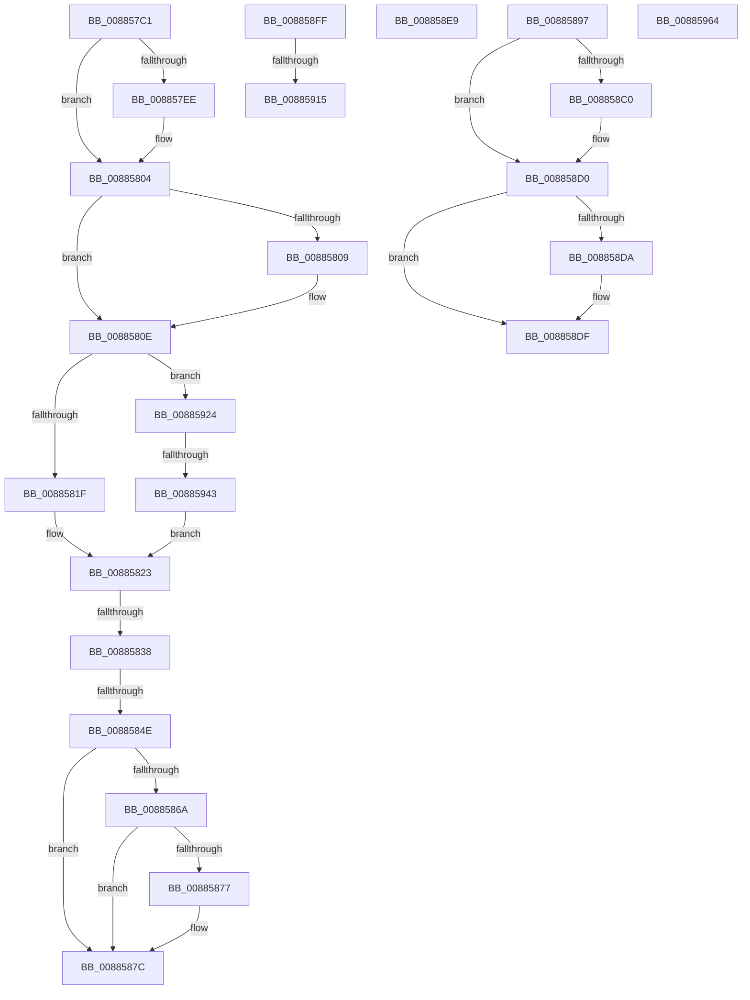

# sub_008857C1

- RVA: `0x008857C1`–`0x00885970` (길이 `431` bytes)
- VA: `0x00000001408857C1`
- 실행 섹션: `PAGE`
- PDB 이름 있음: `아니요`; PDB Function 태그: `아니요`
- unwind 정보 RVA: `0x0007C954`
- 디코드: `100`개 명령, `431/431` bytes 표시
- 미해석 바이트: `0` (있으면 어셈블리에 `.byte`로 보존)

> 이 문서는 커널 이미지의 기계어와 PDB 기호를 분석해 생성했습니다. 4번과 5번은 함수 원형과 자료형을 바이너리 사용 방식에서 추정한 C 해석이며 원본 소스 복구 결과는 아닙니다.

## 1. Dependencies

- 직접 호출 지점: **10**; 고유 호출 대상: **8**
- 직접 호출자로 확인된 함수: **0**
- RIP 상대 이미지 참조: **2**

### Outgoing calls
- `0x008857DA` → [KeAbPreAcquire](../../text/21/KeAbPreAcquire_function_00210230.md) (function, `0x00210230`)
- `0x008857FF` → [ExfAcquirePushLockExclusiveEx](../../text/20/ExfAcquirePushLockExclusiveEx_function_0020FC90.md) (function, `0x0020FC90`)
- `0x00885855` → [KeAbPostRelease](../../text/2E/KeAbPostRelease_function_002E1600.md) (function, `0x002E1600`)
- `0x00885877` → [KiCheckForKernelApcDelivery](../../text/2E/KiCheckForKernelApcDelivery_function_002E2C80.md) (function, `0x002E2C80`)
- `0x008858A1` → [MiPreparePlaceholderVadReplacement](../A7/MiPreparePlaceholderVadReplacement_function_00A7E998.md) (function, `0x00A7E998`)
- `0x008858AF` → [KeAbPreAcquire](../../text/21/KeAbPreAcquire_function_00210230.md) (function, `0x00210230`)
- `0x008858CB` → [ExfAcquirePushLockExclusiveEx](../../text/20/ExfAcquirePushLockExclusiveEx_function_0020FC90.md) (function, `0x0020FC90`)
- `0x008858F2` → [MiDereferenceControlArea](../../text/47/MiDereferenceControlArea_function_00479A20.md) (function, `0x00479A20`)
- `0x00885902` → [MiCreatePlaceholderStorage](../8C/MiCreatePlaceholderStorage_function_008CF330.md) (function, `0x008CF330`)
- `0x00885932` → [MiAllocatePool](../../text/35/MiAllocatePool_function_0035B540.md) (function, `0x0035B540`)

### Direct callers
- 이 함수 시작 RVA로 연결되는 직접 call은 확인되지 않았습니다. 간접 호출은 완전히 역산할 수 없습니다.

### Static image references
- `0x008857C6` → RVA `0x00E2CD10` (`.data`; read)
- `0x008857DF` → RVA `0x00E2CD10` (`.data`; read/write)

## 2. Other-region calls and transfers

- 다른 실행 섹션으로 향하는 call: **8**
  - `0x008857DA` → [KeAbPreAcquire](../../text/21/KeAbPreAcquire_function_00210230.md) (`PAGE` → `.text`)
  - `0x008857FF` → [ExfAcquirePushLockExclusiveEx](../../text/20/ExfAcquirePushLockExclusiveEx_function_0020FC90.md) (`PAGE` → `.text`)
  - `0x00885855` → [KeAbPostRelease](../../text/2E/KeAbPostRelease_function_002E1600.md) (`PAGE` → `.text`)
  - `0x00885877` → [KiCheckForKernelApcDelivery](../../text/2E/KiCheckForKernelApcDelivery_function_002E2C80.md) (`PAGE` → `.text`)
  - `0x008858AF` → [KeAbPreAcquire](../../text/21/KeAbPreAcquire_function_00210230.md) (`PAGE` → `.text`)
  - `0x008858CB` → [ExfAcquirePushLockExclusiveEx](../../text/20/ExfAcquirePushLockExclusiveEx_function_0020FC90.md) (`PAGE` → `.text`)
  - `0x008858F2` → [MiDereferenceControlArea](../../text/47/MiDereferenceControlArea_function_00479A20.md) (`PAGE` → `.text`)
  - `0x00885932` → [MiAllocatePool](../../text/35/MiAllocatePool_function_0035B540.md) (`PAGE` → `.text`)
- call이 아닌 외부 분기/꼬리 이동: **9**
  - `0x00885832` → [sub_00885AED + 0x6D](Unknown_function_00885AED.md) (`tail-transfer`)
  - `0x00885848` → [sub_008859DF + 0xDA](Unknown_function_008859DF.md) (`tail-transfer`)
  - `0x00885892` → [sub_00884EE1 + 0x2A3](Unknown_function_00884EE1.md) (`tail-transfer`)
  - `0x008858E4` → [sub_00884EE1 + 0x392](Unknown_function_00884EE1.md) (`tail-transfer`)
  - `0x008858FA` → [sub_00884EE1 + 0x457](Unknown_function_00884EE1.md) (`tail-transfer`)
  - `0x0088590F` → [sub_00885AED + 0xF](Unknown_function_00885AED.md) (`tail-transfer`)
  - `0x0088591F` → [sub_0088535F + 0x158](Unknown_function_0088535F.md) (`tail-transfer`)
  - `0x0088593D` → [sub_008859DF + 0x4E](Unknown_function_008859DF.md) (`tail-transfer`)
  - `0x0088596B` → [sub_00885634 + 0xE9](Unknown_function_00885634.md) (`tail-transfer`)

## 3. Assembly (complete function range)

```asm
008857C1  48 8B 44 24 50                  mov rax, qword ptr [rsp + 0x50]
008857C6  48 8D 0D 43 75 5A 00            lea rcx, [rip + 0x5a7543]
008857CD  45 33 C0                        xor r8d, r8d
008857D0  33 D2                           xor edx, edx
008857D2  66 FF 88 E6 01 00 00            dec word ptr [rax + 0x1e6]
008857D9  90                              nop
008857DA  E8 51 AA 98 FF                  call 0x140210230
008857DF  F0 48 0F BA 2D 27 75 5A 00 00   lock bts qword ptr [rip + 0x5a7527], 0
008857E9  4C 8B E8                        mov r13, rax
008857EC  73 16                           jae 0x140885804
008857EE  4C 8D 05 1B 75 5A 00            lea r8, [rip + 0x5a751b]
008857F5  48 8B D0                        mov rdx, rax
008857F8  48 8D 0D 11 75 5A 00            lea rcx, [rip + 0x5a7511]
008857FF  E8 8C A4 98 FF                  call 0x14020fc90
00885804  4D 85 ED                        test r13, r13
00885807  74 05                           je 0x14088580e
00885809  41 C6 45 0A 01                  mov byte ptr [r13 + 0xa], 1
0088580E  4C 8B 6D A0                     mov r13, qword ptr [rbp - 0x60]
00885812  4D 8B 6D 20                     mov r13, qword ptr [r13 + 0x20]
00885816  4D 85 ED                        test r13, r13
00885819  0F 84 05 01 00 00               je 0x140885924
0088581F  41 FF 45 08                     inc dword ptr [r13 + 8]
00885823  48 8B 85 80 00 00 00            mov rax, qword ptr [rbp + 0x80]
0088582A  48 8B 48 30                     mov rcx, qword ptr [rax + 0x30]
0088582E  49 39 4D 00                     cmp qword ptr [r13], rcx
00885832  0F 82 22 03 00 00               jb 0x140885b5a
00885838  48 8B C7                        mov rax, rdi
0088583B  F0 48 0F C1 05 CC 74 5A 00      lock xadd qword ptr [rip + 0x5a74cc], rax
00885844  24 06                           and al, 6
00885846  3C 02                           cmp al, 2
00885848  0F 84 6B 02 00 00               je 0x140885ab9
0088584E  48 8D 0D BB 74 5A 00            lea rcx, [rip + 0x5a74bb]
00885855  E8 A6 BD A5 FF                  call 0x1402e1600
0088585A  48 8B 4C 24 50                  mov rcx, qword ptr [rsp + 0x50]
0088585F  90                              nop
00885860  66 83 81 E6 01 00 00 01         add word ptr [rcx + 0x1e6], 1
00885868  75 12                           jne 0x14088587c
0088586A  48 8D 81 98 00 00 00            lea rax, [rcx + 0x98]
00885871  90                              nop
00885872  48 39 00                        cmp qword ptr [rax], rax
00885875  74 05                           je 0x14088587c
00885877  E8 04 D4 A5 FF                  call 0x1402e2c80
0088587C  4C 8B 4D D0                     mov r9, qword ptr [rbp - 0x30]
00885880  4C 8B 54 24 78                  mov r10, qword ptr [rsp + 0x78]
00885885  4D 89 6E 78                     mov qword ptr [r14 + 0x78], r13
00885889  4C 8B 6C 24 68                  mov r13, qword ptr [rsp + 0x68]
0088588E  4C 89 6D 90                     mov qword ptr [rbp - 0x70], r13
00885892  E9 ED F8 FF FF                  jmp 0x140885184
00885897  4C 8B 45 A8                     mov r8, qword ptr [rbp - 0x58]
0088589B  49 8B D4                        mov rdx, r12
0088589E  48 8B C8                        mov rcx, rax
008858A1  E8 F2 90 1F 00                  call 0x140a7e998
008858A6  45 33 C0                        xor r8d, r8d
008858A9  49 8D 4E 28                     lea rcx, [r14 + 0x28]
008858AD  33 D2                           xor edx, edx
008858AF  E8 7C A9 98 FF                  call 0x140210230
008858B4  F0 49 0F BA 6E 28 00            lock bts qword ptr [r14 + 0x28], 0
008858BB  4C 8B E8                        mov r13, rax
008858BE  73 10                           jae 0x1408858d0
008858C0  4D 8D 46 28                     lea r8, [r14 + 0x28]
008858C4  48 8B D0                        mov rdx, rax
008858C7  49 8D 4E 28                     lea rcx, [r14 + 0x28]
008858CB  E8 C0 A3 98 FF                  call 0x14020fc90
008858D0  48 8B 5C 24 68                  mov rbx, qword ptr [rsp + 0x68]
008858D5  4D 85 ED                        test r13, r13
008858D8  74 05                           je 0x1408858df
008858DA  41 C6 45 0A 01                  mov byte ptr [r13 + 0xa], 1
008858DF  4C 8B 6C 24 50                  mov r13, qword ptr [rsp + 0x50]
008858E4  E9 8A F9 FF FF                  jmp 0x140885273
008858E9  49 8B CF                        mov rcx, r15
008858EC  41 BD 1F 00 00 C0               mov r13d, 0xc000001f
008858F2  E8 29 41 BF FF                  call 0x140479a20
008858F7  41 8B C5                        mov eax, r13d
008858FA  E9 39 FA FF FF                  jmp 0x140885338
008858FF  49 8B CE                        mov rcx, r14
00885902  E8 29 9A 04 00                  call 0x1408cf330
00885907  89 45 68                        mov dword ptr [rbp + 0x68], eax
0088590A  44 8B E8                        mov r13d, eax
0088590D  85 C0                           test eax, eax
0088590F  0F 89 E7 01 00 00               jns 0x140885afc
00885915  48 8B 5C 24 60                  mov rbx, qword ptr [rsp + 0x60]
0088591A  4C 8B 64 24 58                  mov r12, qword ptr [rsp + 0x58]
0088591F  E9 93 FB FF FF                  jmp 0x1408854b7
00885924  BA 10 00 00 00                  mov edx, 0x10
00885929  41 B8 4D 6D 43 78               mov r8d, 0x78436d4d
0088592F  8D 4A 30                        lea ecx, [rdx + 0x30]
00885932  E8 09 5C AD FF                  call 0x14035b540
00885937  4C 8B E8                        mov r13, rax
0088593A  48 85 C0                        test rax, rax
0088593D  0F 84 EA 00 00 00               je 0x140885a2d
00885943  48 8B 4D A0                     mov rcx, qword ptr [rbp - 0x60]
00885947  C7 40 08 01 00 00 00            mov dword ptr [rax + 8], 1
0088594E  48 8B C7                        mov rax, rdi
00885951  F0 48 0F B1 79 18               lock cmpxchg qword ptr [rcx + 0x18], rdi
00885957  49 89 45 00                     mov qword ptr [r13], rax
0088595B  4C 89 69 20                     mov qword ptr [rcx + 0x20], r13
0088595F  E9 BF FE FF FF                  jmp 0x140885823
00885964  48 8B 45 78                     mov rax, qword ptr [rbp + 0x78]
00885968  4C 03 28                        add r13, qword ptr [rax]
0088596B  E9 AD FD FF FF                  jmp 0x14088571d
```

## 4. C-style interpretation (structured pseudocode)

```c
__int64 __fastcall sub_008857C1(__int64 a1, int a2, int a3, __int64 a4, __int64 a5, __int64 a6, __int64 a7, __int64 a8, __int64 a9, __int64 a10, __int64 a11, __int64 a12, __int64 a13, __int64 a14, __int64 a15)
{
    __int64 result;
    unsigned __int64 v_stack_p50;
    unsigned __int64 v_stack_p58;
    unsigned __int64 v_stack_p60;
    unsigned __int64 v_stack_p68;

    a3 = 0;
    a2 = 0;
    result = KeAbPreAcquire(v_rip + 5928259, a2, a3, a4);
    if (!(condition_is_above_or_equal)) {
        a3 = v_rip + 5928219;
        a2 = result;
        a1 = v_rip + 5928209;
        result = ExfAcquirePushLockExclusiveEx(a1, a2, a3, a4);
    }
    if (result != 0) {
        *(unsigned __int8 *)(result + 10) = 1;
    }
    if (*(unsigned __int64 *)(*(unsigned __int64 *)(v_rbp - 96) + 32) == 0) goto loc_00885924;
loc_00885823:
    result = (unsigned __int8)((v_rdi) & (6));
    result = KeAbPostRelease(v_rip + 5928123, a2, a3, a4);
    if (((unsigned __int8)(result)) != 2) goto loc_0088587C;
    result = a10 + 152;
    if ((*(unsigned __int64 *)(a10 + 152)) != (a10 + 152)) {
        result = KiCheckForKernelApcDelivery(a10, a2, a3, a4);
    }
    *(unsigned __int64 *)(v_r14 + 120) = *(unsigned __int64 *)(*(unsigned __int64 *)(v_rbp - 96) + 32);
    *(unsigned __int64 *)(v_rbp - 112) = a13;
loc_00885924:
    result = MiAllocatePool(16 + 48, 16, (unsigned int)(0x78436D4DULL), *(unsigned __int64 *)(v_rbp - 48));
    *(unsigned int *)(result + 8) = 1;
    *(unsigned __int64 *)(result) = v_rdi;
    *(unsigned __int64 *)(*(unsigned __int64 *)(v_rbp - 96) + 32) = result;
    goto loc_00885823;
}
```

## 5. (Beta) C Style

```c
int64_t sub_008857C1(int64_t Arg1, int32_t Arg2, int32_t Arg3, int64_t Arg4, uint64_t Arg5, uint64_t Arg6, uint64_t Arg7, uint64_t Arg8, uint64_t Arg9, void *Arg10, uint64_t Arg11, uint64_t Arg12, int64_t Arg13, uint64_t Arg14, int64_t Arg15)
{
    uint8_t *arg10 = (uint8_t *)Arg10;

    int64_t result;
    uint64_t v_stack_p50;
    uint64_t v_stack_p58;
    uint64_t v_stack_p60;
    uint64_t v_stack_p68;

    Arg3 = 0;
    Arg2 = 0;
    result = KeAbPreAcquire(v_rip + 5928259, Arg2, Arg3, Arg4);
    if (!(condition_is_above_or_equal)) {
        Arg3 = v_rip + 5928219;
        Arg2 = result;
        Arg1 = v_rip + 5928209;
        result = ExfAcquirePushLockExclusiveEx(Arg1, Arg2, Arg3, Arg4);
    }
    if (result != 0) {
        *(uint8_t *)(result + 0xA) = 1;
    }
    if (*(uint64_t *)(*(uint64_t *)(local_rbp - 0x60) + 0x20) == 0) goto loc_00885924;
loc_00885823:
    result = (uint8_t)((local_rdi) & (6));
    result = KeAbPostRelease(v_rip + 5928123, Arg2, Arg3, Arg4);
    if (((uint8_t)(result)) != 2) goto loc_0088587C;
    result = Arg10 + 152;
    if ((*(uint64_t *)(arg10 + 0x98)) != (Arg10 + 152)) {
        result = KiCheckForKernelApcDelivery(Arg10, Arg2, Arg3, Arg4);
    }
    *(uint64_t *)(local_r14 + 0x78) = *(uint64_t *)(*(uint64_t *)(local_rbp - 0x60) + 0x20);
    *(uint64_t *)(local_rbp - 0x70) = Arg13;
loc_00885924:
    result = MiAllocatePool(16 + 48, 16, (uint32_t)(0x78436D4DULL), *(uint64_t *)(local_rbp - 0x30));
    *(uint32_t *)(result + 0x8) = 1;
    *(uint64_t *)(result) = local_rdi;
    *(uint64_t *)(*(uint64_t *)(local_rbp - 0x60) + 0x20) = result;
    goto loc_00885823;
}
```

### 관측된 메모리 오프셋

구조체 형식이 확인되지 않은 접근은 인자 기준의 오프셋으로만 기록했습니다.

| 기준 인자 | 오프셋 표현 | 폭 (bit) | 접근 |
|---|---:|---:|---|
| `Arg10` | `+ 0x0` | `64` | `R` |
| `Arg10` | `+ 0x98` | `64` | `R` |
| `Arg10` | `+ 0x1E6` | `16` | `R/W` |

## 6. Execution-region graph

[열기: 2D/3D 그래프와 함수 탐색 컨트롤 패널](../../../control-panel.html?section=page&rva=0x008857C1&view=graph)

- 2D 그래프는 위에서 아래로 흐르고, 3D 그래프는 빈 공간을 드래그해 회전합니다. Shift+드래그는 이동, 휠은 확대·축소, 함수 노드 선택은 대상 보고서 이동입니다.

### Static fallback


