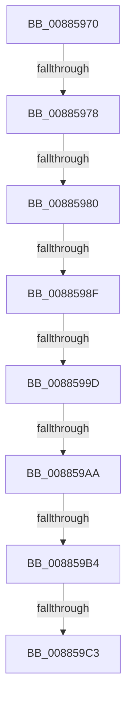

# sub_00885970

- RVA: `0x00885970`–`0x008859C8` (길이 `88` bytes)
- VA: `0x0000000140885970`
- 실행 섹션: `PAGE`
- PDB 이름 있음: `아니요`; PDB Function 태그: `아니요`
- unwind 정보 RVA: `0x0007C970`
- 디코드: `22`개 명령, `88/88` bytes 표시
- 미해석 바이트: `0` (있으면 어셈블리에 `.byte`로 보존)

> 이 문서는 커널 이미지의 기계어와 PDB 기호를 분석해 생성했습니다. 4번과 5번은 함수 원형과 자료형을 바이너리 사용 방식에서 추정한 C 해석이며 원본 소스 복구 결과는 아닙니다.

## 1. Dependencies

- 직접 호출 지점: **0**; 고유 호출 대상: **0**
- 직접 호출자로 확인된 함수: **0**
- RIP 상대 이미지 참조: **0**

### Outgoing calls
- 직접 디코드된 call 명령이 없습니다.

### Direct callers
- 이 함수 시작 RVA로 연결되는 직접 call은 확인되지 않았습니다. 간접 호출은 완전히 역산할 수 없습니다.

### Static image references
- 디코드된 RIP-relative 메모리 참조가 없습니다.

## 2. Other-region calls and transfers

- 다른 실행 섹션으로 향하는 call: **0**
- call이 아닌 외부 분기/꼬리 이동: **8**
  - `0x00885972` → [sub_00885604 + 0x1C](Unknown_function_00885604.md) (`tail-transfer`)
  - `0x0088597A` → [sub_00885604 + 0x1C](Unknown_function_00885604.md) (`tail-transfer`)
  - `0x00885989` → [sub_00885604 + 0x1C](Unknown_function_00885604.md) (`tail-transfer`)
  - `0x00885997` → [sub_00885604 + 0x1C](Unknown_function_00885604.md) (`tail-transfer`)
  - `0x008859A4` → [sub_00885604 + 0x1C](Unknown_function_00885604.md) (`tail-transfer`)
  - `0x008859AE` → [sub_00885ADB](Unknown_function_00885ADB.md) (`tail-transfer`)
  - `0x008859BD` → [MiMapViewOfDataSection + 0x8B](MiMapViewOfDataSection_function_00884E20.md) (`tail-transfer`)
  - `0x008859C3` → [sub_00885604 + 0x1C](Unknown_function_00885604.md) (`tail-transfer`)

## 3. Assembly (complete function range)

```asm
00885970  85 C9                           test ecx, ecx
00885972  0F 85 A8 FC FF FF               jne 0x140885620
00885978  85 D2                           test edx, edx
0088597A  0F 85 A0 FC FF FF               jne 0x140885620
00885980  8B 8D 90 00 00 00               mov ecx, dword ptr [rbp + 0x90]
00885986  83 F9 18                        cmp ecx, 0x18
00885989  0F 84 91 FC FF FF               je 0x140885620
0088598F  8B C1                           mov eax, ecx
00885991  83 E0 F8                        and eax, 0xfffffff8
00885994  83 F8 10                        cmp eax, 0x10
00885997  0F 84 83 FC FF FF               je 0x140885620
0088599D  8B C1                           mov eax, ecx
0088599F  83 E0 05                        and eax, 5
008859A2  3C 05                           cmp al, 5
008859A4  0F 84 76 FC FF FF               je 0x140885620
008859AA  4D 39 4F 40                     cmp qword ptr [r15 + 0x40], r9
008859AE  0F 84 27 01 00 00               je 0x140885adb
008859B4  41 0F B6 47 3E                  movzx eax, byte ptr [r15 + 0x3e]
008859B9  24 0C                           and al, 0xc
008859BB  3C 04                           cmp al, 4
008859BD  0F 84 E8 F4 FF FF               je 0x140884eab
008859C3  E9 58 FC FF FF                  jmp 0x140885620
```

## 4. C-style interpretation (structured pseudocode)

```c
__int64 __fastcall sub_00885970(int a1, int a2, __int64 a3, __int64 a4)
{
    __int64 result;

    result = (unsigned int)(((unsigned int)((unsigned int)((unsigned int)(*(unsigned int *)(v_rbp + 144))))) & (0xFFFFFFF8ULL));
    result = (unsigned int)(((unsigned int)((unsigned int)((unsigned int)(*(unsigned int *)(v_rbp + 144))))) & (5));
    result = (unsigned __int8)((*(unsigned __int8 *)(v_r15 + 62)) & (12));
}
```

## 5. (Beta) C Style

```c
int64_t sub_00885970(int32_t Arg1, int32_t Arg2, int64_t Arg3, int64_t Arg4)
{
    int64_t result;

    result = (uint32_t)(((uint32_t)((uint32_t)((uint32_t)(*(uint32_t *)(local_rbp + 0x90))))) & (0xFFFFFFF8ULL));
    result = (uint32_t)(((uint32_t)((uint32_t)((uint32_t)(*(uint32_t *)(local_rbp + 0x90))))) & (5));
    result = (uint8_t)((*(uint8_t *)(local_r15 + 0x3E)) & (12));
}
```

## 6. Execution-region graph

[열기: 2D/3D 그래프와 함수 탐색 컨트롤 패널](../../../control-panel.html?section=page&rva=0x00885970&view=graph)

- 2D 그래프는 위에서 아래로 흐르고, 3D 그래프는 빈 공간을 드래그해 회전합니다. Shift+드래그는 이동, 휠은 확대·축소, 함수 노드 선택은 대상 보고서 이동입니다.

### Static fallback


