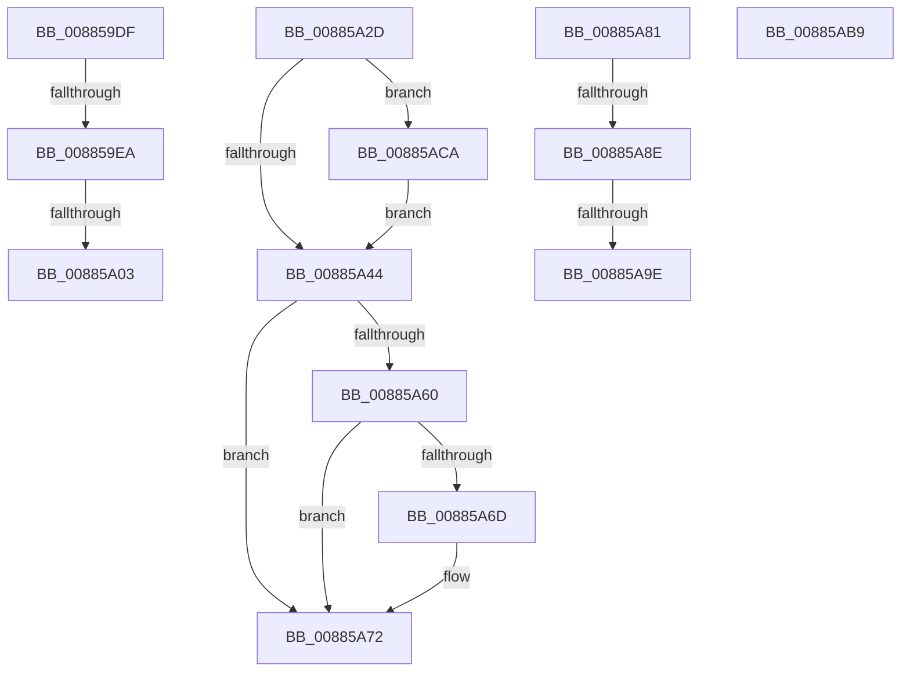

# sub_008859DF

- RVA: `0x008859DF`–`0x00885ADB` (길이 `252` bytes)
- VA: `0x00000001408859DF`
- 실행 섹션: `PAGE`
- PDB 이름 있음: `아니요`; PDB Function 태그: `아니요`
- unwind 정보 RVA: `0x0007C994`
- 디코드: `55`개 명령, `252/252` bytes 표시
- 미해석 바이트: `0` (있으면 어셈블리에 `.byte`로 보존)

> 이 문서는 커널 이미지의 기계어와 PDB 기호를 분석해 생성했습니다. 4번과 5번은 함수 원형과 자료형을 바이너리 사용 방식에서 추정한 C 해석이며 원본 소스 복구 결과는 아닙니다.

## 1. Dependencies

- 직접 호출 지점: **7**; 고유 호출 대상: **6**
- 직접 호출자로 확인된 함수: **0**
- RIP 상대 이미지 참조: **2**

### Outgoing calls
- `0x008859F3` → [MiIncrementLargeSubsections](../../text/4D/MiIncrementLargeSubsections_function_004D3410.md) (function, `0x004D3410`)
- `0x00885A4B` → [KeAbPostRelease](../../text/2E/KeAbPostRelease_function_002E1600.md) (function, `0x002E1600`)
- `0x00885A6D` → [KiCheckForKernelApcDelivery](../../text/2E/KiCheckForKernelApcDelivery_function_002E2C80.md) (function, `0x002E2C80`)
- `0x00885AA1` → [MiFreePlaceholderStorage](../AA/MiFreePlaceholderStorage_function_00AAC868.md) (function, `0x00AAC868`)
- `0x00885AAB` → [ExFreePoolWithTag](../../poolcode/B8/ExFreePoolWithTag_function_00B82870.md) (function, `0x00B82870`)
- `0x00885AC0` → [ExfTryToWakePushLock](../../text/26/ExfTryToWakePushLock_function_00265DD0.md) (function, `0x00265DD0`)
- `0x00885AD1` → [ExfTryToWakePushLock](../../text/26/ExfTryToWakePushLock_function_00265DD0.md) (function, `0x00265DD0`)

### Direct callers
- 이 함수 시작 RVA로 연결되는 직접 call은 확인되지 않았습니다. 간접 호출은 완전히 역산할 수 없습니다.

### Static image references
- `0x00885A2D` → RVA `0x00E2CD10` (`.data`; read/write)
- `0x00885A44` → RVA `0x00E2CD10` (`.data`; read)

## 2. Other-region calls and transfers

- 다른 실행 섹션으로 향하는 call: **6**
  - `0x008859F3` → [MiIncrementLargeSubsections](../../text/4D/MiIncrementLargeSubsections_function_004D3410.md) (`PAGE` → `.text`)
  - `0x00885A4B` → [KeAbPostRelease](../../text/2E/KeAbPostRelease_function_002E1600.md) (`PAGE` → `.text`)
  - `0x00885A6D` → [KiCheckForKernelApcDelivery](../../text/2E/KiCheckForKernelApcDelivery_function_002E2C80.md) (`PAGE` → `.text`)
  - `0x00885AAB` → [ExFreePoolWithTag](../../poolcode/B8/ExFreePoolWithTag_function_00B82870.md) (`PAGE` → `POOLCODE`)
  - `0x00885AC0` → [ExfTryToWakePushLock](../../text/26/ExfTryToWakePushLock_function_00265DD0.md) (`PAGE` → `.text`)
  - `0x00885AD1` → [ExfTryToWakePushLock](../../text/26/ExfTryToWakePushLock_function_00265DD0.md) (`PAGE` → `.text`)
- call이 아닌 외부 분기/꼬리 이동: **8**
  - `0x008859E4` → [sub_00885AED + 0x28](Unknown_function_00885AED.md) (`tail-transfer`)
  - `0x008859FD` → [sub_00885AED + 0x19](Unknown_function_00885AED.md) (`tail-transfer`)
  - `0x00885A28` → [sub_00884EE1 + 0x1C7](Unknown_function_00884EE1.md) (`tail-transfer`)
  - `0x00885A7C` → [sub_0088535F + 0xEA](Unknown_function_0088535F.md) (`tail-transfer`)
  - `0x00885A88` → [sub_00885AED + 0xD2](Unknown_function_00885AED.md) (`tail-transfer`)
  - `0x00885A98` → [sub_00885AED + 0xE2](Unknown_function_00885AED.md) (`tail-transfer`)
  - `0x00885AB4` → [sub_0088535F + 0x17B](Unknown_function_0088535F.md) (`tail-transfer`)
  - `0x00885AC5` → [sub_008857C1 + 0x8D](Unknown_function_008857C1.md) (`tail-transfer`)

## 3. Assembly (complete function range)

```asm
008859DF  49 83 7F 40 00                  cmp qword ptr [r15 + 0x40], 0
008859E4  0F 84 2B 01 00 00               je 0x140885b15
008859EA  48 8B 55 C0                     mov rdx, qword ptr [rbp - 0x40]
008859EE  48 8B 4C 24 60                  mov rcx, qword ptr [rsp + 0x60]
008859F3  E8 18 DA C4 FF                  call 0x1404d3410
008859F8  8B D0                           mov edx, eax
008859FA  83 F8 01                        cmp eax, 1
008859FD  0F 87 03 01 00 00               ja 0x140885b06
00885A03  41 8B 4E 30                     mov ecx, dword ptr [r14 + 0x30]
00885A07  8B C1                           mov eax, ecx
00885A09  0F BA F0 13                     btr eax, 0x13
00885A0D  C7 45 84 01 00 00 00            mov dword ptr [rbp - 0x7c], 1
00885A14  0F BA E8 14                     bts eax, 0x14
00885A18  81 C9 00 00 18 00               or ecx, 0x180000
00885A1E  83 FA 01                        cmp edx, 1
00885A21  0F 44 C8                        cmove ecx, eax
00885A24  41 89 4E 30                     mov dword ptr [r14 + 0x30], ecx
00885A28  E9 7B F6 FF FF                  jmp 0x1408850a8
00885A2D  F0 48 0F C1 3D DA 72 5A 00      lock xadd qword ptr [rip + 0x5a72da], rdi
00885A36  40 80 E7 06                     and dil, 6
00885A3A  40 80 FF 02                     cmp dil, 2
00885A3E  0F 84 86 00 00 00               je 0x140885aca
00885A44  48 8D 0D C5 72 5A 00            lea rcx, [rip + 0x5a72c5]
00885A4B  E8 B0 BB A5 FF                  call 0x1402e1600
00885A50  48 8B 5C 24 50                  mov rbx, qword ptr [rsp + 0x50]
00885A55  90                              nop
00885A56  66 83 83 E6 01 00 00 01         add word ptr [rbx + 0x1e6], 1
00885A5E  75 12                           jne 0x140885a72
00885A60  48 8D 83 98 00 00 00            lea rax, [rbx + 0x98]
00885A67  90                              nop
00885A68  48 39 00                        cmp qword ptr [rax], rax
00885A6B  74 05                           je 0x140885a72
00885A6D  E8 0E D2 A5 FF                  call 0x1402e2c80
00885A72  41 BD 9A 00 00 C0               mov r13d, 0xc000009a
00885A78  44 89 6D 68                     mov dword ptr [rbp + 0x68], r13d
00885A7C  E9 C8 F9 FF FF                  jmp 0x140885449
00885A81  49 8B 46 78                     mov rax, qword ptr [r14 + 0x78]
00885A85  48 85 C0                        test rax, rax
00885A88  0F 88 31 01 00 00               js 0x140885bbf
00885A8E  49 8B 8E 80 00 00 00            mov rcx, qword ptr [r14 + 0x80]
00885A95  48 85 C9                        test rcx, rcx
00885A98  0F 85 31 01 00 00               jne 0x140885bcf
00885A9E  49 8B CE                        mov rcx, r14
00885AA1  E8 C2 6D 22 00                  call 0x140aac868
00885AA6  33 D2                           xor edx, edx
00885AA8  49 8B CE                        mov rcx, r14
00885AAB  E8 C0 CD 2F 00                  call 0x140b82870
00885AB0  44 8B 6D 68                     mov r13d, dword ptr [rbp + 0x68]
00885AB4  E9 21 FA FF FF                  jmp 0x1408854da
00885AB9  48 8D 0D 50 72 5A 00            lea rcx, [rip + 0x5a7250]
00885AC0  E8 0B 03 9E FF                  call 0x140265dd0
00885AC5  E9 84 FD FF FF                  jmp 0x14088584e
00885ACA  48 8D 0D 3F 72 5A 00            lea rcx, [rip + 0x5a723f]
00885AD1  E8 FA 02 9E FF                  call 0x140265dd0
00885AD6  E9 69 FF FF FF                  jmp 0x140885a44
```

## 4. C-style interpretation (structured pseudocode)

```c
__int64 __fastcall sub_008859DF(__int64 a1, __int64 a2, __int64 a3, __int64 a4, __int64 a5, __int64 a6, __int64 a7, __int64 a8, __int64 a9, __int64 a10, __int64 a11, __int64 a12)
{
    __int64 result;
    unsigned __int64 v_stack_p50;

    result = MiIncrementLargeSubsections(a12, *(unsigned __int64 *)(v_rbp - 64), a3, a4);
    *(unsigned int *)(v_rbp - 124) = 1;
    a1 = (unsigned int)(((unsigned int)(*(unsigned int *)(v_r14 + 48))) | (0x180000ULL));
    if (((unsigned int)((unsigned int)((unsigned int)(result)))) == 1) { a1 = (unsigned int)((unsigned int)((unsigned int)((unsigned int)(*(unsigned int *)(v_r14 + 48))))); }
    *(unsigned int *)(v_r14 + 48) = (unsigned int)(a1);
}
```

## 5. (Beta) C Style

```c
int64_t sub_008859DF(int64_t Arg1, int64_t Arg2, int64_t Arg3, int64_t Arg4, uint64_t Arg5, uint64_t Arg6, uint64_t Arg7, uint64_t Arg8, uint64_t Arg9, uint64_t Arg10, uint64_t Arg11, int64_t Arg12)
{
    int64_t result;
    uint64_t v_stack_p50;

    result = MiIncrementLargeSubsections(Arg12, *(uint64_t *)(local_rbp - 0x40), Arg3, Arg4);
    *(uint32_t *)(local_rbp - 0x7C) = 1;
    Arg1 = (uint32_t)(((uint32_t)(*(uint32_t *)(local_r14 + 0x30))) | (0x180000ULL));
    if (((uint32_t)((uint32_t)((uint32_t)(result)))) == 1) { Arg1 = (uint32_t)((uint32_t)((uint32_t)((uint32_t)(*(uint32_t *)(local_r14 + 0x30))))); }
    *(uint32_t *)(local_r14 + 0x30) = (uint32_t)(Arg1);
}
```

## 6. Execution-region graph

[열기: 2D/3D 그래프와 함수 탐색 컨트롤 패널](../../../control-panel.html?section=page&rva=0x008859DF&view=graph)

- 2D 그래프는 위에서 아래로 흐르고, 3D 그래프는 빈 공간을 드래그해 회전합니다. Shift+드래그는 이동, 휠은 확대·축소, 함수 노드 선택은 대상 보고서 이동입니다.

### Static fallback


