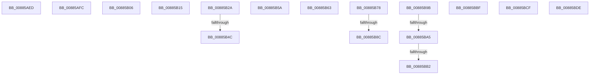

# sub_00885AED

- RVA: `0x00885AED`–`0x00885BED` (길이 `256` bytes)
- VA: `0x0000000140885AED`
- 실행 섹션: `PAGE`
- PDB 이름 있음: `아니요`; PDB Function 태그: `아니요`
- unwind 정보 RVA: `0x0007C9C0`
- 디코드: `57`개 명령, `256/256` bytes 표시
- 미해석 바이트: `0` (있으면 어셈블리에 `.byte`로 보존)

> 이 문서는 커널 이미지의 기계어와 PDB 기호를 분석해 생성했습니다. 4번과 5번은 함수 원형과 자료형을 바이너리 사용 방식에서 추정한 C 해석이며 원본 소스 복구 결과는 아닙니다.

## 1. Dependencies

- 직접 호출 지점: **5**; 고유 호출 대상: **5**
- 직접 호출자로 확인된 함수: **0**
- RIP 상대 이미지 참조: **0**

### Outgoing calls
- `0x00885B39` → [MiFindPlaceholderVadToReplace](../../text/2A/MiFindPlaceholderVadToReplace_function_002A7280.md) (function, `0x002A7280`)
- `0x00885B90` → [ExfTryToWakePushLock](../../text/26/ExfTryToWakePushLock_function_00265DD0.md) (function, `0x00265DD0`)
- `0x00885BC5` → [MiDereferenceExtendInfo](../../text/48/MiDereferenceExtendInfo_function_0048EFA4.md) (function, `0x0048EFA4`)
- `0x00885BD4` → [ObfDereferenceObjectWithTag](../../text/2F/ObfDereferenceObjectWithTag_function_002F78E0.md) (function, `0x002F78E0`)
- `0x00885BE3` → [ExFreePoolWithTag](../../poolcode/B8/ExFreePoolWithTag_function_00B82870.md) (function, `0x00B82870`)

### Direct callers
- 이 함수 시작 RVA로 연결되는 직접 call은 확인되지 않았습니다. 간접 호출은 완전히 역산할 수 없습니다.

### Static image references
- 디코드된 RIP-relative 메모리 참조가 없습니다.

## 2. Other-region calls and transfers

- 다른 실행 섹션으로 향하는 call: **5**
  - `0x00885B39` → [MiFindPlaceholderVadToReplace](../../text/2A/MiFindPlaceholderVadToReplace_function_002A7280.md) (`PAGE` → `.text`)
  - `0x00885B90` → [ExfTryToWakePushLock](../../text/26/ExfTryToWakePushLock_function_00265DD0.md) (`PAGE` → `.text`)
  - `0x00885BC5` → [MiDereferenceExtendInfo](../../text/48/MiDereferenceExtendInfo_function_0048EFA4.md) (`PAGE` → `.text`)
  - `0x00885BD4` → [ObfDereferenceObjectWithTag](../../text/2F/ObfDereferenceObjectWithTag_function_002F78E0.md) (`PAGE` → `.text`)
  - `0x00885BE3` → [ExFreePoolWithTag](../../poolcode/B8/ExFreePoolWithTag_function_00B82870.md) (`PAGE` → `POOLCODE`)
- call이 아닌 외부 분기/꼬리 이동: **16**
  - `0x00885AF7` → [sub_008857C1 + 0x159](Unknown_function_008857C1.md) (`tail-transfer`)
  - `0x00885B01` → [sub_00884EE1 + 0x1A7](Unknown_function_00884EE1.md) (`tail-transfer`)
  - `0x00885B10` → [sub_008857C1 + 0x154](Unknown_function_008857C1.md) (`tail-transfer`)
  - `0x00885B25` → [sub_00884EE1 + 0x1C7](Unknown_function_00884EE1.md) (`tail-transfer`)
  - `0x00885B46` → [sub_00884EE1 + 0x25D](Unknown_function_00884EE1.md) (`tail-transfer`)
  - `0x00885B55` → [sub_0088535F + 0x108](Unknown_function_0088535F.md) (`tail-transfer`)
  - `0x00885B5E` → [sub_008857C1 + 0x77](Unknown_function_008857C1.md) (`tail-transfer`)
  - `0x00885B73` → [sub_00884EE1 + 0x370](Unknown_function_00884EE1.md) (`tail-transfer`)
  - `0x00885B86` → [sub_00B18F72](../B1/Unknown_function_00B18F72.md) (`tail-transfer`)
  - `0x00885B96` → [sub_00B18F72](../B1/Unknown_function_00B18F72.md) (`tail-transfer`)
  - `0x00885B9F` → [sub_0088535F + 0x250](Unknown_function_0088535F.md) (`tail-transfer`)
  - `0x00885BAC` → [sub_0088535F + 0x250](Unknown_function_0088535F.md) (`tail-transfer`)
  - `0x00885BBA` → [sub_0088535F + 0x83](Unknown_function_0088535F.md) (`tail-transfer`)
  - `0x00885BCA` → [sub_008859DF + 0xAF](Unknown_function_008859DF.md) (`tail-transfer`)
  - `0x00885BD9` → [sub_008859DF + 0xBF](Unknown_function_008859DF.md) (`tail-transfer`)
  - `0x00885BE8` → [sub_0088535F + 0x184](Unknown_function_0088535F.md) (`tail-transfer`)

## 3. Assembly (complete function range)

```asm
00885AED  41 BD 9A 00 00 C0               mov r13d, 0xc000009a
00885AF3  44 89 6D 68                     mov dword ptr [rbp + 0x68], r13d
00885AF7  E9 1E FE FF FF                  jmp 0x14088591a
00885AFC  4C 8B 6C 24 78                  mov r13, qword ptr [rsp + 0x78]
00885B01  E9 82 F5 FF FF                  jmp 0x140885088
00885B06  41 BD 20 02 00 C0               mov r13d, 0xc0000220
00885B0C  44 89 6D 68                     mov dword ptr [rbp + 0x68], r13d
00885B10  E9 00 FE FF FF                  jmp 0x140885915
00885B15  41 8B 46 30                     mov eax, dword ptr [r14 + 0x30]
00885B19  0F BA F0 13                     btr eax, 0x13
00885B1D  0F BA E8 14                     bts eax, 0x14
00885B21  41 89 46 30                     mov dword ptr [r14 + 0x30], eax
00885B25  E9 7E F5 FF FF                  jmp 0x1408850a8
00885B2A  44 0F B6 46 39                  movzx r8d, byte ptr [rsi + 0x39]
00885B2F  4C 8D 4D 68                     lea r9, [rbp + 0x68]
00885B33  48 8B D1                        mov rdx, rcx
00885B36  49 8B CD                        mov rcx, r13
00885B39  E8 42 17 A2 FF                  call 0x1402a7280
00885B3E  48 89 44 24 70                  mov qword ptr [rsp + 0x70], rax
00885B43  48 85 C0                        test rax, rax
00885B46  0F 85 F2 F5 FF FF               jne 0x14088513e
00885B4C  44 8B 6D 68                     mov r13d, dword ptr [rbp + 0x68]
00885B50  4C 8B 64 24 58                  mov r12, qword ptr [rsp + 0x58]
00885B55  E9 0D F9 FF FF                  jmp 0x140885467
00885B5A  49 89 4D 00                     mov qword ptr [r13], rcx
00885B5E  E9 D5 FC FF FF                  jmp 0x140885838
00885B63  41 8B 46 30                     mov eax, dword ptr [r14 + 0x30]
00885B67  0F BA F0 14                     btr eax, 0x14
00885B6B  0F BA E8 13                     bts eax, 0x13
00885B6F  41 89 46 30                     mov dword ptr [r14 + 0x30], eax
00885B73  E9 D9 F6 FF FF                  jmp 0x140885251
00885B78  F0 49 0F C1 7E 28               lock xadd qword ptr [r14 + 0x28], rdi
00885B7E  40 80 E7 06                     and dil, 6
00885B82  40 80 FF 02                     cmp dil, 2
00885B86  0F 85 E6 33 29 00               jne 0x140b18f72
00885B8C  49 8D 4E 28                     lea rcx, [r14 + 0x28]
00885B90  E8 3B 02 9E FF                  call 0x140265dd0
00885B95  90                              nop
00885B96  E9 D7 33 29 00                  jmp 0x140b18f72
00885B9B  41 83 F9 04                     cmp r9d, 4
00885B9F  0F 84 0A FA FF FF               je 0x1408855af
00885BA5  41 81 F9 01 00 00 80            cmp r9d, 0x80000001
00885BAC  0F 84 FD F9 FF FF               je 0x1408855af
00885BB2  B8 45 00 00 C0                  mov eax, 0xc0000045
00885BB7  44 8B F8                        mov r15d, eax
00885BBA  E9 23 F8 FF FF                  jmp 0x1408853e2
00885BBF  49 8B D7                        mov rdx, r15
00885BC2  49 8B CE                        mov rcx, r14
00885BC5  E8 DA 93 C0 FF                  call 0x14048efa4
00885BCA  E9 BF FE FF FF                  jmp 0x140885a8e
00885BCF  BA 4D 6D 53 63                  mov edx, 0x63536d4d
00885BD4  E8 07 1D A7 FF                  call 0x1402f78e0
00885BD9  E9 C0 FE FF FF                  jmp 0x140885a9e
00885BDE  33 D2                           xor edx, edx
00885BE0  49 8B CC                        mov rcx, r12
00885BE3  E8 88 CC 2F 00                  call 0x140b82870
00885BE8  E9 F6 F8 FF FF                  jmp 0x1408854e3
```

## 4. C-style interpretation (structured pseudocode)

```c
__int64 __fastcall sub_00885AED(__int64 a1)
{
    unsigned __int64 v_stack_p58;
    unsigned __int64 v_stack_p70;
    unsigned __int64 v_stack_p78;

    *(unsigned int *)(v_rbp + 104) = (unsigned int)((unsigned int)(0xC000009AULL));
}
```

## 5. (Beta) C Style

```c
int64_t sub_00885AED(int64_t Arg1)
{
    uint64_t v_stack_p58;
    uint64_t v_stack_p70;
    uint64_t v_stack_p78;

    *(uint32_t *)(local_rbp + 0x68) = (uint32_t)((uint32_t)(0xC000009AULL));
}
```

## 6. Execution-region graph

[열기: 2D/3D 그래프와 함수 탐색 컨트롤 패널](../../../control-panel.html?section=page&rva=0x00885AED&view=graph)

- 2D 그래프는 위에서 아래로 흐르고, 3D 그래프는 빈 공간을 드래그해 회전합니다. Shift+드래그는 이동, 휠은 확대·축소, 함수 노드 선택은 대상 보고서 이동입니다.

### Static fallback


