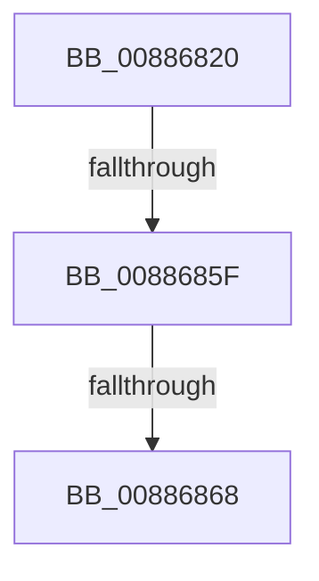

# sub_00886820

- RVA: `0x00886820`–`0x00886874` (길이 `84` bytes)
- VA: `0x0000000140886820`
- 실행 섹션: `PAGE`
- PDB 이름 있음: `아니요`; PDB Function 태그: `아니요`
- unwind 정보 RVA: `0x0007CA6C`
- 디코드: `19`개 명령, `84/84` bytes 표시
- 미해석 바이트: `0` (있으면 어셈블리에 `.byte`로 보존)

> 이 문서는 커널 이미지의 기계어와 PDB 기호를 분석해 생성했습니다. 4번과 5번은 함수 원형과 자료형을 바이너리 사용 방식에서 추정한 C 해석이며 원본 소스 복구 결과는 아닙니다.

## 1. Dependencies

- 직접 호출 지점: **0**; 고유 호출 대상: **0**
- 직접 호출자로 확인된 함수: **0**
- RIP 상대 이미지 참조: **0**

### Outgoing calls
- 직접 디코드된 call 명령이 없습니다.

### Direct callers
- 이 함수 시작 RVA로 연결되는 직접 call은 확인되지 않았습니다. 간접 호출은 완전히 역산할 수 없습니다.

### Static image references
- 디코드된 RIP-relative 메모리 참조가 없습니다.

## 2. Other-region calls and transfers

- 다른 실행 섹션으로 향하는 call: **0**
- call이 아닌 외부 분기/꼬리 이동: **3**
  - `0x00886859` → [sub_00886A23](Unknown_function_00886A23.md) (`tail-transfer`)
  - `0x00886862` → [sub_00886A23 + 0x3D](Unknown_function_00886A23.md) (`tail-transfer`)
  - `0x0088686E` → [sub_00886A23 + 0x47](Unknown_function_00886A23.md) (`tail-transfer`)

## 3. Assembly (complete function range)

```asm
00886820  4C 89 AC 24 A0 00 00 00         mov qword ptr [rsp + 0xa0], r13
00886828  4C 8B C1                        mov r8, rcx
0088682B  4C 8B EE                        mov r13, rsi
0088682E  4C 89 BC 24 A8 00 00 00         mov qword ptr [rsp + 0xa8], r15
00886836  48 F7 DE                        neg rsi
00886839  49 C1 E8 0C                     shr r8, 0xc
0088683D  48 2B CB                        sub rcx, rbx
00886840  49 C1 ED 0C                     shr r13, 0xc
00886844  48 23 CE                        and rcx, rsi
00886847  4C 89 84 24 B0 00 00 00         mov qword ptr [rsp + 0xb0], r8
0088684F  4C 8B F9                        mov r15, rcx
00886852  49 C1 EF 0C                     shr r15, 0xc
00886856  48 85 ED                        test rbp, rbp
00886859  0F 85 C4 01 00 00               jne 0x140886a23
0088685F  48 3B CF                        cmp rcx, rdi
00886862  0F 82 F8 01 00 00               jb 0x140886a60
00886868  49 8B 06                        mov rax, qword ptr [r14]
0088686B  48 85 C0                        test rax, rax
0088686E  0F 84 F6 01 00 00               je 0x140886a6a
```

## 4. C-style interpretation (structured pseudocode)

```c
__int64 __fastcall sub_00886820(__int64 a1)
{
    __int64 v_r13;
    __int64 v_r15;
    __int64 v_rsi;
    unsigned __int64 v_stack_pA0;
    unsigned __int64 v_stack_pA8;
    unsigned __int64 v_stack_pB0;

    v_stack_pA0 = v_r13;
    v_stack_pA8 = v_r15;
    v_rsi = -(v_rsi);
    a3 = (a1) >> (12);
    a1 = (a1) - (v_rbx);
    v_r13 = (v_rsi) >> (12);
    a1 = (a1) & (v_rsi);
    v_stack_pB0 = a3;
    v_r15 = (a1) >> (12);
}
```

## 5. (Beta) C Style

```c
int64_t sub_00886820(int64_t Arg1)
{
    int64_t local_r13;
    int64_t local_r15;
    int64_t local_rsi;
    uint64_t v_stack_pA0;
    uint64_t v_stack_pA8;
    uint64_t v_stack_pB0;

    v_stack_pA0 = local_r13;
    v_stack_pA8 = local_r15;
    local_rsi = -(local_rsi);
    a3 = (Arg1) >> (12);
    Arg1 = (Arg1) - (local_rbx);
    local_r13 = (local_rsi) >> (12);
    Arg1 = (Arg1) & (local_rsi);
    v_stack_pB0 = a3;
    local_r15 = (Arg1) >> (12);
}
```

## 6. Execution-region graph

[열기: 2D/3D 그래프와 함수 탐색 컨트롤 패널](../../../control-panel.html?section=page&rva=0x00886820&view=graph)

- 2D 그래프는 위에서 아래로 흐르고, 3D 그래프는 빈 공간을 드래그해 회전합니다. Shift+드래그는 이동, 휠은 확대·축소, 함수 노드 선택은 대상 보고서 이동입니다.

### Static fallback


