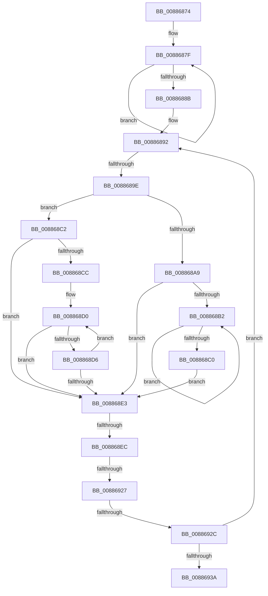

# sub_00886874

- RVA: `0x00886874`–`0x00886947` (길이 `211` bytes)
- VA: `0x0000000140886874`
- 실행 섹션: `PAGE`
- PDB 이름 있음: `아니요`; PDB Function 태그: `아니요`
- unwind 정보 RVA: `0x0007CA84`
- 디코드: `59`개 명령, `211/211` bytes 표시
- 미해석 바이트: `0` (있으면 어셈블리에 `.byte`로 보존)

> 이 문서는 커널 이미지의 기계어와 PDB 기호를 분석해 생성했습니다. 4번과 5번은 함수 원형과 자료형을 바이너리 사용 방식에서 추정한 C 해석이며 원본 소스 복구 결과는 아닙니다.

## 1. Dependencies

- 직접 호출 지점: **0**; 고유 호출 대상: **0**
- 직접 호출자로 확인된 함수: **0**
- RIP 상대 이미지 참조: **0**

### Outgoing calls
- 직접 디코드된 call 명령이 없습니다.

### Direct callers
- 이 함수 시작 RVA로 연결되는 직접 call은 확인되지 않았습니다. 간접 호출은 완전히 역산할 수 없습니다.

### Static image references
- 디코드된 RIP-relative 메모리 참조가 없습니다.

## 2. Other-region calls and transfers

- 다른 실행 섹션으로 향하는 call: **0**
- call이 아닌 외부 분기/꼬리 이동: **4**
  - `0x00886898` → [sub_00886963 + 0x9A](Unknown_function_00886963.md) (`tail-transfer`)
  - `0x008868E6` → [sub_00886963 + 0x26](Unknown_function_00886963.md) (`tail-transfer`)
  - `0x00886925` → [sub_00886963](Unknown_function_00886963.md) (`tail-transfer`)
  - `0x0088692A` → [sub_00886963 + 0x41](Unknown_function_00886963.md) (`tail-transfer`)

## 3. Assembly (complete function range)

```asm
00886874  4C 89 A4 24 90 00 00 00         mov qword ptr [rsp + 0x90], r12
0088687C  45 33 DB                        xor r11d, r11d
0088687F  48 8B D8                        mov rbx, rax
00886882  48 8B 40 08                     mov rax, qword ptr [rax + 8]
00886886  48 85 C0                        test rax, rax
00886889  75 F4                           jne 0x14088687f
0088688B  48 8B F3                        mov rsi, rbx
0088688E  48 C1 EF 0C                     shr rdi, 0xc
00886892  4C 8B E6                        mov r12, rsi
00886895  48 85 DB                        test rbx, rbx
00886898  0F 85 5F 01 00 00               jne 0x1408869fd
0088689E  49 8B 03                        mov rax, qword ptr [r11]
008868A1  49 8B CB                        mov rcx, r11
008868A4  48 85 C0                        test rax, rax
008868A7  74 19                           je 0x1408868c2
008868A9  4C 8B D8                        mov r11, rax
008868AC  48 39 58 08                     cmp qword ptr [rax + 8], rbx
008868B0  74 31                           je 0x1408868e3
008868B2  49 8B 43 08                     mov rax, qword ptr [r11 + 8]
008868B6  4C 8B D8                        mov r11, rax
008868B9  48 83 78 08 00                  cmp qword ptr [rax + 8], 0
008868BE  75 F2                           jne 0x1408868b2
008868C0  EB 21                           jmp 0x1408868e3
008868C2  4D 8B 5B 10                     mov r11, qword ptr [r11 + 0x10]
008868C6  49 83 E3 FC                     and r11, 0xfffffffffffffffc
008868CA  74 17                           je 0x1408868e3
008868CC  0F 1F 40 00                     nop dword ptr [rax]
008868D0  49 39 4B 08                     cmp qword ptr [r11 + 8], rcx
008868D4  74 0D                           je 0x1408868e3
008868D6  49 8B CB                        mov rcx, r11
008868D9  4D 8B 5B 10                     mov r11, qword ptr [r11 + 0x10]
008868DD  49 83 E3 FC                     and r11, 0xfffffffffffffffc
008868E1  75 ED                           jne 0x1408868d0
008868E3  4D 85 DB                        test r11, r11
008868E6  0F 84 9D 00 00 00               je 0x140886989
008868EC  41 0F B6 4B 21                  movzx ecx, byte ptr [r11 + 0x21]
008868F1  48 8D 74 24 20                  lea rsi, [rsp + 0x20]
008868F6  41 8B 43 1C                     mov eax, dword ptr [r11 + 0x1c]
008868FA  4C 8B D7                        mov r10, rdi
008868FD  48 C1 E1 20                     shl rcx, 0x20
00886901  48 0B C8                        or rcx, rax
00886904  48 FF C1                        inc rcx
00886907  48 3B CF                        cmp rcx, rdi
0088690A  4C 0F 43 D1                     cmovae r10, rcx
0088690E  49 0F 43 F3                     cmovae rsi, r11
00886912  49 FF CA                        dec r10
00886915  4D 03 D5                        add r10, r13
00886918  4D 8D 75 FF                     lea r14, [r13 - 1]
0088691C  49 F7 D6                        not r14
0088691F  4D 23 D6                        and r10, r14
00886922  48 85 ED                        test rbp, rbp
00886925  75 3C                           jne 0x140886963
00886927  4D 3B D7                        cmp r10, r15
0088692A  76 78                           jbe 0x1408869a4
0088692C  48 8D 44 24 20                  lea rax, [rsp + 0x20]
00886931  48 3B F0                        cmp rsi, rax
00886934  0F 85 58 FF FF FF               jne 0x140886892
0088693A  B8 17 00 00 C0                  mov eax, 0xc0000017
0088693F  4C 8B A4 24 90 00 00 00         mov r12, qword ptr [rsp + 0x90]
```

## 4. C-style interpretation (structured pseudocode)

```c
__int64 __fastcall sub_00886874(__int64 a1, __int64 a2, __int64 a3, __int64 a4, __int64 a5, __int64 a6, __int64 a7, __int64 a8, __int64 a9, __int64 a10, __int64 a11, __int64 a12, __int64 a13, __int64 a14, __int64 a15, __int64 a16, __int64 a17, __int64 a18)
{
    __int64 v_r10;
    __int64 v_r11;
    __int64 v_r14;
    __int64 v_rdi;
    __int64 v_rsi;
    unsigned __int64 v_stack_p20;
    unsigned __int64 v_stack_p90;

    v_stack_p90 = v_r12;
    v_r11 = 0;
loc_0088687F:
    if (*(unsigned __int64 *)(result + 8) != 0) goto loc_0088687F;
    v_rdi = (v_rdi) >> (12);
loc_00886892:
    if (*(unsigned __int64 *)(v_r11) == 0) goto loc_008868C2;
    if ((*(unsigned __int64 *)(*(unsigned __int64 *)(v_r11) + 8)) == result) goto loc_008868E3;
loc_008868B2:
    if ((*(unsigned __int64 *)(*(unsigned __int64 *)(*(unsigned __int64 *)(v_r11) + 8) + 8)) != 0) goto loc_008868B2;
    goto loc_008868E3;
loc_008868C2:
    v_r11 = (*(unsigned __int64 *)(*(unsigned __int64 *)(*(unsigned __int64 *)(v_r11) + 8) + 16)) & (-4);
    if (condition_is_equal) goto loc_008868E3;
loc_008868D0:
    if ((*(unsigned __int64 *)(v_r11 + 8)) == 0) goto loc_008868E3;
    v_r11 = (*(unsigned __int64 *)(v_r11 + 16)) & (-4);
    if (condition_is_not_equal) goto loc_008868D0;
loc_008868E3:
    a1 = (*(unsigned __int8 *)(v_r11 + 33)) << (32);
    a1 = (a1) | ((unsigned int)(*(unsigned int *)(v_r11 + 28)));
    a1 = (a1) + 1;
    v_r10 = v_rdi;
    if (a1 >= v_rdi) { v_r10 = a1; }
    v_rsi = v_stack_p20;
    if (a1 >= v_rdi) { v_rsi = v_r11; }
    v_r10 = (v_r10) - 1;
    v_r10 = (v_r10) + (v_r13);
    v_r14 = ~(v_r13 - 1);
    v_r10 = (v_r10) & (v_r14);
    if (v_rsi != v_stack_p20) goto loc_00886892;
    return (unsigned int)(0xC0000017ULL);
}
```

## 5. (Beta) C Style

```c
int64_t sub_00886874(int64_t Arg1, int64_t Arg2, int64_t Arg3, int64_t Arg4, uint64_t Arg5, uint64_t Arg6, uint64_t Arg7, uint64_t Arg8, uint64_t Arg9, uint64_t Arg10, uint64_t Arg11, uint64_t Arg12, uint64_t Arg13, uint64_t Arg14, uint64_t Arg15, uint64_t Arg16, uint64_t Arg17, int64_t Arg18)
{
    int64_t local_r10;
    int64_t local_r11;
    int64_t local_r14;
    int64_t local_rdi;
    int64_t local_rsi;
    uint64_t v_stack_p20;
    uint64_t v_stack_p90;

    v_stack_p90 = local_r12;
    local_r11 = 0;
loc_0088687F:
    if (*(uint64_t *)(result + 0x8) != 0) goto loc_0088687F;
    local_rdi = (local_rdi) >> (12);
loc_00886892:
    if (*(uint64_t *)(local_r11) == 0) goto loc_008868C2;
    if ((*(uint64_t *)(*(uint64_t *)(local_r11) + 0x8)) == result) goto loc_008868E3;
loc_008868B2:
    if ((*(uint64_t *)(*(uint64_t *)(*(uint64_t *)(local_r11) + 0x8) + 0x8)) != 0) goto loc_008868B2;
    goto loc_008868E3;
loc_008868C2:
    local_r11 = (*(uint64_t *)(*(uint64_t *)(*(uint64_t *)(local_r11) + 0x8) + 0x10)) & (-4);
    if (condition_is_equal) goto loc_008868E3;
loc_008868D0:
    if ((*(uint64_t *)(local_r11 + 0x8)) == 0) goto loc_008868E3;
    local_r11 = (*(uint64_t *)(local_r11 + 0x10)) & (-4);
    if (condition_is_not_equal) goto loc_008868D0;
loc_008868E3:
    Arg1 = (*(uint8_t *)(local_r11 + 0x21)) << (32);
    Arg1 = (Arg1) | ((uint32_t)(*(uint32_t *)(local_r11 + 0x1C)));
    Arg1 = (Arg1) + 1;
    local_r10 = local_rdi;
    if (Arg1 >= local_rdi) { local_r10 = Arg1; }
    local_rsi = v_stack_p20;
    if (Arg1 >= local_rdi) { local_rsi = local_r11; }
    local_r10 = (local_r10) - 1;
    local_r10 = (local_r10) + (local_r13);
    local_r14 = ~(local_r13 - 1);
    local_r10 = (local_r10) & (local_r14);
    if (local_rsi != v_stack_p20) goto loc_00886892;
    return (uint32_t)(0xC0000017ULL);
}
```

## 6. Execution-region graph

[열기: 2D/3D 그래프와 함수 탐색 컨트롤 패널](../../../control-panel.html?section=page&rva=0x00886874&view=graph)

- 2D 그래프는 위에서 아래로 흐르고, 3D 그래프는 빈 공간을 드래그해 회전합니다. Shift+드래그는 이동, 휠은 확대·축소, 함수 노드 선택은 대상 보고서 이동입니다.

### Static fallback


