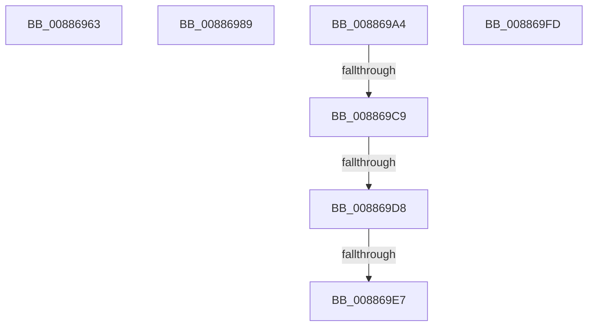

# sub_00886963

- RVA: `0x00886963`–`0x00886A19` (길이 `182` bytes)
- VA: `0x0000000140886963`
- 실행 섹션: `PAGE`
- PDB 이름 있음: `아니요`; PDB Function 태그: `아니요`
- unwind 정보 RVA: `0x0007CABC`
- 디코드: `43`개 명령, `182/182` bytes 표시
- 미해석 바이트: `0` (있으면 어셈블리에 `.byte`로 보존)

> 이 문서는 커널 이미지의 기계어와 PDB 기호를 분석해 생성했습니다. 4번과 5번은 함수 원형과 자료형을 바이너리 사용 방식에서 추정한 C 해석이며 원본 소스 복구 결과는 아닙니다.

## 1. Dependencies

- 직접 호출 지점: **2**; 고유 호출 대상: **2**
- 직접 호출자로 확인된 함수: **0**
- RIP 상대 이미지 참조: **0**

### Outgoing calls
- `0x00886974` → [MiHonorRangeStraddleRequirement](../../text/46/MiHonorRangeStraddleRequirement_function_00462818.md) (function, `0x00462818`)
- `0x00886A0A` → [MiUpdateVadStartVpn](../../text/45/MiUpdateVadStartVpn_function_00450ED4.md) (function, `0x00450ED4`)

### Direct callers
- 이 함수 시작 RVA로 연결되는 직접 call은 확인되지 않았습니다. 간접 호출은 완전히 역산할 수 없습니다.

### Static image references
- 디코드된 RIP-relative 메모리 참조가 없습니다.

## 2. Other-region calls and transfers

- 다른 실행 섹션으로 향하는 call: **2**
  - `0x00886974` → [MiHonorRangeStraddleRequirement](../../text/46/MiHonorRangeStraddleRequirement_function_00462818.md) (`PAGE` → `.text`)
  - `0x00886A0A` → [MiUpdateVadStartVpn](../../text/45/MiUpdateVadStartVpn_function_00450ED4.md) (`PAGE` → `.text`)
- call이 아닌 외부 분기/꼬리 이동: **7**
  - `0x00886987` → [sub_00886874 + 0xB3](Unknown_function_00886874.md) (`tail-transfer`)
  - `0x0088699F` → [sub_00886874 + 0xA1](Unknown_function_00886874.md) (`tail-transfer`)
  - `0x008869C3` → [sub_00886874 + 0xB8](Unknown_function_00886874.md) (`tail-transfer`)
  - `0x008869D2` → [sub_00886874 + 0xB8](Unknown_function_00886874.md) (`tail-transfer`)
  - `0x008869E1` → [sub_00886A7C](Unknown_function_00886A7C.md) (`tail-transfer`)
  - `0x008869F8` → [sub_00886874 + 0xCB](Unknown_function_00886874.md) (`tail-transfer`)
  - `0x00886A14` → [sub_00886874 + 0x78](Unknown_function_00886874.md) (`tail-transfer`)

## 3. Assembly (complete function range)

```asm
00886963  48 8B 94 24 98 00 00 00         mov rdx, qword ptr [rsp + 0x98]
0088696B  45 33 C9                        xor r9d, r9d
0088696E  4C 8B C5                        mov r8, rbp
00886971  49 8B CA                        mov rcx, r10
00886974  E8 9F BE BD FF                  call 0x140462818
00886979  4C 8B 84 24 B0 00 00 00         mov r8, qword ptr [rsp + 0xb0]
00886981  4C 8B D0                        mov r10, rax
00886984  4C 8B CA                        mov r9, rdx
00886987  EB 9E                           jmp 0x140886927
00886989  C7 44 24 3C 00 00 00 00         mov dword ptr [rsp + 0x3c], 0
00886991  48 8D 74 24 20                  lea rsi, [rsp + 0x20]
00886996  C6 44 24 41 00                  mov byte ptr [rsp + 0x41], 0
0088699B  4C 8D 57 FF                     lea r10, [rdi - 1]
0088699F  E9 71 FF FF FF                  jmp 0x140886915
008869A4  41 0F B6 4C 24 20               movzx ecx, byte ptr [r12 + 0x20]
008869AA  41 8B 44 24 18                  mov eax, dword ptr [r12 + 0x18]
008869AF  4D 8B E0                        mov r12, r8
008869B2  48 C1 E1 20                     shl rcx, 0x20
008869B6  48 0B C8                        or rcx, rax
008869B9  49 3B C8                        cmp rcx, r8
008869BC  4C 0F 46 E1                     cmovbe r12, rcx
008869C0  4D 3B E2                        cmp r12, r10
008869C3  0F 86 63 FF FF FF               jbe 0x14088692c
008869C9  49 8B C4                        mov rax, r12
008869CC  49 2B C2                        sub rax, r10
008869CF  4C 3B C8                        cmp r9, rax
008869D2  0F 87 54 FF FF FF               ja 0x14088692c
008869D8  4D 2B E1                        sub r12, r9
008869DB  4D 23 E6                        and r12, r14
008869DE  48 85 ED                        test rbp, rbp
008869E1  0F 85 95 00 00 00               jne 0x140886a7c
008869E7  48 8B 84 24 C0 00 00 00         mov rax, qword ptr [rsp + 0xc0]
008869EF  49 C1 E4 0C                     shl r12, 0xc
008869F3  4C 89 20                        mov qword ptr [rax], r12
008869F6  33 C0                           xor eax, eax
008869F8  E9 42 FF FF FF                  jmp 0x14088693f
008869FD  4C 8B DB                        mov r11, rbx
00886A00  48 8D 4C 24 20                  lea rcx, [rsp + 0x20]
00886A05  33 DB                           xor ebx, ebx
00886A07  49 8B D0                        mov rdx, r8
00886A0A  E8 C5 A4 BC FF                  call 0x140450ed4
00886A0F  4C 8D 64 24 20                  lea r12, [rsp + 0x20]
00886A14  E9 D3 FE FF FF                  jmp 0x1408868ec
```

## 4. C-style interpretation (structured pseudocode)

```c
__int64 __fastcall sub_00886963(__int64 a1, __int64 a2, __int64 a3, int a4, __int64 a5, __int64 a6, __int64 a7, __int64 a8, __int64 a9, __int64 a10, __int64 a11, __int64 a12, __int64 a13, __int64 a14, __int64 a15, __int64 a16, __int64 a17, __int64 a18, __int64 a19, __int64 a20, __int64 a21, __int64 a22)
{
    __int64 result;
    unsigned __int64 v_stack_p20;
    unsigned int v_stack_p3C;
    unsigned __int8 v_stack_p41;
    unsigned __int64 v_stack_pC0;

    a4 = 0;
    result = MiHonorRangeStraddleRequirement(v_r10, a19, v_rbp, a4);
}
```

## 5. (Beta) C Style

```c
int64_t sub_00886963(int64_t Arg1, int64_t Arg2, int64_t Arg3, int32_t Arg4, uint64_t Arg5, uint64_t Arg6, uint64_t Arg7, uint64_t Arg8, uint64_t Arg9, uint64_t Arg10, uint64_t Arg11, uint64_t Arg12, uint64_t Arg13, uint64_t Arg14, uint64_t Arg15, uint64_t Arg16, uint64_t Arg17, uint64_t Arg18, int64_t Arg19, uint64_t Arg20, uint64_t Arg21, int64_t Arg22)
{
    int64_t result;
    uint64_t v_stack_p20;
    uint32_t v_stack_p3C;
    uint8_t v_stack_p41;
    uint64_t v_stack_pC0;

    Arg4 = 0;
    result = MiHonorRangeStraddleRequirement(local_r10, Arg19, local_rbp, Arg4);
}
```

## 6. Execution-region graph

[열기: 2D/3D 그래프와 함수 탐색 컨트롤 패널](../../../control-panel.html?section=page&rva=0x00886963&view=graph)

- 2D 그래프는 위에서 아래로 흐르고, 3D 그래프는 빈 공간을 드래그해 회전합니다. Shift+드래그는 이동, 휠은 확대·축소, 함수 노드 선택은 대상 보고서 이동입니다.

### Static fallback


