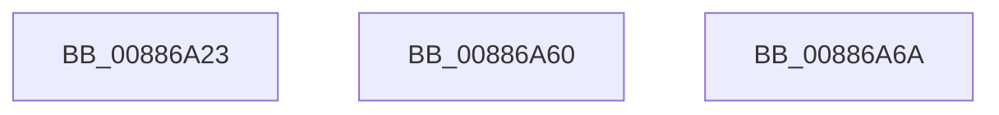

# sub_00886A23

- RVA: `0x00886A23`–`0x00886A7C` (길이 `89` bytes)
- VA: `0x0000000140886A23`
- 실행 섹션: `PAGE`
- PDB 이름 있음: `아니요`; PDB Function 태그: `아니요`
- unwind 정보 RVA: `0x0007CAE8`
- 디코드: `20`개 명령, `89/89` bytes 표시
- 미해석 바이트: `0` (있으면 어셈블리에 `.byte`로 보존)

> 이 문서는 커널 이미지의 기계어와 PDB 기호를 분석해 생성했습니다. 4번과 5번은 함수 원형과 자료형을 바이너리 사용 방식에서 추정한 C 해석이며 원본 소스 복구 결과는 아닙니다.

## 1. Dependencies

- 직접 호출 지점: **1**; 고유 호출 대상: **1**
- 직접 호출자로 확인된 함수: **0**
- RIP 상대 이미지 참조: **0**

### Outgoing calls
- `0x00886A37` → [MiHonorRangeStraddleRequirement](../../text/46/MiHonorRangeStraddleRequirement_function_00462818.md) (function, `0x00462818`)

### Direct callers
- 이 함수 시작 RVA로 연결되는 직접 call은 확인되지 않았습니다. 간접 호출은 완전히 역산할 수 없습니다.

### Static image references
- 디코드된 RIP-relative 메모리 참조가 없습니다.

## 2. Other-region calls and transfers

- 다른 실행 섹션으로 향하는 call: **1**
  - `0x00886A37` → [MiHonorRangeStraddleRequirement](../../text/46/MiHonorRangeStraddleRequirement_function_00462818.md) (`PAGE` → `.text`)
- call이 아닌 외부 분기/꼬리 이동: **3**
  - `0x00886A5B` → [sub_00886820 + 0x3F](Unknown_function_00886820.md) (`tail-transfer`)
  - `0x00886A65` → [sub_00886947](Unknown_function_00886947.md) (`tail-transfer`)
  - `0x00886A77` → [sub_00886947](Unknown_function_00886947.md) (`tail-transfer`)

## 3. Assembly (complete function range)

```asm
00886A23  48 8B 94 24 98 00 00 00         mov rdx, qword ptr [rsp + 0x98]
00886A2B  41 B9 01 00 00 00               mov r9d, 1
00886A31  4C 8B C5                        mov r8, rbp
00886A34  49 8B CF                        mov rcx, r15
00886A37  E8 DC BD BD FF                  call 0x140462818
00886A3C  4C 8B 84 24 B0 00 00 00         mov r8, qword ptr [rsp + 0xb0]
00886A44  4C 8B F8                        mov r15, rax
00886A47  49 8D 45 FF                     lea rax, [r13 - 1]
00886A4B  4C 8B CA                        mov r9, rdx
00886A4E  48 F7 D0                        not rax
00886A51  4C 23 F8                        and r15, rax
00886A54  49 8B CF                        mov rcx, r15
00886A57  48 C1 E1 0C                     shl rcx, 0xc
00886A5B  E9 FF FD FF FF                  jmp 0x14088685f
00886A60  B8 17 00 00 C0                  mov eax, 0xc0000017
00886A65  E9 DD FE FF FF                  jmp 0x140886947
00886A6A  48 8B 84 24 C0 00 00 00         mov rax, qword ptr [rsp + 0xc0]
00886A72  48 89 08                        mov qword ptr [rax], rcx
00886A75  33 C0                           xor eax, eax
00886A77  E9 CB FE FF FF                  jmp 0x140886947
```

## 4. C-style interpretation (structured pseudocode)

```c
__int64 __fastcall sub_00886A23(__int64 a1, __int64 a2, __int64 a3, __int64 a4, __int64 a5, __int64 a6, __int64 a7, __int64 a8, __int64 a9, __int64 a10, __int64 a11, __int64 a12, __int64 a13, __int64 a14, __int64 a15, __int64 a16, __int64 a17, __int64 a18, __int64 a19, __int64 a20, __int64 a21, __int64 a22)
{
    __int64 result;
    __int64 v_r15;
    unsigned __int64 v_stack_pC0;

    result = MiHonorRangeStraddleRequirement(v_r15, a19, v_rbp, 1);
    result = ~(v_r13 - 1);
    v_r15 = (result) & (result);
    a1 = (v_r15) << (12);
}
```

## 5. (Beta) C Style

```c
int64_t sub_00886A23(int64_t Arg1, int64_t Arg2, int64_t Arg3, int64_t Arg4, uint64_t Arg5, uint64_t Arg6, uint64_t Arg7, uint64_t Arg8, uint64_t Arg9, uint64_t Arg10, uint64_t Arg11, uint64_t Arg12, uint64_t Arg13, uint64_t Arg14, uint64_t Arg15, uint64_t Arg16, uint64_t Arg17, uint64_t Arg18, int64_t Arg19, uint64_t Arg20, uint64_t Arg21, int64_t Arg22)
{
    int64_t result;
    int64_t local_r15;
    uint64_t v_stack_pC0;

    result = MiHonorRangeStraddleRequirement(local_r15, Arg19, local_rbp, 1);
    result = ~(local_r13 - 1);
    local_r15 = (result) & (result);
    Arg1 = (local_r15) << (12);
}
```

## 6. Execution-region graph

[열기: 2D/3D 그래프와 함수 탐색 컨트롤 패널](../../../control-panel.html?section=page&rva=0x00886A23&view=graph)

- 2D 그래프는 위에서 아래로 흐르고, 3D 그래프는 빈 공간을 드래그해 회전합니다. Shift+드래그는 이동, 휠은 확대·축소, 함수 노드 선택은 대상 보고서 이동입니다.

### Static fallback


