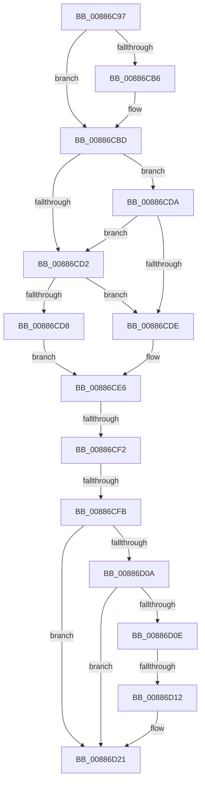

# sub_00886C97

- RVA: `0x00886C97`–`0x00886D2A` (길이 `147` bytes)
- VA: `0x0000000140886C97`
- 실행 섹션: `PAGE`
- PDB 이름 있음: `아니요`; PDB Function 태그: `아니요`
- unwind 정보 RVA: `0x0007CB44`
- 디코드: `47`개 명령, `147/147` bytes 표시
- 미해석 바이트: `0` (있으면 어셈블리에 `.byte`로 보존)

> 이 문서는 커널 이미지의 기계어와 PDB 기호를 분석해 생성했습니다. 4번과 5번은 함수 원형과 자료형을 바이너리 사용 방식에서 추정한 C 해석이며 원본 소스 복구 결과는 아닙니다.

## 1. Dependencies

- 직접 호출 지점: **0**; 고유 호출 대상: **0**
- 직접 호출자로 확인된 함수: **0**
- RIP 상대 이미지 참조: **0**

### Outgoing calls
- 직접 디코드된 call 명령이 없습니다.

### Direct callers
- 이 함수 시작 RVA로 연결되는 직접 call은 확인되지 않았습니다. 간접 호출은 완전히 역산할 수 없습니다.

### Static image references
- 디코드된 RIP-relative 메모리 참조가 없습니다.

## 2. Other-region calls and transfers

- 다른 실행 섹션으로 향하는 call: **0**
- call이 아닌 외부 분기/꼬리 이동: **3**
  - `0x00886CF0` → [sub_00886D30](Unknown_function_00886D30.md) (`tail-transfer`)
  - `0x00886CF9` → [sub_00886D30](Unknown_function_00886D30.md) (`tail-transfer`)
  - `0x00886D10` → [sub_00886D30 + 0xC](Unknown_function_00886D30.md) (`tail-transfer`)

## 3. Assembly (complete function range)

```asm
00886C97  48 89 5C 24 10                  mov qword ptr [rsp + 0x10], rbx
00886C9C  4D 8B CA                        mov r9, r10
00886C9F  48 89 3C 24                     mov qword ptr [rsp], rdi
00886CA3  4C 0F 42 C8                     cmovb r9, rax
00886CA7  33 FF                           xor edi, edi
00886CA9  4C 3B D0                        cmp r10, rax
00886CAC  8B DF                           mov ebx, edi
00886CAE  0F 92 C3                        setb bl
00886CB1  49 3B D0                        cmp rdx, r8
00886CB4  72 07                           jb 0x140886cbd
00886CB6  49 8D 50 FF                     lea rdx, [r8 - 1]
00886CBA  8D 5F 01                        lea ebx, [rdi + 1]
00886CBD  48 2B D0                        sub rdx, rax
00886CC0  4C 2B C8                        sub r9, rax
00886CC3  4C 8B C2                        mov r8, rdx
00886CC6  4D 2B C1                        sub r8, r9
00886CC9  49 FF C0                        inc r8
00886CCC  49 83 F8 01                     cmp r8, 1
00886CD0  74 08                           je 0x140886cda
00886CD2  4D 3B 4B 10                     cmp r9, qword ptr [r11 + 0x10]
00886CD6  74 06                           je 0x140886cde
00886CD8  EB 0C                           jmp 0x140886ce6
00886CDA  85 DB                           test ebx, ebx
00886CDC  75 F4                           jne 0x140886cd2
00886CDE  48 8D 42 01                     lea rax, [rdx + 1]
00886CE2  49 89 43 10                     mov qword ptr [r11 + 0x10], rax
00886CE6  49 8B 4B 20                     mov rcx, qword ptr [r11 + 0x20]
00886CEA  48 FF C2                        inc rdx
00886CED  48 3B CA                        cmp rcx, rdx
00886CF0  73 3E                           jae 0x140886d30
00886CF2  49 03 4B 18                     add rcx, qword ptr [r11 + 0x18]
00886CF6  49 3B C9                        cmp rcx, r9
00886CF9  76 35                           jbe 0x140886d30
00886CFB  BF 01 00 00 00                  mov edi, 1
00886D00  49 89 53 20                     mov qword ptr [r11 + 0x20], rdx
00886D04  49 83 F8 01                     cmp r8, 1
00886D08  76 17                           jbe 0x140886d21
00886D0A  85 DB                           test ebx, ebx
00886D0C  75 13                           jne 0x140886d21
00886D0E  85 FF                           test edi, edi
00886D10  74 2A                           je 0x140886d3c
00886D12  49 8B 43 18                     mov rax, qword ptr [r11 + 0x18]
00886D16  4C 3B C0                        cmp r8, rax
00886D19  49 0F 42 C0                     cmovb rax, r8
00886D1D  49 89 43 18                     mov qword ptr [r11 + 0x18], rax
00886D21  48 8B 5C 24 10                  mov rbx, qword ptr [rsp + 0x10]
00886D26  48 8B 3C 24                     mov rdi, qword ptr [rsp]
```

## 4. C-style interpretation (structured pseudocode)

```c
__int64 __fastcall sub_00886C97(__int64 a1, __int64 a2, __int64 a3)
{
    __int64 result;
    __int64 v_rbx;
    __int64 v_rdi;
    unsigned __int64 v_stack_p0;
    unsigned __int64 v_stack_p10;

    v_stack_p10 = v_rbx;
    v_stack_p0 = v_rdi;
    a4 = v_r10;
    if (condition_is_below) { a4 = result; }
    v_rdi = 0;
    v_rbx = (v_r10 < result) ? 1 : 0;
    if (a2 >= a3) {
        a2 = a3 - 1;
        v_rbx = v_rdi + 1;
    }
    a2 = (a2) - (result);
    a4 = (a4) - (result);
    a3 = (a2) - (a4);
    a3 = (a3) + 1;
    if (a3 == 1) goto loc_00886CDA;
loc_00886CD2:
    if (a4 == (*(unsigned __int64 *)(v_r11 + 16))) goto loc_00886CDE;
    goto loc_00886CE6;
loc_00886CDA:
    if ((unsigned int)(v_rbx) != 0) goto loc_00886CD2;
loc_00886CDE:
    *(unsigned __int64 *)(v_r11 + 16) = a2 + 1;
loc_00886CE6:
    a2 = (a2) + 1;
    a1 = (*(unsigned __int64 *)(v_r11 + 32)) + (*(unsigned __int64 *)(v_r11 + 24));
    *(unsigned __int64 *)(v_r11 + 32) = a2;
    if (a3 <= 1) goto loc_00886D21;
    if ((unsigned int)(v_rbx) != 0) goto loc_00886D21;
    result = *(unsigned __int64 *)(v_r11 + 24);
    if (a3 < (*(unsigned __int64 *)(v_r11 + 24))) { result = a3; }
    *(unsigned __int64 *)(v_r11 + 24) = result;
loc_00886D21:
    return result;
}
```

## 5. (Beta) C Style

```c
int64_t sub_00886C97(int64_t Arg1, int64_t Arg2, void *Arg3)
{
    uint8_t *arg3 = (uint8_t *)Arg3;

    int64_t result;
    int64_t local_rbx;
    int64_t local_rdi;
    uint64_t v_stack_p0;
    uint64_t v_stack_p10;

    v_stack_p10 = local_rbx;
    v_stack_p0 = local_rdi;
    a4 = local_r10;
    if (condition_is_below) { a4 = result; }
    local_rdi = 0;
    local_rbx = (local_r10 < result) ? 1 : 0;
    if (Arg2 >= Arg3) {
        Arg2 = Arg3 - 1;
        local_rbx = local_rdi + 1;
    }
    Arg2 = (Arg2) - (result);
    a4 = (a4) - (result);
    Arg3 = (Arg2) - (a4);
    Arg3 = (Arg3) + 1;
    if (Arg3 == 1) goto loc_00886CDA;
loc_00886CD2:
    if (a4 == (*(uint64_t *)(local_r11 + 0x10))) goto loc_00886CDE;
    goto loc_00886CE6;
loc_00886CDA:
    if ((uint32_t)(local_rbx) != 0) goto loc_00886CD2;
loc_00886CDE:
    *(uint64_t *)(local_r11 + 0x10) = Arg2 + 1;
loc_00886CE6:
    Arg2 = (Arg2) + 1;
    Arg1 = (*(uint64_t *)(local_r11 + 0x20)) + (*(uint64_t *)(local_r11 + 0x18));
    *(uint64_t *)(local_r11 + 0x20) = Arg2;
    if (Arg3 <= 1) goto loc_00886D21;
    if ((uint32_t)(local_rbx) != 0) goto loc_00886D21;
    result = *(uint64_t *)(local_r11 + 0x18);
    if (Arg3 < (*(uint64_t *)(local_r11 + 0x18))) { result = Arg3; }
    *(uint64_t *)(local_r11 + 0x18) = result;
loc_00886D21:
    return result;
}
```

### 관측된 메모리 오프셋

구조체 형식이 확인되지 않은 접근은 인자 기준의 오프셋으로만 기록했습니다.

| 기준 인자 | 오프셋 표현 | 폭 (bit) | 접근 |
|---|---:|---:|---|
| `Arg3` | `- 0x1` | `64` | `R` |

## 6. Execution-region graph

[열기: 2D/3D 그래프와 함수 탐색 컨트롤 패널](../../../control-panel.html?section=page&rva=0x00886C97&view=graph)

- 2D 그래프는 위에서 아래로 흐르고, 3D 그래프는 빈 공간을 드래그해 회전합니다. Shift+드래그는 이동, 휠은 확대·축소, 함수 노드 선택은 대상 보고서 이동입니다.

### Static fallback


