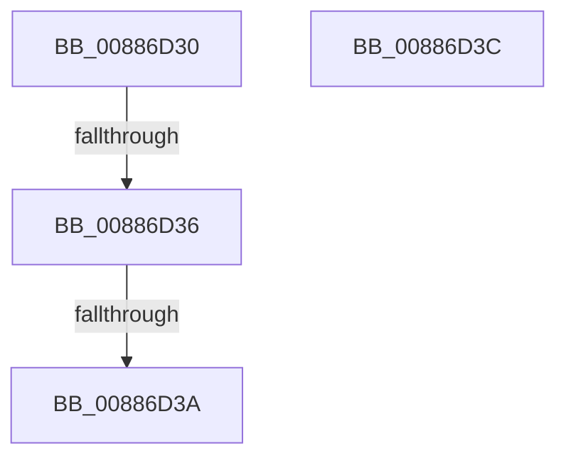

# sub_00886D30

- RVA: `0x00886D30`–`0x00886D42` (길이 `18` bytes)
- VA: `0x0000000140886D30`
- 실행 섹션: `PAGE`
- PDB 이름 있음: `아니요`; PDB Function 태그: `아니요`
- unwind 정보 RVA: `0x0007CB70`
- 디코드: `7`개 명령, `18/18` bytes 표시
- 미해석 바이트: `0` (있으면 어셈블리에 `.byte`로 보존)

> 이 문서는 커널 이미지의 기계어와 PDB 기호를 분석해 생성했습니다. 4번과 5번은 함수 원형과 자료형을 바이너리 사용 방식에서 추정한 C 해석이며 원본 소스 복구 결과는 아닙니다.

## 1. Dependencies

- 직접 호출 지점: **0**; 고유 호출 대상: **0**
- 직접 호출자로 확인된 함수: **0**
- RIP 상대 이미지 참조: **0**

### Outgoing calls
- 직접 디코드된 call 명령이 없습니다.

### Direct callers
- 이 함수 시작 RVA로 연결되는 직접 call은 확인되지 않았습니다. 간접 호출은 완전히 역산할 수 없습니다.

### Static image references
- 디코드된 RIP-relative 메모리 참조가 없습니다.

## 2. Other-region calls and transfers

- 다른 실행 섹션으로 향하는 call: **0**
- call이 아닌 외부 분기/꼬리 이동: **4**
  - `0x00886D34` → [sub_00886C97 + 0x8A](Unknown_function_00886C97.md) (`tail-transfer`)
  - `0x00886D38` → [sub_00886C97 + 0x69](Unknown_function_00886C97.md) (`tail-transfer`)
  - `0x00886D3A` → [sub_00886C97 + 0x6D](Unknown_function_00886C97.md) (`tail-transfer`)
  - `0x00886D40` → [sub_00886C97 + 0x8A](Unknown_function_00886C97.md) (`tail-transfer`)

## 3. Assembly (complete function range)

```asm
00886D30  49 83 F8 01                     cmp r8, 1
00886D34  76 EB                           jbe 0x140886d21
00886D36  85 DB                           test ebx, ebx
00886D38  74 C6                           je 0x140886d00
00886D3A  EB C8                           jmp 0x140886d04
00886D3C  4D 89 43 18                     mov qword ptr [r11 + 0x18], r8
00886D40  EB DF                           jmp 0x140886d21
```

## 4. C-style interpretation (structured pseudocode)

```c
void __fastcall sub_00886D30(__int64 a1, __int64 a2, __int64 a3)
{
}
```

## 5. (Beta) C Style

```c
void sub_00886D30(int64_t Arg1, int64_t Arg2, int64_t Arg3)
{
}
```

## 6. Execution-region graph

[열기: 2D/3D 그래프와 함수 탐색 컨트롤 패널](../../../control-panel.html?section=page&rva=0x00886D30&view=graph)

- 2D 그래프는 위에서 아래로 흐르고, 3D 그래프는 빈 공간을 드래그해 회전합니다. Shift+드래그는 이동, 휠은 확대·축소, 함수 노드 선택은 대상 보고서 이동입니다.

### Static fallback


