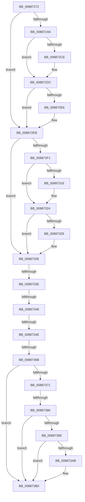

# sub_00887272

- RVA: `0x00887272`–`0x008873D3` (길이 `353` bytes)
- VA: `0x0000000140887272`
- 실행 섹션: `PAGE`
- PDB 이름 있음: `아니요`; PDB Function 태그: `아니요`
- unwind 정보 RVA: `0x0007CBE0`
- 디코드: `86`개 명령, `353/353` bytes 표시
- 미해석 바이트: `0` (있으면 어셈블리에 `.byte`로 보존)

> 이 문서는 커널 이미지의 기계어와 PDB 기호를 분석해 생성했습니다. 4번과 5번은 함수 원형과 자료형을 바이너리 사용 방식에서 추정한 C 해석이며 원본 소스 복구 결과는 아닙니다.

## 1. Dependencies

- 직접 호출 지점: **6**; 고유 호출 대상: **4**
- 직접 호출자로 확인된 함수: **0**
- RIP 상대 이미지 참조: **0**

### Outgoing calls
- `0x008872BE` → [KeAbPreAcquire](../../text/21/KeAbPreAcquire_function_00210230.md) (function, `0x00210230`)
- `0x008872D7` → [ExfAcquirePushLockExclusiveEx](../../text/20/ExfAcquirePushLockExclusiveEx_function_0020FC90.md) (function, `0x0020FC90`)
- `0x00887306` → [KeAbPreAcquire](../../text/21/KeAbPreAcquire_function_00210230.md) (function, `0x00210230`)
- `0x0088731F` → [ExfAcquirePushLockExclusiveEx](../../text/20/ExfAcquirePushLockExclusiveEx_function_0020FC90.md) (function, `0x0020FC90`)
- `0x0088738D` → [KeAbPostRelease](../../text/2E/KeAbPostRelease_function_002E1600.md) (function, `0x002E1600`)
- `0x008873AB` → [KiCheckForKernelApcDelivery](../../text/2E/KiCheckForKernelApcDelivery_function_002E2C80.md) (function, `0x002E2C80`)

### Direct callers
- 이 함수 시작 RVA로 연결되는 직접 call은 확인되지 않았습니다. 간접 호출은 완전히 역산할 수 없습니다.

### Static image references
- 디코드된 RIP-relative 메모리 참조가 없습니다.

## 2. Other-region calls and transfers

- 다른 실행 섹션으로 향하는 call: **6**
  - `0x008872BE` → [KeAbPreAcquire](../../text/21/KeAbPreAcquire_function_00210230.md) (`PAGE` → `.text`)
  - `0x008872D7` → [ExfAcquirePushLockExclusiveEx](../../text/20/ExfAcquirePushLockExclusiveEx_function_0020FC90.md) (`PAGE` → `.text`)
  - `0x00887306` → [KeAbPreAcquire](../../text/21/KeAbPreAcquire_function_00210230.md) (`PAGE` → `.text`)
  - `0x0088731F` → [ExfAcquirePushLockExclusiveEx](../../text/20/ExfAcquirePushLockExclusiveEx_function_0020FC90.md) (`PAGE` → `.text`)
  - `0x0088738D` → [KeAbPostRelease](../../text/2E/KeAbPostRelease_function_002E1600.md) (`PAGE` → `.text`)
  - `0x008873AB` → [KiCheckForKernelApcDelivery](../../text/2E/KiCheckForKernelApcDelivery_function_002E2C80.md) (`PAGE` → `.text`)
- call이 아닌 외부 분기/꼬리 이동: **5**
  - `0x00887338` → [sub_008873D4 + 0xC](Unknown_function_008873D4.md) (`tail-transfer`)
  - `0x00887342` → [sub_008873D4](Unknown_function_008873D4.md) (`tail-transfer`)
  - `0x00887348` → [sub_00887465](Unknown_function_00887465.md) (`tail-transfer`)
  - `0x00887365` → [sub_00887465 + 0x11](Unknown_function_00887465.md) (`tail-transfer`)
  - `0x00887380` → [sub_008874E4 + 0x3D](Unknown_function_008874E4.md) (`tail-transfer`)

## 3. Assembly (complete function range)

```asm
00887272  48 89 5C 24 70                  mov qword ptr [rsp + 0x70], rbx
00887277  4C 89 64 24 78                  mov qword ptr [rsp + 0x78], r12
0088727C  4C 89 AC 24 80 00 00 00         mov qword ptr [rsp + 0x80], r13
00887284  4C 89 7C 24 40                  mov qword ptr [rsp + 0x40], r15
00887289  4C 8D 60 48                     lea r12, [rax + 0x48]
0088728D  65 4C 8B 3C 25 88 01 00 00      mov r15, qword ptr gs:[0x188]
00887296  4C 89 64 24 38                  mov qword ptr [rsp + 0x38], r12
0088729B  48 89 44 24 20                  mov qword ptr [rsp + 0x20], rax
008872A0  40 F6 C6 01                     test sil, 1
008872A4  75 45                           jne 0x1408872eb
008872A6  66 41 FF 8F E6 01 00 00         dec word ptr [r15 + 0x1e6]
008872AE  48 8D 99 B0 06 00 00            lea rbx, [rcx + 0x6b0]
008872B5  48 8B CB                        mov rcx, rbx
008872B8  45 33 C0                        xor r8d, r8d
008872BB  33 D2                           xor edx, edx
008872BD  90                              nop
008872BE  E8 6D 8F 98 FF                  call 0x140210230
008872C3  F0 48 0F BA 2B 00               lock bts qword ptr [rbx], 0
008872C9  4C 8B E8                        mov r13, rax
008872CC  73 0E                           jae 0x1408872dc
008872CE  4C 8B C3                        mov r8, rbx
008872D1  48 8B D0                        mov rdx, rax
008872D4  48 8B CB                        mov rcx, rbx
008872D7  E8 B4 89 98 FF                  call 0x14020fc90
008872DC  48 8B 44 24 20                  mov rax, qword ptr [rsp + 0x20]
008872E1  4D 85 ED                        test r13, r13
008872E4  74 05                           je 0x1408872eb
008872E6  41 C6 45 0A 01                  mov byte ptr [r13 + 0xa], 1
008872EB  40 F6 C6 02                     test sil, 2
008872EF  75 3D                           jne 0x14088732e
008872F1  66 41 FF 8F E6 01 00 00         dec word ptr [r15 + 0x1e6]
008872F9  48 8D 58 28                     lea rbx, [rax + 0x28]
008872FD  48 8B CB                        mov rcx, rbx
00887300  45 33 C0                        xor r8d, r8d
00887303  33 D2                           xor edx, edx
00887305  90                              nop
00887306  E8 25 8F 98 FF                  call 0x140210230
0088730B  F0 48 0F BA 2B 00               lock bts qword ptr [rbx], 0
00887311  4C 8B E8                        mov r13, rax
00887314  73 0E                           jae 0x140887324
00887316  4C 8B C3                        mov r8, rbx
00887319  48 8B D0                        mov rdx, rax
0088731C  48 8B CB                        mov rcx, rbx
0088731F  E8 6C 89 98 FF                  call 0x14020fc90
00887324  4D 85 ED                        test r13, r13
00887327  74 05                           je 0x14088732e
00887329  41 C6 45 0A 01                  mov byte ptr [r13 + 0xa], 1
0088732E  49 8B 1C 24                     mov rbx, qword ptr [r12]
00887332  45 32 E4                        xor r12b, r12b
00887335  48 85 DB                        test rbx, rbx
00887338  0F 84 A2 00 00 00               je 0x1408873e0
0088733E  48 3B 7B 18                     cmp rdi, qword ptr [rbx + 0x18]
00887342  0F 82 8C 00 00 00               jb 0x1408873d4
00887348  0F 87 17 01 00 00               ja 0x140887465
0088734E  48 FF 43 20                     inc qword ptr [rbx + 0x20]
00887352  4C 8B AC 24 88 00 00 00         mov r13, qword ptr [rsp + 0x88]
0088735A  48 C7 C3 FF FF FF FF            mov rbx, 0xffffffffffffffff
00887361  40 F6 C6 02                     test sil, 2
00887365  0F 84 0B 01 00 00               je 0x140887476
0088736B  40 F6 C6 01                     test sil, 1
0088736F  75 3F                           jne 0x1408873b0
00887371  F0 49 0F C1 9D B0 06 00 00      lock xadd qword ptr [r13 + 0x6b0], rbx
0088737A  80 E3 06                        and bl, 6
0088737D  80 FB 02                        cmp bl, 2
00887380  0F 84 9B 01 00 00               je 0x140887521
00887386  49 8D 8D B0 06 00 00            lea rcx, [r13 + 0x6b0]
0088738D  E8 6E A2 A5 FF                  call 0x1402e1600
00887392  90                              nop
00887393  66 41 83 87 E6 01 00 00 01      add word ptr [r15 + 0x1e6], 1
0088739C  75 12                           jne 0x1408873b0
0088739E  49 8D 87 98 00 00 00            lea rax, [r15 + 0x98]
008873A5  90                              nop
008873A6  48 39 00                        cmp qword ptr [rax], rax
008873A9  74 05                           je 0x1408873b0
008873AB  E8 D0 B8 A5 FF                  call 0x1402e2c80
008873B0  4C 8B AC 24 80 00 00 00         mov r13, qword ptr [rsp + 0x80]
008873B8  8B C5                           mov eax, ebp
008873BA  4C 8B 64 24 78                  mov r12, qword ptr [rsp + 0x78]
008873BF  48 8B 5C 24 70                  mov rbx, qword ptr [rsp + 0x70]
008873C4  4C 8B 7C 24 40                  mov r15, qword ptr [rsp + 0x40]
008873C9  48 83 C4 48                     add rsp, 0x48
008873CD  41 5E                           pop r14
008873CF  5F                              pop rdi
008873D0  5E                              pop rsi
008873D1  5D                              pop rbp
008873D2  C3                              ret
```

## 4. C-style interpretation (structured pseudocode)

```c
__int64 __fastcall sub_00887272(__int64 a1, int a2, int a3, __int64 a4, __int64 a5, __int64 a6, __int64 a7, __int64 a8, __int64 a9, __int64 a10, __int64 a11, __int64 a12, __int64 a13, __int64 a14, __int64 a15, __int64 a16, __int64 a17)
{
    __int64 result;
    __int64 v_r12;
    __int64 v_rbx;
    __int64 v_rsp;
    unsigned __int64 v_stack_p20;
    unsigned __int64 v_stack_p38;
    unsigned __int64 v_stack_p40;
    unsigned __int64 v_stack_p70;
    unsigned __int64 v_stack_p78;
    unsigned __int64 v_stack_p80;

    v_stack_p70 = v_rbx;
    v_stack_p78 = v_r12;
    v_stack_p80 = v_r13;
    v_stack_p40 = v_r15;
    v_stack_p38 = result + 72;
    v_stack_p20 = result;
    if ((((unsigned __int8)(v_rsi)) & (1)) != 0) goto loc_008872EB;
    a3 = 0;
    a2 = 0;
    result = KeAbPreAcquire(a1 + 1712, a2, a3, a4);
    if (!(condition_is_above_or_equal)) {
        a3 = a1 + 1712;
        a2 = result;
        a1 = a1 + 1712;
        result = ExfAcquirePushLockExclusiveEx(a1, a2, a3, a4);
    }
    if (result != 0) {
        *(unsigned __int8 *)(result + 10) = 1;
    }
    if ((((unsigned __int8)(v_rsi)) & (2)) != 0) goto loc_0088732E;
    a3 = 0;
    a2 = 0;
    result = KeAbPreAcquire(v_stack_p20 + 40, a2, a3, a4);
    if (!(condition_is_above_or_equal)) {
        a3 = v_stack_p20 + 40;
        a2 = result;
        a1 = v_stack_p20 + 40;
        result = ExfAcquirePushLockExclusiveEx(a1, a2, a3, a4);
    }
    if (result != 0) {
        *(unsigned __int8 *)(result + 10) = 1;
    }
    v_r12 = 0;
    if ((((unsigned __int8)(v_rsi)) & (1)) != 0) goto loc_008873B0;
    v_rbx = (unsigned __int8)((-1) & (6));
    result = KeAbPostRelease(a17 + 1712, a2, a3, a4);
    if (((unsigned __int8)(v_rbx)) != 2) goto loc_008873B0;
    result = *(unsigned __int64 *)(gs_base + (0 + 392)) + 152;
    if ((*(unsigned __int64 *)(*(unsigned __int64 *)(gs_base + (0 + 392)) + 152)) != (*(unsigned __int64 *)(gs_base + (0 + 392)) + 152)) {
        result = KiCheckForKernelApcDelivery(a17 + 1712, a2, a3, a4);
    }
    v_rsp = (v_rsp) + (72);
    return (unsigned int)((unsigned int)(v_rbp));
}
```

## 5. (Beta) C Style

```c
int64_t sub_00887272(void *Arg1, int32_t Arg2, int32_t Arg3, int64_t Arg4, uint64_t Arg5, uint64_t Arg6, uint64_t Arg7, int64_t Arg8, uint64_t Arg9, uint64_t Arg10, uint64_t Arg11, uint64_t Arg12, uint64_t Arg13, int64_t Arg14, int64_t Arg15, int64_t Arg16, void *Arg17)
{
    uint8_t *arg1 = (uint8_t *)Arg1;
    uint8_t *arg17 = (uint8_t *)Arg17;

    int64_t result;
    int64_t local_r12;
    int64_t local_rbx;
    int64_t local_rsp;
    uint64_t v_stack_p20;
    uint64_t v_stack_p38;
    uint64_t v_stack_p40;
    uint64_t v_stack_p70;
    uint64_t v_stack_p78;
    uint64_t v_stack_p80;

    v_stack_p70 = local_rbx;
    v_stack_p78 = local_r12;
    v_stack_p80 = local_r13;
    v_stack_p40 = local_r15;
    v_stack_p38 = result + 72;
    v_stack_p20 = result;
    if ((((uint8_t)(local_rsi)) & (1)) != 0) goto loc_008872EB;
    Arg3 = 0;
    Arg2 = 0;
    result = KeAbPreAcquire(Arg1 + 1712, Arg2, Arg3, Arg4);
    if (!(condition_is_above_or_equal)) {
        Arg3 = Arg1 + 1712;
        Arg2 = result;
        Arg1 = Arg1 + 1712;
        result = ExfAcquirePushLockExclusiveEx(Arg1, Arg2, Arg3, Arg4);
    }
    if (result != 0) {
        *(uint8_t *)(result + 0xA) = 1;
    }
    if ((((uint8_t)(local_rsi)) & (2)) != 0) goto loc_0088732E;
    Arg3 = 0;
    Arg2 = 0;
    result = KeAbPreAcquire(v_stack_p20 + 40, Arg2, Arg3, Arg4);
    if (!(condition_is_above_or_equal)) {
        Arg3 = v_stack_p20 + 40;
        Arg2 = result;
        Arg1 = v_stack_p20 + 40;
        result = ExfAcquirePushLockExclusiveEx(Arg1, Arg2, Arg3, Arg4);
    }
    if (result != 0) {
        *(uint8_t *)(result + 0xA) = 1;
    }
    local_r12 = 0;
    if ((((uint8_t)(local_rsi)) & (1)) != 0) goto loc_008873B0;
    local_rbx = (uint8_t)((-1) & (6));
    result = KeAbPostRelease(Arg17 + 1712, Arg2, Arg3, Arg4);
    if (((uint8_t)(local_rbx)) != 2) goto loc_008873B0;
    result = *(uint64_t *)(gs_base + (0 + 0x188)) + 152;
    if ((*(uint64_t *)(*(uint64_t *)(gs_base + (0 + 0x188)) + 0x98)) != (*(uint64_t *)(gs_base + (0 + 0x188)) + 152)) {
        result = KiCheckForKernelApcDelivery(Arg17 + 1712, Arg2, Arg3, Arg4);
    }
    local_rsp = (local_rsp) + (72);
    return (uint32_t)((uint32_t)(local_rbp));
}
```

### 관측된 메모리 오프셋

구조체 형식이 확인되지 않은 접근은 인자 기준의 오프셋으로만 기록했습니다.

| 기준 인자 | 오프셋 표현 | 폭 (bit) | 접근 |
|---|---:|---:|---|
| `Arg1` | `+ 0x0` | `64` | `R/W` |
| `Arg1` | `+ 0x6B0` | `64` | `R` |
| `Arg17` | `+ 0x6B0` | `64` | `R` |
| `Arg17` | `+ 0x6B0` | `64` | `R/W` |

## 6. Execution-region graph

[열기: 2D/3D 그래프와 함수 탐색 컨트롤 패널](../../../control-panel.html?section=page&rva=0x00887272&view=graph)

- 2D 그래프는 위에서 아래로 흐르고, 3D 그래프는 빈 공간을 드래그해 회전합니다. Shift+드래그는 이동, 휠은 확대·축소, 함수 노드 선택은 대상 보고서 이동입니다.

### Static fallback


