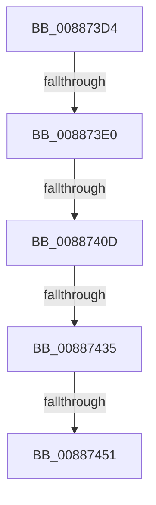

# sub_008873D4

- RVA: `0x008873D4`–`0x00887458` (길이 `132` bytes)
- VA: `0x00000001408873D4`
- 실행 섹션: `PAGE`
- PDB 이름 있음: `아니요`; PDB Function 태그: `아니요`
- unwind 정보 RVA: `0x0007CC14`
- 디코드: `29`개 명령, `132/132` bytes 표시
- 미해석 바이트: `0` (있으면 어셈블리에 `.byte`로 보존)

> 이 문서는 커널 이미지의 기계어와 PDB 기호를 분석해 생성했습니다. 4번과 5번은 함수 원형과 자료형을 바이너리 사용 방식에서 추정한 C 해석이며 원본 소스 복구 결과는 아닙니다.

## 1. Dependencies

- 직접 호출 지점: **3**; 고유 호출 대상: **3**
- 직접 호출자로 확인된 함수: **0**
- RIP 상대 이미지 참조: **0**

### Outgoing calls
- `0x008873E0` → [MmGetCurrentProcessorColor](../../text/41/MmGetCurrentProcessorColor_function_00418930.md) (function, `0x00418930`)
- `0x008873FC` → [ExAllocatePoolMm](../../text/35/ExAllocatePoolMm_function_0035B690.md) (function, `0x0035B690`)
- `0x0088741C` → [MiGetCommittedPages](../../text/32/MiGetCommittedPages_function_00325CE0.md) (function, `0x00325CE0`)

### Direct callers
- 이 함수 시작 RVA로 연결되는 직접 call은 확인되지 않았습니다. 간접 호출은 완전히 역산할 수 없습니다.

### Static image references
- 디코드된 RIP-relative 메모리 참조가 없습니다.

## 2. Other-region calls and transfers

- 다른 실행 섹션으로 향하는 call: **3**
  - `0x008873E0` → [MmGetCurrentProcessorColor](../../text/41/MmGetCurrentProcessorColor_function_00418930.md) (`PAGE` → `.text`)
  - `0x008873FC` → [ExAllocatePoolMm](../../text/35/ExAllocatePoolMm_function_0035B690.md) (`PAGE` → `.text`)
  - `0x0088741C` → [MiGetCommittedPages](../../text/32/MiGetCommittedPages_function_00325CE0.md) (`PAGE` → `.text`)
- call이 아닌 외부 분기/꼬리 이동: **4**
  - `0x008873DA` → [sub_00887465 + 0x9](Unknown_function_00887465.md) (`tail-transfer`)
  - `0x00887407` → [sub_008874E4 + 0x8](Unknown_function_008874E4.md) (`tail-transfer`)
  - `0x0088742F` → [sub_008874E4 + 0x1A](Unknown_function_008874E4.md) (`tail-transfer`)
  - `0x0088744B` → [sub_008874E4 + 0x5C](Unknown_function_008874E4.md) (`tail-transfer`)

## 3. Assembly (complete function range)

```asm
008873D4  48 8B 03                        mov rax, qword ptr [rbx]
008873D7  48 85 C0                        test rax, rax
008873DA  0F 85 8E 00 00 00               jne 0x14088746e
008873E0  E8 4B 15 B9 FF                  call 0x140418930
008873E5  48 8B 54 24 28                  mov rdx, qword ptr [rsp + 0x28]
008873EA  0F BA E8 1F                     bts eax, 0x1f
008873EE  44 8B C8                        mov r9d, eax
008873F1  41 B8 4D 69 53 6E               mov r8d, 0x6e53694d
008873F7  B9 00 01 00 00                  mov ecx, 0x100
008873FC  E8 8F 42 AD FF                  call 0x14035b690
00887401  4C 8B C8                        mov r9, rax
00887404  48 85 C0                        test rax, rax
00887407  0F 84 DF 00 00 00               je 0x1408874ec
0088740D  49 8B CE                        mov rcx, r14
00887410  48 C7 40 20 01 00 00 00         mov qword ptr [rax + 0x20], 1
00887418  48 89 78 18                     mov qword ptr [rax + 0x18], rdi
0088741C  E8 BF E8 A9 FF                  call 0x140325ce0
00887421  4C 8B AC 24 88 00 00 00         mov r13, qword ptr [rsp + 0x88]
00887429  4C 8B C0                        mov r8, rax
0088742C  4D 85 ED                        test r13, r13
0088742F  0F 84 C9 00 00 00               je 0x1408874fe
00887435  49 8D 85 B8 06 00 00            lea rax, [r13 + 0x6b8]
0088743C  4D 89 71 38                     mov qword ptr [r9 + 0x38], r14
00887440  48 8B 50 08                     mov rdx, qword ptr [rax + 8]
00887444  49 8D 49 28                     lea rcx, [r9 + 0x28]
00887448  48 39 02                        cmp qword ptr [rdx], rax
0088744B  0F 84 EF 00 00 00               je 0x140887540
00887451  B9 03 00 00 00                  mov ecx, 3
00887456  CD 29                           int 0x29
```

## 4. C-style interpretation (structured pseudocode)

```c
__int64 __fastcall sub_008873D4(__int64 a1, __int64 a2, __int64 a3, __int64 a4, __int64 a5, __int64 a6, __int64 a7, __int64 a8, __int64 a9, __int64 a10, __int64 a11, __int64 a12, __int64 a13, __int64 a14, __int64 a15, __int64 a16, __int64 a17)
{
    __int64 result;

    result = MmGetCurrentProcessorColor(a1, a2, a3, a4);
    result = ExAllocatePoolMm(256, a5, (unsigned int)(0x6E53694DULL), (unsigned int)((unsigned int)(result)));
    *(unsigned __int64 *)(result + 32) = 1;
    *(unsigned __int64 *)(result + 24) = v_rdi;
    result = MiGetCommittedPages(v_r14, a5, (unsigned int)(0x6E53694DULL), result);
    *(unsigned __int64 *)(result + 56) = v_r14;
    return a17 + 1720;
}
```

## 5. (Beta) C Style

```c
int64_t sub_008873D4(int64_t Arg1, int64_t Arg2, int64_t Arg3, int64_t Arg4, int64_t Arg5, uint64_t Arg6, uint64_t Arg7, uint64_t Arg8, uint64_t Arg9, uint64_t Arg10, uint64_t Arg11, uint64_t Arg12, uint64_t Arg13, uint64_t Arg14, uint64_t Arg15, uint64_t Arg16, int64_t Arg17)
{
    int64_t result;

    result = MmGetCurrentProcessorColor(Arg1, Arg2, Arg3, Arg4);
    result = ExAllocatePoolMm(256, Arg5, (uint32_t)(0x6E53694DULL), (uint32_t)((uint32_t)(result)));
    *(uint64_t *)(result + 0x20) = 1;
    *(uint64_t *)(result + 0x18) = local_rdi;
    result = MiGetCommittedPages(local_r14, Arg5, (uint32_t)(0x6E53694DULL), result);
    *(uint64_t *)(result + 0x38) = local_r14;
    return Arg17 + 1720;
}
```

## 6. Execution-region graph

[열기: 2D/3D 그래프와 함수 탐색 컨트롤 패널](../../../control-panel.html?section=page&rva=0x008873D4&view=graph)

- 2D 그래프는 위에서 아래로 흐르고, 3D 그래프는 빈 공간을 드래그해 회전합니다. Shift+드래그는 이동, 휠은 확대·축소, 함수 노드 선택은 대상 보고서 이동입니다.

### Static fallback


