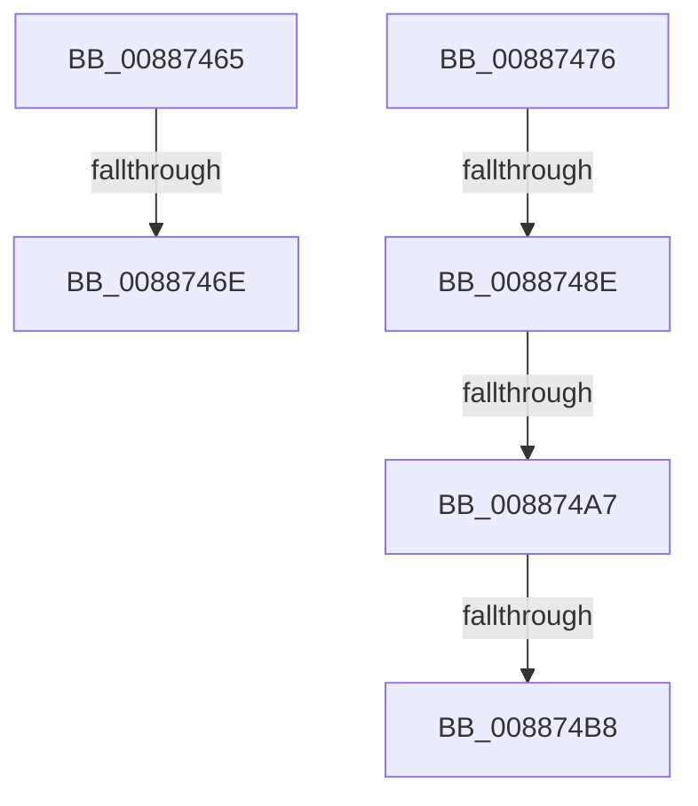

# sub_00887465

- RVA: `0x00887465`–`0x008874C2` (길이 `93` bytes)
- VA: `0x0000000140887465`
- 실행 섹션: `PAGE`
- PDB 이름 있음: `아니요`; PDB Function 태그: `아니요`
- unwind 정보 RVA: `0x0007CC48`
- 디코드: `22`개 명령, `93/93` bytes 표시
- 미해석 바이트: `0` (있으면 어셈블리에 `.byte`로 보존)

> 이 문서는 커널 이미지의 기계어와 PDB 기호를 분석해 생성했습니다. 4번과 5번은 함수 원형과 자료형을 바이너리 사용 방식에서 추정한 C 해석이며 원본 소스 복구 결과는 아닙니다.

## 1. Dependencies

- 직접 호출 지점: **2**; 고유 호출 대상: **2**
- 직접 호출자로 확인된 함수: **0**
- RIP 상대 이미지 참조: **0**

### Outgoing calls
- `0x00887492` → [KeAbPostRelease](../../text/2E/KeAbPostRelease_function_002E1600.md) (function, `0x002E1600`)
- `0x008874B8` → [KiCheckForKernelApcDelivery](../../text/2E/KiCheckForKernelApcDelivery_function_002E2C80.md) (function, `0x002E2C80`)

### Direct callers
- 이 함수 시작 RVA로 연결되는 직접 call은 확인되지 않았습니다. 간접 호출은 완전히 역산할 수 없습니다.

### Static image references
- 디코드된 RIP-relative 메모리 참조가 없습니다.

## 2. Other-region calls and transfers

- 다른 실행 섹션으로 향하는 call: **2**
  - `0x00887492` → [KeAbPostRelease](../../text/2E/KeAbPostRelease_function_002E1600.md) (`PAGE` → `.text`)
  - `0x008874B8` → [KiCheckForKernelApcDelivery](../../text/2E/KiCheckForKernelApcDelivery_function_002E2C80.md) (`PAGE` → `.text`)
- call이 아닌 외부 분기/꼬리 이동: **6**
  - `0x0088746C` → [sub_008874E4](Unknown_function_008874E4.md) (`tail-transfer`)
  - `0x00887471` → [sub_00887272 + 0xCC](Unknown_function_00887272.md) (`tail-transfer`)
  - `0x00887488` → [sub_008874E4 + 0x4E](Unknown_function_008874E4.md) (`tail-transfer`)
  - `0x008874A1` → [sub_00887272 + 0xF9](Unknown_function_00887272.md) (`tail-transfer`)
  - `0x008874B2` → [sub_00887272 + 0xF9](Unknown_function_00887272.md) (`tail-transfer`)
  - `0x008874BD` → [sub_00887272 + 0xF9](Unknown_function_00887272.md) (`tail-transfer`)

## 3. Assembly (complete function range)

```asm
00887465  48 8B 43 08                     mov rax, qword ptr [rbx + 8]
00887469  48 85 C0                        test rax, rax
0088746C  74 76                           je 0x1408874e4
0088746E  48 8B D8                        mov rbx, rax
00887471  E9 C8 FE FF FF                  jmp 0x14088733e
00887476  48 8B 7C 24 20                  mov rdi, qword ptr [rsp + 0x20]
0088747B  48 8B C3                        mov rax, rbx
0088747E  F0 48 0F C1 47 28               lock xadd qword ptr [rdi + 0x28], rax
00887484  24 06                           and al, 6
00887486  3C 02                           cmp al, 2
00887488  0F 84 A4 00 00 00               je 0x140887532
0088748E  48 8D 4F 28                     lea rcx, [rdi + 0x28]
00887492  E8 69 A1 A5 FF                  call 0x1402e1600
00887497  90                              nop
00887498  66 41 83 87 E6 01 00 00 01      add word ptr [r15 + 0x1e6], 1
008874A1  0F 85 C4 FE FF FF               jne 0x14088736b
008874A7  49 8D 87 98 00 00 00            lea rax, [r15 + 0x98]
008874AE  90                              nop
008874AF  48 39 00                        cmp qword ptr [rax], rax
008874B2  0F 84 B3 FE FF FF               je 0x14088736b
008874B8  E8 C3 B7 A5 FF                  call 0x1402e2c80
008874BD  E9 A9 FE FF FF                  jmp 0x14088736b
```

## 4. C-style interpretation (structured pseudocode)

```c
__int64 __fastcall sub_00887465(void)
{
    unsigned __int64 v_stack_p20;
}
```

## 5. (Beta) C Style

```c
void sub_00887465(void)
{
    uint64_t v_stack_p20;
}
```

## 6. Execution-region graph

[열기: 2D/3D 그래프와 함수 탐색 컨트롤 패널](../../../control-panel.html?section=page&rva=0x00887465&view=graph)

- 2D 그래프는 위에서 아래로 흐르고, 3D 그래프는 빈 공간을 드래그해 회전합니다. Shift+드래그는 이동, 휠은 확대·축소, 함수 노드 선택은 대상 보고서 이동입니다.

### Static fallback


