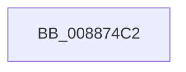

# sub_008874C2

- RVA: `0x008874C2`–`0x008874E4` (길이 `34` bytes)
- VA: `0x00000001408874C2`
- 실행 섹션: `PAGE`
- PDB 이름 있음: `아니요`; PDB Function 태그: `아니요`
- unwind 정보 RVA: `0x0007CC68`
- 디코드: `6`개 명령, `34/34` bytes 표시
- 미해석 바이트: `0` (있으면 어셈블리에 `.byte`로 보존)

> 이 문서는 커널 이미지의 기계어와 PDB 기호를 분석해 생성했습니다. 4번과 5번은 함수 원형과 자료형을 바이너리 사용 방식에서 추정한 C 해석이며 원본 소스 복구 결과는 아닙니다.

## 1. Dependencies

- 직접 호출 지점: **0**; 고유 호출 대상: **0**
- 직접 호출자로 확인된 함수: **0**
- RIP 상대 이미지 참조: **0**

### Outgoing calls
- 직접 디코드된 call 명령이 없습니다.

### Direct callers
- 이 함수 시작 RVA로 연결되는 직접 call은 확인되지 않았습니다. 간접 호출은 완전히 역산할 수 없습니다.

### Static image references
- 디코드된 RIP-relative 메모리 참조가 없습니다.

## 2. Other-region calls and transfers

- 다른 실행 섹션으로 향하는 call: **0**
- call이 아닌 외부 분기/꼬리 이동: **1**
  - `0x008874DF` → [MiInsertSharedCommitNode + 0x5F](MiInsertSharedCommitNode_function_00887210.md) (`tail-transfer`)

## 3. Assembly (complete function range)

```asm
008874C2  48 83 E1 FE                     and rcx, 0xfffffffffffffffe
008874C6  48 C7 44 24 28 28 00 00 00      mov qword ptr [rsp + 0x28], 0x28
008874CF  48 89 4C 24 30                  mov qword ptr [rsp + 0x30], rcx
008874D4  48 8B CD                        mov rcx, rbp
008874D7  48 89 8C 24 88 00 00 00         mov qword ptr [rsp + 0x88], rcx
008874DF  E9 8B FD FF FF                  jmp 0x14088726f
```

## 4. C-style interpretation (structured pseudocode)

```c
void __fastcall sub_008874C2(__int64 a1)
{
    unsigned __int64 v_stack_p28;
    unsigned __int64 v_stack_p30;
    unsigned __int64 v_stack_p88;

    a1 = (a1) & (-2);
    v_stack_p28 = 40;
    v_stack_p30 = a1;
    v_stack_p88 = v_rbp;
}
```

## 5. (Beta) C Style

```c
void sub_008874C2(int64_t Arg1)
{
    uint64_t v_stack_p28;
    uint64_t v_stack_p30;
    uint64_t v_stack_p88;

    Arg1 = (Arg1) & (-2);
    v_stack_p28 = 40;
    v_stack_p30 = Arg1;
    v_stack_p88 = local_rbp;
}
```

## 6. Execution-region graph

[열기: 2D/3D 그래프와 함수 탐색 컨트롤 패널](../../../control-panel.html?section=page&rva=0x008874C2&view=graph)

- 2D 그래프는 위에서 아래로 흐르고, 3D 그래프는 빈 공간을 드래그해 회전합니다. Shift+드래그는 이동, 휠은 확대·축소, 함수 노드 선택은 대상 보고서 이동입니다.

### Static fallback


