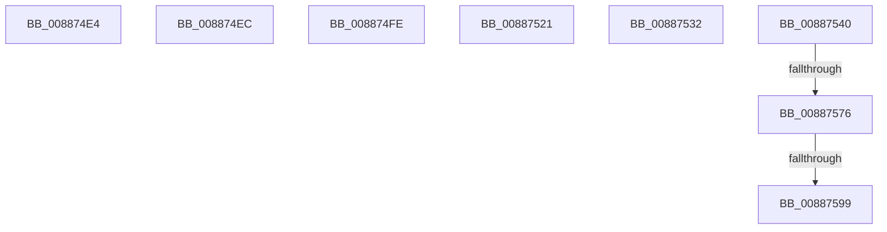

# sub_008874E4

- RVA: `0x008874E4`–`0x008875B0` (길이 `204` bytes)
- VA: `0x00000001408874E4`
- 실행 섹션: `PAGE`
- PDB 이름 있음: `아니요`; PDB Function 태그: `아니요`
- unwind 정보 RVA: `0x0007CC78`
- 디코드: `44`개 명령, `204/204` bytes 표시
- 미해석 바이트: `0` (있으면 어셈블리에 `.byte`로 보존)

> 이 문서는 커널 이미지의 기계어와 PDB 기호를 분석해 생성했습니다. 4번과 5번은 함수 원형과 자료형을 바이너리 사용 방식에서 추정한 C 해석이며 원본 소스 복구 결과는 아닙니다.

## 1. Dependencies

- 직접 호출 지점: **6**; 고유 호출 대상: **4**
- 직접 호출자로 확인된 함수: **0**
- RIP 상대 이미지 참조: **0**

### Outgoing calls
- `0x00887517` → [RtlAvlInsertNodeEx](../../text/26/RtlAvlInsertNodeEx_function_00265790.md) (function, `0x00265790`)
- `0x00887528` → [ExfTryToWakePushLock](../../text/26/ExfTryToWakePushLock_function_00265DD0.md) (function, `0x00265DD0`)
- `0x00887536` → [ExfTryToWakePushLock](../../text/26/ExfTryToWakePushLock_function_00265DD0.md) (function, `0x00265DD0`)
- `0x00887562` → [RtlAvlInsertNodeEx](../../text/26/RtlAvlInsertNodeEx_function_00265790.md) (function, `0x00265790`)
- `0x0088758A` → [MiInsertSharedCommitNode](MiInsertSharedCommitNode_function_00887210.md) (function, `0x00887210`)
- `0x008875A6` → [MiRemoveSharedCommitNode](MiRemoveSharedCommitNode_function_008889A0.md) (function, `0x008889A0`)

### Direct callers
- 이 함수 시작 RVA로 연결되는 직접 call은 확인되지 않았습니다. 간접 호출은 완전히 역산할 수 없습니다.

### Static image references
- 디코드된 RIP-relative 메모리 참조가 없습니다.

## 2. Other-region calls and transfers

- 다른 실행 섹션으로 향하는 call: **4**
  - `0x00887517` → [RtlAvlInsertNodeEx](../../text/26/RtlAvlInsertNodeEx_function_00265790.md) (`PAGE` → `.text`)
  - `0x00887528` → [ExfTryToWakePushLock](../../text/26/ExfTryToWakePushLock_function_00265DD0.md) (`PAGE` → `.text`)
  - `0x00887536` → [ExfTryToWakePushLock](../../text/26/ExfTryToWakePushLock_function_00265DD0.md) (`PAGE` → `.text`)
  - `0x00887562` → [RtlAvlInsertNodeEx](../../text/26/RtlAvlInsertNodeEx_function_00265790.md) (`PAGE` → `.text`)
- call이 아닌 외부 분기/꼬리 이동: **8**
  - `0x008874E7` → [sub_008873D4 + 0xC](Unknown_function_008873D4.md) (`tail-transfer`)
  - `0x008874F9` → [sub_00887272 + 0xE8](Unknown_function_00887272.md) (`tail-transfer`)
  - `0x0088751C` → [sub_00887272 + 0xE8](Unknown_function_00887272.md) (`tail-transfer`)
  - `0x0088752D` → [sub_00887272 + 0x114](Unknown_function_00887272.md) (`tail-transfer`)
  - `0x0088753B` → [sub_00887465 + 0x29](Unknown_function_00887465.md) (`tail-transfer`)
  - `0x00887570` → [sub_00887272 + 0xE8](Unknown_function_00887272.md) (`tail-transfer`)
  - `0x00887593` → [sub_00887272 + 0xE8](Unknown_function_00887272.md) (`tail-transfer`)
  - `0x008875AB` → [sub_00887272 + 0xE8](Unknown_function_00887272.md) (`tail-transfer`)

## 3. Assembly (complete function range)

```asm
008874E4  41 B4 01                        mov r12b, 1
008874E7  E9 F4 FE FF FF                  jmp 0x1408873e0
008874EC  4C 8B AC 24 88 00 00 00         mov r13, qword ptr [rsp + 0x88]
008874F4  BD 9A 00 00 C0                  mov ebp, 0xc000009a
008874F9  E9 5C FE FF FF                  jmp 0x14088735a
008874FE  48 8B 44 24 30                  mov rax, qword ptr [rsp + 0x30]
00887503  F0 4C 01 80 20 06 00 00         lock add qword ptr [rax + 0x620], r8
0088750B  48 8B 4C 24 38                  mov rcx, qword ptr [rsp + 0x38]
00887510  45 0F B6 C4                     movzx r8d, r12b
00887514  48 8B D3                        mov rdx, rbx
00887517  E8 74 E2 9D FF                  call 0x140265790
0088751C  E9 39 FE FF FF                  jmp 0x14088735a
00887521  49 8D 8D B0 06 00 00            lea rcx, [r13 + 0x6b0]
00887528  E8 A3 E8 9D FF                  call 0x140265dd0
0088752D  E9 54 FE FF FF                  jmp 0x140887386
00887532  48 8D 4F 28                     lea rcx, [rdi + 0x28]
00887536  E8 95 E8 9D FF                  call 0x140265dd0
0088753B  E9 4E FF FF FF                  jmp 0x14088748e
00887540  48 89 01                        mov qword ptr [rcx], rax
00887543  48 89 51 08                     mov qword ptr [rcx + 8], rdx
00887547  48 89 0A                        mov qword ptr [rdx], rcx
0088754A  48 89 48 08                     mov qword ptr [rax + 8], rcx
0088754E  F0 4D 01 85 A8 06 00 00         lock add qword ptr [r13 + 0x6a8], r8
00887556  48 8B 4C 24 38                  mov rcx, qword ptr [rsp + 0x38]
0088755B  45 0F B6 C4                     movzx r8d, r12b
0088755F  48 8B D3                        mov rdx, rbx
00887562  E8 29 E2 9D FF                  call 0x140265790
00887567  41 8B 85 FC 05 00 00            mov eax, dword ptr [r13 + 0x5fc]
0088756E  A8 08                           test al, 8
00887570  0F 84 E4 FD FF FF               je 0x14088735a
00887576  49 8B 95 A0 02 00 00            mov rdx, qword ptr [r13 + 0x2a0]
0088757D  41 B8 03 00 00 00               mov r8d, 3
00887583  48 83 CA 01                     or rdx, 1
00887587  49 8B CE                        mov rcx, r14
0088758A  E8 81 FC FF FF                  call 0x140887210
0088758F  8B E8                           mov ebp, eax
00887591  85 C0                           test eax, eax
00887593  0F 89 C1 FD FF FF               jns 0x14088735a
00887599  44 8B C6                        mov r8d, esi
0088759C  49 8B D5                        mov rdx, r13
0088759F  41 83 C8 07                     or r8d, 7
008875A3  49 8B CE                        mov rcx, r14
008875A6  E8 F5 13 00 00                  call 0x1408889a0
008875AB  E9 AA FD FF FF                  jmp 0x14088735a
```

## 4. C-style interpretation (structured pseudocode)

```c
__int64 __fastcall sub_008874E4(__int64 a1, __int64 a2, __int64 a3)
{
    unsigned __int64 v_stack_p30;
    unsigned __int64 v_stack_p38;
    unsigned __int64 v_stack_p88;
}
```

## 5. (Beta) C Style

```c
int64_t sub_008874E4(int64_t Arg1, int64_t Arg2, int64_t Arg3)
{
    uint64_t v_stack_p30;
    uint64_t v_stack_p38;
    uint64_t v_stack_p88;
}
```

## 6. Execution-region graph

[열기: 2D/3D 그래프와 함수 탐색 컨트롤 패널](../../../control-panel.html?section=page&rva=0x008874E4&view=graph)

- 2D 그래프는 위에서 아래로 흐르고, 3D 그래프는 빈 공간을 드래그해 회전합니다. Shift+드래그는 이동, 휠은 확대·축소, 함수 노드 선택은 대상 보고서 이동입니다.

### Static fallback


