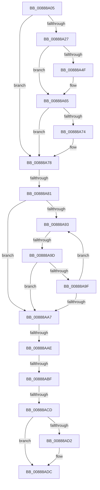

# sub_00888A05

- RVA: `0x00888A05`–`0x00888AF0` (길이 `235` bytes)
- VA: `0x0000000140888A05`
- 실행 섹션: `PAGE`
- PDB 이름 있음: `아니요`; PDB Function 태그: `아니요`
- unwind 정보 RVA: `0x0007CE40`
- 디코드: `57`개 명령, `235/235` bytes 표시
- 미해석 바이트: `0` (있으면 어셈블리에 `.byte`로 보존)

> 이 문서는 커널 이미지의 기계어와 PDB 기호를 분석해 생성했습니다. 4번과 5번은 함수 원형과 자료형을 바이너리 사용 방식에서 추정한 C 해석이며 원본 소스 복구 결과는 아닙니다.

## 1. Dependencies

- 직접 호출 지점: **3**; 고유 호출 대상: **3**
- 직접 호출자로 확인된 함수: **0**
- RIP 상대 이미지 참조: **0**

### Outgoing calls
- `0x00888A3B` → [KeAbPreAcquire](../../text/21/KeAbPreAcquire_function_00210230.md) (function, `0x00210230`)
- `0x00888A60` → [ExfAcquirePushLockExclusiveEx](../../text/20/ExfAcquirePushLockExclusiveEx_function_0020FC90.md) (function, `0x0020FC90`)
- `0x00888AD7` → [ExFreePoolWithTag](../../poolcode/B8/ExFreePoolWithTag_function_00B82870.md) (function, `0x00B82870`)

### Direct callers
- 이 함수 시작 RVA로 연결되는 직접 call은 확인되지 않았습니다. 간접 호출은 완전히 역산할 수 없습니다.

### Static image references
- 디코드된 RIP-relative 메모리 참조가 없습니다.

## 2. Other-region calls and transfers

- 다른 실행 섹션으로 향하는 call: **3**
  - `0x00888A3B` → [KeAbPreAcquire](../../text/21/KeAbPreAcquire_function_00210230.md) (`PAGE` → `.text`)
  - `0x00888A60` → [ExfAcquirePushLockExclusiveEx](../../text/20/ExfAcquirePushLockExclusiveEx_function_0020FC90.md) (`PAGE` → `.text`)
  - `0x00888AD7` → [ExFreePoolWithTag](../../poolcode/B8/ExFreePoolWithTag_function_00B82870.md) (`PAGE` → `POOLCODE`)
- call이 아닌 외부 분기/꼬리 이동: **6**
  - `0x00888A7B` → [sub_00888B41](Unknown_function_00888B41.md) (`tail-transfer`)
  - `0x00888A97` → [sub_00888B41 + 0x12D](Unknown_function_00888B41.md) (`tail-transfer`)
  - `0x00888AAC` → [sub_00888AF0](Unknown_function_00888AF0.md) (`tail-transfer`)
  - `0x00888AB9` → [sub_00888B41 + 0xCA](Unknown_function_00888B41.md) (`tail-transfer`)
  - `0x00888AC7` → [sub_00888B41 + 0x83](Unknown_function_00888B41.md) (`tail-transfer`)
  - `0x00888AEB` → [MiRemoveSharedCommitNode + 0x41](MiRemoveSharedCommitNode_function_008889A0.md) (`tail-transfer`)

## 3. Assembly (complete function range)

```asm
00888A05  48 89 74 24 60                  mov qword ptr [rsp + 0x60], rsi
00888A0A  48 89 7C 24 28                  mov qword ptr [rsp + 0x28], rdi
00888A0F  4C 89 7C 24 20                  mov qword ptr [rsp + 0x20], r15
00888A14  44 8B FD                        mov r15d, ebp
00888A17  48 89 44 24 68                  mov qword ptr [rsp + 0x68], rax
00888A1C  48 89 4C 24 78                  mov qword ptr [rsp + 0x78], rcx
00888A21  41 83 E7 01                     and r15d, 1
00888A25  75 51                           jne 0x140888a78
00888A27  66 FF 88 E6 01 00 00            dec word ptr [rax + 0x1e6]
00888A2E  49 8D 8D B0 06 00 00            lea rcx, [r13 + 0x6b0]
00888A35  45 33 C0                        xor r8d, r8d
00888A38  33 D2                           xor edx, edx
00888A3A  90                              nop
00888A3B  E8 F0 77 98 FF                  call 0x140210230
00888A40  F0 49 0F BA AD B0 06 00 00 00   lock bts qword ptr [r13 + 0x6b0], 0
00888A4A  48 8B F8                        mov rdi, rax
00888A4D  73 16                           jae 0x140888a65
00888A4F  4D 8D 85 B0 06 00 00            lea r8, [r13 + 0x6b0]
00888A56  48 8B D0                        mov rdx, rax
00888A59  49 8D 8D B0 06 00 00            lea rcx, [r13 + 0x6b0]
00888A60  E8 2B 72 98 FF                  call 0x14020fc90
00888A65  48 8B 44 24 68                  mov rax, qword ptr [rsp + 0x68]
00888A6A  48 8B 4C 24 78                  mov rcx, qword ptr [rsp + 0x78]
00888A6F  48 85 FF                        test rdi, rdi
00888A72  74 04                           je 0x140888a78
00888A74  C6 47 0A 01                     mov byte ptr [rdi + 0xa], 1
00888A78  83 E5 02                        and ebp, 2
00888A7B  0F 84 C0 00 00 00               je 0x140888b41
00888A81  48 8B 74 24 78                  mov rsi, qword ptr [rsp + 0x78]
00888A86  48 8B 7E 48                     mov rdi, qword ptr [rsi + 0x48]
00888A8A  48 8D 4E 48                     lea rcx, [rsi + 0x48]
00888A8E  48 85 FF                        test rdi, rdi
00888A91  74 14                           je 0x140888aa7
00888A93  48 3B 5F 18                     cmp rbx, qword ptr [rdi + 0x18]
00888A97  0F 87 D1 01 00 00               ja 0x140888c6e
00888A9D  73 08                           jae 0x140888aa7
00888A9F  48 8B 3F                        mov rdi, qword ptr [rdi]
00888AA2  48 85 FF                        test rdi, rdi
00888AA5  75 EC                           jne 0x140888a93
00888AA7  48 83 6F 20 01                  sub qword ptr [rdi + 0x20], 1
00888AAC  74 42                           je 0x140888af0
00888AAE  33 FF                           xor edi, edi
00888AB0  48 C7 C3 FF FF FF FF            mov rbx, 0xffffffffffffffff
00888AB7  85 ED                           test ebp, ebp
00888AB9  0F 84 4C 01 00 00               je 0x140888c0b
00888ABF  48 8B 6C 24 68                  mov rbp, qword ptr [rsp + 0x68]
00888AC4  45 85 FF                        test r15d, r15d
00888AC7  0F 84 F7 00 00 00               je 0x140888bc4
00888ACD  48 85 FF                        test rdi, rdi
00888AD0  74 0A                           je 0x140888adc
00888AD2  33 D2                           xor edx, edx
00888AD4  48 8B CF                        mov rcx, rdi
00888AD7  E8 94 9D 2F 00                  call 0x140b82870
00888ADC  48 8B 7C 24 28                  mov rdi, qword ptr [rsp + 0x28]
00888AE1  48 8B 74 24 60                  mov rsi, qword ptr [rsp + 0x60]
00888AE6  4C 8B 7C 24 20                  mov r15, qword ptr [rsp + 0x20]
00888AEB  E9 F1 FE FF FF                  jmp 0x1408889e1
```

## 4. C-style interpretation (structured pseudocode)

```c
__int64 __fastcall sub_00888A05(__int64 a1, int a2, int a3, __int64 a4, __int64 a5, __int64 a6, __int64 a7, __int64 a8, __int64 a9, __int64 a10, __int64 a11, __int64 a12, __int64 a13, __int64 a14, __int64 a15)
{
    __int64 result;
    __int64 v_r15;
    __int64 v_rbp;
    __int64 v_rdi;
    unsigned __int64 v_stack_p20;
    unsigned __int64 v_stack_p28;
    unsigned __int64 v_stack_p60;
    unsigned __int64 v_stack_p68;
    unsigned __int64 v_stack_p78;

    v_stack_p60 = v_rsi;
    v_stack_p28 = v_rdi;
    v_stack_p20 = v_r15;
    v_stack_p68 = result;
    v_stack_p78 = a1;
    v_r15 = (unsigned int)(((unsigned int)((unsigned int)(v_rbp))) & (1));
    if (condition_is_not_equal) goto loc_00888A78;
    a3 = 0;
    a2 = 0;
    result = KeAbPreAcquire(v_r13 + 1712, a2, a3, a4);
    if (!(condition_is_above_or_equal)) {
        a3 = v_r13 + 1712;
        a2 = result;
        a1 = v_r13 + 1712;
        result = ExfAcquirePushLockExclusiveEx(a1, a2, a3, a4);
    }
    if (result != 0) {
        *(unsigned __int8 *)(result + 10) = 1;
    }
    v_rbp = (unsigned int)((v_rbp) & (2));
    if (*(unsigned __int64 *)(a15 + 72) == 0) goto loc_00888AA7;
loc_00888A93:
    if (v_rbx >= (*(unsigned __int64 *)(*(unsigned __int64 *)(a15 + 72) + 24))) goto loc_00888AA7;
    if (*(unsigned __int64 *)(*(unsigned __int64 *)(a15 + 72)) != 0) goto loc_00888A93;
loc_00888AA7:
    v_rdi = 0;
    result = a13;
    if (0 != 0) {
        a2 = 0;
        a1 = 0;
        result = ExFreePoolWithTag(a1, a2, a3, a4);
    }
}
```

## 5. (Beta) C Style

```c
int64_t sub_00888A05(int64_t Arg1, int32_t Arg2, int32_t Arg3, int64_t Arg4, int64_t Arg5, uint64_t Arg6, uint64_t Arg7, uint64_t Arg8, uint64_t Arg9, uint64_t Arg10, uint64_t Arg11, int64_t Arg12, int64_t Arg13, uint64_t Arg14, void *Arg15)
{
    uint8_t *arg15 = (uint8_t *)Arg15;

    int64_t result;
    int64_t local_r15;
    int64_t local_rbp;
    int64_t local_rdi;
    uint64_t v_stack_p20;
    uint64_t v_stack_p28;
    uint64_t v_stack_p60;
    uint64_t v_stack_p68;
    uint64_t v_stack_p78;

    v_stack_p60 = local_rsi;
    v_stack_p28 = local_rdi;
    v_stack_p20 = local_r15;
    v_stack_p68 = result;
    v_stack_p78 = Arg1;
    local_r15 = (uint32_t)(((uint32_t)((uint32_t)(local_rbp))) & (1));
    if (condition_is_not_equal) goto loc_00888A78;
    Arg3 = 0;
    Arg2 = 0;
    result = KeAbPreAcquire(local_r13 + 1712, Arg2, Arg3, Arg4);
    if (!(condition_is_above_or_equal)) {
        Arg3 = local_r13 + 1712;
        Arg2 = result;
        Arg1 = local_r13 + 1712;
        result = ExfAcquirePushLockExclusiveEx(Arg1, Arg2, Arg3, Arg4);
    }
    if (result != 0) {
        *(uint8_t *)(result + 0xA) = 1;
    }
    local_rbp = (uint32_t)((local_rbp) & (2));
    if (*(uint64_t *)(arg15 + 0x48) == 0) goto loc_00888AA7;
loc_00888A93:
    if (local_rbx >= (*(uint64_t *)(*(uint64_t *)(arg15 + 0x48) + 0x18))) goto loc_00888AA7;
    if (*(uint64_t *)(*(uint64_t *)(arg15 + 0x48)) != 0) goto loc_00888A93;
loc_00888AA7:
    local_rdi = 0;
    result = Arg13;
    if (0 != 0) {
        Arg2 = 0;
        Arg1 = 0;
        result = ExFreePoolWithTag(Arg1, Arg2, Arg3, Arg4);
    }
}
```

### 관측된 메모리 오프셋

구조체 형식이 확인되지 않은 접근은 인자 기준의 오프셋으로만 기록했습니다.

| 기준 인자 | 오프셋 표현 | 폭 (bit) | 접근 |
|---|---:|---:|---|
| `Arg15` | `+ 0x48` | `64` | `R` |

## 6. Execution-region graph

[열기: 2D/3D 그래프와 함수 탐색 컨트롤 패널](../../../control-panel.html?section=page&rva=0x00888A05&view=graph)

- 2D 그래프는 위에서 아래로 흐르고, 3D 그래프는 빈 공간을 드래그해 회전합니다. Shift+드래그는 이동, 휠은 확대·축소, 함수 노드 선택은 대상 보고서 이동입니다.

### Static fallback


