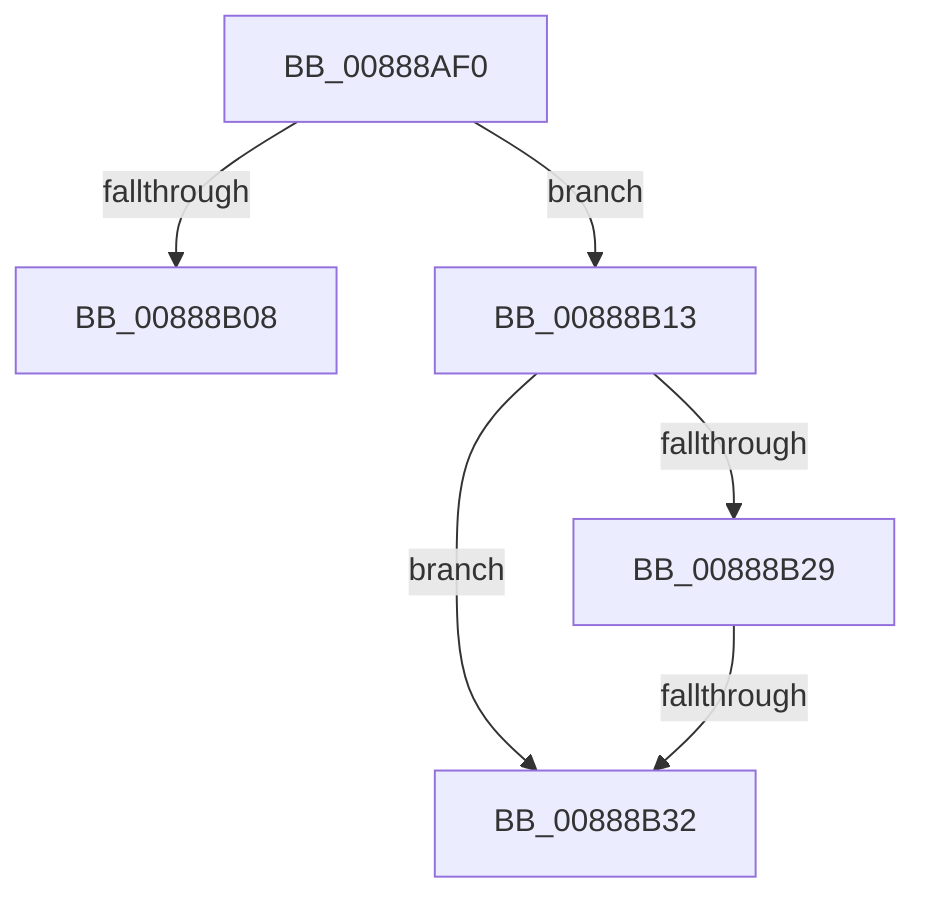

# sub_00888AF0

- RVA: `0x00888AF0`–`0x00888B39` (길이 `73` bytes)
- VA: `0x0000000140888AF0`
- 실행 섹션: `PAGE`
- PDB 이름 있음: `아니요`; PDB Function 태그: `아니요`
- unwind 정보 RVA: `0x0007CE5C`
- 디코드: `19`개 명령, `73/73` bytes 표시
- 미해석 바이트: `0` (있으면 어셈블리에 `.byte`로 보존)

> 이 문서는 커널 이미지의 기계어와 PDB 기호를 분석해 생성했습니다. 4번과 5번은 함수 원형과 자료형을 바이너리 사용 방식에서 추정한 C 해석이며 원본 소스 복구 결과는 아닙니다.

## 1. Dependencies

- 직접 호출 지점: **2**; 고유 호출 대상: **2**
- 직접 호출자로 확인된 함수: **0**
- RIP 상대 이미지 참조: **0**

### Outgoing calls
- `0x00888AF3` → [RtlAvlRemoveNode](../../text/29/RtlAvlRemoveNode_function_00296650.md) (function, `0x00296650`)
- `0x00888AFB` → [MiGetCommittedPages](../../text/32/MiGetCommittedPages_function_00325CE0.md) (function, `0x00325CE0`)

### Direct callers
- 이 함수 시작 RVA로 연결되는 직접 call은 확인되지 않았습니다. 간접 호출은 완전히 역산할 수 없습니다.

### Static image references
- 디코드된 RIP-relative 메모리 참조가 없습니다.

## 2. Other-region calls and transfers

- 다른 실행 섹션으로 향하는 call: **2**
  - `0x00888AF3` → [RtlAvlRemoveNode](../../text/29/RtlAvlRemoveNode_function_00296650.md) (`PAGE` → `.text`)
  - `0x00888AFB` → [MiGetCommittedPages](../../text/32/MiGetCommittedPages_function_00325CE0.md) (`PAGE` → `.text`)
- call이 아닌 외부 분기/꼬리 이동: **2**
  - `0x00888B11` → [sub_00888A05 + 0xAB](Unknown_function_00888A05.md) (`tail-transfer`)
  - `0x00888B30` → [sub_00888B41 + 0x44](Unknown_function_00888B41.md) (`tail-transfer`)

## 3. Assembly (complete function range)

```asm
00888AF0  48 8B D7                        mov rdx, rdi
00888AF3  E8 58 DB A0 FF                  call 0x140296650
00888AF8  49 8B CE                        mov rcx, r14
00888AFB  E8 E0 D1 A9 FF                  call 0x140325ce0
00888B00  48 F7 D8                        neg rax
00888B03  4D 85 ED                        test r13, r13
00888B06  75 0B                           jne 0x140888b13
00888B08  F0 49 01 84 24 20 06 00 00      lock add qword ptr [r12 + 0x620], rax
00888B11  EB 9D                           jmp 0x140888ab0
00888B13  F0 49 01 85 A8 06 00 00         lock add qword ptr [r13 + 0x6a8], rax
00888B1B  48 8B 57 28                     mov rdx, qword ptr [rdi + 0x28]
00888B1F  48 8D 47 28                     lea rax, [rdi + 0x28]
00888B23  48 39 42 08                     cmp qword ptr [rdx + 8], rax
00888B27  75 09                           jne 0x140888b32
00888B29  48 8B 48 08                     mov rcx, qword ptr [rax + 8]
00888B2D  48 39 01                        cmp qword ptr [rcx], rax
00888B30  74 53                           je 0x140888b85
00888B32  B9 03 00 00 00                  mov ecx, 3
00888B37  CD 29                           int 0x29
```

## 4. C-style interpretation (structured pseudocode)

```c
__int64 __fastcall sub_00888AF0(void)
{
    __int64 result;

    result = RtlAvlRemoveNode(a1, v_rdi, a3, a4);
    result = MiGetCommittedPages(v_r14, v_rdi, a3, a4);
    result = -(result);
    if (v_r13 != 0) goto loc_00888B13;
loc_00888B13:
    if ((*(unsigned __int64 *)(*(unsigned __int64 *)(v_rdi + 40) + 8)) != (v_rdi + 40)) goto loc_00888B32;
loc_00888B32:
    return v_rdi + 40;
}
```

## 5. (Beta) C Style

```c
void sub_00888AF0(void)
{
    int64_t result;

    result = RtlAvlRemoveNode(a1, local_rdi, a3, a4);
    result = MiGetCommittedPages(local_r14, local_rdi, a3, a4);
    result = -(result);
    if (local_r13 != 0) goto loc_00888B13;
loc_00888B13:
    if ((*(uint64_t *)(*(uint64_t *)(local_rdi + 0x28) + 0x8)) != (local_rdi + 40)) goto loc_00888B32;
loc_00888B32:
    return local_rdi + 40;
}
```

## 6. Execution-region graph

[열기: 2D/3D 그래프와 함수 탐색 컨트롤 패널](../../../control-panel.html?section=page&rva=0x00888AF0&view=graph)

- 2D 그래프는 위에서 아래로 흐르고, 3D 그래프는 빈 공간을 드래그해 회전합니다. Shift+드래그는 이동, 휠은 확대·축소, 함수 노드 선택은 대상 보고서 이동입니다.

### Static fallback


