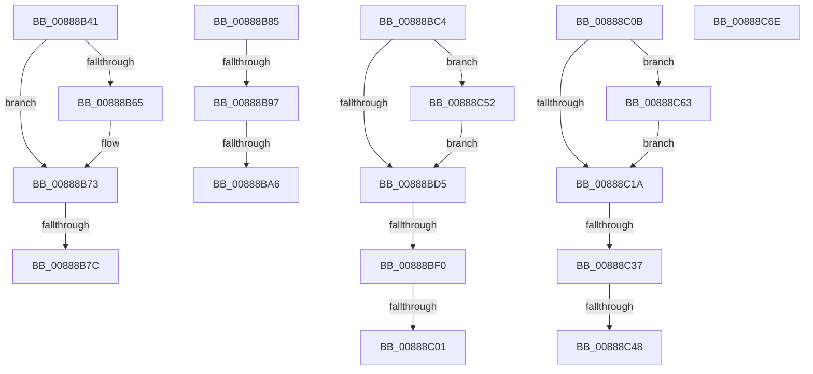

# sub_00888B41

- RVA: `0x00888B41`–`0x00888C77` (길이 `310` bytes)
- VA: `0x0000000140888B41`
- 실행 섹션: `PAGE`
- PDB 이름 있음: `아니요`; PDB Function 태그: `아니요`
- unwind 정보 RVA: `0x0007CE88`
- 디코드: `71`개 명령, `310/310` bytes 표시
- 미해석 바이트: `0` (있으면 어셈블리에 `.byte`로 보존)

> 이 문서는 커널 이미지의 기계어와 PDB 기호를 분석해 생성했습니다. 4번과 5번은 함수 원형과 자료형을 바이너리 사용 방식에서 추정한 C 해석이며 원본 소스 복구 결과는 아닙니다.

## 1. Dependencies

- 직접 호출 지점: **9**; 고유 호출 대상: **6**
- 직접 호출자로 확인된 함수: **0**
- RIP 상대 이미지 참조: **0**

### Outgoing calls
- `0x00888B55` → [KeAbPreAcquire](../../text/21/KeAbPreAcquire_function_00210230.md) (function, `0x00210230`)
- `0x00888B6E` → [ExfAcquirePushLockExclusiveEx](../../text/20/ExfAcquirePushLockExclusiveEx_function_0020FC90.md) (function, `0x0020FC90`)
- `0x00888BBA` → [MiRemoveSharedCommitNode](MiRemoveSharedCommitNode_function_008889A0.md) (function, `0x008889A0`)
- `0x00888BDC` → [KeAbPostRelease](../../text/2E/KeAbPostRelease_function_002E1600.md) (function, `0x002E1600`)
- `0x00888C01` → [KiCheckForKernelApcDelivery](../../text/2E/KiCheckForKernelApcDelivery_function_002E2C80.md) (function, `0x002E2C80`)
- `0x00888C1E` → [KeAbPostRelease](../../text/2E/KeAbPostRelease_function_002E1600.md) (function, `0x002E1600`)
- `0x00888C48` → [KiCheckForKernelApcDelivery](../../text/2E/KiCheckForKernelApcDelivery_function_002E2C80.md) (function, `0x002E2C80`)
- `0x00888C59` → [ExfTryToWakePushLock](../../text/26/ExfTryToWakePushLock_function_00265DD0.md) (function, `0x00265DD0`)
- `0x00888C67` → [ExfTryToWakePushLock](../../text/26/ExfTryToWakePushLock_function_00265DD0.md) (function, `0x00265DD0`)

### Direct callers
- 이 함수 시작 RVA로 연결되는 직접 call은 확인되지 않았습니다. 간접 호출은 완전히 역산할 수 없습니다.

### Static image references
- 디코드된 RIP-relative 메모리 참조가 없습니다.

## 2. Other-region calls and transfers

- 다른 실행 섹션으로 향하는 call: **8**
  - `0x00888B55` → [KeAbPreAcquire](../../text/21/KeAbPreAcquire_function_00210230.md) (`PAGE` → `.text`)
  - `0x00888B6E` → [ExfAcquirePushLockExclusiveEx](../../text/20/ExfAcquirePushLockExclusiveEx_function_0020FC90.md) (`PAGE` → `.text`)
  - `0x00888BDC` → [KeAbPostRelease](../../text/2E/KeAbPostRelease_function_002E1600.md) (`PAGE` → `.text`)
  - `0x00888C01` → [KiCheckForKernelApcDelivery](../../text/2E/KiCheckForKernelApcDelivery_function_002E2C80.md) (`PAGE` → `.text`)
  - `0x00888C1E` → [KeAbPostRelease](../../text/2E/KeAbPostRelease_function_002E1600.md) (`PAGE` → `.text`)
  - `0x00888C48` → [KiCheckForKernelApcDelivery](../../text/2E/KiCheckForKernelApcDelivery_function_002E2C80.md) (`PAGE` → `.text`)
  - `0x00888C59` → [ExfTryToWakePushLock](../../text/26/ExfTryToWakePushLock_function_00265DD0.md) (`PAGE` → `.text`)
  - `0x00888C67` → [ExfTryToWakePushLock](../../text/26/ExfTryToWakePushLock_function_00265DD0.md) (`PAGE` → `.text`)
- call이 아닌 외부 분기/꼬리 이동: **12**
  - `0x00888B76` → [sub_00888A05 + 0x7C](Unknown_function_00888A05.md) (`tail-transfer`)
  - `0x00888B80` → [sub_00888A05 + 0x7C](Unknown_function_00888A05.md) (`tail-transfer`)
  - `0x00888B91` → [sub_00888A05 + 0xAB](Unknown_function_00888A05.md) (`tail-transfer`)
  - `0x00888BA0` → [sub_00888A05 + 0xAB](Unknown_function_00888A05.md) (`tail-transfer`)
  - `0x00888BBF` → [sub_00888A05 + 0xAB](Unknown_function_00888A05.md) (`tail-transfer`)
  - `0x00888BEA` → [sub_00888A05 + 0xC8](Unknown_function_00888A05.md) (`tail-transfer`)
  - `0x00888BFB` → [sub_00888A05 + 0xC8](Unknown_function_00888A05.md) (`tail-transfer`)
  - `0x00888C06` → [sub_00888A05 + 0xC8](Unknown_function_00888A05.md) (`tail-transfer`)
  - `0x00888C31` → [sub_00888A05 + 0xBF](Unknown_function_00888A05.md) (`tail-transfer`)
  - `0x00888C42` → [sub_00888A05 + 0xBF](Unknown_function_00888A05.md) (`tail-transfer`)
  - `0x00888C4D` → [sub_00888A05 + 0xBF](Unknown_function_00888A05.md) (`tail-transfer`)
  - `0x00888C72` → [sub_00888A05 + 0x9D](Unknown_function_00888A05.md) (`tail-transfer`)

## 3. Assembly (complete function range)

```asm
00888B41  66 FF 88 E6 01 00 00            dec word ptr [rax + 0x1e6]
00888B48  48 8D 71 28                     lea rsi, [rcx + 0x28]
00888B4C  48 8B CE                        mov rcx, rsi
00888B4F  45 33 C0                        xor r8d, r8d
00888B52  33 D2                           xor edx, edx
00888B54  90                              nop
00888B55  E8 D6 76 98 FF                  call 0x140210230
00888B5A  F0 48 0F BA 2E 00               lock bts qword ptr [rsi], 0
00888B60  48 8B F8                        mov rdi, rax
00888B63  73 0E                           jae 0x140888b73
00888B65  4C 8B C6                        mov r8, rsi
00888B68  48 8B D0                        mov rdx, rax
00888B6B  48 8B CE                        mov rcx, rsi
00888B6E  E8 1D 71 98 FF                  call 0x14020fc90
00888B73  48 85 FF                        test rdi, rdi
00888B76  0F 84 05 FF FF FF               je 0x140888a81
00888B7C  C6 47 0A 01                     mov byte ptr [rdi + 0xa], 1
00888B80  E9 FC FE FF FF                  jmp 0x140888a81
00888B85  F6 44 24 70 04                  test byte ptr [rsp + 0x70], 4
00888B8A  48 89 11                        mov qword ptr [rcx], rdx
00888B8D  48 89 4A 08                     mov qword ptr [rdx + 8], rcx
00888B91  0F 85 19 FF FF FF               jne 0x140888ab0
00888B97  41 8B 85 FC 05 00 00            mov eax, dword ptr [r13 + 0x5fc]
00888B9E  A8 08                           test al, 8
00888BA0  0F 84 0A FF FF FF               je 0x140888ab0
00888BA6  49 8B 95 A0 02 00 00            mov rdx, qword ptr [r13 + 0x2a0]
00888BAD  41 B8 03 00 00 00               mov r8d, 3
00888BB3  48 83 CA 01                     or rdx, 1
00888BB7  49 8B CE                        mov rcx, r14
00888BBA  E8 E1 FD FF FF                  call 0x1408889a0
00888BBF  E9 EC FE FF FF                  jmp 0x140888ab0
00888BC4  F0 49 0F C1 9D B0 06 00 00      lock xadd qword ptr [r13 + 0x6b0], rbx
00888BCD  80 E3 06                        and bl, 6
00888BD0  80 FB 02                        cmp bl, 2
00888BD3  74 7D                           je 0x140888c52
00888BD5  49 8D 8D B0 06 00 00            lea rcx, [r13 + 0x6b0]
00888BDC  E8 1F 8A A5 FF                  call 0x1402e1600
00888BE1  90                              nop
00888BE2  66 83 85 E6 01 00 00 01         add word ptr [rbp + 0x1e6], 1
00888BEA  0F 85 DD FE FF FF               jne 0x140888acd
00888BF0  48 8D 85 98 00 00 00            lea rax, [rbp + 0x98]
00888BF7  90                              nop
00888BF8  48 39 00                        cmp qword ptr [rax], rax
00888BFB  0F 84 CC FE FF FF               je 0x140888acd
00888C01  E8 7A A0 A5 FF                  call 0x1402e2c80
00888C06  E9 C2 FE FF FF                  jmp 0x140888acd
00888C0B  48 8B C3                        mov rax, rbx
00888C0E  F0 48 0F C1 46 28               lock xadd qword ptr [rsi + 0x28], rax
00888C14  24 06                           and al, 6
00888C16  3C 02                           cmp al, 2
00888C18  74 49                           je 0x140888c63
00888C1A  48 8D 4E 28                     lea rcx, [rsi + 0x28]
00888C1E  E8 DD 89 A5 FF                  call 0x1402e1600
00888C23  48 8B 6C 24 68                  mov rbp, qword ptr [rsp + 0x68]
00888C28  90                              nop
00888C29  66 83 85 E6 01 00 00 01         add word ptr [rbp + 0x1e6], 1
00888C31  0F 85 8D FE FF FF               jne 0x140888ac4
00888C37  48 8D 85 98 00 00 00            lea rax, [rbp + 0x98]
00888C3E  90                              nop
00888C3F  48 39 00                        cmp qword ptr [rax], rax
00888C42  0F 84 7C FE FF FF               je 0x140888ac4
00888C48  E8 33 A0 A5 FF                  call 0x1402e2c80
00888C4D  E9 72 FE FF FF                  jmp 0x140888ac4
00888C52  49 8D 8D B0 06 00 00            lea rcx, [r13 + 0x6b0]
00888C59  E8 72 D1 9D FF                  call 0x140265dd0
00888C5E  E9 72 FF FF FF                  jmp 0x140888bd5
00888C63  48 8D 4E 28                     lea rcx, [rsi + 0x28]
00888C67  E8 64 D1 9D FF                  call 0x140265dd0
00888C6C  EB AC                           jmp 0x140888c1a
00888C6E  48 8B 7F 08                     mov rdi, qword ptr [rdi + 8]
00888C72  E9 2B FE FF FF                  jmp 0x140888aa2
```

## 4. C-style interpretation (structured pseudocode)

```c
__int64 __fastcall sub_00888B41(__int64 a1, int a2, int a3)
{
    __int64 result;
    unsigned __int64 v_stack_p68;
    unsigned __int8 v_stack_p70;

    a3 = 0;
    a2 = 0;
    result = KeAbPreAcquire(a1 + 40, a2, a3, a4);
    if (!(condition_is_above_or_equal)) {
        a3 = a1 + 40;
        a2 = result;
        a1 = a1 + 40;
        result = ExfAcquirePushLockExclusiveEx(a1, a2, a3, a4);
    }
    *(unsigned __int8 *)(result + 10) = 1;
}
```

## 5. (Beta) C Style

```c
int64_t sub_00888B41(void *Arg1, int32_t Arg2, int32_t Arg3)
{
    uint8_t *arg1 = (uint8_t *)Arg1;

    int64_t result;
    uint64_t v_stack_p68;
    uint8_t v_stack_p70;

    Arg3 = 0;
    Arg2 = 0;
    result = KeAbPreAcquire(Arg1 + 40, Arg2, Arg3, a4);
    if (!(condition_is_above_or_equal)) {
        Arg3 = Arg1 + 40;
        Arg2 = result;
        Arg1 = Arg1 + 40;
        result = ExfAcquirePushLockExclusiveEx(Arg1, Arg2, Arg3, a4);
    }
    *(uint8_t *)(result + 0xA) = 1;
}
```

### 관측된 메모리 오프셋

구조체 형식이 확인되지 않은 접근은 인자 기준의 오프셋으로만 기록했습니다.

| 기준 인자 | 오프셋 표현 | 폭 (bit) | 접근 |
|---|---:|---:|---|
| `Arg1` | `+ 0x0` | `64` | `R/W` |
| `Arg1` | `+ 0x28` | `64` | `R` |

## 6. Execution-region graph

[열기: 2D/3D 그래프와 함수 탐색 컨트롤 패널](../../../control-panel.html?section=page&rva=0x00888B41&view=graph)

- 2D 그래프는 위에서 아래로 흐르고, 3D 그래프는 빈 공간을 드래그해 회전합니다. Shift+드래그는 이동, 휠은 확대·축소, 함수 노드 선택은 대상 보고서 이동입니다.

### Static fallback


