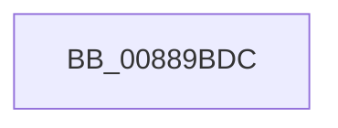

# sub_00889BDC

- RVA: `0x00889BDC`–`0x00889C50` (길이 `116` bytes)
- VA: `0x0000000140889BDC`
- 실행 섹션: `PAGE`
- PDB 이름 있음: `아니요`; PDB Function 태그: `아니요`
- unwind 정보 RVA: `0x0007CFC4`
- 디코드: `26`개 명령, `116/116` bytes 표시
- 미해석 바이트: `0` (있으면 어셈블리에 `.byte`로 보존)

> 이 문서는 커널 이미지의 기계어와 PDB 기호를 분석해 생성했습니다. 4번과 5번은 함수 원형과 자료형을 바이너리 사용 방식에서 추정한 C 해석이며 원본 소스 복구 결과는 아닙니다.

## 1. Dependencies

- 직접 호출 지점: **4**; 고유 호출 대상: **4**
- 직접 호출자로 확인된 함수: **0**
- RIP 상대 이미지 참조: **0**

### Outgoing calls
- `0x00889BE6` → [AlpcpReferenceBlob](../89/AlpcpReferenceBlob_function_00890110.md) (function, `0x00890110`)
- `0x00889BF9` → [AlpcpLockForCachedReferenceBlob](AlpcpLockForCachedReferenceBlob_function_0088A8B0.md) (function, `0x0088A8B0`)
- `0x00889C04` → [AlpcpUnlockBlob](AlpcpUnlockBlob_function_0088B990.md) (function, `0x0088B990`)
- `0x00889C11` → [AlpcpDereferenceBlobEx](AlpcpDereferenceBlobEx_function_0088AF00.md) (function, `0x0088AF00`)

### Direct callers
- 이 함수 시작 RVA로 연결되는 직접 call은 확인되지 않았습니다. 간접 호출은 완전히 역산할 수 없습니다.

### Static image references
- 디코드된 RIP-relative 메모리 참조가 없습니다.

## 2. Other-region calls and transfers

- 다른 실행 섹션으로 향하는 call: **0**
- call이 아닌 외부 분기/꼬리 이동: **1**
  - `0x00889C4E` → [sub_00889C50 + 0x7](Unknown_function_00889C50.md) (`tail-transfer`)

## 3. Assembly (complete function range)

```asm
00889BDC  48 89 6C 24 40                  mov qword ptr [rsp + 0x40], rbp
00889BE1  48 89 7C 24 48                  mov qword ptr [rsp + 0x48], rdi
00889BE6  E8 25 65 00 00                  call 0x140890110
00889BEB  48 8B 83 90 00 00 00            mov rax, qword ptr [rbx + 0x90]
00889BF2  48 8B 78 10                     mov rdi, qword ptr [rax + 0x10]
00889BF6  48 8B CF                        mov rcx, rdi
00889BF9  E8 B2 0C 00 00                  call 0x14088a8b0
00889BFE  8B 6F 30                        mov ebp, dword ptr [rdi + 0x30]
00889C01  48 8B CF                        mov rcx, rdi
00889C04  E8 87 1D 00 00                  call 0x14088b990
00889C09  BA 01 00 00 00                  mov edx, 1
00889C0E  48 8B CE                        mov rcx, rsi
00889C11  E8 EA 12 00 00                  call 0x14088af00
00889C16  81 4B 28 00 40 00 00            or dword ptr [rbx + 0x28], 0x4000
00889C1D  0F 57 C0                        xorps xmm0, xmm0
00889C20  48 8B 8B 90 00 00 00            mov rcx, qword ptr [rbx + 0x90]
00889C27  40 F6 C5 01                     test bpl, 1
00889C2B  48 8B 7C 24 48                  mov rdi, qword ptr [rsp + 0x48]
00889C30  48 8B 6C 24 40                  mov rbp, qword ptr [rsp + 0x40]
00889C35  41 0F 11 07                     movups xmmword ptr [r15], xmm0
00889C39  41 0F 11 47 10                  movups xmmword ptr [r15 + 0x10], xmm0
00889C3E  48 8B 41 28                     mov rax, qword ptr [rcx + 0x28]
00889C42  49 89 47 10                     mov qword ptr [r15 + 0x10], rax
00889C46  48 8B 41 30                     mov rax, qword ptr [rcx + 0x30]
00889C4A  49 89 47 18                     mov qword ptr [r15 + 0x18], rax
00889C4E  74 07                           je 0x140889c57
```

## 4. C-style interpretation (structured pseudocode)

```c
__int64 __fastcall sub_00889BDC(__int64 a1, __int64 a2, __int64 a3, __int64 a4, __int64 a5, __int64 a6, __int64 a7, __int64 a8, __int64 a9)
{
    __int64 result;
    unsigned __int64 v_stack_p40;
    unsigned __int64 v_stack_p48;

    v_stack_p40 = v_rbp;
    v_stack_p48 = v_rdi;
    result = AlpcpReferenceBlob(a1, a2, a3, a4);
    result = AlpcpLockForCachedReferenceBlob(*(unsigned __int64 *)(*(unsigned __int64 *)(v_rbx + 144) + 16), a2, a3, a4);
    result = AlpcpUnlockBlob(*(unsigned __int64 *)(*(unsigned __int64 *)(v_rbx + 144) + 16), a2, a3, a4);
    result = AlpcpDereferenceBlobEx(v_rsi, 1, a3, a4);
    *(unsigned __int64 *)(v_r15) = v_xmm0;
    *(unsigned __int64 *)(v_r15 + 16) = v_xmm0;
    *(unsigned __int64 *)(v_r15 + 16) = *(unsigned __int64 *)(*(unsigned __int64 *)(v_rbx + 144) + 40);
    *(unsigned __int64 *)(v_r15 + 24) = *(unsigned __int64 *)(*(unsigned __int64 *)(v_rbx + 144) + 48);
}
```

## 5. (Beta) C Style

```c
int64_t sub_00889BDC(int64_t Arg1, int64_t Arg2, int64_t Arg3, int64_t Arg4, uint64_t Arg5, uint64_t Arg6, uint64_t Arg7, int64_t Arg8, int64_t Arg9)
{
    int64_t result;
    uint64_t v_stack_p40;
    uint64_t v_stack_p48;

    v_stack_p40 = local_rbp;
    v_stack_p48 = local_rdi;
    result = AlpcpReferenceBlob(Arg1, Arg2, Arg3, Arg4);
    result = AlpcpLockForCachedReferenceBlob(*(uint64_t *)(*(uint64_t *)(local_rbx + 0x90) + 0x10), Arg2, Arg3, Arg4);
    result = AlpcpUnlockBlob(*(uint64_t *)(*(uint64_t *)(local_rbx + 0x90) + 0x10), Arg2, Arg3, Arg4);
    result = AlpcpDereferenceBlobEx(local_rsi, 1, Arg3, Arg4);
    *(uint64_t *)(local_r15) = v_xmm0;
    *(uint64_t *)(local_r15 + 0x10) = v_xmm0;
    *(uint64_t *)(local_r15 + 0x10) = *(uint64_t *)(*(uint64_t *)(local_rbx + 0x90) + 0x28);
    *(uint64_t *)(local_r15 + 0x18) = *(uint64_t *)(*(uint64_t *)(local_rbx + 0x90) + 0x30);
}
```

## 6. Execution-region graph

[열기: 2D/3D 그래프와 함수 탐색 컨트롤 패널](../../../control-panel.html?section=page&rva=0x00889BDC&view=graph)

- 2D 그래프는 위에서 아래로 흐르고, 3D 그래프는 빈 공간을 드래그해 회전합니다. Shift+드래그는 이동, 휠은 확대·축소, 함수 노드 선택은 대상 보고서 이동입니다.

### Static fallback


