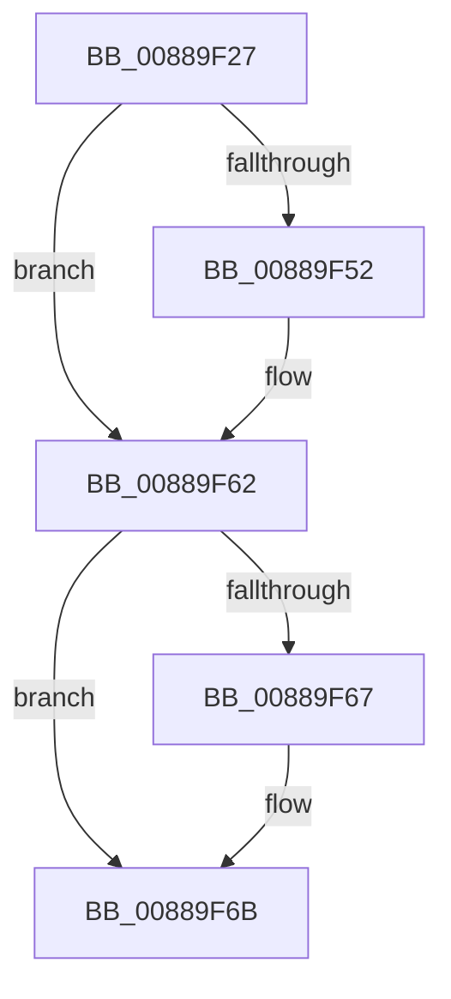

# sub_00889F27

- RVA: `0x00889F27`–`0x00889F78` (길이 `81` bytes)
- VA: `0x0000000140889F27`
- 실행 섹션: `PAGE`
- PDB 이름 있음: `아니요`; PDB Function 태그: `아니요`
- unwind 정보 RVA: `0x0007D038`
- 디코드: `23`개 명령, `81/81` bytes 표시
- 미해석 바이트: `0` (있으면 어셈블리에 `.byte`로 보존)

> 이 문서는 커널 이미지의 기계어와 PDB 기호를 분석해 생성했습니다. 4번과 5번은 함수 원형과 자료형을 바이너리 사용 방식에서 추정한 C 해석이며 원본 소스 복구 결과는 아닙니다.

## 1. Dependencies

- 직접 호출 지점: **2**; 고유 호출 대상: **2**
- 직접 호출자로 확인된 함수: **0**
- RIP 상대 이미지 참조: **0**

### Outgoing calls
- `0x00889F3A` → [KeAbPreAcquire](../../text/21/KeAbPreAcquire_function_00210230.md) (function, `0x00210230`)
- `0x00889F5D` → [ExfAcquirePushLockSharedEx](../../text/21/ExfAcquirePushLockSharedEx_function_0021044C.md) (function, `0x0021044C`)

### Direct callers
- 이 함수 시작 RVA로 연결되는 직접 call은 확인되지 않았습니다. 간접 호출은 완전히 역산할 수 없습니다.

### Static image references
- 디코드된 RIP-relative 메모리 참조가 없습니다.

## 2. Other-region calls and transfers

- 다른 실행 섹션으로 향하는 call: **2**
  - `0x00889F3A` → [KeAbPreAcquire](../../text/21/KeAbPreAcquire_function_00210230.md) (`PAGE` → `.text`)
  - `0x00889F5D` → [ExfAcquirePushLockSharedEx](../../text/21/ExfAcquirePushLockSharedEx_function_0021044C.md) (`PAGE` → `.text`)
- call이 아닌 외부 분기/꼬리 이동: **1**
  - `0x00889F76` → [sub_00889F78 + 0x15](Unknown_function_00889F78.md) (`tail-transfer`)

## 3. Assembly (complete function range)

```asm
00889F27  48 89 7C 24 60                  mov qword ptr [rsp + 0x60], rdi
00889F2C  48 8B CD                        mov rcx, rbp
00889F2F  4C 89 7C 24 68                  mov qword ptr [rsp + 0x68], r15
00889F34  33 D2                           xor edx, edx
00889F36  48 83 EE 10                     sub rsi, 0x10
00889F3A  E8 F1 62 98 FF                  call 0x140210230
00889F3F  48 8B F8                        mov rdi, rax
00889F42  41 BF 11 00 00 00               mov r15d, 0x11
00889F48  33 C0                           xor eax, eax
00889F4A  F0 4C 0F B1 7D 00               lock cmpxchg qword ptr [rbp], r15
00889F50  74 10                           je 0x140889f62
00889F52  4C 8B CD                        mov r9, rbp
00889F55  4C 8B C7                        mov r8, rdi
00889F58  33 D2                           xor edx, edx
00889F5A  48 8B CD                        mov rcx, rbp
00889F5D  E8 EA 64 98 FF                  call 0x14021044c
00889F62  48 85 FF                        test rdi, rdi
00889F65  74 04                           je 0x140889f6b
00889F67  C6 47 0A 01                     mov byte ptr [rdi + 0xa], 1
00889F6B  48 8B 7C 24 60                  mov rdi, qword ptr [rsp + 0x60]
00889F70  8B C6                           mov eax, esi
00889F72  48 3B 43 10                     cmp rax, qword ptr [rbx + 0x10]
00889F76  73 15                           jae 0x140889f8d
```

## 4. C-style interpretation (structured pseudocode)

```c
__int64 __fastcall sub_00889F27(__int64 a1, int a2, __int64 a3, __int64 a4, __int64 a5, __int64 a6, __int64 a7, __int64 a8, __int64 a9, __int64 a10, __int64 a11, __int64 a12)
{
    __int64 result;
    __int64 v_rsi;
    unsigned __int64 v_stack_p60;
    unsigned __int64 v_stack_p68;

    v_stack_p60 = v_rdi;
    v_stack_p68 = v_r15;
    a2 = 0;
    v_rsi = (v_rsi) - (16);
    result = KeAbPreAcquire(v_rbp, a2, a3, a4);
    result = 0;
    if (!(condition_is_equal)) {
        a4 = v_rbp;
        a3 = 0;
        a2 = 0;
        a1 = v_rbp;
        result = ExfAcquirePushLockSharedEx(a1, a2, a3, a4);
    }
    if (result != 0) {
        *(unsigned __int8 *)(result + 10) = 1;
    }
}
```

## 5. (Beta) C Style

```c
int64_t sub_00889F27(int64_t Arg1, int32_t Arg2, int64_t Arg3, int64_t Arg4, uint64_t Arg5, uint64_t Arg6, uint64_t Arg7, uint64_t Arg8, uint64_t Arg9, uint64_t Arg10, uint64_t Arg11, int64_t Arg12)
{
    int64_t result;
    int64_t local_rsi;
    uint64_t v_stack_p60;
    uint64_t v_stack_p68;

    v_stack_p60 = local_rdi;
    v_stack_p68 = local_r15;
    Arg2 = 0;
    local_rsi = (local_rsi) - (16);
    result = KeAbPreAcquire(local_rbp, Arg2, Arg3, Arg4);
    result = 0;
    if (!(condition_is_equal)) {
        Arg4 = local_rbp;
        Arg3 = 0;
        Arg2 = 0;
        Arg1 = local_rbp;
        result = ExfAcquirePushLockSharedEx(Arg1, Arg2, Arg3, Arg4);
    }
    if (result != 0) {
        *(uint8_t *)(result + 0xA) = 1;
    }
}
```

## 6. Execution-region graph

[열기: 2D/3D 그래프와 함수 탐색 컨트롤 패널](../../../control-panel.html?section=page&rva=0x00889F27&view=graph)

- 2D 그래프는 위에서 아래로 흐르고, 3D 그래프는 빈 공간을 드래그해 회전합니다. Shift+드래그는 이동, 휠은 확대·축소, 함수 노드 선택은 대상 보고서 이동입니다.

### Static fallback


