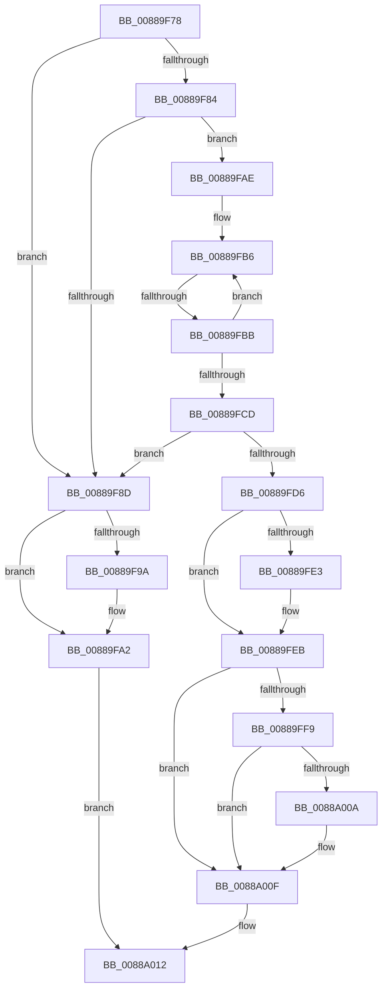

# sub_00889F78

- RVA: `0x00889F78`–`0x0088A025` (길이 `173` bytes)
- VA: `0x0000000140889F78`
- 실행 섹션: `PAGE`
- PDB 이름 있음: `아니요`; PDB Function 태그: `아니요`
- unwind 정보 RVA: `0x0007D050`
- 디코드: `53`개 명령, `173/173` bytes 표시
- 미해석 바이트: `0` (있으면 어셈블리에 `.byte`로 보존)

> 이 문서는 커널 이미지의 기계어와 PDB 기호를 분석해 생성했습니다. 4번과 5번은 함수 원형과 자료형을 바이너리 사용 방식에서 추정한 C 해석이며 원본 소스 복구 결과는 아닙니다.

## 1. Dependencies

- 직접 호출 지점: **5**; 고유 호출 대상: **3**
- 직접 호출자로 확인된 함수: **0**
- RIP 상대 이미지 참조: **0**

### Outgoing calls
- `0x00889F9D` → [ExfReleasePushLockShared](../../text/26/ExfReleasePushLockShared_function_00263440.md) (function, `0x00263440`)
- `0x00889FA5` → [KeAbPostRelease](../../text/2E/KeAbPostRelease_function_002E1600.md) (function, `0x002E1600`)
- `0x00889FE6` → [ExfReleasePushLockShared](../../text/26/ExfReleasePushLockShared_function_00263440.md) (function, `0x00263440`)
- `0x00889FEE` → [KeAbPostRelease](../../text/2E/KeAbPostRelease_function_002E1600.md) (function, `0x002E1600`)
- `0x0088A00A` → [ExfAcquireReleasePushLockExclusive](../../text/41/ExfAcquireReleasePushLockExclusive_function_00419C2C.md) (function, `0x00419C2C`)

### Direct callers
- 이 함수 시작 RVA로 연결되는 직접 call은 확인되지 않았습니다. 간접 호출은 완전히 역산할 수 없습니다.

### Static image references
- 디코드된 RIP-relative 메모리 참조가 없습니다.

## 2. Other-region calls and transfers

- 다른 실행 섹션으로 향하는 call: **5**
  - `0x00889F9D` → [ExfReleasePushLockShared](../../text/26/ExfReleasePushLockShared_function_00263440.md) (`PAGE` → `.text`)
  - `0x00889FA5` → [KeAbPostRelease](../../text/2E/KeAbPostRelease_function_002E1600.md) (`PAGE` → `.text`)
  - `0x00889FE6` → [ExfReleasePushLockShared](../../text/26/ExfReleasePushLockShared_function_00263440.md) (`PAGE` → `.text`)
  - `0x00889FEE` → [KeAbPostRelease](../../text/2E/KeAbPostRelease_function_002E1600.md) (`PAGE` → `.text`)
  - `0x0088A00A` → [ExfAcquireReleasePushLockExclusive](../../text/41/ExfAcquireReleasePushLockExclusive_function_00419C2C.md) (`PAGE` → `.text`)
- call이 아닌 외부 분기/꼬리 이동: **1**
  - `0x00889FB9` → [sub_0088A032](Unknown_function_0088A032.md) (`tail-transfer`)

## 3. Assembly (complete function range)

```asm
00889F78  48 8B 1B                        mov rbx, qword ptr [rbx]
00889F7B  48 8B 1C C3                     mov rbx, qword ptr [rbx + rax*8]
00889F7F  48 85 DB                        test rbx, rbx
00889F82  74 09                           je 0x140889f8d
00889F84  0F B6 43 E1                     movzx eax, byte ptr [rbx - 0x1f]
00889F88  41 3B 06                        cmp eax, dword ptr [r14]
00889F8B  74 21                           je 0x140889fae
00889F8D  33 C9                           xor ecx, ecx
00889F8F  49 8B C7                        mov rax, r15
00889F92  F0 48 0F B1 4D 00               lock cmpxchg qword ptr [rbp], rcx
00889F98  74 08                           je 0x140889fa2
00889F9A  48 8B CD                        mov rcx, rbp
00889F9D  E8 9E 94 9D FF                  call 0x140263440
00889FA2  48 8B CD                        mov rcx, rbp
00889FA5  E8 56 76 A5 FF                  call 0x1402e1600
00889FAA  33 C0                           xor eax, eax
00889FAC  EB 64                           jmp 0x14088a012
00889FAE  0F 0D 4B E8                     prefetchw byte ptr [rbx - 0x18]
00889FB2  48 8B 43 E8                     mov rax, qword ptr [rbx - 0x18]
00889FB6  48 85 C0                        test rax, rax
00889FB9  7E 77                           jle 0x14088a032
00889FBB  48 8B D0                        mov rdx, rax
00889FBE  48 8D 48 01                     lea rcx, [rax + 1]
00889FC2  F0 48 0F B1 4B E8               lock cmpxchg qword ptr [rbx - 0x18], rcx
00889FC8  48 3B C2                        cmp rax, rdx
00889FCB  75 E9                           jne 0x140889fb6
00889FCD  48 8D 48 01                     lea rcx, [rax + 1]
00889FD1  48 85 C9                        test rcx, rcx
00889FD4  74 B7                           je 0x140889f8d
00889FD6  33 C9                           xor ecx, ecx
00889FD8  49 8B C7                        mov rax, r15
00889FDB  F0 48 0F B1 4D 00               lock cmpxchg qword ptr [rbp], rcx
00889FE1  74 08                           je 0x140889feb
00889FE3  48 8B CD                        mov rcx, rbp
00889FE6  E8 55 94 9D FF                  call 0x140263440
00889FEB  48 8B CD                        mov rcx, rbp
00889FEE  E8 0D 76 A5 FF                  call 0x1402e1600
00889FF3  F6 43 E0 04                     test byte ptr [rbx - 0x20], 4
00889FF7  74 16                           je 0x14088a00f
00889FF9  48 8D 4B F0                     lea rcx, [rbx - 0x10]
00889FFD  F0 83 0C 24 00                  lock or dword ptr [rsp], 0
0088A002  48 8B 11                        mov rdx, qword ptr [rcx]
0088A005  F6 C2 01                        test dl, 1
0088A008  74 05                           je 0x14088a00f
0088A00A  E8 1D FC B8 FF                  call 0x140419c2c
0088A00F  48 8B C3                        mov rax, rbx
0088A012  48 8B 6C 24 58                  mov rbp, qword ptr [rsp + 0x58]
0088A017  4C 8B 7C 24 68                  mov r15, qword ptr [rsp + 0x68]
0088A01C  48 83 C4 30                     add rsp, 0x30
0088A020  41 5E                           pop r14
0088A022  5E                              pop rsi
0088A023  5B                              pop rbx
0088A024  C3                              ret
```

## 4. C-style interpretation (structured pseudocode)

```c
__int64 __fastcall sub_00889F78(int a1, __int64 a2, __int64 a3, __int64 a4, __int64 a5, __int64 a6, __int64 a7, __int64 a8, __int64 a9, __int64 a10, __int64 a11, __int64 a12, __int64 a13)
{
    __int64 result;
    __int64 v_rsp;
    unsigned int v_stack_p0;

    if (*(unsigned __int64 *)(*(unsigned __int64 *)(v_rbx) + result * 8) == 0) goto loc_00889F8D;
    if (((unsigned int)(*(unsigned __int8 *)(*(unsigned __int64 *)(*(unsigned __int64 *)(v_rbx) + result * 8) - 31))) == (*(unsigned int *)(v_r14))) goto loc_00889FAE;
loc_00889F8D:
    a1 = 0;
    result = v_r15;
    if (!(condition_is_equal)) {
        a1 = v_rbp;
        result = ExfReleasePushLockShared(a1, a2, a3, a4);
    }
    result = KeAbPostRelease(v_rbp, a2, a3, a4);
    result = 0;
    goto loc_0088A012;
loc_00889FAE:
loc_00889FB6:
    if ((*(unsigned __int64 *)(*(unsigned __int64 *)(*(unsigned __int64 *)(v_rbx) + result * 8) - 24)) != (*(unsigned __int64 *)(*(unsigned __int64 *)(*(unsigned __int64 *)(v_rbx) + result * 8) - 24))) goto loc_00889FB6;
    if (*(unsigned __int64 *)(*(unsigned __int64 *)(*(unsigned __int64 *)(v_rbx) + result * 8) - 24) + 1 == 0) goto loc_00889F8D;
    a1 = 0;
    result = v_r15;
    if (!(condition_is_equal)) {
        a1 = v_rbp;
        result = ExfReleasePushLockShared(a1, *(unsigned __int64 *)(*(unsigned __int64 *)(*(unsigned __int64 *)(v_rbx) + result * 8) - 24), a3, a4);
    }
    result = KeAbPostRelease(v_rbp, *(unsigned __int64 *)(*(unsigned __int64 *)(*(unsigned __int64 *)(v_rbx) + result * 8) - 24), a3, a4);
    if (((*(unsigned __int8 *)(*(unsigned __int64 *)(*(unsigned __int64 *)(v_rbx) + result * 8) - 32)) & (4)) == 0) goto loc_0088A00F;
    if ((((unsigned __int8)(*(unsigned __int64 *)(*(unsigned __int64 *)(*(unsigned __int64 *)(v_rbx) + result * 8) - 16))) & (1)) != 0) {
        result = ExfAcquireReleasePushLockExclusive(*(unsigned __int64 *)(*(unsigned __int64 *)(v_rbx) + result * 8) - 16, *(unsigned __int64 *)(*(unsigned __int64 *)(*(unsigned __int64 *)(v_rbx) + result * 8) - 16), a3, a4);
    }
loc_0088A012:
    v_rsp = (v_rsp) + (48);
    return *(unsigned __int64 *)(*(unsigned __int64 *)(v_rbx) + result * 8);
}
```

## 5. (Beta) C Style

```c
int64_t sub_00889F78(int32_t Arg1, int64_t Arg2, int64_t Arg3, int64_t Arg4, uint64_t Arg5, uint64_t Arg6, uint64_t Arg7, uint64_t Arg8, uint64_t Arg9, uint64_t Arg10, int64_t Arg11, uint64_t Arg12, int64_t Arg13)
{
    int64_t result;
    int64_t local_rsp;
    uint32_t v_stack_p0;

    if (*(uint64_t *)(*(uint64_t *)(local_rbx) + result * 8) == 0) goto loc_00889F8D;
    if (((uint32_t)(*(uint8_t *)(*(uint64_t *)(*(uint64_t *)(local_rbx) + result * 8) - 0x1F))) == (*(uint32_t *)(local_r14))) goto loc_00889FAE;
loc_00889F8D:
    Arg1 = 0;
    result = local_r15;
    if (!(condition_is_equal)) {
        Arg1 = local_rbp;
        result = ExfReleasePushLockShared(Arg1, Arg2, Arg3, Arg4);
    }
    result = KeAbPostRelease(local_rbp, Arg2, Arg3, Arg4);
    result = 0;
    goto loc_0088A012;
loc_00889FAE:
loc_00889FB6:
    if ((*(uint64_t *)(*(uint64_t *)(*(uint64_t *)(local_rbx) + result * 8) - 0x18)) != (*(uint64_t *)(*(uint64_t *)(*(uint64_t *)(local_rbx) + result * 8) - 0x18))) goto loc_00889FB6;
    if (*(uint64_t *)(*(uint64_t *)(*(uint64_t *)(local_rbx) + result * 8) - 0x18) + 1 == 0) goto loc_00889F8D;
    Arg1 = 0;
    result = local_r15;
    if (!(condition_is_equal)) {
        Arg1 = local_rbp;
        result = ExfReleasePushLockShared(Arg1, *(uint64_t *)(*(uint64_t *)(*(uint64_t *)(local_rbx) + result * 8) - 0x18), Arg3, Arg4);
    }
    result = KeAbPostRelease(local_rbp, *(uint64_t *)(*(uint64_t *)(*(uint64_t *)(local_rbx) + result * 8) - 0x18), Arg3, Arg4);
    if (((*(uint8_t *)(*(uint64_t *)(*(uint64_t *)(local_rbx) + result * 8) - 0x20)) & (4)) == 0) goto loc_0088A00F;
    if ((((uint8_t)(*(uint64_t *)(*(uint64_t *)(*(uint64_t *)(local_rbx) + result * 8) - 0x10))) & (1)) != 0) {
        result = ExfAcquireReleasePushLockExclusive(*(uint64_t *)(*(uint64_t *)(local_rbx) + result * 8) - 16, *(uint64_t *)(*(uint64_t *)(*(uint64_t *)(local_rbx) + result * 8) - 0x10), Arg3, Arg4);
    }
loc_0088A012:
    local_rsp = (local_rsp) + (48);
    return *(uint64_t *)(*(uint64_t *)(local_rbx) + result * 8);
}
```

## 6. Execution-region graph

[열기: 2D/3D 그래프와 함수 탐색 컨트롤 패널](../../../control-panel.html?section=page&rva=0x00889F78&view=graph)

- 2D 그래프는 위에서 아래로 흐르고, 3D 그래프는 빈 공간을 드래그해 회전합니다. Shift+드래그는 이동, 휠은 확대·축소, 함수 노드 선택은 대상 보고서 이동입니다.

### Static fallback


