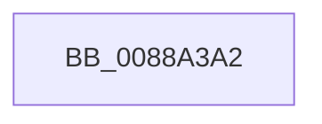

# sub_0088A3A2

- RVA: `0x0088A3A2`–`0x0088A3C7` (길이 `37` bytes)
- VA: `0x000000014088A3A2`
- 실행 섹션: `PAGE`
- PDB 이름 있음: `아니요`; PDB Function 태그: `아니요`
- unwind 정보 RVA: `0x0007D0AC`
- 디코드: `9`개 명령, `37/37` bytes 표시
- 미해석 바이트: `0` (있으면 어셈블리에 `.byte`로 보존)

> 이 문서는 커널 이미지의 기계어와 PDB 기호를 분석해 생성했습니다. 4번과 5번은 함수 원형과 자료형을 바이너리 사용 방식에서 추정한 C 해석이며 원본 소스 복구 결과는 아닙니다.

## 1. Dependencies

- 직접 호출 지점: **2**; 고유 호출 대상: **2**
- 직접 호출자로 확인된 함수: **0**
- RIP 상대 이미지 참조: **0**

### Outgoing calls
- `0x0088A3AA` → [MiUnmapViewOfSection](MiUnmapViewOfSection_function_0088A4C4.md) (function, `0x0088A4C4`)
- `0x0088A3BB` → [ObfDereferenceObjectWithTag](../../text/2F/ObfDereferenceObjectWithTag_function_002F78E0.md) (function, `0x002F78E0`)

### Direct callers
- 이 함수 시작 RVA로 연결되는 직접 call은 확인되지 않았습니다. 간접 호출은 완전히 역산할 수 없습니다.

### Static image references
- 디코드된 RIP-relative 메모리 참조가 없습니다.

## 2. Other-region calls and transfers

- 다른 실행 섹션으로 향하는 call: **1**
  - `0x0088A3BB` → [ObfDereferenceObjectWithTag](../../text/2F/ObfDereferenceObjectWithTag_function_002F78E0.md) (`PAGE` → `.text`)
- 별도 외부 분기/꼬리 이동을 확인하지 못했습니다.

## 3. Assembly (complete function range)

```asm
0088A3A2  48 89 7C 24 50                  mov qword ptr [rsp + 0x50], rdi
0088A3A7  48 8B D3                        mov rdx, rbx
0088A3AA  E8 15 01 00 00                  call 0x14088a4c4
0088A3AF  48 8B 4C 24 60                  mov rcx, qword ptr [rsp + 0x60]
0088A3B4  BA 4D 6D 56 77                  mov edx, 0x77566d4d
0088A3B9  8B F8                           mov edi, eax
0088A3BB  E8 20 D5 A6 FF                  call 0x1402f78e0
0088A3C0  8B C7                           mov eax, edi
0088A3C2  48 8B 7C 24 50                  mov rdi, qword ptr [rsp + 0x50]
```

## 4. C-style interpretation (structured pseudocode)

```c
__int64 __fastcall sub_0088A3A2(__int64 a1, __int64 a2, __int64 a3, __int64 a4, __int64 a5, __int64 a6, __int64 a7, __int64 a8, __int64 a9, __int64 a10, __int64 a11, __int64 a12)
{
    __int64 result;
    unsigned __int64 v_stack_p50;

    v_stack_p50 = v_rdi;
    result = MiUnmapViewOfSection(a1, v_rbx, a3, a4);
    result = ObfDereferenceObjectWithTag(a12, (unsigned int)(0x77566D4DULL), a3, a4);
    return (unsigned int)((unsigned int)((unsigned int)((unsigned int)(result))));
}
```

## 5. (Beta) C Style

```c
int64_t sub_0088A3A2(int64_t Arg1, int64_t Arg2, int64_t Arg3, int64_t Arg4, uint64_t Arg5, uint64_t Arg6, uint64_t Arg7, uint64_t Arg8, uint64_t Arg9, int64_t Arg10, uint64_t Arg11, int64_t Arg12)
{
    int64_t result;
    uint64_t v_stack_p50;

    v_stack_p50 = local_rdi;
    result = MiUnmapViewOfSection(Arg1, local_rbx, Arg3, Arg4);
    result = ObfDereferenceObjectWithTag(Arg12, (uint32_t)(0x77566D4DULL), Arg3, Arg4);
    return (uint32_t)((uint32_t)((uint32_t)((uint32_t)(result))));
}
```

## 6. Execution-region graph

[열기: 2D/3D 그래프와 함수 탐색 컨트롤 패널](../../../control-panel.html?section=page&rva=0x0088A3A2&view=graph)

- 2D 그래프는 위에서 아래로 흐르고, 3D 그래프는 빈 공간을 드래그해 회전합니다. Shift+드래그는 이동, 휠은 확대·축소, 함수 노드 선택은 대상 보고서 이동입니다.

### Static fallback


