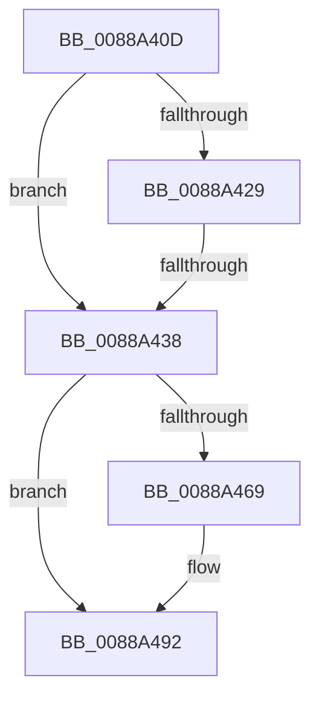

# sub_0088A40D

- RVA: `0x0088A40D`–`0x0088A4A2` (길이 `149` bytes)
- VA: `0x000000014088A40D`
- 실행 섹션: `PAGE`
- PDB 이름 있음: `아니요`; PDB Function 태그: `아니요`
- unwind 정보 RVA: `0x0007D0E0`
- 디코드: `36`개 명령, `149/149` bytes 표시
- 미해석 바이트: `0` (있으면 어셈블리에 `.byte`로 보존)

> 이 문서는 커널 이미지의 기계어와 PDB 기호를 분석해 생성했습니다. 4번과 5번은 함수 원형과 자료형을 바이너리 사용 방식에서 추정한 C 해석이며 원본 소스 복구 결과는 아닙니다.

## 1. Dependencies

- 직접 호출 지점: **3**; 고유 호출 대상: **3**
- 직접 호출자로 확인된 함수: **0**
- RIP 상대 이미지 참조: **1**

### Outgoing calls
- `0x0088A460` → [ObpReferenceObjectByHandleWithTag](../86/ObpReferenceObjectByHandleWithTag_function_00869650.md) (function, `0x00869650`)
- `0x0088A47A` → [MiUnmapViewOfSection](MiUnmapViewOfSection_function_0088A4C4.md) (function, `0x0088A4C4`)
- `0x0088A48B` → [ObfDereferenceObjectWithTag](../../text/2F/ObfDereferenceObjectWithTag_function_002F78E0.md) (function, `0x002F78E0`)

### Direct callers
- 이 함수 시작 RVA로 연결되는 직접 call은 확인되지 않았습니다. 간접 호출은 완전히 역산할 수 없습니다.

### Static image references
- `0x0088A438` → RVA `0x00FC6A98` (`ALMOSTRO`; read)

## 2. Other-region calls and transfers

- 다른 실행 섹션으로 향하는 call: **1**
  - `0x0088A48B` → [ObfDereferenceObjectWithTag](../../text/2F/ObfDereferenceObjectWithTag_function_002F78E0.md) (`PAGE` → `.text`)
- call이 아닌 외부 분기/꼬리 이동: **1**
  - `0x0088A436` → [sub_0088A4B4](Unknown_function_0088A4B4.md) (`tail-transfer`)

## 3. Assembly (complete function range)

```asm
0088A40D  48 89 5C 24 50                  mov qword ptr [rsp + 0x50], rbx
0088A412  41 8B D8                        mov ebx, r8d
0088A415  83 E3 02                        and ebx, 2
0088A418  C1 E3 19                        shl ebx, 0x19
0088A41B  44 0F B6 88 32 02 00 00         movzx r9d, byte ptr [rax + 0x232]
0088A423  41 80 F9 01                     cmp r9b, 1
0088A427  75 0F                           jne 0x14088a438
0088A429  48 B8 FF FF FE FF FF 7F 00 00   movabs rax, 0x7ffffffeffff
0088A433  48 3B F0                        cmp rsi, rax
0088A436  77 7C                           ja 0x14088a4b4
0088A438  4C 8B 05 59 C6 73 00            mov r8, qword ptr [rip + 0x73c659]
0088A43F  48 8D 44 24 68                  lea rax, [rsp + 0x68]
0088A444  48 89 54 24 38                  mov qword ptr [rsp + 0x38], rdx
0088A449  48 89 54 24 30                  mov qword ptr [rsp + 0x30], rdx
0088A44E  BA 08 00 00 00                  mov edx, 8
0088A453  48 89 44 24 28                  mov qword ptr [rsp + 0x28], rax
0088A458  C7 44 24 20 4D 6D 56 77         mov dword ptr [rsp + 0x20], 0x77566d4d
0088A460  E8 EB F1 FD FF                  call 0x140869650
0088A465  85 C0                           test eax, eax
0088A467  78 29                           js 0x14088a492
0088A469  48 8B 4C 24 68                  mov rcx, qword ptr [rsp + 0x68]
0088A46E  83 E7 01                        and edi, 1
0088A471  44 8B C7                        mov r8d, edi
0088A474  44 8B CB                        mov r9d, ebx
0088A477  48 8B D6                        mov rdx, rsi
0088A47A  E8 45 00 00 00                  call 0x14088a4c4
0088A47F  48 8B 4C 24 68                  mov rcx, qword ptr [rsp + 0x68]
0088A484  BA 4D 6D 56 77                  mov edx, 0x77566d4d
0088A489  8B D8                           mov ebx, eax
0088A48B  E8 50 D4 A6 FF                  call 0x1402f78e0
0088A490  8B C3                           mov eax, ebx
0088A492  48 8B 5C 24 50                  mov rbx, qword ptr [rsp + 0x50]
0088A497  48 8B 74 24 58                  mov rsi, qword ptr [rsp + 0x58]
0088A49C  48 83 C4 40                     add rsp, 0x40
0088A4A0  5F                              pop rdi
0088A4A1  C3                              ret
```

## 4. C-style interpretation (structured pseudocode)

```c
__int64 __fastcall sub_0088A40D(__int64 a1, __int64 a2, int a3, __int64 a4, __int64 a5, __int64 a6, __int64 a7, __int64 a8, __int64 a9, __int64 a10, __int64 a11, __int64 a12, __int64 a13)
{
    __int64 result;
    __int64 v_rbx;
    __int64 v_rdi;
    __int64 v_rsp;
    unsigned int v_stack_p20;
    unsigned __int64 v_stack_p28;
    unsigned __int64 v_stack_p30;
    unsigned __int64 v_stack_p38;
    unsigned __int64 v_stack_p50;

    v_stack_p50 = v_rbx;
    v_rbx = (unsigned int)(((unsigned int)(a3)) & (2));
    v_rbx = (unsigned int)((v_rbx) << (25));
    if (((unsigned __int8)(*(unsigned __int8 *)(result + 562))) != 1) goto loc_0088A438;
loc_0088A438:
    v_stack_p38 = a2;
    v_stack_p30 = a2;
    v_stack_p28 = a13;
    v_stack_p20 = 0x77566D4DULL;
    result = ObpReferenceObjectByHandleWithTag(a1, 8, *(unsigned __int64 *)(v_rip + 7587417), *(unsigned __int8 *)(result + 562));
    if (!(sign_flag)) {
        a1 = a13;
        v_rdi = (unsigned int)((v_rdi) & (1));
        a3 = (unsigned int)(v_rdi);
        a4 = (unsigned int)(v_rbx);
        a2 = v_rsi;
        result = MiUnmapViewOfSection(a1, a2, a3, a4);
        a1 = a13;
        a2 = 0x77566D4DULL;
        v_rbx = (unsigned int)(result);
        result = ObfDereferenceObjectWithTag(a1, a2, a3, a4);
        result = (unsigned int)(v_rbx);
    }
    v_rsp = (v_rsp) + (64);
    return result;
}
```

## 5. (Beta) C Style

```c
int64_t sub_0088A40D(int64_t Arg1, int64_t Arg2, int32_t Arg3, int64_t Arg4, uint64_t Arg5, uint64_t Arg6, uint64_t Arg7, uint64_t Arg8, uint64_t Arg9, int64_t Arg10, int64_t Arg11, uint64_t Arg12, int64_t Arg13)
{
    int64_t result;
    int64_t local_rbx;
    int64_t local_rdi;
    int64_t local_rsp;
    uint32_t v_stack_p20;
    uint64_t v_stack_p28;
    uint64_t v_stack_p30;
    uint64_t v_stack_p38;
    uint64_t v_stack_p50;

    v_stack_p50 = local_rbx;
    local_rbx = (uint32_t)(((uint32_t)(Arg3)) & (2));
    local_rbx = (uint32_t)((local_rbx) << (25));
    if (((uint8_t)(*(uint8_t *)(result + 0x232))) != 1) goto loc_0088A438;
loc_0088A438:
    v_stack_p38 = Arg2;
    v_stack_p30 = Arg2;
    v_stack_p28 = Arg13;
    v_stack_p20 = 0x77566D4DULL;
    result = ObpReferenceObjectByHandleWithTag(Arg1, 8, *(uint64_t *)(v_rip + 0x73C659), *(uint8_t *)(result + 0x232));
    if (!(sign_flag)) {
        Arg1 = Arg13;
        local_rdi = (uint32_t)((local_rdi) & (1));
        Arg3 = (uint32_t)(local_rdi);
        Arg4 = (uint32_t)(local_rbx);
        Arg2 = local_rsi;
        result = MiUnmapViewOfSection(Arg1, Arg2, Arg3, Arg4);
        Arg1 = Arg13;
        Arg2 = 0x77566D4DULL;
        local_rbx = (uint32_t)(result);
        result = ObfDereferenceObjectWithTag(Arg1, Arg2, Arg3, Arg4);
        result = (uint32_t)(local_rbx);
    }
    local_rsp = (local_rsp) + (64);
    return result;
}
```

## 6. Execution-region graph

[열기: 2D/3D 그래프와 함수 탐색 컨트롤 패널](../../../control-panel.html?section=page&rva=0x0088A40D&view=graph)

- 2D 그래프는 위에서 아래로 흐르고, 3D 그래프는 빈 공간을 드래그해 회전합니다. Shift+드래그는 이동, 휠은 확대·축소, 함수 노드 선택은 대상 보고서 이동입니다.

### Static fallback


