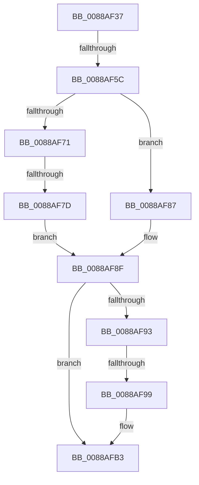

# sub_0088AF37

- RVA: `0x0088AF37`–`0x0088AFC2` (길이 `139` bytes)
- VA: `0x000000014088AF37`
- 실행 섹션: `PAGE`
- PDB 이름 있음: `아니요`; PDB Function 태그: `아니요`
- unwind 정보 RVA: `0x0007D180`
- 디코드: `34`개 명령, `139/139` bytes 표시
- 미해석 바이트: `0` (있으면 어셈블리에 `.byte`로 보존)

> 이 문서는 커널 이미지의 기계어와 PDB 기호를 분석해 생성했습니다. 4번과 5번은 함수 원형과 자료형을 바이너리 사용 방식에서 추정한 C 해석이며 원본 소스 복구 결과는 아닙니다.

## 1. Dependencies

- 직접 호출 지점: **4**; 고유 호출 대상: **4**
- 직접 호출자로 확인된 함수: **0**
- RIP 상대 이미지 참조: **4**

### Outgoing calls
- `0x0088AF5C` → [AlpcMessageCleanupProcedure](AlpcMessageCleanupProcedure_function_0088BBA0.md) (function, `0x0088BBA0`)
- `0x0088AF80` → [AlpcSecurityDestroyProcedure](AlpcSecurityDestroyProcedure_function_0088B330.md) (function, `0x0088B330`)
- `0x0088AF8A` → [AlpcMessageDestroyProcedure](AlpcMessageDestroyProcedure_function_0088B500.md) (function, `0x0088B500`)
- `0x0088AFAE` → [ExFreeToPagedLookasideList](../../text/38/ExFreeToPagedLookasideList_function_00387D30.md) (function, `0x00387D30`)

### Direct callers
- 이 함수 시작 RVA로 연결되는 직접 call은 확인되지 않았습니다. 간접 호출은 완전히 역산할 수 없습니다.

### Static image references
- `0x0088AF3C` → RVA `0x00001450` (`.rdata`; read)
- `0x0088AF65` → RVA `0x0088B500` (`AlpcMessageDestroyProcedure`; read)
- `0x0088AF71` → RVA `0x0088B330` (`AlpcSecurityDestroyProcedure`; read)
- `0x0088AF9C` → RVA `0x00E27180` (`.data`; read)

## 2. Other-region calls and transfers

- 다른 실행 섹션으로 향하는 call: **1**
  - `0x0088AFAE` → [ExFreeToPagedLookasideList](../../text/38/ExFreeToPagedLookasideList_function_00387D30.md) (`PAGE` → `.text`)
- call이 아닌 외부 분기/꼬리 이동: **4**
  - `0x0088AF56` → [sub_0088B031](Unknown_function_0088B031.md) (`tail-transfer`)
  - `0x0088AF7B` → [sub_0088AFE4](Unknown_function_0088AFE4.md) (`tail-transfer`)
  - `0x0088AF97` → [sub_0088AFC2](Unknown_function_0088AFC2.md) (`tail-transfer`)
  - `0x0088AFBD` → [AlpcpDereferenceBlobEx + 0x1F](AlpcpDereferenceBlobEx_function_0088AF00.md) (`tail-transfer`)

## 3. Assembly (complete function range)

```asm
0088AF37  48 89 74 24 40                  mov qword ptr [rsp + 0x40], rsi
0088AF3C  48 8D 35 0D 65 77 FF            lea rsi, [rip - 0x889af3]
0088AF43  48 89 7C 24 48                  mov qword ptr [rsp + 0x48], rdi
0088AF48  48 8B 34 C6                     mov rsi, qword ptr [rsi + rax*8]
0088AF4C  48 8B 46 18                     mov rax, qword ptr [rsi + 0x18]
0088AF50  48 3B C1                        cmp rax, rcx
0088AF53  48 8B CB                        mov rcx, rbx
0088AF56  0F 85 D5 00 00 00               jne 0x14088b031
0088AF5C  E8 3F 0C 00 00                  call 0x14088bba0
0088AF61  48 8B 46 28                     mov rax, qword ptr [rsi + 0x28]
0088AF65  48 8D 0D 94 05 00 00            lea rcx, [rip + 0x594]
0088AF6C  48 3B C1                        cmp rax, rcx
0088AF6F  74 16                           je 0x14088af87
0088AF71  48 8D 0D B8 03 00 00            lea rcx, [rip + 0x3b8]
0088AF78  48 3B C1                        cmp rax, rcx
0088AF7B  75 67                           jne 0x14088afe4
0088AF7D  48 8B CB                        mov rcx, rbx
0088AF80  E8 AB 03 00 00                  call 0x14088b330
0088AF85  EB 08                           jmp 0x14088af8f
0088AF87  48 8B CB                        mov rcx, rbx
0088AF8A  E8 71 05 00 00                  call 0x14088b500
0088AF8F  85 C0                           test eax, eax
0088AF91  78 20                           js 0x14088afb3
0088AF93  F6 43 E0 02                     test byte ptr [rbx - 0x20], 2
0088AF97  74 29                           je 0x14088afc2
0088AF99  8B 4E 08                        mov ecx, dword ptr [rsi + 8]
0088AF9C  48 8D 15 DD C1 59 00            lea rdx, [rip + 0x59c1dd]
0088AFA3  48 C1 E1 07                     shl rcx, 7
0088AFA7  48 03 CA                        add rcx, rdx
0088AFAA  48 8D 53 D0                     lea rdx, [rbx - 0x30]
0088AFAE  E8 7D CD AF FF                  call 0x140387d30
0088AFB3  48 8B 74 24 40                  mov rsi, qword ptr [rsp + 0x40]
0088AFB8  48 8B 7C 24 48                  mov rdi, qword ptr [rsp + 0x48]
0088AFBD  E9 5D FF FF FF                  jmp 0x14088af1f
```

## 4. C-style interpretation (structured pseudocode)

```c
__int64 __fastcall sub_0088AF37(__int64 a1, __int64 a2, __int64 a3, __int64 a4, __int64 a5, __int64 a6, __int64 a7, __int64 a8, __int64 a9)
{
    __int64 result;
    unsigned __int64 v_stack_p40;
    unsigned __int64 v_stack_p48;

    v_stack_p40 = v_rsi;
    v_stack_p48 = v_rdi;
    result = AlpcMessageCleanupProcedure(v_rbx, a2, a3, a4);
    if ((*(unsigned __int64 *)(*(unsigned __int64 *)(v_rip - 8952563 + result * 8) + 40)) == (v_rip + 1428)) goto loc_0088AF87;
    result = AlpcSecurityDestroyProcedure(v_rbx, a2, a3, a4);
    goto loc_0088AF8F;
loc_0088AF87:
    result = AlpcMessageDestroyProcedure(v_rbx, a2, a3, a4);
loc_0088AF8F:
    if (sign_flag) goto loc_0088AFB3;
    a1 = ((unsigned int)(*(unsigned int *)(*(unsigned __int64 *)(v_rip - 8952563 + result * 8) + 8))) << (7);
    a1 = (a1) + (v_rip + 5882333);
    result = ExFreeToPagedLookasideList(a1, v_rbx - 48, a3, a4);
loc_0088AFB3:
}
```

## 5. (Beta) C Style

```c
int64_t sub_0088AF37(int64_t Arg1, int64_t Arg2, int64_t Arg3, int64_t Arg4, uint64_t Arg5, uint64_t Arg6, uint64_t Arg7, int64_t Arg8, int64_t Arg9)
{
    int64_t result;
    uint64_t v_stack_p40;
    uint64_t v_stack_p48;

    v_stack_p40 = local_rsi;
    v_stack_p48 = local_rdi;
    result = AlpcMessageCleanupProcedure(local_rbx, Arg2, Arg3, Arg4);
    if ((*(uint64_t *)(*(uint64_t *)(v_rip - 0x889AF3 + result * 8) + 0x28)) == (v_rip + 1428)) goto loc_0088AF87;
    result = AlpcSecurityDestroyProcedure(local_rbx, Arg2, Arg3, Arg4);
    goto loc_0088AF8F;
loc_0088AF87:
    result = AlpcMessageDestroyProcedure(local_rbx, Arg2, Arg3, Arg4);
loc_0088AF8F:
    if (sign_flag) goto loc_0088AFB3;
    Arg1 = ((uint32_t)(*(uint32_t *)(*(uint64_t *)(v_rip - 0x889AF3 + result * 8) + 0x8))) << (7);
    Arg1 = (Arg1) + (v_rip + 5882333);
    result = ExFreeToPagedLookasideList(Arg1, local_rbx - 48, Arg3, Arg4);
loc_0088AFB3:
}
```

## 6. Execution-region graph

[열기: 2D/3D 그래프와 함수 탐색 컨트롤 패널](../../../control-panel.html?section=page&rva=0x0088AF37&view=graph)

- 2D 그래프는 위에서 아래로 흐르고, 3D 그래프는 빈 공간을 드래그해 회전합니다. Shift+드래그는 이동, 휠은 확대·축소, 함수 노드 선택은 대상 보고서 이동입니다.

### Static fallback


