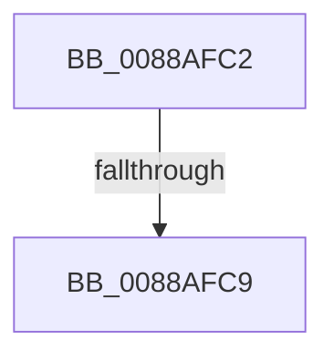

# sub_0088AFC2

- RVA: `0x0088AFC2`–`0x0088AFE4` (길이 `34` bytes)
- VA: `0x000000014088AFC2`
- 실행 섹션: `PAGE`
- PDB 이름 있음: `아니요`; PDB Function 태그: `아니요`
- unwind 정보 RVA: `0x0007D198`
- 디코드: `8`개 명령, `34/34` bytes 표시
- 미해석 바이트: `0` (있으면 어셈블리에 `.byte`로 보존)

> 이 문서는 커널 이미지의 기계어와 PDB 기호를 분석해 생성했습니다. 4번과 5번은 함수 원형과 자료형을 바이너리 사용 방식에서 추정한 C 해석이며 원본 소스 복구 결과는 아닙니다.

## 1. Dependencies

- 직접 호출 지점: **1**; 고유 호출 대상: **1**
- 직접 호출자로 확인된 함수: **0**
- RIP 상대 이미지 참조: **0**

### Outgoing calls
- `0x0088AFD0` → [ExFreePoolWithTag](../../poolcode/B8/ExFreePoolWithTag_function_00B82870.md) (function, `0x00B82870`)

### Direct callers
- 이 함수 시작 RVA로 연결되는 직접 call은 확인되지 않았습니다. 간접 호출은 완전히 역산할 수 없습니다.

### Static image references
- 디코드된 RIP-relative 메모리 참조가 없습니다.

## 2. Other-region calls and transfers

- 다른 실행 섹션으로 향하는 call: **1**
  - `0x0088AFD0` → [ExFreePoolWithTag](../../poolcode/B8/ExFreePoolWithTag_function_00B82870.md) (`PAGE` → `POOLCODE`)
- call이 아닌 외부 분기/꼬리 이동: **2**
  - `0x0088AFC7` → [sub_0088AFE4 + 0x16](Unknown_function_0088AFE4.md) (`tail-transfer`)
  - `0x0088AFDF` → [AlpcpDereferenceBlobEx + 0x1F](AlpcpDereferenceBlobEx_function_0088AF00.md) (`tail-transfer`)

## 3. Assembly (complete function range)

```asm
0088AFC2  48 83 7E 30 00                  cmp qword ptr [rsi + 0x30], 0
0088AFC7  77 31                           ja 0x14088affa
0088AFC9  8B 56 04                        mov edx, dword ptr [rsi + 4]
0088AFCC  48 8D 4B D0                     lea rcx, [rbx - 0x30]
0088AFD0  E8 9B 78 2F 00                  call 0x140b82870
0088AFD5  48 8B 74 24 40                  mov rsi, qword ptr [rsp + 0x40]
0088AFDA  48 8B 7C 24 48                  mov rdi, qword ptr [rsp + 0x48]
0088AFDF  E9 3B FF FF FF                  jmp 0x14088af1f
```

## 4. C-style interpretation (structured pseudocode)

```c
__int64 __fastcall sub_0088AFC2(__int64 a1, __int64 a2, __int64 a3, __int64 a4, __int64 a5, __int64 a6, __int64 a7, __int64 a8, __int64 a9)
{
    __int64 result;

    result = ExFreePoolWithTag(v_rbx - 48, (unsigned int)(*(unsigned int *)(v_rsi + 4)), a3, a4);
}
```

## 5. (Beta) C Style

```c
int64_t sub_0088AFC2(int64_t Arg1, int64_t Arg2, int64_t Arg3, int64_t Arg4, uint64_t Arg5, uint64_t Arg6, uint64_t Arg7, int64_t Arg8, int64_t Arg9)
{
    int64_t result;

    result = ExFreePoolWithTag(local_rbx - 48, (uint32_t)(*(uint32_t *)(local_rsi + 0x4)), Arg3, Arg4);
}
```

## 6. Execution-region graph

[열기: 2D/3D 그래프와 함수 탐색 컨트롤 패널](../../../control-panel.html?section=page&rva=0x0088AFC2&view=graph)

- 2D 그래프는 위에서 아래로 흐르고, 3D 그래프는 빈 공간을 드래그해 회전합니다. Shift+드래그는 이동, 휠은 확대·축소, 함수 노드 선택은 대상 보고서 이동입니다.

### Static fallback


