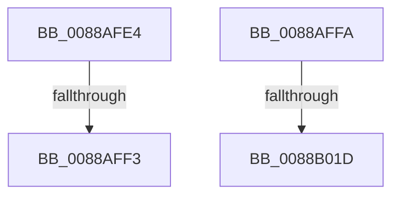

# sub_0088AFE4

- RVA: `0x0088AFE4`–`0x0088B031` (길이 `77` bytes)
- VA: `0x000000014088AFE4`
- 실행 섹션: `PAGE`
- PDB 이름 있음: `아니요`; PDB Function 태그: `아니요`
- unwind 정보 RVA: `0x0007D1B0`
- 디코드: `18`개 명령, `77/77` bytes 표시
- 미해석 바이트: `0` (있으면 어셈블리에 `.byte`로 보존)

> 이 문서는 커널 이미지의 기계어와 PDB 기호를 분석해 생성했습니다. 4번과 5번은 함수 원형과 자료형을 바이너리 사용 방식에서 추정한 C 해석이며 원본 소스 복구 결과는 아닙니다.

## 1. Dependencies

- 직접 호출 지점: **2**; 고유 호출 대상: **2**
- 직접 호출자로 확인된 함수: **0**
- RIP 상대 이미지 참조: **3**

### Outgoing calls
- `0x0088AFF3` → [AlpcViewDestroyProcedure](AlpcViewDestroyProcedure_function_0088B080.md) (function, `0x0088B080`)
- `0x0088B01D` → [AlpcpFreeMessageFunction](AlpcpFreeMessageFunction_function_0088A060.md) (function, `0x0088A060`)

### Direct callers
- 이 함수 시작 RVA로 연결되는 직접 call은 확인되지 않았습니다. 간접 호출은 완전히 역산할 수 없습니다.

### Static image references
- `0x0088AFE4` → RVA `0x0088B080` (`AlpcViewDestroyProcedure`; read)
- `0x0088AFFD` → RVA `0x0088A060` (`AlpcpFreeMessageFunction`; read)
- `0x0088B008` → RVA `0x00E27180` (`.data`; read)

## 2. Other-region calls and transfers

- 다른 실행 섹션으로 향하는 call: **0**
- call이 아닌 외부 분기/꼬리 이동: **4**
  - `0x0088AFF1` → [sub_0088B031 + 0xA](Unknown_function_0088B031.md) (`tail-transfer`)
  - `0x0088AFF8` → [sub_0088AF37 + 0x58](Unknown_function_0088AF37.md) (`tail-transfer`)
  - `0x0088B01B` → [sub_0088B031 + 0x14](Unknown_function_0088B031.md) (`tail-transfer`)
  - `0x0088B02C` → [AlpcpDereferenceBlobEx + 0x1F](AlpcpDereferenceBlobEx_function_0088AF00.md) (`tail-transfer`)

## 3. Assembly (complete function range)

```asm
0088AFE4  48 8D 0D 95 00 00 00            lea rcx, [rip + 0x95]
0088AFEB  48 3B C1                        cmp rax, rcx
0088AFEE  48 8B CB                        mov rcx, rbx
0088AFF1  75 48                           jne 0x14088b03b
0088AFF3  E8 88 00 00 00                  call 0x14088b080
0088AFF8  EB 95                           jmp 0x14088af8f
0088AFFA  8B 46 08                        mov eax, dword ptr [rsi + 8]
0088AFFD  48 8D 0D 5C F0 FF FF            lea rcx, [rip - 0xfa4]
0088B004  48 C1 E0 07                     shl rax, 7
0088B008  48 8D 15 71 C1 59 00            lea rdx, [rip + 0x59c171]
0088B00F  48 8B 44 10 38                  mov rax, qword ptr [rax + rdx + 0x38]
0088B014  48 3B C1                        cmp rax, rcx
0088B017  48 8D 4B D0                     lea rcx, [rbx - 0x30]
0088B01B  75 28                           jne 0x14088b045
0088B01D  E8 3E F0 FF FF                  call 0x14088a060
0088B022  48 8B 74 24 40                  mov rsi, qword ptr [rsp + 0x40]
0088B027  48 8B 7C 24 48                  mov rdi, qword ptr [rsp + 0x48]
0088B02C  E9 EE FE FF FF                  jmp 0x14088af1f
```

## 4. C-style interpretation (structured pseudocode)

```c
__int64 __fastcall sub_0088AFE4(void)
{
    __int64 result;
    unsigned __int64 v_stack_p40;
    unsigned __int64 v_stack_p48;

    result = AlpcViewDestroyProcedure(v_rbx, a2, a3, a4);
}
```

## 5. (Beta) C Style

```c
void sub_0088AFE4(void)
{
    int64_t result;
    uint64_t v_stack_p40;
    uint64_t v_stack_p48;

    result = AlpcViewDestroyProcedure(local_rbx, a2, a3, a4);
}
```

## 6. Execution-region graph

[열기: 2D/3D 그래프와 함수 탐색 컨트롤 패널](../../../control-panel.html?section=page&rva=0x0088AFE4&view=graph)

- 2D 그래프는 위에서 아래로 흐르고, 3D 그래프는 빈 공간을 드래그해 회전합니다. Shift+드래그는 이동, 휠은 확대·축소, 함수 노드 선택은 대상 보고서 이동입니다.

### Static fallback


