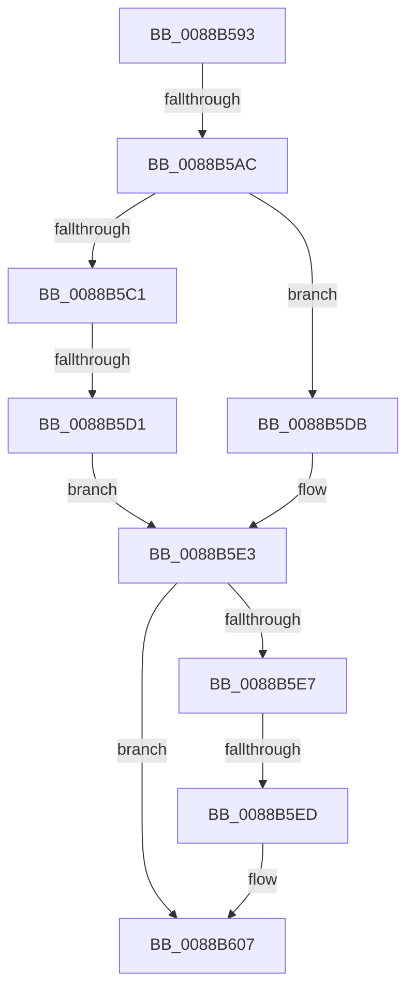

# sub_0088B593

- RVA: `0x0088B593`–`0x0088B611` (길이 `126` bytes)
- VA: `0x000000014088B593`
- 실행 섹션: `PAGE`
- PDB 이름 있음: `아니요`; PDB Function 태그: `아니요`
- unwind 정보 RVA: `0x0007D244`
- 디코드: `31`개 명령, `126/126` bytes 표시
- 미해석 바이트: `0` (있으면 어셈블리에 `.byte`로 보존)

> 이 문서는 커널 이미지의 기계어와 PDB 기호를 분석해 생성했습니다. 4번과 5번은 함수 원형과 자료형을 바이너리 사용 방식에서 추정한 C 해석이며 원본 소스 복구 결과는 아닙니다.

## 1. Dependencies

- 직접 호출 지점: **4**; 고유 호출 대상: **4**
- 직접 호출자로 확인된 함수: **0**
- RIP 상대 이미지 참조: **3**

### Outgoing calls
- `0x0088B5AC` → [AlpcMessageCleanupProcedure](AlpcMessageCleanupProcedure_function_0088BBA0.md) (function, `0x0088BBA0`)
- `0x0088B5D4` → [AlpcSecurityDestroyProcedure](AlpcSecurityDestroyProcedure_function_0088B330.md) (function, `0x0088B330`)
- `0x0088B5DE` → [AlpcMessageDestroyProcedure](AlpcMessageDestroyProcedure_function_0088B500.md) (function, `0x0088B500`)
- `0x0088B602` → [ExFreeToPagedLookasideList](../../text/38/ExFreeToPagedLookasideList_function_00387D30.md) (function, `0x00387D30`)

### Direct callers
- 이 함수 시작 RVA로 연결되는 직접 call은 확인되지 않았습니다. 간접 호출은 완전히 역산할 수 없습니다.

### Static image references
- `0x0088B5B5` → RVA `0x0088B500` (`AlpcMessageDestroyProcedure`; read)
- `0x0088B5C1` → RVA `0x0088B330` (`AlpcSecurityDestroyProcedure`; read)
- `0x0088B5F0` → RVA `0x00E27180` (`.data`; read)

## 2. Other-region calls and transfers

- 다른 실행 섹션으로 향하는 call: **1**
  - `0x0088B602` → [ExFreeToPagedLookasideList](../../text/38/ExFreeToPagedLookasideList_function_00387D30.md) (`PAGE` → `.text`)
- call이 아닌 외부 분기/꼬리 이동: **4**
  - `0x0088B5A6` → [sub_0088B6D3](Unknown_function_0088B6D3.md) (`tail-transfer`)
  - `0x0088B5CB` → [sub_0088B688](Unknown_function_0088B688.md) (`tail-transfer`)
  - `0x0088B5EB` → [sub_0088B66B](Unknown_function_0088B66B.md) (`tail-transfer`)
  - `0x0088B60C` → [AlpcMessageDestroyProcedure + 0x67](AlpcMessageDestroyProcedure_function_0088B500.md) (`tail-transfer`)

## 3. Assembly (complete function range)

```asm
0088B593  48 89 74 24 40                  mov qword ptr [rsp + 0x40], rsi
0088B598  48 8B 1C C3                     mov rbx, qword ptr [rbx + rax*8]
0088B59C  48 8B 43 18                     mov rax, qword ptr [rbx + 0x18]
0088B5A0  48 3B C1                        cmp rax, rcx
0088B5A3  48 8B CF                        mov rcx, rdi
0088B5A6  0F 85 27 01 00 00               jne 0x14088b6d3
0088B5AC  E8 EF 05 00 00                  call 0x14088bba0
0088B5B1  48 8B 43 28                     mov rax, qword ptr [rbx + 0x28]
0088B5B5  48 8D 0D 44 FF FF FF            lea rcx, [rip - 0xbc]
0088B5BC  48 3B C1                        cmp rax, rcx
0088B5BF  74 1A                           je 0x14088b5db
0088B5C1  48 8D 0D 68 FD FF FF            lea rcx, [rip - 0x298]
0088B5C8  48 3B C1                        cmp rax, rcx
0088B5CB  0F 85 B7 00 00 00               jne 0x14088b688
0088B5D1  48 8B CF                        mov rcx, rdi
0088B5D4  E8 57 FD FF FF                  call 0x14088b330
0088B5D9  EB 08                           jmp 0x14088b5e3
0088B5DB  48 8B CF                        mov rcx, rdi
0088B5DE  E8 1D FF FF FF                  call 0x14088b500
0088B5E3  85 C0                           test eax, eax
0088B5E5  78 20                           js 0x14088b607
0088B5E7  F6 47 E0 02                     test byte ptr [rdi - 0x20], 2
0088B5EB  74 7E                           je 0x14088b66b
0088B5ED  8B 4B 08                        mov ecx, dword ptr [rbx + 8]
0088B5F0  48 8D 15 89 BB 59 00            lea rdx, [rip + 0x59bb89]
0088B5F7  48 C1 E1 07                     shl rcx, 7
0088B5FB  48 03 CA                        add rcx, rdx
0088B5FE  48 8D 57 D0                     lea rdx, [rdi - 0x30]
0088B602  E8 29 C7 AF FF                  call 0x140387d30
0088B607  48 8B 74 24 40                  mov rsi, qword ptr [rsp + 0x40]
0088B60C  E9 56 FF FF FF                  jmp 0x14088b567
```

## 4. C-style interpretation (structured pseudocode)

```c
__int64 __fastcall sub_0088B593(__int64 a1, __int64 a2, __int64 a3, __int64 a4, __int64 a5, __int64 a6, __int64 a7, __int64 a8)
{
    __int64 result;
    unsigned __int64 v_stack_p40;

    v_stack_p40 = v_rsi;
    result = AlpcMessageCleanupProcedure(v_rdi, a2, a3, a4);
    if ((*(unsigned __int64 *)(*(unsigned __int64 *)(v_rbx + result * 8) + 40)) == (v_rip - 188)) goto loc_0088B5DB;
    result = AlpcSecurityDestroyProcedure(v_rdi, a2, a3, a4);
    goto loc_0088B5E3;
loc_0088B5DB:
    result = AlpcMessageDestroyProcedure(v_rdi, a2, a3, a4);
loc_0088B5E3:
    if (sign_flag) goto loc_0088B607;
    a1 = ((unsigned int)(*(unsigned int *)(*(unsigned __int64 *)(v_rbx + result * 8) + 8))) << (7);
    a1 = (a1) + (v_rip + 5880713);
    result = ExFreeToPagedLookasideList(a1, v_rdi - 48, a3, a4);
loc_0088B607:
}
```

## 5. (Beta) C Style

```c
int64_t sub_0088B593(int64_t Arg1, int64_t Arg2, int64_t Arg3, int64_t Arg4, uint64_t Arg5, uint64_t Arg6, uint64_t Arg7, int64_t Arg8)
{
    int64_t result;
    uint64_t v_stack_p40;

    v_stack_p40 = local_rsi;
    result = AlpcMessageCleanupProcedure(local_rdi, Arg2, Arg3, Arg4);
    if ((*(uint64_t *)(*(uint64_t *)(local_rbx + result * 8) + 0x28)) == (v_rip - 188)) goto loc_0088B5DB;
    result = AlpcSecurityDestroyProcedure(local_rdi, Arg2, Arg3, Arg4);
    goto loc_0088B5E3;
loc_0088B5DB:
    result = AlpcMessageDestroyProcedure(local_rdi, Arg2, Arg3, Arg4);
loc_0088B5E3:
    if (sign_flag) goto loc_0088B607;
    Arg1 = ((uint32_t)(*(uint32_t *)(*(uint64_t *)(local_rbx + result * 8) + 0x8))) << (7);
    Arg1 = (Arg1) + (v_rip + 5880713);
    result = ExFreeToPagedLookasideList(Arg1, local_rdi - 48, Arg3, Arg4);
loc_0088B607:
}
```

## 6. Execution-region graph

[열기: 2D/3D 그래프와 함수 탐색 컨트롤 패널](../../../control-panel.html?section=page&rva=0x0088B593&view=graph)

- 2D 그래프는 위에서 아래로 흐르고, 3D 그래프는 빈 공간을 드래그해 회전합니다. Shift+드래그는 이동, 휠은 확대·축소, 함수 노드 선택은 대상 보고서 이동입니다.

### Static fallback


