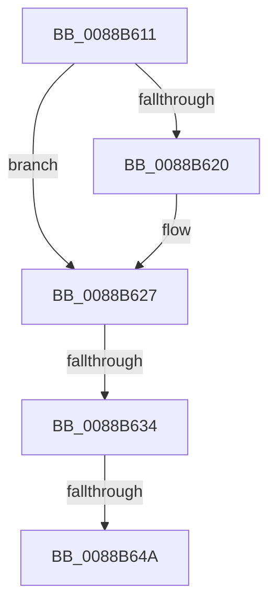

# sub_0088B611

- RVA: `0x0088B611`–`0x0088B66B` (길이 `90` bytes)
- VA: `0x000000014088B611`
- 실행 섹션: `PAGE`
- PDB 이름 있음: `아니요`; PDB Function 태그: `아니요`
- unwind 정보 RVA: `0x0007D258`
- 디코드: `17`개 명령, `90/90` bytes 표시
- 미해석 바이트: `0` (있으면 어셈블리에 `.byte`로 보존)

> 이 문서는 커널 이미지의 기계어와 PDB 기호를 분석해 생성했습니다. 4번과 5번은 함수 원형과 자료형을 바이너리 사용 방식에서 추정한 C 해석이며 원본 소스 복구 결과는 아닙니다.

## 1. Dependencies

- 직접 호출 지점: **1**; 고유 호출 대상: **1**
- 직접 호출자로 확인된 함수: **0**
- RIP 상대 이미지 참조: **0**

### Outgoing calls
- `0x0088B65B` → [ObfDereferenceObjectWithTag](../../text/2F/ObfDereferenceObjectWithTag_function_002F78E0.md) (function, `0x002F78E0`)

### Direct callers
- 이 함수 시작 RVA로 연결되는 직접 call은 확인되지 않았습니다. 간접 호출은 완전히 역산할 수 없습니다.

### Static image references
- 디코드된 RIP-relative 메모리 참조가 없습니다.

## 2. Other-region calls and transfers

- 다른 실행 섹션으로 향하는 call: **1**
  - `0x0088B65B` → [ObfDereferenceObjectWithTag](../../text/2F/ObfDereferenceObjectWithTag_function_002F78E0.md) (`PAGE` → `.text`)
- call이 아닌 외부 분기/꼬리 이동: **3**
  - `0x0088B62E` → [sub_0088B6F6 + 0xA](Unknown_function_0088B6F6.md) (`tail-transfer`)
  - `0x0088B644` → [sub_0088B6F6](Unknown_function_0088B6F6.md) (`tail-transfer`)
  - `0x0088B666` → [AlpcMessageDestroyProcedure + 0x30](AlpcMessageDestroyProcedure_function_0088B500.md) (`tail-transfer`)

## 3. Assembly (complete function range)

```asm
0088B611  48 83 BB E0 00 00 00 00         cmp qword ptr [rbx + 0xe0], 0
0088B619  BA 18 03 00 00                  mov edx, 0x318
0088B61E  74 07                           je 0x14088b627
0088B620  48 03 93 E8 00 00 00            add rdx, qword ptr [rbx + 0xe8]
0088B627  F7 43 28 00 04 00 00            test dword ptr [rbx + 0x28], 0x400
0088B62E  0F 85 CC 00 00 00               jne 0x14088b700
0088B634  48 8B 81 98 05 00 00            mov rax, qword ptr [rcx + 0x598]
0088B63B  48 03 C2                        add rax, rdx
0088B63E  48 3D 00 10 00 00               cmp rax, 0x1000
0088B644  0F 83 AC 00 00 00               jae 0x14088b6f6
0088B64A  F0 48 01 91 98 05 00 00         lock add qword ptr [rcx + 0x598], rdx
0088B652  48 8B 4B 30                     mov rcx, qword ptr [rbx + 0x30]
0088B656  BA 41 6C 70 63                  mov edx, 0x63706c41
0088B65B  E8 80 C2 A6 FF                  call 0x1402f78e0
0088B660  33 C0                           xor eax, eax
0088B662  48 89 43 30                     mov qword ptr [rbx + 0x30], rax
0088B666  E9 C5 FE FF FF                  jmp 0x14088b530
```

## 4. C-style interpretation (structured pseudocode)

```c
__int64 __fastcall sub_0088B611(__int64 a1)
{
    __int64 result;

    if ((*(unsigned __int64 *)(v_rbx + 224)) != 0) {
        a2 = (792) + (*(unsigned __int64 *)(v_rbx + 232));
    }
    result = (*(unsigned __int64 *)(a1 + 1432)) + (a2);
    result = ObfDereferenceObjectWithTag(*(unsigned __int64 *)(v_rbx + 48), (unsigned int)(0x63706C41ULL), a3, a4);
    result = 0;
    *(unsigned __int64 *)(v_rbx + 48) = 0;
}
```

## 5. (Beta) C Style

```c
int64_t sub_0088B611(void *Arg1)
{
    uint8_t *arg1 = (uint8_t *)Arg1;

    int64_t result;

    if ((*(uint64_t *)(local_rbx + 0xE0)) != 0) {
        a2 = (792) + (*(uint64_t *)(local_rbx + 0xE8));
    }
    result = (*(uint64_t *)(arg1 + 0x598)) + (a2);
    result = ObfDereferenceObjectWithTag(*(uint64_t *)(local_rbx + 0x30), (uint32_t)(0x63706C41ULL), a3, a4);
    result = 0;
    *(uint64_t *)(local_rbx + 0x30) = 0;
}
```

### 관측된 메모리 오프셋

구조체 형식이 확인되지 않은 접근은 인자 기준의 오프셋으로만 기록했습니다.

| 기준 인자 | 오프셋 표현 | 폭 (bit) | 접근 |
|---|---:|---:|---|
| `Arg1` | `+ 0x598` | `64` | `R` |
| `Arg1` | `+ 0x598` | `64` | `R/W` |

## 6. Execution-region graph

[열기: 2D/3D 그래프와 함수 탐색 컨트롤 패널](../../../control-panel.html?section=page&rva=0x0088B611&view=graph)

- 2D 그래프는 위에서 아래로 흐르고, 3D 그래프는 빈 공간을 드래그해 회전합니다. Shift+드래그는 이동, 휠은 확대·축소, 함수 노드 선택은 대상 보고서 이동입니다.

### Static fallback


