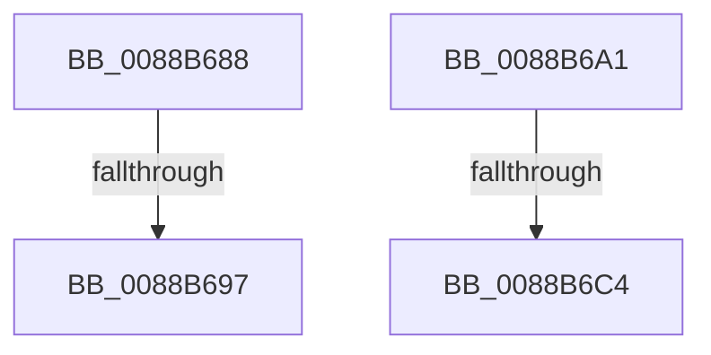

# sub_0088B688

- RVA: `0x0088B688`–`0x0088B6D3` (길이 `75` bytes)
- VA: `0x000000014088B688`
- 실행 섹션: `PAGE`
- PDB 이름 있음: `아니요`; PDB Function 태그: `아니요`
- unwind 정보 RVA: `0x0007D27C`
- 디코드: `17`개 명령, `75/75` bytes 표시
- 미해석 바이트: `0` (있으면 어셈블리에 `.byte`로 보존)

> 이 문서는 커널 이미지의 기계어와 PDB 기호를 분석해 생성했습니다. 4번과 5번은 함수 원형과 자료형을 바이너리 사용 방식에서 추정한 C 해석이며 원본 소스 복구 결과는 아닙니다.

## 1. Dependencies

- 직접 호출 지점: **2**; 고유 호출 대상: **2**
- 직접 호출자로 확인된 함수: **0**
- RIP 상대 이미지 참조: **3**

### Outgoing calls
- `0x0088B697` → [AlpcViewDestroyProcedure](AlpcViewDestroyProcedure_function_0088B080.md) (function, `0x0088B080`)
- `0x0088B6C4` → [AlpcpFreeMessageFunction](AlpcpFreeMessageFunction_function_0088A060.md) (function, `0x0088A060`)

### Direct callers
- 이 함수 시작 RVA로 연결되는 직접 call은 확인되지 않았습니다. 간접 호출은 완전히 역산할 수 없습니다.

### Static image references
- `0x0088B688` → RVA `0x0088B080` (`AlpcViewDestroyProcedure`; read)
- `0x0088B6A4` → RVA `0x0088A060` (`AlpcpFreeMessageFunction`; read)
- `0x0088B6AF` → RVA `0x00E27180` (`.data`; read)

## 2. Other-region calls and transfers

- 다른 실행 섹션으로 향하는 call: **0**
- call이 아닌 외부 분기/꼬리 이동: **4**
  - `0x0088B695` → [sub_0088B6D3 + 0xA](Unknown_function_0088B6D3.md) (`tail-transfer`)
  - `0x0088B69C` → [sub_0088B593 + 0x50](Unknown_function_0088B593.md) (`tail-transfer`)
  - `0x0088B6C2` → [sub_0088B6D3 + 0x14](Unknown_function_0088B6D3.md) (`tail-transfer`)
  - `0x0088B6CE` → [AlpcMessageDestroyProcedure + 0x67](AlpcMessageDestroyProcedure_function_0088B500.md) (`tail-transfer`)

## 3. Assembly (complete function range)

```asm
0088B688  48 8D 0D F1 F9 FF FF            lea rcx, [rip - 0x60f]
0088B68F  48 3B C1                        cmp rax, rcx
0088B692  48 8B CF                        mov rcx, rdi
0088B695  75 46                           jne 0x14088b6dd
0088B697  E8 E4 F9 FF FF                  call 0x14088b080
0088B69C  E9 42 FF FF FF                  jmp 0x14088b5e3
0088B6A1  8B 43 08                        mov eax, dword ptr [rbx + 8]
0088B6A4  48 8D 0D B5 E9 FF FF            lea rcx, [rip - 0x164b]
0088B6AB  48 C1 E0 07                     shl rax, 7
0088B6AF  48 8D 15 CA BA 59 00            lea rdx, [rip + 0x59baca]
0088B6B6  48 8B 44 10 38                  mov rax, qword ptr [rax + rdx + 0x38]
0088B6BB  48 3B C1                        cmp rax, rcx
0088B6BE  48 8D 4F D0                     lea rcx, [rdi - 0x30]
0088B6C2  75 23                           jne 0x14088b6e7
0088B6C4  E8 97 E9 FF FF                  call 0x14088a060
0088B6C9  48 8B 74 24 40                  mov rsi, qword ptr [rsp + 0x40]
0088B6CE  E9 94 FE FF FF                  jmp 0x14088b567
```

## 4. C-style interpretation (structured pseudocode)

```c
__int64 __fastcall sub_0088B688(void)
{
    __int64 result;
    unsigned __int64 v_stack_p40;

    result = AlpcViewDestroyProcedure(v_rdi, a2, a3, a4);
}
```

## 5. (Beta) C Style

```c
void sub_0088B688(void)
{
    int64_t result;
    uint64_t v_stack_p40;

    result = AlpcViewDestroyProcedure(local_rdi, a2, a3, a4);
}
```

## 6. Execution-region graph

[열기: 2D/3D 그래프와 함수 탐색 컨트롤 패널](../../../control-panel.html?section=page&rva=0x0088B688&view=graph)

- 2D 그래프는 위에서 아래로 흐르고, 3D 그래프는 빈 공간을 드래그해 회전합니다. Shift+드래그는 이동, 휠은 확대·축소, 함수 노드 선택은 대상 보고서 이동입니다.

### Static fallback


