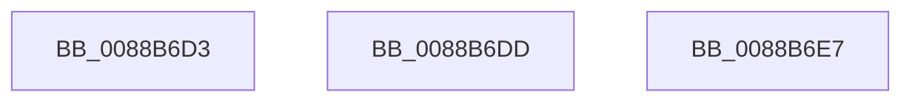

# sub_0088B6D3

- RVA: `0x0088B6D3`–`0x0088B6F6` (길이 `35` bytes)
- VA: `0x000000014088B6D3`
- 실행 섹션: `PAGE`
- PDB 이름 있음: `아니요`; PDB Function 태그: `아니요`
- unwind 정보 RVA: `0x0007D290`
- 디코드: `7`개 명령, `35/35` bytes 표시
- 미해석 바이트: `0` (있으면 어셈블리에 `.byte`로 보존)

> 이 문서는 커널 이미지의 기계어와 PDB 기호를 분석해 생성했습니다. 4번과 5번은 함수 원형과 자료형을 바이너리 사용 방식에서 추정한 C 해석이며 원본 소스 복구 결과는 아닙니다.

## 1. Dependencies

- 직접 호출 지점: **3**; 고유 호출 대상: **1**
- 직접 호출자로 확인된 함수: **0**
- RIP 상대 이미지 참조: **0**

### Outgoing calls
- `0x0088B6D3` → [guard_dispatch_icall](../../text/6B/guard_dispatch_icall_function_006BAAD0.md) (function, `0x006BAAD0`)
- `0x0088B6DD` → [guard_dispatch_icall](../../text/6B/guard_dispatch_icall_function_006BAAD0.md) (function, `0x006BAAD0`)
- `0x0088B6E7` → [guard_dispatch_icall](../../text/6B/guard_dispatch_icall_function_006BAAD0.md) (function, `0x006BAAD0`)

### Direct callers
- 이 함수 시작 RVA로 연결되는 직접 call은 확인되지 않았습니다. 간접 호출은 완전히 역산할 수 없습니다.

### Static image references
- 디코드된 RIP-relative 메모리 참조가 없습니다.

## 2. Other-region calls and transfers

- 다른 실행 섹션으로 향하는 call: **3**
  - `0x0088B6D3` → [guard_dispatch_icall](../../text/6B/guard_dispatch_icall_function_006BAAD0.md) (`PAGE` → `.text`)
  - `0x0088B6DD` → [guard_dispatch_icall](../../text/6B/guard_dispatch_icall_function_006BAAD0.md) (`PAGE` → `.text`)
  - `0x0088B6E7` → [guard_dispatch_icall](../../text/6B/guard_dispatch_icall_function_006BAAD0.md) (`PAGE` → `.text`)
- call이 아닌 외부 분기/꼬리 이동: **3**
  - `0x0088B6D8` → [sub_0088B593 + 0x1E](Unknown_function_0088B593.md) (`tail-transfer`)
  - `0x0088B6E2` → [sub_0088B593 + 0x50](Unknown_function_0088B593.md) (`tail-transfer`)
  - `0x0088B6F1` → [AlpcMessageDestroyProcedure + 0x67](AlpcMessageDestroyProcedure_function_0088B500.md) (`tail-transfer`)

## 3. Assembly (complete function range)

```asm
0088B6D3  E8 F8 F3 E2 FF                  call 0x1406baad0
0088B6D8  E9 D4 FE FF FF                  jmp 0x14088b5b1
0088B6DD  E8 EE F3 E2 FF                  call 0x1406baad0
0088B6E2  E9 FC FE FF FF                  jmp 0x14088b5e3
0088B6E7  E8 E4 F3 E2 FF                  call 0x1406baad0
0088B6EC  48 8B 74 24 40                  mov rsi, qword ptr [rsp + 0x40]
0088B6F1  E9 71 FE FF FF                  jmp 0x14088b567
```

## 4. C-style interpretation (structured pseudocode)

```c
__int64 __fastcall sub_0088B6D3(void)
{
    __int64 result;
    unsigned __int64 v_stack_p40;

    result = guard_dispatch_icall(a1, a2, a3, a4);
}
```

## 5. (Beta) C Style

```c
void sub_0088B6D3(void)
{
    int64_t result;
    uint64_t v_stack_p40;

    result = guard_dispatch_icall(a1, a2, a3, a4);
}
```

## 6. Execution-region graph

[열기: 2D/3D 그래프와 함수 탐색 컨트롤 패널](../../../control-panel.html?section=page&rva=0x0088B6D3&view=graph)

- 2D 그래프는 위에서 아래로 흐르고, 3D 그래프는 빈 공간을 드래그해 회전합니다. Shift+드래그는 이동, 휠은 확대·축소, 함수 노드 선택은 대상 보고서 이동입니다.

### Static fallback


