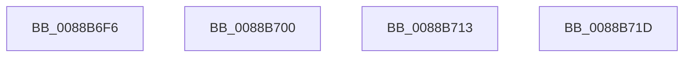

# sub_0088B6F6

- RVA: `0x0088B6F6`–`0x0088B736` (길이 `64` bytes)
- VA: `0x000000014088B6F6`
- 실행 섹션: `PAGE`
- PDB 이름 있음: `아니요`; PDB Function 태그: `아니요`
- unwind 정보 RVA: `0x0007D2A4`
- 디코드: `16`개 명령, `64/64` bytes 표시
- 미해석 바이트: `0` (있으면 어셈블리에 `.byte`로 보존)

> 이 문서는 커널 이미지의 기계어와 PDB 기호를 분석해 생성했습니다. 4번과 5번은 함수 원형과 자료형을 바이너리 사용 방식에서 추정한 C 해석이며 원본 소스 복구 결과는 아닙니다.

## 1. Dependencies

- 직접 호출 지점: **4**; 고유 호출 대상: **4**
- 직접 호출자로 확인된 함수: **0**
- RIP 상대 이미지 참조: **0**

### Outgoing calls
- `0x0088B6F6` → [PsReturnProcessPagedPoolQuota](../../text/2A/PsReturnProcessPagedPoolQuota_function_002A6860.md) (function, `0x002A6860`)
- `0x0088B703` → [PsReturnSharedPoolQuota](../8B/PsReturnSharedPoolQuota_function_008BCC30.md) (function, `0x008BCC30`)
- `0x0088B713` → [AlpcpEnterFreeEventMessageLog](../AC/AlpcpEnterFreeEventMessageLog_function_00ACCBB8.md) (function, `0x00ACCBB8`)
- `0x0088B730` → [KeBugCheckEx](../../text/4F/KeBugCheckEx_function_004FD660.md) (function, `0x004FD660`)

### Direct callers
- 이 함수 시작 RVA로 연결되는 직접 call은 확인되지 않았습니다. 간접 호출은 완전히 역산할 수 없습니다.

### Static image references
- 디코드된 RIP-relative 메모리 참조가 없습니다.

## 2. Other-region calls and transfers

- 다른 실행 섹션으로 향하는 call: **2**
  - `0x0088B6F6` → [PsReturnProcessPagedPoolQuota](../../text/2A/PsReturnProcessPagedPoolQuota_function_002A6860.md) (`PAGE` → `.text`)
  - `0x0088B730` → [KeBugCheckEx](../../text/4F/KeBugCheckEx_function_004FD660.md) (`PAGE` → `.text`)
- call이 아닌 외부 분기/꼬리 이동: **3**
  - `0x0088B6FB` → [sub_0088B611 + 0x41](Unknown_function_0088B611.md) (`tail-transfer`)
  - `0x0088B70E` → [AlpcMessageDestroyProcedure + 0x30](AlpcMessageDestroyProcedure_function_0088B500.md) (`tail-transfer`)
  - `0x0088B718` → [AlpcMessageDestroyProcedure + 0x1A](AlpcMessageDestroyProcedure_function_0088B500.md) (`tail-transfer`)

## 3. Assembly (complete function range)

```asm
0088B6F6  E8 65 B1 A1 FF                  call 0x1402a6860
0088B6FB  E9 52 FF FF FF                  jmp 0x14088b652
0088B700  45 33 C0                        xor r8d, r8d
0088B703  E8 28 15 03 00                  call 0x1408bcc30
0088B708  33 C0                           xor eax, eax
0088B70A  48 89 43 30                     mov qword ptr [rbx + 0x30], rax
0088B70E  E9 1D FE FF FF                  jmp 0x14088b530
0088B713  E8 A0 14 24 00                  call 0x140accbb8
0088B718  E9 FD FD FF FF                  jmp 0x14088b51a
0088B71D  33 D2                           xor edx, edx
0088B71F  48 89 44 24 20                  mov qword ptr [rsp + 0x20], rax
0088B724  41 B9 21 00 00 00               mov r9d, 0x21
0088B72A  4C 8B C7                        mov r8, rdi
0088B72D  8D 4A 18                        lea ecx, [rdx + 0x18]
0088B730  E8 2B 1F C7 FF                  call 0x1404fd660
0088B735  CC                              int3
```

## 4. C-style interpretation (structured pseudocode)

```c
__int64 __fastcall sub_0088B6F6(__int64 a1, int a2, int a3)
{
    __int64 result;
    unsigned __int64 v_stack_p20;

    result = PsReturnProcessPagedPoolQuota(a1, a2, a3, a4);
}
```

## 5. (Beta) C Style

```c
int64_t sub_0088B6F6(int64_t Arg1, int32_t Arg2, int32_t Arg3)
{
    int64_t result;
    uint64_t v_stack_p20;

    result = PsReturnProcessPagedPoolQuota(Arg1, Arg2, Arg3, a4);
}
```

## 6. Execution-region graph

[열기: 2D/3D 그래프와 함수 탐색 컨트롤 패널](../../../control-panel.html?section=page&rva=0x0088B6F6&view=graph)

- 2D 그래프는 위에서 아래로 흐르고, 3D 그래프는 빈 공간을 드래그해 회전합니다. Shift+드래그는 이동, 휠은 확대·축소, 함수 노드 선택은 대상 보고서 이동입니다.

### Static fallback


