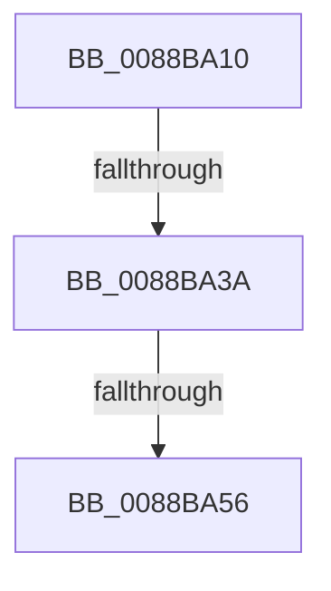

# sub_0088BA10

- RVA: `0x0088BA10`–`0x0088BA74` (길이 `100` bytes)
- VA: `0x000000014088BA10`
- 실행 섹션: `PAGE`
- PDB 이름 있음: `아니요`; PDB Function 태그: `아니요`
- unwind 정보 RVA: `0x0007D2D4`
- 디코드: `22`개 명령, `100/100` bytes 표시
- 미해석 바이트: `0` (있으면 어셈블리에 `.byte`로 보존)

> 이 문서는 커널 이미지의 기계어와 PDB 기호를 분석해 생성했습니다. 4번과 5번은 함수 원형과 자료형을 바이너리 사용 방식에서 추정한 C 해석이며 원본 소스 복구 결과는 아닙니다.

## 1. Dependencies

- 직접 호출 지점: **2**; 고유 호출 대상: **2**
- 직접 호출자로 확인된 함수: **0**
- RIP 상대 이미지 참조: **2**

### Outgoing calls
- `0x0088BA3A` → [AlpcMessageCleanupProcedure](AlpcMessageCleanupProcedure_function_0088BBA0.md) (function, `0x0088BBA0`)
- `0x0088BA5A` → [KeAbPostRelease](../../text/2E/KeAbPostRelease_function_002E1600.md) (function, `0x002E1600`)

### Direct callers
- 이 함수 시작 RVA로 연결되는 직접 call은 확인되지 않았습니다. 간접 호출은 완전히 역산할 수 없습니다.

### Static image references
- `0x0088BA1A` → RVA `0x00001450` (`.rdata`; read)
- `0x0088BA63` → RVA `0x0088B500` (`AlpcMessageDestroyProcedure`; read)

## 2. Other-region calls and transfers

- 다른 실행 섹션으로 향하는 call: **1**
  - `0x0088BA5A` → [KeAbPostRelease](../../text/2E/KeAbPostRelease_function_002E1600.md) (`PAGE` → `.text`)
- call이 아닌 외부 분기/꼬리 이동: **3**
  - `0x0088BA34` → [sub_0088BB42](Unknown_function_0088BB42.md) (`tail-transfer`)
  - `0x0088BA50` → [sub_0088BB56](Unknown_function_0088BB56.md) (`tail-transfer`)
  - `0x0088BA72` → [sub_0088BA74 + 0x16](Unknown_function_0088BA74.md) (`tail-transfer`)

## 3. Assembly (complete function range)

```asm
0088BA10  48 89 6C 24 40                  mov qword ptr [rsp + 0x40], rbp
0088BA15  48 89 74 24 48                  mov qword ptr [rsp + 0x48], rsi
0088BA1A  48 8D 35 2F 5A 77 FF            lea rsi, [rip - 0x88a5d1]
0088BA21  48 89 7C 24 50                  mov qword ptr [rsp + 0x50], rdi
0088BA26  48 8B 34 C6                     mov rsi, qword ptr [rsi + rax*8]
0088BA2A  48 8B 46 18                     mov rax, qword ptr [rsi + 0x18]
0088BA2E  48 3B C1                        cmp rax, rcx
0088BA31  48 8B CB                        mov rcx, rbx
0088BA34  0F 85 08 01 00 00               jne 0x14088bb42
0088BA3A  E8 61 01 00 00                  call 0x14088bba0
0088BA3F  48 C7 C0 FF FF FF FF            mov rax, 0xffffffffffffffff
0088BA46  F0 48 0F C1 43 F0               lock xadd qword ptr [rbx - 0x10], rax
0088BA4C  24 06                           and al, 6
0088BA4E  3C 02                           cmp al, 2
0088BA50  0F 84 00 01 00 00               je 0x14088bb56
0088BA56  48 8D 4B F0                     lea rcx, [rbx - 0x10]
0088BA5A  E8 A1 5B A5 FF                  call 0x1402e1600
0088BA5F  48 8B 46 28                     mov rax, qword ptr [rsi + 0x28]
0088BA63  48 8D 0D 96 FA FF FF            lea rcx, [rip - 0x56a]
0088BA6A  48 8B 6C 24 40                  mov rbp, qword ptr [rsp + 0x40]
0088BA6F  48 3B C1                        cmp rax, rcx
0088BA72  74 16                           je 0x14088ba8a
```

## 4. C-style interpretation (structured pseudocode)

```c
__int64 __fastcall sub_0088BA10(__int64 a1, __int64 a2, __int64 a3, __int64 a4, __int64 a5, __int64 a6, __int64 a7, __int64 a8)
{
    __int64 result;
    unsigned __int64 v_stack_p40;
    unsigned __int64 v_stack_p48;
    unsigned __int64 v_stack_p50;

    v_stack_p40 = v_rbp;
    v_stack_p48 = v_rsi;
    v_stack_p50 = v_rdi;
    result = AlpcMessageCleanupProcedure(v_rbx, a2, a3, a4);
    result = (unsigned __int8)((-1) & (6));
    result = KeAbPostRelease(v_rbx - 16, a2, a3, a4);
}
```

## 5. (Beta) C Style

```c
int64_t sub_0088BA10(int64_t Arg1, int64_t Arg2, int64_t Arg3, int64_t Arg4, uint64_t Arg5, uint64_t Arg6, uint64_t Arg7, int64_t Arg8)
{
    int64_t result;
    uint64_t v_stack_p40;
    uint64_t v_stack_p48;
    uint64_t v_stack_p50;

    v_stack_p40 = local_rbp;
    v_stack_p48 = local_rsi;
    v_stack_p50 = local_rdi;
    result = AlpcMessageCleanupProcedure(local_rbx, Arg2, Arg3, Arg4);
    result = (uint8_t)((-1) & (6));
    result = KeAbPostRelease(local_rbx - 16, Arg2, Arg3, Arg4);
}
```

## 6. Execution-region graph

[열기: 2D/3D 그래프와 함수 탐색 컨트롤 패널](../../../control-panel.html?section=page&rva=0x0088BA10&view=graph)

- 2D 그래프는 위에서 아래로 흐르고, 3D 그래프는 빈 공간을 드래그해 회전합니다. Shift+드래그는 이동, 휠은 확대·축소, 함수 노드 선택은 대상 보고서 이동입니다.

### Static fallback


