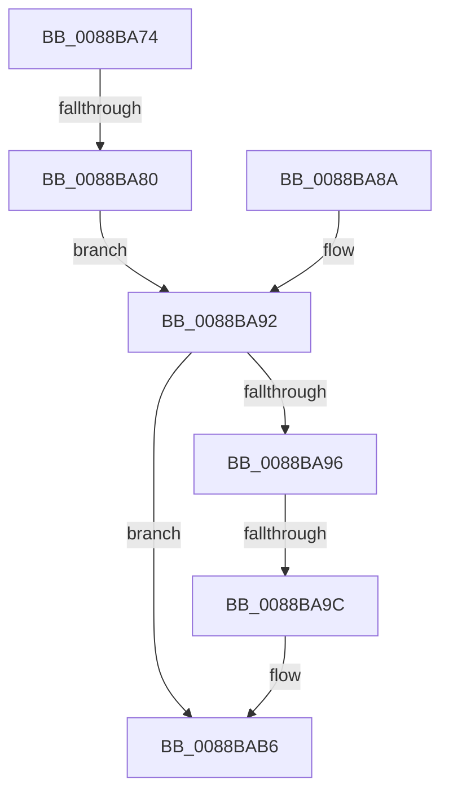

# sub_0088BA74

- RVA: `0x0088BA74`–`0x0088BAC5` (길이 `81` bytes)
- VA: `0x000000014088BA74`
- 실행 섹션: `PAGE`
- PDB 이름 있음: `아니요`; PDB Function 태그: `아니요`
- unwind 정보 RVA: `0x0007D2F0`
- 디코드: `21`개 명령, `81/81` bytes 표시
- 미해석 바이트: `0` (있으면 어셈블리에 `.byte`로 보존)

> 이 문서는 커널 이미지의 기계어와 PDB 기호를 분석해 생성했습니다. 4번과 5번은 함수 원형과 자료형을 바이너리 사용 방식에서 추정한 C 해석이며 원본 소스 복구 결과는 아닙니다.

## 1. Dependencies

- 직접 호출 지점: **3**; 고유 호출 대상: **3**
- 직접 호출자로 확인된 함수: **0**
- RIP 상대 이미지 참조: **2**

### Outgoing calls
- `0x0088BA83` → [AlpcSecurityDestroyProcedure](AlpcSecurityDestroyProcedure_function_0088B330.md) (function, `0x0088B330`)
- `0x0088BA8D` → [AlpcMessageDestroyProcedure](AlpcMessageDestroyProcedure_function_0088B500.md) (function, `0x0088B500`)
- `0x0088BAB1` → [ExFreeToPagedLookasideList](../../text/38/ExFreeToPagedLookasideList_function_00387D30.md) (function, `0x00387D30`)

### Direct callers
- 이 함수 시작 RVA로 연결되는 직접 call은 확인되지 않았습니다. 간접 호출은 완전히 역산할 수 없습니다.

### Static image references
- `0x0088BA74` → RVA `0x0088B330` (`AlpcSecurityDestroyProcedure`; read)
- `0x0088BA9F` → RVA `0x00E27180` (`.data`; read)

## 2. Other-region calls and transfers

- 다른 실행 섹션으로 향하는 call: **1**
  - `0x0088BAB1` → [ExFreeToPagedLookasideList](../../text/38/ExFreeToPagedLookasideList_function_00387D30.md) (`PAGE` → `.text`)
- call이 아닌 외부 분기/꼬리 이동: **3**
  - `0x0088BA7E` → [sub_0088BAE7](Unknown_function_0088BAE7.md) (`tail-transfer`)
  - `0x0088BA9A` → [sub_0088BAC5](Unknown_function_0088BAC5.md) (`tail-transfer`)
  - `0x0088BAC0` → [AlpcpUnlockBlob + 0x68](AlpcpUnlockBlob_function_0088B990.md) (`tail-transfer`)

## 3. Assembly (complete function range)

```asm
0088BA74  48 8D 0D B5 F8 FF FF            lea rcx, [rip - 0x74b]
0088BA7B  48 3B C1                        cmp rax, rcx
0088BA7E  75 67                           jne 0x14088bae7
0088BA80  48 8B CB                        mov rcx, rbx
0088BA83  E8 A8 F8 FF FF                  call 0x14088b330
0088BA88  EB 08                           jmp 0x14088ba92
0088BA8A  48 8B CB                        mov rcx, rbx
0088BA8D  E8 6E FA FF FF                  call 0x14088b500
0088BA92  85 C0                           test eax, eax
0088BA94  78 20                           js 0x14088bab6
0088BA96  F6 43 E0 02                     test byte ptr [rbx - 0x20], 2
0088BA9A  74 29                           je 0x14088bac5
0088BA9C  8B 4E 08                        mov ecx, dword ptr [rsi + 8]
0088BA9F  48 8D 15 DA B6 59 00            lea rdx, [rip + 0x59b6da]
0088BAA6  48 C1 E1 07                     shl rcx, 7
0088BAAA  48 03 CA                        add rcx, rdx
0088BAAD  48 8D 53 D0                     lea rdx, [rbx - 0x30]
0088BAB1  E8 7A C2 AF FF                  call 0x140387d30
0088BAB6  48 8B 74 24 48                  mov rsi, qword ptr [rsp + 0x48]
0088BABB  48 8B 7C 24 50                  mov rdi, qword ptr [rsp + 0x50]
0088BAC0  E9 33 FF FF FF                  jmp 0x14088b9f8
```

## 4. C-style interpretation (structured pseudocode)

```c
__int64 __fastcall sub_0088BA74(__int64 a1, __int64 a2, __int64 a3, __int64 a4, __int64 a5, __int64 a6, __int64 a7, __int64 a8, __int64 a9, __int64 a10)
{
    __int64 result;

    result = AlpcSecurityDestroyProcedure(v_rbx, a2, a3, a4);
    goto loc_0088BA92;
loc_0088BA92:
    if (sign_flag) goto loc_0088BAB6;
    a1 = ((unsigned int)(*(unsigned int *)(v_rsi + 8))) << (7);
    a1 = (a1) + (v_rip + 5879514);
    result = ExFreeToPagedLookasideList(a1, v_rbx - 48, a3, a4);
loc_0088BAB6:
}
```

## 5. (Beta) C Style

```c
int64_t sub_0088BA74(int64_t Arg1, int64_t Arg2, int64_t Arg3, int64_t Arg4, uint64_t Arg5, uint64_t Arg6, uint64_t Arg7, uint64_t Arg8, int64_t Arg9, int64_t Arg10)
{
    int64_t result;

    result = AlpcSecurityDestroyProcedure(local_rbx, Arg2, Arg3, Arg4);
    goto loc_0088BA92;
loc_0088BA92:
    if (sign_flag) goto loc_0088BAB6;
    Arg1 = ((uint32_t)(*(uint32_t *)(local_rsi + 0x8))) << (7);
    Arg1 = (Arg1) + (v_rip + 5879514);
    result = ExFreeToPagedLookasideList(Arg1, local_rbx - 48, Arg3, Arg4);
loc_0088BAB6:
}
```

## 6. Execution-region graph

[열기: 2D/3D 그래프와 함수 탐색 컨트롤 패널](../../../control-panel.html?section=page&rva=0x0088BA74&view=graph)

- 2D 그래프는 위에서 아래로 흐르고, 3D 그래프는 빈 공간을 드래그해 회전합니다. Shift+드래그는 이동, 휠은 확대·축소, 함수 노드 선택은 대상 보고서 이동입니다.

### Static fallback


