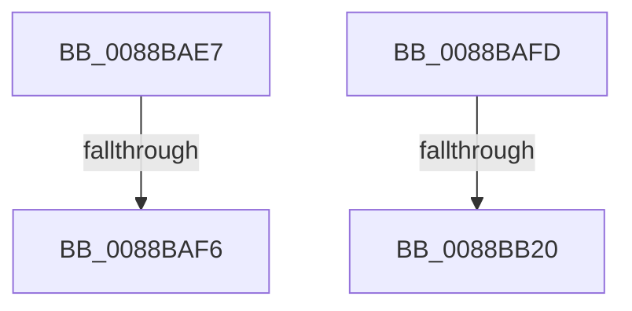

# sub_0088BAE7

- RVA: `0x0088BAE7`–`0x0088BB34` (길이 `77` bytes)
- VA: `0x000000014088BAE7`
- 실행 섹션: `PAGE`
- PDB 이름 있음: `아니요`; PDB Function 태그: `아니요`
- unwind 정보 RVA: `0x0007D320`
- 디코드: `18`개 명령, `77/77` bytes 표시
- 미해석 바이트: `0` (있으면 어셈블리에 `.byte`로 보존)

> 이 문서는 커널 이미지의 기계어와 PDB 기호를 분석해 생성했습니다. 4번과 5번은 함수 원형과 자료형을 바이너리 사용 방식에서 추정한 C 해석이며 원본 소스 복구 결과는 아닙니다.

## 1. Dependencies

- 직접 호출 지점: **2**; 고유 호출 대상: **2**
- 직접 호출자로 확인된 함수: **0**
- RIP 상대 이미지 참조: **3**

### Outgoing calls
- `0x0088BAF6` → [AlpcViewDestroyProcedure](AlpcViewDestroyProcedure_function_0088B080.md) (function, `0x0088B080`)
- `0x0088BB20` → [AlpcpFreeMessageFunction](AlpcpFreeMessageFunction_function_0088A060.md) (function, `0x0088A060`)

### Direct callers
- 이 함수 시작 RVA로 연결되는 직접 call은 확인되지 않았습니다. 간접 호출은 완전히 역산할 수 없습니다.

### Static image references
- `0x0088BAE7` → RVA `0x0088B080` (`AlpcViewDestroyProcedure`; read)
- `0x0088BB00` → RVA `0x0088A060` (`AlpcpFreeMessageFunction`; read)
- `0x0088BB0B` → RVA `0x00E27180` (`.data`; read)

## 2. Other-region calls and transfers

- 다른 실행 섹션으로 향하는 call: **0**
- call이 아닌 외부 분기/꼬리 이동: **4**
  - `0x0088BAF4` → [sub_0088BB4C](Unknown_function_0088BB4C.md) (`tail-transfer`)
  - `0x0088BAFB` → [sub_0088BA74 + 0x1E](Unknown_function_0088BA74.md) (`tail-transfer`)
  - `0x0088BB1E` → [sub_0088BB64](Unknown_function_0088BB64.md) (`tail-transfer`)
  - `0x0088BB2F` → [AlpcpUnlockBlob + 0x68](AlpcpUnlockBlob_function_0088B990.md) (`tail-transfer`)

## 3. Assembly (complete function range)

```asm
0088BAE7  48 8D 0D 92 F5 FF FF            lea rcx, [rip - 0xa6e]
0088BAEE  48 3B C1                        cmp rax, rcx
0088BAF1  48 8B CB                        mov rcx, rbx
0088BAF4  75 56                           jne 0x14088bb4c
0088BAF6  E8 85 F5 FF FF                  call 0x14088b080
0088BAFB  EB 95                           jmp 0x14088ba92
0088BAFD  8B 46 08                        mov eax, dword ptr [rsi + 8]
0088BB00  48 8D 0D 59 E5 FF FF            lea rcx, [rip - 0x1aa7]
0088BB07  48 C1 E0 07                     shl rax, 7
0088BB0B  48 8D 15 6E B6 59 00            lea rdx, [rip + 0x59b66e]
0088BB12  48 8B 44 10 38                  mov rax, qword ptr [rax + rdx + 0x38]
0088BB17  48 3B C1                        cmp rax, rcx
0088BB1A  48 8D 4B D0                     lea rcx, [rbx - 0x30]
0088BB1E  75 44                           jne 0x14088bb64
0088BB20  E8 3B E5 FF FF                  call 0x14088a060
0088BB25  48 8B 74 24 48                  mov rsi, qword ptr [rsp + 0x48]
0088BB2A  48 8B 7C 24 50                  mov rdi, qword ptr [rsp + 0x50]
0088BB2F  E9 C4 FE FF FF                  jmp 0x14088b9f8
```

## 4. C-style interpretation (structured pseudocode)

```c
__int64 __fastcall sub_0088BAE7(void)
{
    __int64 result;
    unsigned __int64 v_stack_p48;
    unsigned __int64 v_stack_p50;

    result = AlpcViewDestroyProcedure(v_rbx, a2, a3, a4);
}
```

## 5. (Beta) C Style

```c
void sub_0088BAE7(void)
{
    int64_t result;
    uint64_t v_stack_p48;
    uint64_t v_stack_p50;

    result = AlpcViewDestroyProcedure(local_rbx, a2, a3, a4);
}
```

## 6. Execution-region graph

[열기: 2D/3D 그래프와 함수 탐색 컨트롤 패널](../../../control-panel.html?section=page&rva=0x0088BAE7&view=graph)

- 2D 그래프는 위에서 아래로 흐르고, 3D 그래프는 빈 공간을 드래그해 회전합니다. Shift+드래그는 이동, 휠은 확대·축소, 함수 노드 선택은 대상 보고서 이동입니다.

### Static fallback


