# sub_0088D871

- RVA: `0x0088D871`–`0x0088DAFD` (길이 `652` bytes)
- VA: `0x000000014088D871`
- 실행 섹션: `PAGE`
- PDB 이름 있음: `아니요`; PDB Function 태그: `아니요`
- unwind 정보 RVA: `0x0007D48C`
- 디코드: `150`개 명령, `652/652` bytes 표시
- 미해석 바이트: `0` (있으면 어셈블리에 `.byte`로 보존)

> 이 문서는 커널 이미지의 기계어와 PDB 기호를 분석해 생성했습니다. 4번과 5번은 함수 원형과 자료형을 바이너리 사용 방식에서 추정한 C 해석이며 원본 소스 복구 결과는 아닙니다.

## 1. Dependencies

- 직접 호출 지점: **13**; 고유 호출 대상: **8**
- 직접 호출자로 확인된 함수: **0**
- RIP 상대 이미지 참조: **1**

### Outgoing calls
- `0x0088D889` → [KeAbPreAcquire](../../text/21/KeAbPreAcquire_function_00210230.md) (function, `0x00210230`)
- `0x0088D8A2` → [ExfAcquirePushLockExclusiveEx](../../text/20/ExfAcquirePushLockExclusiveEx_function_0020FC90.md) (function, `0x0020FC90`)
- `0x0088D8CD` → [KeAbPostRelease](../../text/2E/KeAbPostRelease_function_002E1600.md) (function, `0x002E1600`)
- `0x0088D95D` → [ObfReferenceObject](../../text/20/ObfReferenceObject_function_0020FA20.md) (function, `0x0020FA20`)
- `0x0088D9A0` → [KeAbPreAcquire](../../text/21/KeAbPreAcquire_function_00210230.md) (function, `0x00210230`)
- `0x0088D9B9` → [ExfAcquirePushLockExclusiveEx](../../text/20/ExfAcquirePushLockExclusiveEx_function_0020FC90.md) (function, `0x0020FC90`)
- `0x0088DA08` → [KeAbPostRelease](../../text/2E/KeAbPostRelease_function_002E1600.md) (function, `0x002E1600`)
- `0x0088DA76` → [AlpcpCaptureMessageDataSafe](AlpcpCaptureMessageDataSafe_function_0088F3B0.md) (function, `0x0088F3B0`)
- `0x0088DA91` → [KeAbPreAcquire](../../text/21/KeAbPreAcquire_function_00210230.md) (function, `0x00210230`)
- `0x0088DAAD` → [ExfAcquirePushLockSharedEx](../../text/21/ExfAcquirePushLockSharedEx_function_0021044C.md) (function, `0x0021044C`)
- `0x0088DACC` → [AlpcpExposeViewAttributeInSenderContext](AlpcpExposeViewAttributeInSenderContext_function_0088F600.md) (function, `0x0088F600`)
- `0x0088DADE` → [ExfReleasePushLockShared](../../text/26/ExfReleasePushLockShared_function_00263440.md) (function, `0x00263440`)
- `0x0088DAE6` → [KeAbPostRelease](../../text/2E/KeAbPostRelease_function_002E1600.md) (function, `0x002E1600`)

### Direct callers
- 이 함수 시작 RVA로 연결되는 직접 call은 확인되지 않았습니다. 간접 호출은 완전히 역산할 수 없습니다.

### Static image references
- `0x0088DAEB` → RVA `0x00E66D00` (`.data`; read)

## 2. Other-region calls and transfers

- 다른 실행 섹션으로 향하는 call: **11**
  - `0x0088D889` → [KeAbPreAcquire](../../text/21/KeAbPreAcquire_function_00210230.md) (`PAGE` → `.text`)
  - `0x0088D8A2` → [ExfAcquirePushLockExclusiveEx](../../text/20/ExfAcquirePushLockExclusiveEx_function_0020FC90.md) (`PAGE` → `.text`)
  - `0x0088D8CD` → [KeAbPostRelease](../../text/2E/KeAbPostRelease_function_002E1600.md) (`PAGE` → `.text`)
  - `0x0088D95D` → [ObfReferenceObject](../../text/20/ObfReferenceObject_function_0020FA20.md) (`PAGE` → `.text`)
  - `0x0088D9A0` → [KeAbPreAcquire](../../text/21/KeAbPreAcquire_function_00210230.md) (`PAGE` → `.text`)
  - `0x0088D9B9` → [ExfAcquirePushLockExclusiveEx](../../text/20/ExfAcquirePushLockExclusiveEx_function_0020FC90.md) (`PAGE` → `.text`)
  - `0x0088DA08` → [KeAbPostRelease](../../text/2E/KeAbPostRelease_function_002E1600.md) (`PAGE` → `.text`)
  - `0x0088DA91` → [KeAbPreAcquire](../../text/21/KeAbPreAcquire_function_00210230.md) (`PAGE` → `.text`)
  - `0x0088DAAD` → [ExfAcquirePushLockSharedEx](../../text/21/ExfAcquirePushLockSharedEx_function_0021044C.md) (`PAGE` → `.text`)
  - `0x0088DADE` → [ExfReleasePushLockShared](../../text/26/ExfReleasePushLockShared_function_00263440.md) (`PAGE` → `.text`)
  - `0x0088DAE6` → [KeAbPostRelease](../../text/2E/KeAbPostRelease_function_002E1600.md) (`PAGE` → `.text`)
- call이 아닌 외부 분기/꼬리 이동: **6**
  - `0x0088D8C4` → [sub_0088DBCA + 0xD](Unknown_function_0088DBCA.md) (`tail-transfer`)
  - `0x0088D93A` → [sub_0088DBCA + 0x1A](Unknown_function_0088DBCA.md) (`tail-transfer`)
  - `0x0088D972` → [sub_0088DBCA + 0xB4](Unknown_function_0088DBCA.md) (`tail-transfer`)
  - `0x0088D9FF` → [sub_0088DBCA](Unknown_function_0088DBCA.md) (`tail-transfer`)
  - `0x0088DA52` → [sub_0088DBCA + 0x2B](Unknown_function_0088DBCA.md) (`tail-transfer`)
  - `0x0088DAF7` → [sub_0088DCA0](Unknown_function_0088DCA0.md) (`tail-transfer`)

## 3. Assembly (complete function range)

```asm
0088D871  48 89 5C 24 48                  mov qword ptr [rsp + 0x48], rbx
0088D876  48 8D 5A FF                     lea rbx, [rdx - 1]
0088D87A  75 69                           jne 0x14088d8e5
0088D87C  4C 8D BD 60 01 00 00            lea r15, [rbp + 0x160]
0088D883  45 33 C0                        xor r8d, r8d
0088D886  49 8B CF                        mov rcx, r15
0088D889  E8 A2 29 98 FF                  call 0x140210230
0088D88E  F0 49 0F BA 2F 00               lock bts qword ptr [r15], 0
0088D894  4C 8B E8                        mov r13, rax
0088D897  73 0E                           jae 0x14088d8a7
0088D899  4D 8B C7                        mov r8, r15
0088D89C  48 8B D0                        mov rdx, rax
0088D89F  49 8B CF                        mov rcx, r15
0088D8A2  E8 E9 23 98 FF                  call 0x14020fc90
0088D8A7  4D 85 ED                        test r13, r13
0088D8AA  74 05                           je 0x14088d8b1
0088D8AC  41 C6 45 0A 01                  mov byte ptr [r13 + 0xa], 1
0088D8B1  83 A5 A0 01 00 00 F7            and dword ptr [rbp + 0x1a0], 0xfffffff7
0088D8B8  48 8B C3                        mov rax, rbx
0088D8BB  F0 49 0F C1 07                  lock xadd qword ptr [r15], rax
0088D8C0  24 06                           and al, 6
0088D8C2  3C 02                           cmp al, 2
0088D8C4  0F 84 0D 03 00 00               je 0x14088dbd7
0088D8CA  49 8B CF                        mov rcx, r15
0088D8CD  E8 2E 3D A5 FF                  call 0x1402e1600
0088D8D2  8B 4F 28                        mov ecx, dword ptr [rdi + 0x28]
0088D8D5  4C 8B BC 24 A8 00 00 00         mov r15, qword ptr [rsp + 0xa8]
0088D8DD  44 8B AC 24 90 00 00 00         mov r13d, dword ptr [rsp + 0x90]
0088D8E5  65 4C 8B 04 25 88 01 00 00      mov r8, qword ptr gs:[0x188]
0088D8EE  0F B7 46 34                     movzx eax, word ptr [rsi + 0x34]
0088D8F2  66 89 87 F2 00 00 00            mov word ptr [rdi + 0xf2], ax
0088D8F9  0F B7 46 34                     movzx eax, word ptr [rsi + 0x34]
0088D8FD  66 83 E8 28                     sub ax, 0x28
0088D901  4C 89 84 24 A8 00 00 00         mov qword ptr [rsp + 0xa8], r8
0088D909  66 89 87 F0 00 00 00            mov word ptr [rdi + 0xf0], ax
0088D910  0F B7 56 36                     movzx edx, word ptr [rsi + 0x36]
0088D914  66 89 97 F4 00 00 00            mov word ptr [rdi + 0xf4], dx
0088D91B  0F B7 46 38                     movzx eax, word ptr [rsi + 0x38]
0088D91F  66 89 87 F6 00 00 00            mov word ptr [rdi + 0xf6], ax
0088D926  41 0F 10 80 08 05 00 00         movups xmm0, xmmword ptr [r8 + 0x508]
0088D92E  0F 11 87 F8 00 00 00            movups xmmword ptr [rdi + 0xf8], xmm0
0088D935  41 0F BA E5 10                  bt r13d, 0x10
0088D93A  0F 83 A4 02 00 00               jae 0x14088dbe4
0088D940  B8 FF DF FF FF                  mov eax, 0xffffdfff
0088D945  66 23 D0                        and dx, ax
0088D948  0F BA E9 09                     bts ecx, 9
0088D94C  89 4F 28                        mov dword ptr [rdi + 0x28], ecx
0088D94F  48 8D 47 28                     lea rax, [rdi + 0x28]
0088D953  49 8B CF                        mov rcx, r15
0088D956  66 89 97 F4 00 00 00            mov word ptr [rdi + 0xf4], dx
0088D95D  E8 BE 20 98 FF                  call 0x14020fa20
0088D962  81 4F 28 00 10 00 00            or dword ptr [rdi + 0x28], 0x1000
0088D969  4C 89 7F 18                     mov qword ptr [rdi + 0x18], r15
0088D96D  41 0F BA E5 11                  bt r13d, 0x11
0088D972  0F 82 06 03 00 00               jb 0x14088dc7e
0088D978  48 8B 47 10                     mov rax, qword ptr [rdi + 0x10]
0088D97C  81 4F 28 00 01 00 00            or dword ptr [rdi + 0x28], 0x100
0088D983  48 89 44 24 30                  mov qword ptr [rsp + 0x30], rax
0088D988  48 85 C0                        test rax, rax
0088D98B  0F 84 88 00 00 00               je 0x14088da19
0088D991  4C 8D B8 B0 00 00 00            lea r15, [rax + 0xb0]
0088D998  45 33 C0                        xor r8d, r8d
0088D99B  49 8B CF                        mov rcx, r15
0088D99E  33 D2                           xor edx, edx
0088D9A0  E8 8B 28 98 FF                  call 0x140210230
0088D9A5  F0 49 0F BA 2F 00               lock bts qword ptr [r15], 0
0088D9AB  4C 8B E8                        mov r13, rax
0088D9AE  73 0E                           jae 0x14088d9be
0088D9B0  4D 8B C7                        mov r8, r15
0088D9B3  48 8B D0                        mov rdx, rax
0088D9B6  49 8B CF                        mov rcx, r15
0088D9B9  E8 D2 22 98 FF                  call 0x14020fc90
0088D9BE  4D 85 ED                        test r13, r13
0088D9C1  74 05                           je 0x14088d9c8
0088D9C3  41 C6 45 0A 01                  mov byte ptr [r13 + 0xa], 1
0088D9C8  48 8B 44 24 30                  mov rax, qword ptr [rsp + 0x30]
0088D9CD  FF 88 C8 01 00 00               dec dword ptr [rax + 0x1c8]
0088D9D3  83 67 28 F8                     and dword ptr [rdi + 0x28], 0xfffffff8
0088D9D7  48 C7 47 10 00 00 00 00         mov qword ptr [rdi + 0x10], 0
0088D9DF  48 8B 4F 08                     mov rcx, qword ptr [rdi + 8]
0088D9E3  48 8B 07                        mov rax, qword ptr [rdi]
0088D9E6  48 89 01                        mov qword ptr [rcx], rax
0088D9E9  48 8B 0F                        mov rcx, qword ptr [rdi]
0088D9EC  48 8B 47 08                     mov rax, qword ptr [rdi + 8]
0088D9F0  48 89 41 08                     mov qword ptr [rcx + 8], rax
0088D9F4  F0 49 0F C1 1F                  lock xadd qword ptr [r15], rbx
0088D9F9  80 E3 06                        and bl, 6
0088D9FC  80 FB 02                        cmp bl, 2
0088D9FF  0F 84 C5 01 00 00               je 0x14088dbca
0088DA05  49 8B CF                        mov rcx, r15
0088DA08  E8 F3 3B A5 FF                  call 0x1402e1600
0088DA0D  66 FF 4F E2                     dec word ptr [rdi - 0x1e]
0088DA11  44 8B AC 24 90 00 00 00         mov r13d, dword ptr [rsp + 0x90]
0088DA19  8B 47 28                        mov eax, dword ptr [rdi + 0x28]
0088DA1C  83 E0 FD                        and eax, 0xfffffffd
0088DA1F  83 C8 05                        or eax, 5
0088DA22  89 47 28                        mov dword ptr [rdi + 0x28], eax
0088DA25  B8 01 00 00 00                  mov eax, 1
0088DA2A  F0 0F C1 85 90 01 00 00         lock xadd dword ptr [rbp + 0x190], eax
0088DA32  8B 4F 28                        mov ecx, dword ptr [rdi + 0x28]
0088DA35  FF C0                           inc eax
0088DA37  41 83 E4 03                     and r12d, 3
0088DA3B  89 47 2C                        mov dword ptr [rdi + 0x2c], eax
0088DA3E  83 E1 87                        and ecx, 0xffffff87
0088DA41  42 8D 04 E5 00 00 00 00         lea eax, [r12*8]
0088DA49  0B C8                           or ecx, eax
0088DA4B  89 4F 28                        mov dword ptr [rdi + 0x28], ecx
0088DA4E  41 83 FC 02                     cmp r12d, 2
0088DA52  0F 85 9D 01 00 00               jne 0x14088dbf5
0088DA58  48 8B 45 38                     mov rax, qword ptr [rbp + 0x38]
0088DA5C  41 BC 11 00 00 00               mov r12d, 0x11
0088DA62  48 89 47 78                     mov qword ptr [rdi + 0x78], rax
0088DA66  45 33 FF                        xor r15d, r15d
0088DA69  48 83 BF B0 00 00 00 00         cmp qword ptr [rdi + 0xb0], 0
0088DA71  74 0F                           je 0x14088da82
0088DA73  48 8B CF                        mov rcx, rdi
0088DA76  E8 35 19 00 00                  call 0x14088f3b0
0088DA7B  4C 89 BF B0 00 00 00            mov qword ptr [rdi + 0xb0], r15
0088DA82  48 8D 9D 60 01 00 00            lea rbx, [rbp + 0x160]
0088DA89  45 33 C0                        xor r8d, r8d
0088DA8C  48 8B CB                        mov rcx, rbx
0088DA8F  33 D2                           xor edx, edx
0088DA91  E8 9A 27 98 FF                  call 0x140210230
0088DA96  4C 8B F0                        mov r14, rax
0088DA99  33 C0                           xor eax, eax
0088DA9B  F0 4C 0F B1 23                  lock cmpxchg qword ptr [rbx], r12
0088DAA0  74 10                           je 0x14088dab2
0088DAA2  4C 8B CB                        mov r9, rbx
0088DAA5  4D 8B C6                        mov r8, r14
0088DAA8  33 D2                           xor edx, edx
0088DAAA  48 8B CB                        mov rcx, rbx
0088DAAD  E8 9A 29 98 FF                  call 0x14021044c
0088DAB2  4D 85 F6                        test r14, r14
0088DAB5  74 05                           je 0x14088dabc
0088DAB7  41 C6 46 0A 01                  mov byte ptr [r14 + 0xa], 1
0088DABC  48 83 BF 90 00 00 00 00         cmp qword ptr [rdi + 0x90], 0
0088DAC4  74 0B                           je 0x14088dad1
0088DAC6  48 8B D7                        mov rdx, rdi
0088DAC9  48 8B CD                        mov rcx, rbp
0088DACC  E8 2F 1B 00 00                  call 0x14088f600
0088DAD1  49 8B C4                        mov rax, r12
0088DAD4  F0 4C 0F B1 3B                  lock cmpxchg qword ptr [rbx], r15
0088DAD9  74 08                           je 0x14088dae3
0088DADB  48 8B CB                        mov rcx, rbx
0088DADE  E8 5D 59 9D FF                  call 0x140263440
0088DAE3  48 8B CB                        mov rcx, rbx
0088DAE6  E8 15 3B A5 FF                  call 0x1402e1600
0088DAEB  80 3D 0E 92 5D 00 00            cmp byte ptr [rip + 0x5d920e], 0
0088DAF2  48 8B 5C 24 48                  mov rbx, qword ptr [rsp + 0x48]
0088DAF7  0F 85 A3 01 00 00               jne 0x14088dca0
```

## 4. C-style interpretation (structured pseudocode)

```c
__int64 __fastcall sub_0088D871(__int64 a1, __int64 a2, int a3, __int64 a4, __int64 a5, __int64 a6, __int64 a7, __int64 a8, __int64 a9, __int64 a10, __int64 a11, __int64 a12, __int64 a13, __int64 a14, __int64 a15, __int64 a16, __int64 a17, unsigned int a18, __int64 a19, __int64 a20, __int64 a21)
{
    __int64 result;
    __int64 v_r12;
    __int64 v_r15;
    __int64 v_rbx;
    unsigned __int64 v_stack_p30;
    unsigned __int64 v_stack_p48;
    unsigned __int64 v_stack_pA8;

    v_stack_p48 = v_rbx;
    if (condition_is_not_equal) goto loc_0088D8E5;
    a3 = 0;
    result = KeAbPreAcquire(v_rbp + 352, a2, a3, a4);
    if (!(condition_is_above_or_equal)) {
        a3 = v_rbp + 352;
        a2 = result;
        a1 = v_rbp + 352;
        result = ExfAcquirePushLockExclusiveEx(a1, a2, a3, a4);
    }
    if (result != 0) {
        *(unsigned __int8 *)(result + 10) = 1;
    }
    result = (unsigned __int8)((a2 - 1) & (6));
    result = KeAbPostRelease(v_rbp + 352, a2, a3, a4);
loc_0088D8E5:
    *(unsigned __int16 *)(v_rdi + 242) = (unsigned __int16)(*(unsigned __int16 *)(v_rsi + 52));
    result = (unsigned __int16)((*(unsigned __int16 *)(v_rsi + 52)) - (40));
    v_stack_pA8 = *(unsigned __int64 *)(gs_base + (0 + 392));
    *(unsigned __int16 *)(v_rdi + 240) = (unsigned __int16)(result);
    *(unsigned __int16 *)(v_rdi + 244) = (unsigned __int16)(*(unsigned __int16 *)(v_rsi + 54));
    *(unsigned __int16 *)(v_rdi + 246) = (unsigned __int16)(*(unsigned __int16 *)(v_rsi + 56));
    *(unsigned __int64 *)(v_rdi + 248) = v_xmm0;
    a2 = (unsigned __int16)((*(unsigned __int16 *)(v_rsi + 54)) & ((unsigned __int16)((unsigned int)(0xFFFFDFFFULL))));
    *(unsigned int *)(v_rdi + 40) = (unsigned int)((unsigned int)(*(unsigned int *)(v_rdi + 40)));
    *(unsigned __int16 *)(v_rdi + 244) = (unsigned __int16)(a2);
    result = ObfReferenceObject(a21, a2, *(unsigned __int64 *)(gs_base + (0 + 392)), a4);
    *(unsigned __int64 *)(v_rdi + 24) = a21;
    v_stack_p30 = *(unsigned __int64 *)(v_rdi + 16);
    if (*(unsigned __int64 *)(v_rdi + 16) == 0) goto loc_0088DA19;
    a3 = 0;
    a2 = 0;
    result = KeAbPreAcquire(*(unsigned __int64 *)(v_rdi + 16) + 176, a2, a3, a4);
    if (!(condition_is_above_or_equal)) {
        a3 = *(unsigned __int64 *)(v_rdi + 16) + 176;
        a2 = result;
        a1 = *(unsigned __int64 *)(v_rdi + 16) + 176;
        result = ExfAcquirePushLockExclusiveEx(a1, a2, a3, a4);
    }
    if (result != 0) {
        *(unsigned __int8 *)(result + 10) = 1;
    }
    *(unsigned __int64 *)(v_rdi + 16) = 0;
    *(unsigned __int64 *)(*(unsigned __int64 *)(v_rdi + 8)) = *(unsigned __int64 *)(v_rdi);
    *(unsigned __int64 *)(*(unsigned __int64 *)(v_rdi) + 8) = *(unsigned __int64 *)(v_rdi + 8);
    v_rbx = (unsigned __int8)((a2 - 1) & (6));
    result = KeAbPostRelease(*(unsigned __int64 *)(v_rdi + 16) + 176, a2, a3, a4);
loc_0088DA19:
    result = (unsigned int)(((unsigned int)(*(unsigned int *)(v_rdi + 40))) & (0xFFFFFFFDULL));
    result = (unsigned int)((result) | (5));
    *(unsigned int *)(v_rdi + 40) = (unsigned int)(result);
    result = (unsigned int)((1) + 1);
    v_r12 = (unsigned int)((v_r12) & (3));
    *(unsigned int *)(v_rdi + 44) = (unsigned int)(result);
    a1 = (unsigned int)(((unsigned int)(*(unsigned int *)(v_rdi + 40))) & (0xFFFFFF87ULL));
    a1 = (unsigned int)((a1) | ((unsigned int)(v_r12 * 8)));
    *(unsigned int *)(v_rdi + 40) = (unsigned int)(a1);
    *(unsigned __int64 *)(v_rdi + 120) = *(unsigned __int64 *)(v_rbp + 56);
    v_r15 = 0;
    result = *(unsigned __int64 *)(v_rbp + 56);
    if ((*(unsigned __int64 *)(v_rdi + 176)) != 0) {
        a1 = v_rdi;
        result = AlpcpCaptureMessageDataSafe(a1, a2, a3, a4);
        *(unsigned __int64 *)(v_rdi + 176) = 0;
    }
    a3 = 0;
    a2 = 0;
    result = KeAbPreAcquire(v_rbp + 352, a2, a3, a4);
    result = 0;
    if (!(condition_is_equal)) {
        a4 = v_rbp + 352;
        a3 = 0;
        a2 = 0;
        a1 = v_rbp + 352;
        result = ExfAcquirePushLockSharedEx(a1, a2, a3, a4);
    }
    if (result != 0) {
        *(unsigned __int8 *)(result + 10) = 1;
    }
    if ((*(unsigned __int64 *)(v_rdi + 144)) != 0) {
        a2 = v_rdi;
        a1 = v_rbp;
        result = AlpcpExposeViewAttributeInSenderContext(a1, a2, a3, a4);
    }
    result = 17;
    if ((*(unsigned __int64 *)(v_rdi + 144)) != 0) {
        a1 = v_rbp + 352;
        result = ExfReleasePushLockShared(a1, a2, a3, a4);
    }
    result = KeAbPostRelease(v_rbp + 352, a2, a3, a4);
}
```

## 5. (Beta) C Style

```c
int64_t sub_0088D871(int64_t Arg1, void *Arg2, int32_t Arg3, int64_t Arg4, uint64_t Arg5, void *Arg6, uint64_t Arg7, uint64_t Arg8, int64_t Arg9, uint64_t Arg10, uint64_t Arg11, uint64_t Arg12, uint64_t Arg13, uint64_t Arg14, uint64_t Arg15, uint64_t Arg16, uint64_t Arg17, uint32_t Arg18, uint64_t Arg19, uint64_t Arg20, int64_t Arg21)
{
    uint8_t *arg2 = (uint8_t *)Arg2;
    uint8_t *arg6 = (uint8_t *)Arg6;

    int64_t result;
    int64_t local_r12;
    int64_t local_r15;
    int64_t local_rbx;
    uint64_t v_stack_p30;
    uint64_t v_stack_p48;
    uint64_t v_stack_pA8;

    v_stack_p48 = local_rbx;
    if (condition_is_not_equal) goto loc_0088D8E5;
    Arg3 = 0;
    result = KeAbPreAcquire(local_rbp + 352, Arg2, Arg3, Arg4);
    if (!(condition_is_above_or_equal)) {
        Arg3 = local_rbp + 352;
        Arg2 = result;
        Arg1 = local_rbp + 352;
        result = ExfAcquirePushLockExclusiveEx(Arg1, Arg2, Arg3, Arg4);
    }
    if (result != 0) {
        *(uint8_t *)(result + 0xA) = 1;
    }
    result = (uint8_t)((Arg2 - 1) & (6));
    result = KeAbPostRelease(local_rbp + 352, Arg2, Arg3, Arg4);
loc_0088D8E5:
    *(uint16_t *)(local_rdi + 0xF2) = (uint16_t)(*(uint16_t *)(local_rsi + 0x34));
    result = (uint16_t)((*(uint16_t *)(local_rsi + 0x34)) - (40));
    v_stack_pA8 = *(uint64_t *)(gs_base + (0 + 0x188));
    *(uint16_t *)(local_rdi + 0xF0) = (uint16_t)(result);
    *(uint16_t *)(local_rdi + 0xF4) = (uint16_t)(*(uint16_t *)(local_rsi + 0x36));
    *(uint16_t *)(local_rdi + 0xF6) = (uint16_t)(*(uint16_t *)(local_rsi + 0x38));
    *(uint64_t *)(local_rdi + 0xF8) = v_xmm0;
    Arg2 = (uint16_t)((*(uint16_t *)(local_rsi + 0x36)) & ((uint16_t)((uint32_t)(0xFFFFDFFFULL))));
    *(uint32_t *)(local_rdi + 0x28) = (uint32_t)((uint32_t)(*(uint32_t *)(local_rdi + 0x28)));
    *(uint16_t *)(local_rdi + 0xF4) = (uint16_t)(Arg2);
    result = ObfReferenceObject(Arg21, Arg2, *(uint64_t *)(gs_base + (0 + 0x188)), Arg4);
    *(uint64_t *)(local_rdi + 0x18) = Arg21;
    v_stack_p30 = *(uint64_t *)(local_rdi + 0x10);
    if (*(uint64_t *)(local_rdi + 0x10) == 0) goto loc_0088DA19;
    Arg3 = 0;
    Arg2 = 0;
    result = KeAbPreAcquire(*(uint64_t *)(local_rdi + 0x10) + 176, Arg2, Arg3, Arg4);
    if (!(condition_is_above_or_equal)) {
        Arg3 = *(uint64_t *)(local_rdi + 0x10) + 176;
        Arg2 = result;
        Arg1 = *(uint64_t *)(local_rdi + 0x10) + 176;
        result = ExfAcquirePushLockExclusiveEx(Arg1, Arg2, Arg3, Arg4);
    }
    if (result != 0) {
        *(uint8_t *)(result + 0xA) = 1;
    }
    *(uint64_t *)(local_rdi + 0x10) = 0;
    *(uint64_t *)(*(uint64_t *)(local_rdi + 0x8)) = *(uint64_t *)(local_rdi);
    *(uint64_t *)(*(uint64_t *)(local_rdi) + 0x8) = *(uint64_t *)(local_rdi + 0x8);
    local_rbx = (uint8_t)((Arg2 - 1) & (6));
    result = KeAbPostRelease(*(uint64_t *)(local_rdi + 0x10) + 176, Arg2, Arg3, Arg4);
loc_0088DA19:
    result = (uint32_t)(((uint32_t)(*(uint32_t *)(local_rdi + 0x28))) & (0xFFFFFFFDULL));
    result = (uint32_t)((result) | (5));
    *(uint32_t *)(local_rdi + 0x28) = (uint32_t)(result);
    result = (uint32_t)((1) + 1);
    local_r12 = (uint32_t)((local_r12) & (3));
    *(uint32_t *)(local_rdi + 0x2C) = (uint32_t)(result);
    Arg1 = (uint32_t)(((uint32_t)(*(uint32_t *)(local_rdi + 0x28))) & (0xFFFFFF87ULL));
    Arg1 = (uint32_t)((Arg1) | ((uint32_t)(local_r12 * 8)));
    *(uint32_t *)(local_rdi + 0x28) = (uint32_t)(Arg1);
    *(uint64_t *)(local_rdi + 0x78) = *(uint64_t *)(local_rbp + 0x38);
    local_r15 = 0;
    result = *(uint64_t *)(local_rbp + 0x38);
    if ((*(uint64_t *)(local_rdi + 0xB0)) != 0) {
        Arg1 = local_rdi;
        result = AlpcpCaptureMessageDataSafe(Arg1, Arg2, Arg3, Arg4);
        *(uint64_t *)(local_rdi + 0xB0) = 0;
    }
    Arg3 = 0;
    Arg2 = 0;
    result = KeAbPreAcquire(local_rbp + 352, Arg2, Arg3, Arg4);
    result = 0;
    if (!(condition_is_equal)) {
        Arg4 = local_rbp + 352;
        Arg3 = 0;
        Arg2 = 0;
        Arg1 = local_rbp + 352;
        result = ExfAcquirePushLockSharedEx(Arg1, Arg2, Arg3, Arg4);
    }
    if (result != 0) {
        *(uint8_t *)(result + 0xA) = 1;
    }
    if ((*(uint64_t *)(local_rdi + 0x90)) != 0) {
        Arg2 = local_rdi;
        Arg1 = local_rbp;
        result = AlpcpExposeViewAttributeInSenderContext(Arg1, Arg2, Arg3, Arg4);
    }
    result = 17;
    if ((*(uint64_t *)(local_rdi + 0x90)) != 0) {
        Arg1 = local_rbp + 352;
        result = ExfReleasePushLockShared(Arg1, Arg2, Arg3, Arg4);
    }
    result = KeAbPostRelease(local_rbp + 352, Arg2, Arg3, Arg4);
}
```

### 관측된 메모리 오프셋

구조체 형식이 확인되지 않은 접근은 인자 기준의 오프셋으로만 기록했습니다.

| 기준 인자 | 오프셋 표현 | 폭 (bit) | 접근 |
|---|---:|---:|---|
| `Arg2` | `- 0x1` | `64` | `R` |
| `Arg6` | `+ 0x1C8` | `32` | `R/W` |

## 6. Execution-region graph

[열기: 2D/3D 그래프와 함수 탐색 컨트롤 패널](../../../control-panel.html?section=page&rva=0x0088D871&view=graph)

- 2D 그래프는 위에서 아래로 흐르고, 3D 그래프는 빈 공간을 드래그해 회전합니다. Shift+드래그는 이동, 휠은 확대·축소, 함수 노드 선택은 대상 보고서 이동입니다.

### Static fallback

```mermaid
flowchart TD
  bb_0088D871[BB_0088D871]
  bb_0088D87C[BB_0088D87C]
  bb_0088D899[BB_0088D899]
  bb_0088D8A7[BB_0088D8A7]
  bb_0088D8AC[BB_0088D8AC]
  bb_0088D8B1[BB_0088D8B1]
  bb_0088D8CA[BB_0088D8CA]
  bb_0088D8E5[BB_0088D8E5]
  bb_0088D940[BB_0088D940]
  bb_0088D978[BB_0088D978]
  bb_0088D991[BB_0088D991]
  bb_0088D9B0[BB_0088D9B0]
  bb_0088D9BE[BB_0088D9BE]
  bb_0088D9C3[BB_0088D9C3]
  bb_0088D9C8[BB_0088D9C8]
  bb_0088DA05[BB_0088DA05]
  bb_0088DA19[BB_0088DA19]
  bb_0088DA58[BB_0088DA58]
  bb_0088DA73[BB_0088DA73]
  bb_0088DA82[BB_0088DA82]
  bb_0088DAA2[BB_0088DAA2]
  bb_0088DAB2[BB_0088DAB2]
  bb_0088DAB7[BB_0088DAB7]
  bb_0088DABC[BB_0088DABC]
  bb_0088DAC6[BB_0088DAC6]
  bb_0088DAD1[BB_0088DAD1]
  bb_0088DADB[BB_0088DADB]
  bb_0088DAE3[BB_0088DAE3]
  bb_0088D871 -->|branch| bb_0088D8E5
  bb_0088D871 -->|fallthrough| bb_0088D87C
  bb_0088D87C -->|branch| bb_0088D8A7
  bb_0088D87C -->|fallthrough| bb_0088D899
  bb_0088D899 -->|flow| bb_0088D8A7
  bb_0088D8A7 -->|branch| bb_0088D8B1
  bb_0088D8A7 -->|fallthrough| bb_0088D8AC
  bb_0088D8AC -->|flow| bb_0088D8B1
  bb_0088D8B1 -->|fallthrough| bb_0088D8CA
  bb_0088D8CA -->|flow| bb_0088D8E5
  bb_0088D8E5 -->|fallthrough| bb_0088D940
  bb_0088D940 -->|fallthrough| bb_0088D978
  bb_0088D978 -->|branch| bb_0088DA19
  bb_0088D978 -->|fallthrough| bb_0088D991
  bb_0088D991 -->|branch| bb_0088D9BE
  bb_0088D991 -->|fallthrough| bb_0088D9B0
  bb_0088D9B0 -->|flow| bb_0088D9BE
  bb_0088D9BE -->|branch| bb_0088D9C8
  bb_0088D9BE -->|fallthrough| bb_0088D9C3
  bb_0088D9C3 -->|flow| bb_0088D9C8
  bb_0088D9C8 -->|fallthrough| bb_0088DA05
  bb_0088DA05 -->|flow| bb_0088DA19
  bb_0088DA19 -->|fallthrough| bb_0088DA58
  bb_0088DA58 -->|branch| bb_0088DA82
  bb_0088DA58 -->|fallthrough| bb_0088DA73
  bb_0088DA73 -->|flow| bb_0088DA82
  bb_0088DA82 -->|branch| bb_0088DAB2
  bb_0088DA82 -->|fallthrough| bb_0088DAA2
  bb_0088DAA2 -->|flow| bb_0088DAB2
  bb_0088DAB2 -->|branch| bb_0088DABC
  bb_0088DAB2 -->|fallthrough| bb_0088DAB7
  bb_0088DAB7 -->|flow| bb_0088DABC
  bb_0088DABC -->|branch| bb_0088DAD1
  bb_0088DABC -->|fallthrough| bb_0088DAC6
  bb_0088DAC6 -->|flow| bb_0088DAD1
  bb_0088DAD1 -->|branch| bb_0088DAE3
  bb_0088DAD1 -->|fallthrough| bb_0088DADB
  bb_0088DADB -->|flow| bb_0088DAE3
```


