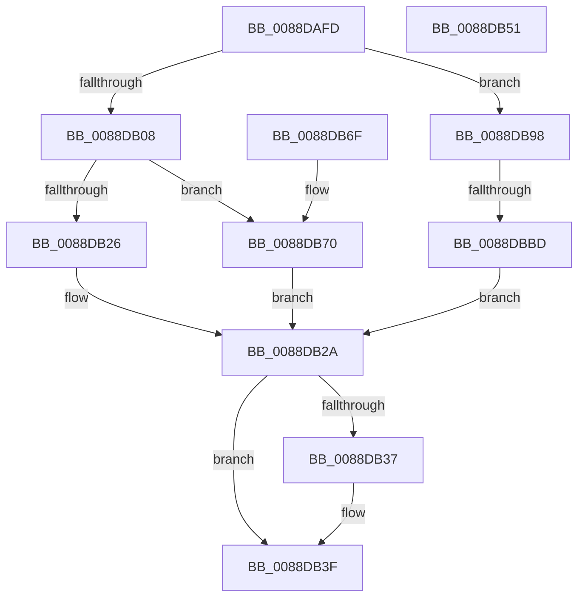

# sub_0088DAFD

- RVA: `0x0088DAFD`–`0x0088DBCA` (길이 `205` bytes)
- VA: `0x000000014088DAFD`
- 실행 섹션: `PAGE`
- PDB 이름 있음: `아니요`; PDB Function 태그: `아니요`
- unwind 정보 RVA: `0x0007D4A0`
- 디코드: `56`개 명령, `205/205` bytes 표시
- 미해석 바이트: `0` (있으면 어셈블리에 `.byte`로 보존)

> 이 문서는 커널 이미지의 기계어와 PDB 기호를 분석해 생성했습니다. 4번과 5번은 함수 원형과 자료형을 바이너리 사용 방식에서 추정한 C 해석이며 원본 소스 복구 결과는 아닙니다.

## 1. Dependencies

- 직접 호출 지점: **5**; 고유 호출 대상: **3**
- 직접 호출자로 확인된 함수: **0**
- RIP 상대 이미지 참조: **1**

### Outgoing calls
- `0x0088DB13` → [AlpcpUnlockMessage](../89/AlpcpUnlockMessage_function_00897AE0.md) (function, `0x00897AE0`)
- `0x0088DB3A` → [ObfDereferenceObject](../../text/2F/ObfDereferenceObject_function_002F9350.md) (function, `0x002F9350`)
- `0x0088DB55` → [AlpcpUnlockMessage](../89/AlpcpUnlockMessage_function_00897AE0.md) (function, `0x00897AE0`)
- `0x0088DB91` → [KeReleaseSemaphoreEx](../../text/34/KeReleaseSemaphoreEx_function_003468C0.md) (function, `0x003468C0`)
- `0x0088DBC0` → [AlpcpUnlockMessage](../89/AlpcpUnlockMessage_function_00897AE0.md) (function, `0x00897AE0`)

### Direct callers
- 이 함수 시작 RVA로 연결되는 직접 call은 확인되지 않았습니다. 간접 호출은 완전히 역산할 수 없습니다.

### Static image references
- `0x0088DB98` → RVA `0x00E66D00` (`.data`; read)

## 2. Other-region calls and transfers

- 다른 실행 섹션으로 향하는 call: **2**
  - `0x0088DB3A` → [ObfDereferenceObject](../../text/2F/ObfDereferenceObject_function_002F9350.md) (`PAGE` → `.text`)
  - `0x0088DB91` → [KeReleaseSemaphoreEx](../../text/34/KeReleaseSemaphoreEx_function_003468C0.md) (`PAGE` → `.text`)
- call이 아닌 외부 분기/꼬리 이동: **1**
  - `0x0088DBB7` → [sub_0088DCA0 + 0xD](Unknown_function_0088DCA0.md) (`tail-transfer`)

## 3. Assembly (complete function range)

```asm
0088DAFD  41 0F BA E5 11                  bt r13d, 0x11
0088DB02  0F 82 90 00 00 00               jb 0x14088db98
0088DB08  4C 89 7F 20                     mov qword ptr [rdi + 0x20], r15
0088DB0C  48 8B CF                        mov rcx, rdi
0088DB0F  66 FF 4F E2                     dec word ptr [rdi - 0x1e]
0088DB13  E8 C8 9F 00 00                  call 0x140897ae0
0088DB18  48 8B 8C 24 A0 00 00 00         mov rcx, qword ptr [rsp + 0xa0]
0088DB20  41 F6 C5 04                     test r13b, 4
0088DB24  74 4A                           je 0x14088db70
0088DB26  48 89 4E 18                     mov qword ptr [rsi + 0x18], rcx
0088DB2A  F7 84 24 98 00 00 00 00 10 00 00  test dword ptr [rsp + 0x98], 0x1000
0088DB35  74 08                           je 0x14088db3f
0088DB37  48 8B CD                        mov rcx, rbp
0088DB3A  E8 11 B8 A6 FF                  call 0x1402f9350
0088DB3F  33 C0                           xor eax, eax
0088DB41  48 83 C4 50                     add rsp, 0x50
0088DB45  41 5F                           pop r15
0088DB47  41 5E                           pop r14
0088DB49  41 5D                           pop r13
0088DB4B  41 5C                           pop r12
0088DB4D  5F                              pop rdi
0088DB4E  5E                              pop rsi
0088DB4F  5D                              pop rbp
0088DB50  C3                              ret
0088DB51  CC                              int3
0088DB52  48 8B CF                        mov rcx, rdi
0088DB55  E8 86 9F 00 00                  call 0x140897ae0
0088DB5A  B8 23 00 00 C0                  mov eax, 0xc0000023
0088DB5F  48 83 C4 50                     add rsp, 0x50
0088DB63  41 5F                           pop r15
0088DB65  41 5E                           pop r14
0088DB67  41 5D                           pop r13
0088DB69  41 5C                           pop r12
0088DB6B  5F                              pop rdi
0088DB6C  5E                              pop rsi
0088DB6D  5D                              pop rbp
0088DB6E  C3                              ret
0088DB6F  CC                              int3
0088DB70  41 C1 ED 15                     shr r13d, 0x15
0088DB74  BA 01 00 00 00                  mov edx, 1
0088DB79  41 83 E5 02                     and r13d, 2
0088DB7D  4C 89 7C 24 28                  mov qword ptr [rsp + 0x28], r15
0088DB82  48 81 C1 18 05 00 00            add rcx, 0x518
0088DB89  44 89 6C 24 20                  mov dword ptr [rsp + 0x20], r13d
0088DB8E  44 8B C2                        mov r8d, edx
0088DB91  E8 2A 8D AB FF                  call 0x1403468c0
0088DB96  EB 92                           jmp 0x14088db2a
0088DB98  80 3D 61 91 5D 00 00            cmp byte ptr [rip + 0x5d9161], 0
0088DB9F  48 8B 84 24 A8 00 00 00         mov rax, qword ptr [rsp + 0xa8]
0088DBA7  48 8B 8C 24 A0 00 00 00         mov rcx, qword ptr [rsp + 0xa0]
0088DBAF  48 89 47 20                     mov qword ptr [rdi + 0x20], rax
0088DBB3  48 89 4E 18                     mov qword ptr [rsi + 0x18], rcx
0088DBB7  0F 85 F0 00 00 00               jne 0x14088dcad
0088DBBD  48 8B CF                        mov rcx, rdi
0088DBC0  E8 1B 9F 00 00                  call 0x140897ae0
0088DBC5  E9 60 FF FF FF                  jmp 0x14088db2a
```

## 4. C-style interpretation (structured pseudocode)

```c
__int64 __fastcall sub_0088DAFD(__int64 a1, __int64 a2, __int64 a3, __int64 a4, __int64 a5, __int64 a6, __int64 a7, __int64 a8, __int64 a9, __int64 a10, __int64 a11, __int64 a12, __int64 a13, __int64 a14, __int64 a15, __int64 a16, __int64 a17, __int64 a18, unsigned int a19, __int64 a20, __int64 a21)
{
    __int64 result;
    __int64 v_r13;
    __int64 v_rsp;
    unsigned int v_stack_p130;
    unsigned __int64 v_stack_p138;

    if (condition_is_below) goto loc_0088DB98;
    *(unsigned __int64 *)(v_rdi + 32) = v_r15;
    result = AlpcpUnlockMessage(v_rdi, a2, a3, a4);
    if ((((unsigned __int8)(v_r13)) & (4)) == 0) goto loc_0088DB70;
    *(unsigned __int64 *)(v_rsi + 24) = a20;
loc_0088DB2A:
    if (((a19) & (0x1000ULL)) != 0) {
        a1 = v_rbp;
        result = ObfDereferenceObject(a1, a2, a3, a4);
    }
    result = 0;
    v_rsp = (v_rsp) + (80);
    return result;
loc_0088DB70:
    v_r13 = (unsigned int)((v_r13) >> (21));
    v_r13 = (unsigned int)((v_r13) & (2));
    v_stack_p138 = v_r15;
    a1 = (a1) + (0x518ULL);
    v_stack_p130 = (unsigned int)(v_r13);
    result = KeReleaseSemaphoreEx(a1, 1, 1, a4);
    goto loc_0088DB2A;
loc_0088DB98:
    *(unsigned __int64 *)(v_rdi + 32) = a21;
    *(unsigned __int64 *)(v_rsi + 24) = a20;
    result = AlpcpUnlockMessage(v_rdi, 1, 1, a4);
    goto loc_0088DB2A;
}
```

## 5. (Beta) C Style

```c
int64_t sub_0088DAFD(int64_t Arg1, int64_t Arg2, int64_t Arg3, int64_t Arg4, uint64_t Arg5, uint64_t Arg6, uint64_t Arg7, uint64_t Arg8, uint64_t Arg9, uint64_t Arg10, uint64_t Arg11, uint64_t Arg12, uint64_t Arg13, uint64_t Arg14, uint64_t Arg15, uint64_t Arg16, uint64_t Arg17, uint64_t Arg18, uint32_t Arg19, int64_t Arg20, int64_t Arg21)
{
    int64_t result;
    int64_t local_r13;
    int64_t local_rsp;
    uint32_t v_stack_p130;
    uint64_t v_stack_p138;

    if (condition_is_below) goto loc_0088DB98;
    *(uint64_t *)(local_rdi + 0x20) = local_r15;
    result = AlpcpUnlockMessage(local_rdi, Arg2, Arg3, Arg4);
    if ((((uint8_t)(local_r13)) & (4)) == 0) goto loc_0088DB70;
    *(uint64_t *)(local_rsi + 0x18) = Arg20;
loc_0088DB2A:
    if (((Arg19) & (0x1000ULL)) != 0) {
        Arg1 = local_rbp;
        result = ObfDereferenceObject(Arg1, Arg2, Arg3, Arg4);
    }
    result = 0;
    local_rsp = (local_rsp) + (80);
    return result;
loc_0088DB70:
    local_r13 = (uint32_t)((local_r13) >> (21));
    local_r13 = (uint32_t)((local_r13) & (2));
    v_stack_p138 = local_r15;
    Arg1 = (Arg1) + (0x518ULL);
    v_stack_p130 = (uint32_t)(local_r13);
    result = KeReleaseSemaphoreEx(Arg1, 1, 1, Arg4);
    goto loc_0088DB2A;
loc_0088DB98:
    *(uint64_t *)(local_rdi + 0x20) = Arg21;
    *(uint64_t *)(local_rsi + 0x18) = Arg20;
    result = AlpcpUnlockMessage(local_rdi, 1, 1, Arg4);
    goto loc_0088DB2A;
}
```

## 6. Execution-region graph

[열기: 2D/3D 그래프와 함수 탐색 컨트롤 패널](../../../control-panel.html?section=page&rva=0x0088DAFD&view=graph)

- 2D 그래프는 위에서 아래로 흐르고, 3D 그래프는 빈 공간을 드래그해 회전합니다. Shift+드래그는 이동, 휠은 확대·축소, 함수 노드 선택은 대상 보고서 이동입니다.

### Static fallback


