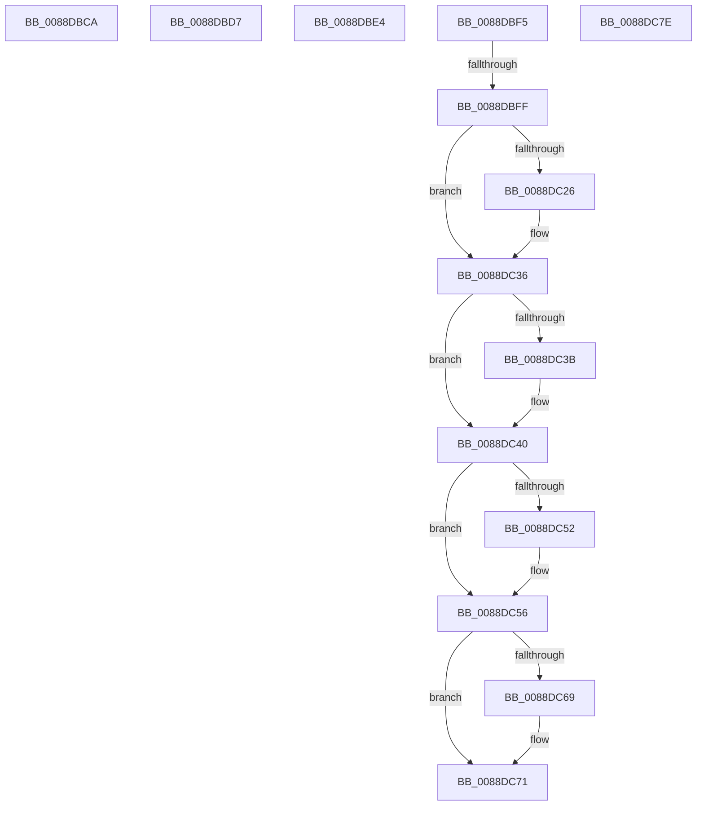

# sub_0088DBCA

- RVA: `0x0088DBCA`–`0x0088DCA0` (길이 `214` bytes)
- VA: `0x000000014088DBCA`
- 실행 섹션: `PAGE`
- PDB 이름 있음: `아니요`; PDB Function 태그: `아니요`
- unwind 정보 RVA: `0x0007D4B8`
- 디코드: `54`개 명령, `214/214` bytes 표시
- 미해석 바이트: `0` (있으면 어셈블리에 `.byte`로 보존)

> 이 문서는 커널 이미지의 기계어와 PDB 기호를 분석해 생성했습니다. 4번과 5번은 함수 원형과 자료형을 바이너리 사용 방식에서 추정한 C 해석이며 원본 소스 복구 결과는 아닙니다.

## 1. Dependencies

- 직접 호출 지점: **6**; 고유 호출 대상: **5**
- 직접 호출자로 확인된 함수: **0**
- RIP 상대 이미지 참조: **0**

### Outgoing calls
- `0x0088DBCD` → [ExfTryToWakePushLock](../../text/26/ExfTryToWakePushLock_function_00265DD0.md) (function, `0x00265DD0`)
- `0x0088DBDA` → [ExfTryToWakePushLock](../../text/26/ExfTryToWakePushLock_function_00265DD0.md) (function, `0x00265DD0`)
- `0x0088DC0F` → [KeAbPreAcquire](../../text/21/KeAbPreAcquire_function_00210230.md) (function, `0x00210230`)
- `0x0088DC31` → [ExfAcquirePushLockSharedEx](../../text/21/ExfAcquirePushLockSharedEx_function_0021044C.md) (function, `0x0021044C`)
- `0x0088DC6C` → [ExfReleasePushLockShared](../../text/26/ExfReleasePushLockShared_function_00263440.md) (function, `0x00263440`)
- `0x0088DC74` → [KeAbPostRelease](../../text/2E/KeAbPostRelease_function_002E1600.md) (function, `0x002E1600`)

### Direct callers
- 이 함수 시작 RVA로 연결되는 직접 call은 확인되지 않았습니다. 간접 호출은 완전히 역산할 수 없습니다.

### Static image references
- 디코드된 RIP-relative 메모리 참조가 없습니다.

## 2. Other-region calls and transfers

- 다른 실행 섹션으로 향하는 call: **6**
  - `0x0088DBCD` → [ExfTryToWakePushLock](../../text/26/ExfTryToWakePushLock_function_00265DD0.md) (`PAGE` → `.text`)
  - `0x0088DBDA` → [ExfTryToWakePushLock](../../text/26/ExfTryToWakePushLock_function_00265DD0.md) (`PAGE` → `.text`)
  - `0x0088DC0F` → [KeAbPreAcquire](../../text/21/KeAbPreAcquire_function_00210230.md) (`PAGE` → `.text`)
  - `0x0088DC31` → [ExfAcquirePushLockSharedEx](../../text/21/ExfAcquirePushLockSharedEx_function_0021044C.md) (`PAGE` → `.text`)
  - `0x0088DC6C` → [ExfReleasePushLockShared](../../text/26/ExfReleasePushLockShared_function_00263440.md) (`PAGE` → `.text`)
  - `0x0088DC74` → [KeAbPostRelease](../../text/2E/KeAbPostRelease_function_002E1600.md) (`PAGE` → `.text`)
- call이 아닌 외부 분기/꼬리 이동: **6**
  - `0x0088DBD2` → [sub_0088D871 + 0x194](Unknown_function_0088D871.md) (`tail-transfer`)
  - `0x0088DBDF` → [sub_0088D871 + 0x59](Unknown_function_0088D871.md) (`tail-transfer`)
  - `0x0088DBF0` → [sub_0088D871 + 0xDB](Unknown_function_0088D871.md) (`tail-transfer`)
  - `0x0088DBF9` → [sub_0088D871 + 0x1E7](Unknown_function_0088D871.md) (`tail-transfer`)
  - `0x0088DC79` → [sub_0088D871 + 0x1F8](Unknown_function_0088D871.md) (`tail-transfer`)
  - `0x0088DC9B` → [sub_0088D871 + 0x107](Unknown_function_0088D871.md) (`tail-transfer`)

## 3. Assembly (complete function range)

```asm
0088DBCA  49 8B CF                        mov rcx, r15
0088DBCD  E8 FE 81 9D FF                  call 0x140265dd0
0088DBD2  E9 2E FE FF FF                  jmp 0x14088da05
0088DBD7  49 8B CF                        mov rcx, r15
0088DBDA  E8 F1 81 9D FF                  call 0x140265dd0
0088DBDF  E9 E6 FC FF FF                  jmp 0x14088d8ca
0088DBE4  B8 00 20 00 00                  mov eax, 0x2000
0088DBE9  66 0B D0                        or dx, ax
0088DBEC  0F BA F1 09                     btr ecx, 9
0088DBF0  E9 57 FD FF FF                  jmp 0x14088d94c
0088DBF5  41 83 FC 01                     cmp r12d, 1
0088DBF9  0F 85 59 FE FF FF               jne 0x14088da58
0088DBFF  4C 8B 7D 10                     mov r15, qword ptr [rbp + 0x10]
0088DC03  45 33 C0                        xor r8d, r8d
0088DC06  33 D2                           xor edx, edx
0088DC08  49 8D 5F F0                     lea rbx, [r15 - 0x10]
0088DC0C  48 8B CB                        mov rcx, rbx
0088DC0F  E8 1C 26 98 FF                  call 0x140210230
0088DC14  4C 8B F0                        mov r14, rax
0088DC17  41 BC 11 00 00 00               mov r12d, 0x11
0088DC1D  33 C0                           xor eax, eax
0088DC1F  F0 4C 0F B1 23                  lock cmpxchg qword ptr [rbx], r12
0088DC24  74 10                           je 0x14088dc36
0088DC26  4C 8B CB                        mov r9, rbx
0088DC29  4D 8B C6                        mov r8, r14
0088DC2C  33 D2                           xor edx, edx
0088DC2E  48 8B CB                        mov rcx, rbx
0088DC31  E8 16 28 98 FF                  call 0x14021044c
0088DC36  4D 85 F6                        test r14, r14
0088DC39  74 05                           je 0x14088dc40
0088DC3B  41 C6 46 0A 01                  mov byte ptr [r14 + 0xa], 1
0088DC40  49 8B 47 08                     mov rax, qword ptr [r15 + 8]
0088DC44  48 8B D7                        mov rdx, rdi
0088DC47  45 33 FF                        xor r15d, r15d
0088DC4A  41 8B CF                        mov ecx, r15d
0088DC4D  48 85 C0                        test rax, rax
0088DC50  74 04                           je 0x14088dc56
0088DC52  48 8B 48 38                     mov rcx, qword ptr [rax + 0x38]
0088DC56  B8 78 00 00 00                  mov eax, 0x78
0088DC5B  48 89 0C 02                     mov qword ptr [rdx + rax], rcx
0088DC5F  49 8B C4                        mov rax, r12
0088DC62  F0 4C 0F B1 3B                  lock cmpxchg qword ptr [rbx], r15
0088DC67  74 08                           je 0x14088dc71
0088DC69  48 8B CB                        mov rcx, rbx
0088DC6C  E8 CF 57 9D FF                  call 0x140263440
0088DC71  48 8B CB                        mov rcx, rbx
0088DC74  E8 87 39 A5 FF                  call 0x1402e1600
0088DC79  E9 EB FD FF FF                  jmp 0x14088da69
0088DC7E  48 8B 8C 24 A8 00 00 00         mov rcx, qword ptr [rsp + 0xa8]
0088DC86  48 8B C7                        mov rax, rdi
0088DC89  48 87 81 B8 05 00 00            xchg qword ptr [rcx + 0x5b8], rax
0088DC90  81 4F 28 00 08 00 00            or dword ptr [rdi + 0x28], 0x800
0088DC97  66 FF 47 E2                     inc word ptr [rdi - 0x1e]
0088DC9B  E9 D8 FC FF FF                  jmp 0x14088d978
```

## 4. C-style interpretation (structured pseudocode)

```c
__int64 __fastcall sub_0088DBCA(__int64 a1, unsigned __int16 a2, int a3)
{
    __int64 result;
    unsigned __int64 v_stack_pA8;

    result = ExfTryToWakePushLock(v_r15, a2, a3, a4);
}
```

## 5. (Beta) C Style

```c
int64_t sub_0088DBCA(int64_t Arg1, uint16_t Arg2, int32_t Arg3)
{
    int64_t result;
    uint64_t v_stack_pA8;

    result = ExfTryToWakePushLock(local_r15, Arg2, Arg3, a4);
}
```

## 6. Execution-region graph

[열기: 2D/3D 그래프와 함수 탐색 컨트롤 패널](../../../control-panel.html?section=page&rva=0x0088DBCA&view=graph)

- 2D 그래프는 위에서 아래로 흐르고, 3D 그래프는 빈 공간을 드래그해 회전합니다. Shift+드래그는 이동, 휠은 확대·축소, 함수 노드 선택은 대상 보고서 이동입니다.

### Static fallback


