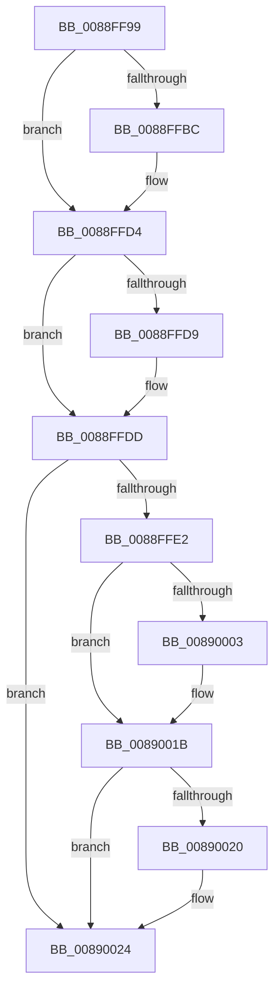

# sub_0088FF99

- RVA: `0x0088FF99`–`0x00890033` (길이 `154` bytes)
- VA: `0x000000014088FF99`
- 실행 섹션: `PAGE`
- PDB 이름 있음: `아니요`; PDB Function 태그: `아니요`
- unwind 정보 RVA: `0x0007D670`
- 디코드: `38`개 명령, `154/154` bytes 표시
- 미해석 바이트: `0` (있으면 어셈블리에 `.byte`로 보존)

> 이 문서는 커널 이미지의 기계어와 PDB 기호를 분석해 생성했습니다. 4번과 5번은 함수 원형과 자료형을 바이너리 사용 방식에서 추정한 C 해석이며 원본 소스 복구 결과는 아닙니다.

## 1. Dependencies

- 직접 호출 지점: **4**; 고유 호출 대상: **2**
- 직접 호출자로 확인된 함수: **0**
- RIP 상대 이미지 참조: **0**

### Outgoing calls
- `0x0088FFA7` → [KeAbPreAcquire](../../text/21/KeAbPreAcquire_function_00210230.md) (function, `0x00210230`)
- `0x0088FFCF` → [ExfAcquirePushLockSharedEx](../../text/21/ExfAcquirePushLockSharedEx_function_0021044C.md) (function, `0x0021044C`)
- `0x0088FFEE` → [KeAbPreAcquire](../../text/21/KeAbPreAcquire_function_00210230.md) (function, `0x00210230`)
- `0x00890016` → [ExfAcquirePushLockSharedEx](../../text/21/ExfAcquirePushLockSharedEx_function_0021044C.md) (function, `0x0021044C`)

### Direct callers
- 이 함수 시작 RVA로 연결되는 직접 call은 확인되지 않았습니다. 간접 호출은 완전히 역산할 수 없습니다.

### Static image references
- 디코드된 RIP-relative 메모리 참조가 없습니다.

## 2. Other-region calls and transfers

- 다른 실행 섹션으로 향하는 call: **4**
  - `0x0088FFA7` → [KeAbPreAcquire](../../text/21/KeAbPreAcquire_function_00210230.md) (`PAGE` → `.text`)
  - `0x0088FFCF` → [ExfAcquirePushLockSharedEx](../../text/21/ExfAcquirePushLockSharedEx_function_0021044C.md) (`PAGE` → `.text`)
  - `0x0088FFEE` → [KeAbPreAcquire](../../text/21/KeAbPreAcquire_function_00210230.md) (`PAGE` → `.text`)
  - `0x00890016` → [ExfAcquirePushLockSharedEx](../../text/21/ExfAcquirePushLockSharedEx_function_0021044C.md) (`PAGE` → `.text`)
- call이 아닌 외부 분기/꼬리 이동: **1**
  - `0x00890031` → [sub_00890033 + 0x75](../89/Unknown_function_00890033.md) (`tail-transfer`)

## 3. Assembly (complete function range)

```asm
0088FF99  48 89 6C 24 58                  mov qword ptr [rsp + 0x58], rbp
0088FF9E  33 D2                           xor edx, edx
0088FFA0  48 8D 8B 60 01 00 00            lea rcx, [rbx + 0x160]
0088FFA7  E8 84 02 98 FF                  call 0x140210230
0088FFAC  48 8B E8                        mov rbp, rax
0088FFAF  33 C0                           xor eax, eax
0088FFB1  F0 4C 0F B1 AB 60 01 00 00      lock cmpxchg qword ptr [rbx + 0x160], r13
0088FFBA  74 18                           je 0x14088ffd4
0088FFBC  4C 8D 8B 60 01 00 00            lea r9, [rbx + 0x160]
0088FFC3  4C 8B C5                        mov r8, rbp
0088FFC6  33 D2                           xor edx, edx
0088FFC8  48 8D 8B 60 01 00 00            lea rcx, [rbx + 0x160]
0088FFCF  E8 78 04 98 FF                  call 0x14021044c
0088FFD4  48 85 ED                        test rbp, rbp
0088FFD7  74 04                           je 0x14088ffdd
0088FFD9  C6 45 0A 01                     mov byte ptr [rbp + 0xa], 1
0088FFDD  48 3B FB                        cmp rdi, rbx
0088FFE0  74 42                           je 0x140890024
0088FFE2  45 33 C0                        xor r8d, r8d
0088FFE5  48 8D 8F 60 01 00 00            lea rcx, [rdi + 0x160]
0088FFEC  33 D2                           xor edx, edx
0088FFEE  E8 3D 02 98 FF                  call 0x140210230
0088FFF3  48 8B E8                        mov rbp, rax
0088FFF6  33 C0                           xor eax, eax
0088FFF8  F0 4C 0F B1 AF 60 01 00 00      lock cmpxchg qword ptr [rdi + 0x160], r13
00890001  74 18                           je 0x14089001b
00890003  4C 8D 8F 60 01 00 00            lea r9, [rdi + 0x160]
0089000A  4C 8B C5                        mov r8, rbp
0089000D  33 D2                           xor edx, edx
0089000F  48 8D 8F 60 01 00 00            lea rcx, [rdi + 0x160]
00890016  E8 31 04 98 FF                  call 0x14021044c
0089001B  48 85 ED                        test rbp, rbp
0089001E  74 04                           je 0x140890024
00890020  C6 45 0A 01                     mov byte ptr [rbp + 0xa], 1
00890024  8B 83 A0 01 00 00               mov eax, dword ptr [rbx + 0x1a0]
0089002A  48 8B 6C 24 58                  mov rbp, qword ptr [rsp + 0x58]
0089002F  A8 20                           test al, 0x20
00890031  75 75                           jne 0x1408900a8
```

## 4. C-style interpretation (structured pseudocode)

```c
__int64 __fastcall sub_0088FF99(__int64 a1, int a2, __int64 a3, __int64 a4, __int64 a5, __int64 a6, __int64 a7, __int64 a8, __int64 a9, __int64 a10, __int64 a11)
{
    __int64 result;
    unsigned __int64 v_stack_p58;

    v_stack_p58 = v_rbp;
    a2 = 0;
    result = KeAbPreAcquire(v_rbx + 352, a2, a3, a4);
    result = 0;
    if (!(condition_is_equal)) {
        a4 = v_rbx + 352;
        a3 = 0;
        a2 = 0;
        a1 = v_rbx + 352;
        result = ExfAcquirePushLockSharedEx(a1, a2, a3, a4);
    }
    if (result != 0) {
        *(unsigned __int8 *)(result + 10) = 1;
    }
    if (v_rdi == v_rbx) goto loc_00890024;
    a3 = 0;
    a2 = 0;
    result = KeAbPreAcquire(v_rdi + 352, a2, a3, a4);
    result = 0;
    if (!(condition_is_equal)) {
        a4 = v_rdi + 352;
        a3 = 0;
        a2 = 0;
        a1 = v_rdi + 352;
        result = ExfAcquirePushLockSharedEx(a1, a2, a3, a4);
    }
    if (result != 0) {
        *(unsigned __int8 *)(result + 10) = 1;
    }
}
```

## 5. (Beta) C Style

```c
int64_t sub_0088FF99(int64_t Arg1, int32_t Arg2, int64_t Arg3, int64_t Arg4, uint64_t Arg5, uint64_t Arg6, uint64_t Arg7, uint64_t Arg8, uint64_t Arg9, uint64_t Arg10, int64_t Arg11)
{
    int64_t result;
    uint64_t v_stack_p58;

    v_stack_p58 = local_rbp;
    Arg2 = 0;
    result = KeAbPreAcquire(local_rbx + 352, Arg2, Arg3, Arg4);
    result = 0;
    if (!(condition_is_equal)) {
        Arg4 = local_rbx + 352;
        Arg3 = 0;
        Arg2 = 0;
        Arg1 = local_rbx + 352;
        result = ExfAcquirePushLockSharedEx(Arg1, Arg2, Arg3, Arg4);
    }
    if (result != 0) {
        *(uint8_t *)(result + 0xA) = 1;
    }
    if (local_rdi == local_rbx) goto loc_00890024;
    Arg3 = 0;
    Arg2 = 0;
    result = KeAbPreAcquire(local_rdi + 352, Arg2, Arg3, Arg4);
    result = 0;
    if (!(condition_is_equal)) {
        Arg4 = local_rdi + 352;
        Arg3 = 0;
        Arg2 = 0;
        Arg1 = local_rdi + 352;
        result = ExfAcquirePushLockSharedEx(Arg1, Arg2, Arg3, Arg4);
    }
    if (result != 0) {
        *(uint8_t *)(result + 0xA) = 1;
    }
}
```

## 6. Execution-region graph

[열기: 2D/3D 그래프와 함수 탐색 컨트롤 패널](../../../control-panel.html?section=page&rva=0x0088FF99&view=graph)

- 2D 그래프는 위에서 아래로 흐르고, 3D 그래프는 빈 공간을 드래그해 회전합니다. Shift+드래그는 이동, 휠은 확대·축소, 함수 노드 선택은 대상 보고서 이동입니다.

### Static fallback


