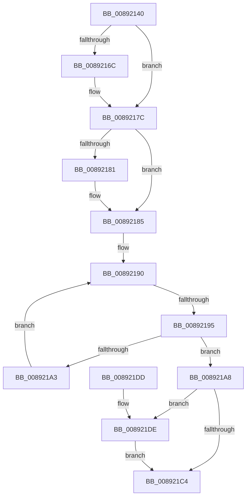

# AlpcAddHandleTableEntry

- RVA: `0x00892140`–`0x008921E9` (길이 `169` bytes)
- VA: `0x0000000140892140`
- 실행 섹션: `PAGE`
- PDB 이름 있음: `예`; PDB Function 태그: `아니요`
- unwind 정보 RVA: `0x0007DB54`
- 디코드: `54`개 명령, `169/169` bytes 표시
- 미해석 바이트: `0` (있으면 어셈블리에 `.byte`로 보존)

> 이 문서는 커널 이미지의 기계어와 PDB 기호를 분석해 생성했습니다. 4번과 5번은 함수 원형과 자료형을 바이너리 사용 방식에서 추정한 C 해석이며 원본 소스 복구 결과는 아닙니다.

## 1. Dependencies

- 직접 호출 지점: **4**; 고유 호출 대상: **4**
- 직접 호출자로 확인된 함수: **3**
- RIP 상대 이미지 참조: **0**

### Outgoing calls
- `0x0089215B` → [KeAbPreAcquire](../../text/21/KeAbPreAcquire_function_00210230.md) (function, `0x00210230`)
- `0x00892177` → [ExfAcquirePushLockExclusiveEx](../../text/20/ExfAcquirePushLockExclusiveEx_function_0020FC90.md) (function, `0x0020FC90`)
- `0x008921C8` → [KeAbPostRelease](../../text/2E/KeAbPostRelease_function_002E1600.md) (function, `0x002E1600`)
- `0x008921E2` → [ExfTryToWakePushLock](../../text/26/ExfTryToWakePushLock_function_00265DD0.md) (function, `0x00265DD0`)

### Direct callers
- [AlpcpCreateSecurityContext](AlpcpCreateSecurityContext_function_00890D94.md) at `0x00890FDD`
- [AlpcpCreateReserve](AlpcpCreateReserve_function_00892318.md) at `0x008924E3`
- [AlpcpCreateSection](AlpcpCreateSection_function_0089307C.md) at `0x00893216`

### Static image references
- 디코드된 RIP-relative 메모리 참조가 없습니다.

## 2. Other-region calls and transfers

- 다른 실행 섹션으로 향하는 call: **4**
  - `0x0089215B` → [KeAbPreAcquire](../../text/21/KeAbPreAcquire_function_00210230.md) (`PAGE` → `.text`)
  - `0x00892177` → [ExfAcquirePushLockExclusiveEx](../../text/20/ExfAcquirePushLockExclusiveEx_function_0020FC90.md) (`PAGE` → `.text`)
  - `0x008921C8` → [KeAbPostRelease](../../text/2E/KeAbPostRelease_function_002E1600.md) (`PAGE` → `.text`)
  - `0x008921E2` → [ExfTryToWakePushLock](../../text/26/ExfTryToWakePushLock_function_00265DD0.md) (`PAGE` → `.text`)
- call이 아닌 외부 분기/꼬리 이동: **1**
  - `0x00892193` → [sub_008921E9](Unknown_function_008921E9.md) (`tail-transfer`)

## 3. Assembly (complete function range)

```asm
00892140  40 53                           push rbx
00892142  56                              push rsi
00892143  57                              push rdi
00892144  41 54                           push r12
00892146  41 55                           push r13
00892148  48 83 EC 20                     sub rsp, 0x20
0089214C  4C 8B EA                        mov r13, rdx
0089214F  48 8B F1                        mov rsi, rcx
00892152  33 D2                           xor edx, edx
00892154  48 83 C1 08                     add rcx, 8
00892158  45 33 C0                        xor r8d, r8d
0089215B  E8 D0 E0 97 FF                  call 0x140210230
00892160  F0 48 0F BA 6E 08 00            lock bts qword ptr [rsi + 8], 0
00892167  48 8B D8                        mov rbx, rax
0089216A  73 10                           jae 0x14089217c
0089216C  4C 8D 46 08                     lea r8, [rsi + 8]
00892170  48 8B D0                        mov rdx, rax
00892173  48 8D 4E 08                     lea rcx, [rsi + 8]
00892177  E8 14 DB 97 FF                  call 0x14020fc90
0089217C  48 85 DB                        test rbx, rbx
0089217F  74 04                           je 0x140892185
00892181  C6 43 0A 01                     mov byte ptr [rbx + 0xa], 1
00892185  48 8B 56 10                     mov rdx, qword ptr [rsi + 0x10]
00892189  33 FF                           xor edi, edi
0089218B  0F 1F 44 00 00                  nop dword ptr [rax + rax]
00892190  48 3B FA                        cmp rdi, rdx
00892193  73 54                           jae 0x1408921e9
00892195  48 8B 06                        mov rax, qword ptr [rsi]
00892198  48 83 3C F8 00                  cmp qword ptr [rax + rdi*8], 0
0089219D  48 8D 0C F8                     lea rcx, [rax + rdi*8]
008921A1  74 05                           je 0x1408921a8
008921A3  48 FF C7                        inc rdi
008921A6  EB E8                           jmp 0x140892190
008921A8  49 8B 45 00                     mov rax, qword ptr [r13]
008921AC  48 C7 C3 FF FF FF FF            mov rbx, 0xffffffffffffffff
008921B3  48 89 01                        mov qword ptr [rcx], rax
008921B6  F0 48 0F C1 5E 08               lock xadd qword ptr [rsi + 8], rbx
008921BC  80 E3 06                        and bl, 6
008921BF  80 FB 02                        cmp bl, 2
008921C2  74 1A                           je 0x1408921de
008921C4  48 8D 4E 08                     lea rcx, [rsi + 8]
008921C8  E8 33 F4 A4 FF                  call 0x1402e1600
008921CD  48 8D 47 10                     lea rax, [rdi + 0x10]
008921D1  48 83 C4 20                     add rsp, 0x20
008921D5  41 5D                           pop r13
008921D7  41 5C                           pop r12
008921D9  5F                              pop rdi
008921DA  5E                              pop rsi
008921DB  5B                              pop rbx
008921DC  C3                              ret
008921DD  CC                              int3
008921DE  48 8D 4E 08                     lea rcx, [rsi + 8]
008921E2  E8 E9 3B 9D FF                  call 0x140265dd0
008921E7  EB DB                           jmp 0x1408921c4
```

## 4. C-style interpretation (structured pseudocode)

```c
__int64 __fastcall AlpcAddHandleTableEntry(__int64 a1, __int64 a2, int a3)
{
    __int64 result;
    __int64 v_rbx;
    __int64 v_rdi;
    __int64 v_rsp;

    v_rsp = (v_rsp) - (32);
    a2 = 0;
    a1 = (a1) + (8);
    a3 = 0;
    result = KeAbPreAcquire(a1, a2, a3, a4);
    if (!(condition_is_above_or_equal)) {
        a3 = a1 + 8;
        a2 = result;
        a1 = a1 + 8;
        result = ExfAcquirePushLockExclusiveEx(a1, a2, a3, a4);
    }
    if (result != 0) {
        *(unsigned __int8 *)(result + 10) = 1;
    }
    v_rdi = 0;
loc_00892190:
    if ((*(unsigned __int64 *)(*(unsigned __int64 *)(a1) + v_rdi * 8)) == 0) goto loc_008921A8;
    v_rdi = (v_rdi) + 1;
    goto loc_00892190;
loc_008921A8:
    *(unsigned __int64 *)(*(unsigned __int64 *)(a1) + v_rdi * 8) = *(unsigned __int64 *)(a2);
    v_rbx = (unsigned __int8)((-1) & (6));
    if (((unsigned __int8)(v_rbx)) == 2) goto loc_008921DE;
loc_008921C4:
    result = KeAbPostRelease(a1 + 8, *(unsigned __int64 *)(a1 + 16), a3, a4);
    v_rsp = (v_rsp) + (32);
    return v_rdi + 16;
loc_008921DE:
    result = ExfTryToWakePushLock(a1 + 8, *(unsigned __int64 *)(a1 + 16), a3, a4);
    goto loc_008921C4;
}
```

## 5. (Beta) C Style

```c
int64_t AlpcAddHandleTableEntry(void *Arg1, void *Arg2, int32_t Arg3)
{
    uint8_t *arg1 = (uint8_t *)Arg1;
    uint8_t *arg2 = (uint8_t *)Arg2;

    int64_t result;
    int64_t local_rbx;
    int64_t local_rdi;
    int64_t local_rsp;

    local_rsp = (local_rsp) - (32);
    Arg2 = 0;
    Arg1 = (Arg1) + (8);
    Arg3 = 0;
    result = KeAbPreAcquire(Arg1, Arg2, Arg3, a4);
    if (!(condition_is_above_or_equal)) {
        Arg3 = Arg1 + 8;
        Arg2 = result;
        Arg1 = Arg1 + 8;
        result = ExfAcquirePushLockExclusiveEx(Arg1, Arg2, Arg3, a4);
    }
    if (result != 0) {
        *(uint8_t *)(result + 0xA) = 1;
    }
    local_rdi = 0;
loc_00892190:
    if ((*(uint64_t *)(*(uint64_t *)(arg1) + local_rdi * 8)) == 0) goto loc_008921A8;
    local_rdi = (local_rdi) + 1;
    goto loc_00892190;
loc_008921A8:
    *(uint64_t *)(*(uint64_t *)(arg1) + local_rdi * 8) = *(uint64_t *)(arg2);
    local_rbx = (uint8_t)((-1) & (6));
    if (((uint8_t)(local_rbx)) == 2) goto loc_008921DE;
loc_008921C4:
    result = KeAbPostRelease(Arg1 + 8, *(uint64_t *)(arg1 + 0x10), Arg3, a4);
    local_rsp = (local_rsp) + (32);
    return local_rdi + 16;
loc_008921DE:
    result = ExfTryToWakePushLock(Arg1 + 8, *(uint64_t *)(arg1 + 0x10), Arg3, a4);
    goto loc_008921C4;
}
```

### 관측된 메모리 오프셋

구조체 형식이 확인되지 않은 접근은 인자 기준의 오프셋으로만 기록했습니다.

| 기준 인자 | 오프셋 표현 | 폭 (bit) | 접근 |
|---|---:|---:|---|
| `Arg1` | `+ 0x0` | `64` | `R` |
| `Arg1` | `+ 0x8` | `64` | `R` |
| `Arg1` | `+ 0x8` | `64` | `R/W` |
| `Arg1` | `+ 0x10` | `64` | `R` |
| `Arg2` | `+ 0x0` | `64` | `R` |

## 6. Execution-region graph

[열기: 2D/3D 그래프와 함수 탐색 컨트롤 패널](../../../control-panel.html?section=page&rva=0x00892140&view=graph)

- 2D 그래프는 위에서 아래로 흐르고, 3D 그래프는 빈 공간을 드래그해 회전합니다. Shift+드래그는 이동, 휠은 확대·축소, 함수 노드 선택은 대상 보고서 이동입니다.

### Static fallback


