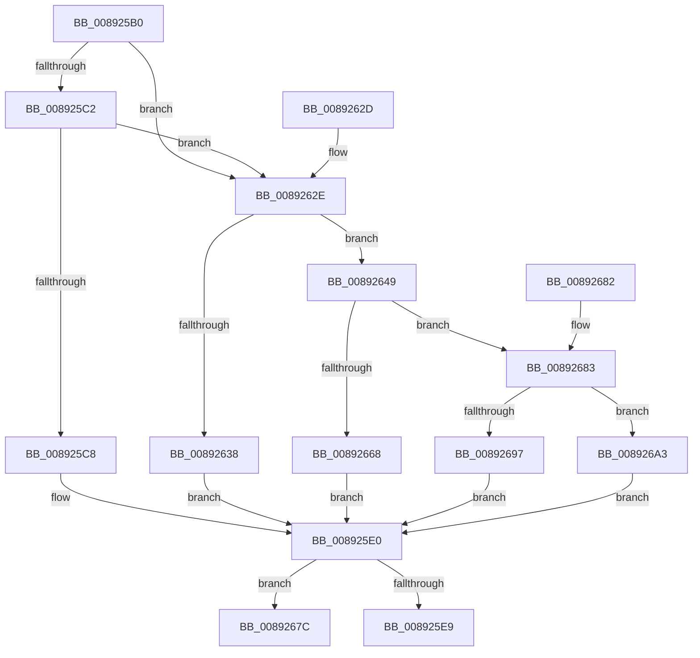

# AlpcpAllocateBlob

- RVA: `0x008925B0`–`0x008926AF` (길이 `255` bytes)
- VA: `0x00000001408925B0`
- 실행 섹션: `PAGE`
- PDB 이름 있음: `예`; PDB Function 태그: `아니요`
- unwind 정보 RVA: `0x0007DC14`
- 디코드: `72`개 명령, `255/255` bytes 표시
- 미해석 바이트: `0` (있으면 어셈블리에 `.byte`로 보존)

> 이 문서는 커널 이미지의 기계어와 PDB 기호를 분석해 생성했습니다. 4번과 5번은 함수 원형과 자료형을 바이너리 사용 방식에서 추정한 C 해석이며 원본 소스 복구 결과는 아닙니다.

## 1. Dependencies

- 직접 호출 지점: **5**; 고유 호출 대상: **5**
- 직접 호출자로 확인된 함수: **6**
- RIP 상대 이미지 참조: **3**

### Outgoing calls
- `0x008925D9` → [ExAllocateFromPagedLookasideList](../../text/3F/ExAllocateFromPagedLookasideList_function_003FB730.md) (function, `0x003FB730`)
- `0x00892640` → [ExAllocatePool2](../../poolcode/B8/ExAllocatePool2_function_00B820F0.md) (function, `0x00B820F0`)
- `0x00892670` → [AlpcpAllocateBuffer](AlpcpAllocateBuffer_function_00892BC0.md) (function, `0x00892BC0`)
- `0x00892697` → [AlpcpAllocateMessageFunction](AlpcpAllocateMessageFunction_function_00892FF0.md) (function, `0x00892FF0`)
- `0x008926A3` → [guard_dispatch_icall](../../text/6B/guard_dispatch_icall_function_006BAAD0.md) (function, `0x006BAAD0`)

### Direct callers
- [AlpcpCreateReserve](AlpcpCreateReserve_function_00892318.md) at `0x00892367`
- [AlpcpCaptureHandleAttributeInternal](AlpcpCaptureHandleAttributeInternal_function_00892CDC.md) at `0x00892D48`
- [AlpcpCreateSection](AlpcpCreateSection_function_0089307C.md) at `0x008930E5`
- [AlpcpCreateRegion](AlpcpCreateRegion_function_008933B0.md) at `0x0089347C`
- [AlpcpCreateClientPort](../92/AlpcpCreateClientPort_function_009270AC.md) at `0x009272C7`
- [AlpcpCreateConnectionPort](../9E/AlpcpCreateConnectionPort_function_009E70B0.md) at `0x009E71EB`

### Static image references
- `0x008925CB` → RVA `0x00E27180` (`.data`; read)
- `0x0089265C` → RVA `0x00892BC0` (`AlpcpAllocateBuffer`; read)
- `0x00892683` → RVA `0x00892FF0` (`AlpcpAllocateMessageFunction`; read)

## 2. Other-region calls and transfers

- 다른 실행 섹션으로 향하는 call: **3**
  - `0x008925D9` → [ExAllocateFromPagedLookasideList](../../text/3F/ExAllocateFromPagedLookasideList_function_003FB730.md) (`PAGE` → `.text`)
  - `0x00892640` → [ExAllocatePool2](../../poolcode/B8/ExAllocatePool2_function_00B820F0.md) (`PAGE` → `POOLCODE`)
  - `0x008926A3` → [guard_dispatch_icall](../../text/6B/guard_dispatch_icall_function_006BAAD0.md) (`PAGE` → `.text`)
- 별도 외부 분기/꼬리 이동을 확인하지 못했습니다.

## 3. Assembly (complete function range)

```asm
008925B0  40 53                           push rbx
008925B2  48 83 EC 20                     sub rsp, 0x20
008925B6  48 83 C2 30                     add rdx, 0x30
008925BA  48 8B D9                        mov rbx, rcx
008925BD  45 85 C0                        test r8d, r8d
008925C0  75 6C                           jne 0x14089262e
008925C2  48 39 51 30                     cmp qword ptr [rcx + 0x30], rdx
008925C6  72 66                           jb 0x14089262e
008925C8  8B 49 08                        mov ecx, dword ptr [rcx + 8]
008925CB  4C 8D 05 AE 4B 59 00            lea r8, [rip + 0x594bae]
008925D2  48 C1 E1 07                     shl rcx, 7
008925D6  49 03 C8                        add rcx, r8
008925D9  E8 52 91 B6 FF                  call 0x1403fb730
008925DE  B2 02                           mov dl, 2
008925E0  48 85 C0                        test rax, rax
008925E3  0F 84 93 00 00 00               je 0x14089267c
008925E9  33 C9                           xor ecx, ecx
008925EB  48 89 08                        mov qword ptr [rax], rcx
008925EE  48 89 48 08                     mov qword ptr [rax + 8], rcx
008925F2  48 89 48 10                     mov qword ptr [rax + 0x10], rcx
008925F6  48 89 48 18                     mov qword ptr [rax + 0x18], rcx
008925FA  48 89 48 28                     mov qword ptr [rax + 0x28], rcx
008925FE  48 89 48 20                     mov qword ptr [rax + 0x20], rcx
00892602  0F B6 0B                        movzx ecx, byte ptr [rbx]
00892605  88 48 11                        mov byte ptr [rax + 0x11], cl
00892608  48 89 40 08                     mov qword ptr [rax + 8], rax
0089260C  48 89 00                        mov qword ptr [rax], rax
0089260F  0F B6 48 10                     movzx ecx, byte ptr [rax + 0x10]
00892613  80 E1 FD                        and cl, 0xfd
00892616  48 C7 40 18 01 00 00 00         mov qword ptr [rax + 0x18], 1
0089261E  0A CA                           or cl, dl
00892620  88 48 10                        mov byte ptr [rax + 0x10], cl
00892623  48 83 C0 30                     add rax, 0x30
00892627  48 83 C4 20                     add rsp, 0x20
0089262B  5B                              pop rbx
0089262C  C3                              ret
0089262D  CC                              int3
0089262E  48 83 7B 30 00                  cmp qword ptr [rbx + 0x30], 0
00892633  8B 49 04                        mov ecx, dword ptr [rcx + 4]
00892636  77 11                           ja 0x140892649
00892638  44 8B C1                        mov r8d, ecx
0089263B  B9 00 01 00 00                  mov ecx, 0x100
00892640  E8 AB FA 2E 00                  call 0x140b820f0
00892645  32 D2                           xor dl, dl
00892647  EB 97                           jmp 0x1408925e0
00892649  8B 43 08                        mov eax, dword ptr [rbx + 8]
0089264C  4C 8D 05 2D 4B 59 00            lea r8, [rip + 0x594b2d]
00892653  48 C1 E0 07                     shl rax, 7
00892657  4A 8B 44 00 30                  mov rax, qword ptr [rax + r8 + 0x30]
0089265C  4C 8D 05 5D 05 00 00            lea r8, [rip + 0x55d]
00892663  49 3B C0                        cmp rax, r8
00892666  75 1B                           jne 0x140892683
00892668  44 8B C1                        mov r8d, ecx
0089266B  B9 01 00 00 00                  mov ecx, 1
00892670  E8 4B 05 00 00                  call 0x140892bc0
00892675  32 D2                           xor dl, dl
00892677  E9 64 FF FF FF                  jmp 0x1408925e0
0089267C  48 83 C4 20                     add rsp, 0x20
00892680  5B                              pop rbx
00892681  C3                              ret
00892682  CC                              int3
00892683  4C 8D 05 66 09 00 00            lea r8, [rip + 0x966]
0089268A  49 3B C0                        cmp rax, r8
0089268D  44 8B C1                        mov r8d, ecx
00892690  B9 01 00 00 00                  mov ecx, 1
00892695  75 0C                           jne 0x1408926a3
00892697  E8 54 09 00 00                  call 0x140892ff0
0089269C  32 D2                           xor dl, dl
0089269E  E9 3D FF FF FF                  jmp 0x1408925e0
008926A3  E8 28 84 E2 FF                  call 0x1406baad0
008926A8  32 D2                           xor dl, dl
008926AA  E9 31 FF FF FF                  jmp 0x1408925e0
```

## 4. C-style interpretation (structured pseudocode)

```c
__int64 __fastcall AlpcpAllocateBlob(__int64 a1, __int64 a2, int a3)
{
    __int64 result;
    __int64 v_rsp;

    v_rsp = (v_rsp) - (32);
    a2 = (a2) + (48);
    if (a3 != 0) goto loc_0089262E;
    if ((*(unsigned __int64 *)(a1 + 48)) < a2) goto loc_0089262E;
    a1 = ((unsigned int)(*(unsigned int *)(a1 + 8))) << (7);
    a1 = (a1) + (v_rip + 5852078);
    result = ExAllocateFromPagedLookasideList(a1, a2, v_rip + 5852078, a4);
loc_008925E0:
    if (result == 0) goto loc_0089267C;
    a1 = 0;
    *(unsigned __int64 *)(result) = 0;
    *(unsigned __int64 *)(result + 8) = 0;
    *(unsigned __int64 *)(result + 16) = 0;
    *(unsigned __int64 *)(result + 24) = 0;
    *(unsigned __int64 *)(result + 40) = 0;
    *(unsigned __int64 *)(result + 32) = 0;
    *(unsigned __int8 *)(result + 17) = (unsigned __int8)(*(unsigned __int8 *)(a1));
    *(unsigned __int64 *)(result + 8) = result;
    *(unsigned __int64 *)(result) = result;
    a1 = (unsigned __int8)((*(unsigned __int8 *)(result + 16)) & (253));
    *(unsigned __int64 *)(result + 24) = 1;
    a1 = (unsigned __int8)((a1) | (2));
    *(unsigned __int8 *)(result + 16) = (unsigned __int8)(a1);
    result = (result) + (48);
    v_rsp = (v_rsp) + (32);
    return result;
loc_0089262E:
    if ((*(unsigned __int64 *)(a1 + 48)) > 0) goto loc_00892649;
    result = ExAllocatePool2(256, 2, (unsigned int)((unsigned int)((unsigned int)(*(unsigned int *)(a1 + 4)))), a4);
    a2 = 0;
    goto loc_008925E0;
loc_00892649:
    result = ((unsigned int)(*(unsigned int *)(a1 + 8))) << (7);
    if ((*(unsigned __int64 *)(result + v_rip + 5851949 * 1 + 48)) != (v_rip + 1373)) goto loc_00892683;
    result = AlpcpAllocateBuffer(1, a2, 256, a4);
    a2 = 0;
    goto loc_008925E0;
loc_0089267C:
    v_rsp = (v_rsp) + (32);
    return result;
loc_00892683:
    if (result != (v_rip + 2406)) goto loc_008926A3;
    result = AlpcpAllocateMessageFunction(1, a2, 1, a4);
    a2 = 0;
    goto loc_008925E0;
loc_008926A3:
    result = guard_dispatch_icall(1, a2, 1, a4);
    a2 = 0;
    goto loc_008925E0;
}
```

## 5. (Beta) C Style

```c
int64_t AlpcpAllocateBlob(void *Arg1, int64_t Arg2, int32_t Arg3)
{
    uint8_t *arg1 = (uint8_t *)Arg1;

    int64_t result;
    int64_t local_rsp;

    local_rsp = (local_rsp) - (32);
    Arg2 = (Arg2) + (48);
    if (Arg3 != 0) goto loc_0089262E;
    if ((*(uint64_t *)(arg1 + 0x30)) < Arg2) goto loc_0089262E;
    Arg1 = ((uint32_t)(*(uint32_t *)(arg1 + 0x8))) << (7);
    Arg1 = (Arg1) + (v_rip + 5852078);
    result = ExAllocateFromPagedLookasideList(Arg1, Arg2, v_rip + 5852078, a4);
loc_008925E0:
    if (result == 0) goto loc_0089267C;
    Arg1 = 0;
    *(uint64_t *)(result) = 0;
    *(uint64_t *)(result + 0x8) = 0;
    *(uint64_t *)(result + 0x10) = 0;
    *(uint64_t *)(result + 0x18) = 0;
    *(uint64_t *)(result + 0x28) = 0;
    *(uint64_t *)(result + 0x20) = 0;
    *(uint8_t *)(result + 0x11) = (uint8_t)(*(uint8_t *)(arg1));
    *(uint64_t *)(result + 0x8) = result;
    *(uint64_t *)(result) = result;
    Arg1 = (uint8_t)((*(uint8_t *)(result + 0x10)) & (253));
    *(uint64_t *)(result + 0x18) = 1;
    Arg1 = (uint8_t)((Arg1) | (2));
    *(uint8_t *)(result + 0x10) = (uint8_t)(Arg1);
    result = (result) + (48);
    local_rsp = (local_rsp) + (32);
    return result;
loc_0089262E:
    if ((*(uint64_t *)(arg1 + 0x30)) > 0) goto loc_00892649;
    result = ExAllocatePool2(256, 2, (uint32_t)((uint32_t)((uint32_t)(*(uint32_t *)(arg1 + 0x4)))), a4);
    Arg2 = 0;
    goto loc_008925E0;
loc_00892649:
    result = ((uint32_t)(*(uint32_t *)(arg1 + 0x8))) << (7);
    if ((*(uint64_t *)(result + v_rip + 0x594B2D * 1 + 0x30)) != (v_rip + 1373)) goto loc_00892683;
    result = AlpcpAllocateBuffer(1, Arg2, 256, a4);
    Arg2 = 0;
    goto loc_008925E0;
loc_0089267C:
    local_rsp = (local_rsp) + (32);
    return result;
loc_00892683:
    if (result != (v_rip + 2406)) goto loc_008926A3;
    result = AlpcpAllocateMessageFunction(1, Arg2, 1, a4);
    Arg2 = 0;
    goto loc_008925E0;
loc_008926A3:
    result = guard_dispatch_icall(1, Arg2, 1, a4);
    Arg2 = 0;
    goto loc_008925E0;
}
```

### 관측된 메모리 오프셋

구조체 형식이 확인되지 않은 접근은 인자 기준의 오프셋으로만 기록했습니다.

| 기준 인자 | 오프셋 표현 | 폭 (bit) | 접근 |
|---|---:|---:|---|
| `Arg1` | `+ 0x0` | `8` | `R` |
| `Arg1` | `+ 0x4` | `32` | `R` |
| `Arg1` | `+ 0x8` | `32` | `R` |
| `Arg1` | `+ 0x30` | `64` | `R` |

## 6. Execution-region graph

[열기: 2D/3D 그래프와 함수 탐색 컨트롤 패널](../../../control-panel.html?section=page&rva=0x008925B0&view=graph)

- 2D 그래프는 위에서 아래로 흐르고, 3D 그래프는 빈 공간을 드래그해 회전합니다. Shift+드래그는 이동, 휠은 확대·축소, 함수 노드 선택은 대상 보고서 이동입니다.

### Static fallback


