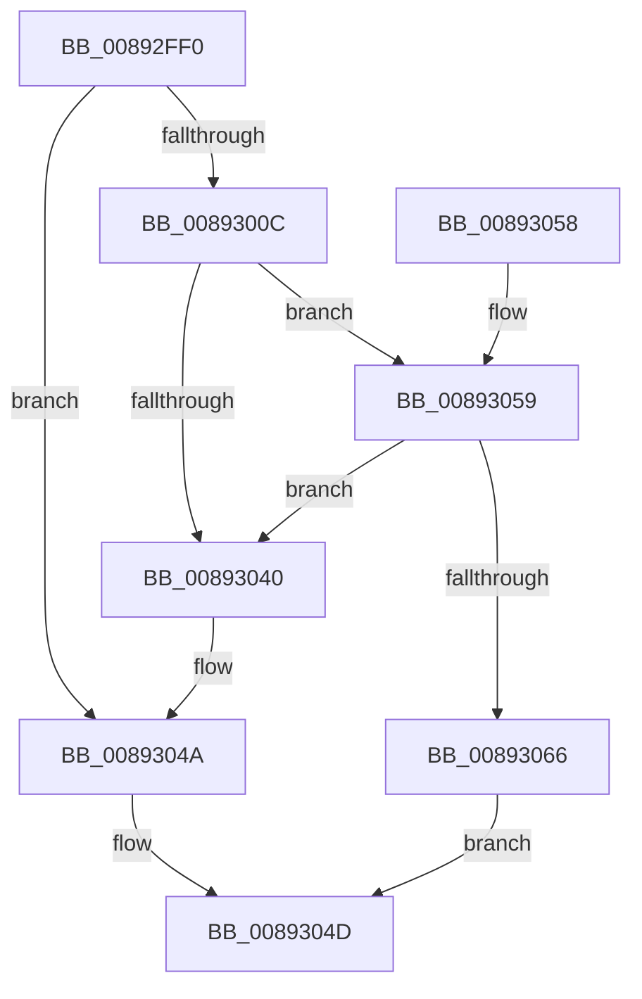

# AlpcpAllocateMessageFunction

- RVA: `0x00892FF0`–`0x00893074` (길이 `132` bytes)
- VA: `0x0000000140892FF0`
- 실행 섹션: `PAGE`
- PDB 이름 있음: `예`; PDB Function 태그: `아니요`
- unwind 정보 RVA: `0x0007DDD4`
- 디코드: `38`개 명령, `132/132` bytes 표시
- 미해석 바이트: `0` (있으면 어셈블리에 `.byte`로 보존)

> 이 문서는 커널 이미지의 기계어와 PDB 기호를 분석해 생성했습니다. 4번과 5번은 함수 원형과 자료형을 바이너리 사용 방식에서 추정한 C 해석이며 원본 소스 복구 결과는 아닙니다.

## 1. Dependencies

- 직접 호출 지점: **5**; 고유 호출 대상: **5**
- 직접 호출자로 확인된 함수: **3**
- RIP 상대 이미지 참조: **1**

### Outgoing calls
- `0x00892FFF` → [ExAllocatePool2](../../poolcode/B8/ExAllocatePool2_function_00B820F0.md) (function, `0x00B820F0`)
- `0x0089301B` → [memset](../../text/6C/memset_function_006C6C40.md) (function, `0x006C6C40`)
- `0x00893036` → [ExCreateHandleEx](../86/ExCreateHandleEx_function_0086ACB0.md) (function, `0x0086ACB0`)
- `0x0089305C` → [AlpcpAllocateMessageFromExtendedTables](../74/AlpcpAllocateMessageFromExtendedTables_function_0074C500.md) (function, `0x0074C500`)
- `0x0089306B` → [ExFreePoolWithTag](../../poolcode/B8/ExFreePoolWithTag_function_00B82870.md) (function, `0x00B82870`)

### Direct callers
- [ExAllocateFromPagedLookasideList](../../text/3F/ExAllocateFromPagedLookasideList_function_003FB730.md) at `0x003FB7AB`
- [AlpcpAllocateBlob](AlpcpAllocateBlob_function_008925B0.md) at `0x00892697`
- [sub_008928D9](Unknown_function_008928D9.md) at `0x00892927`

### Static image references
- `0x00893020` → RVA `0x00FC6F68` (`ALMOSTRO`; read)

## 2. Other-region calls and transfers

- 다른 실행 섹션으로 향하는 call: **3**
  - `0x00892FFF` → [ExAllocatePool2](../../poolcode/B8/ExAllocatePool2_function_00B820F0.md) (`PAGE` → `POOLCODE`)
  - `0x0089301B` → [memset](../../text/6C/memset_function_006C6C40.md) (`PAGE` → `.text`)
  - `0x0089306B` → [ExFreePoolWithTag](../../poolcode/B8/ExFreePoolWithTag_function_00B82870.md) (`PAGE` → `POOLCODE`)
- 별도 외부 분기/꼬리 이동을 확인하지 못했습니다.

## 3. Assembly (complete function range)

```asm
00892FF0  48 89 5C 24 08                  mov qword ptr [rsp + 8], rbx
00892FF5  57                              push rdi
00892FF6  48 83 EC 30                     sub rsp, 0x30
00892FFA  B9 00 01 00 00                  mov ecx, 0x100
00892FFF  E8 EC F0 2E 00                  call 0x140b820f0
00893004  48 8B D8                        mov rbx, rax
00893007  48 85 C0                        test rax, rax
0089300A  74 3E                           je 0x14089304a
0089300C  48 8D 78 30                     lea rdi, [rax + 0x30]
00893010  33 D2                           xor edx, edx
00893012  48 8B CF                        mov rcx, rdi
00893015  41 B8 18 01 00 00               mov r8d, 0x118
0089301B  E8 20 3C E3 FF                  call 0x1406c6c40
00893020  48 8B 0D 41 3F 73 00            mov rcx, qword ptr [rip + 0x733f41]
00893027  45 33 C9                        xor r9d, r9d
0089302A  48 83 64 24 20 00               and qword ptr [rsp + 0x20], 0
00893030  45 33 C0                        xor r8d, r8d
00893033  48 8B D7                        mov rdx, rdi
00893036  E8 75 7C FD FF                  call 0x14086acb0
0089303B  48 85 C0                        test rax, rax
0089303E  74 19                           je 0x140893059
00893040  0F BA E8 1F                     bts eax, 0x1f
00893044  89 87 08 01 00 00               mov dword ptr [rdi + 0x108], eax
0089304A  48 8B C3                        mov rax, rbx
0089304D  48 8B 5C 24 40                  mov rbx, qword ptr [rsp + 0x40]
00893052  48 83 C4 30                     add rsp, 0x30
00893056  5F                              pop rdi
00893057  C3                              ret
00893058  CC                              int3
00893059  48 8B CF                        mov rcx, rdi
0089305C  E8 9F 94 EB FF                  call 0x14074c500
00893061  48 85 C0                        test rax, rax
00893064  75 DA                           jne 0x140893040
00893066  33 D2                           xor edx, edx
00893068  48 8B CB                        mov rcx, rbx
0089306B  E8 00 F8 2E 00                  call 0x140b82870
00893070  33 C0                           xor eax, eax
00893072  EB D9                           jmp 0x14089304d
```

## 4. C-style interpretation (structured pseudocode)

```c
__int64 __fastcall AlpcpAllocateMessageFunction(__int64 a1, int a2, __int64 a3, int a4)
{
    __int64 result;
    __int64 v_rsp;
    unsigned __int64 v_stack_m18;
    unsigned __int64 v_stack_p8;

    v_stack_p8 = v_rbx;
    v_rsp = (v_rsp) - (48);
    result = ExAllocatePool2(256, a2, a3, a4);
    if (result == 0) goto loc_0089304A;
    a2 = 0;
    result = memset(result + 48, a2, 280, a4);
    a4 = 0;
    a3 = 0;
    result = ExCreateHandleEx(*(unsigned __int64 *)(v_rip + 7552833), result + 48, a3, a4);
    if (result == 0) goto loc_00893059;
loc_00893040:
    *(unsigned int *)(result + 48 + 264) = (unsigned int)(result);
loc_0089304A:
loc_0089304D:
    v_rsp = (v_rsp) + (48);
    return result;
loc_00893059:
    result = AlpcpAllocateMessageFromExtendedTables(result + 48, result + 48, a3, a4);
    if (result != 0) goto loc_00893040;
    a2 = 0;
    result = ExFreePoolWithTag(v_stack_p8, a2, a3, a4);
    result = 0;
    goto loc_0089304D;
}
```

## 5. (Beta) C Style

```c
int64_t AlpcpAllocateMessageFunction(int64_t Arg1, int32_t Arg2, int64_t Arg3, int32_t Arg4)
{
    int64_t result;
    int64_t local_rsp;
    uint64_t v_stack_m18;
    uint64_t v_stack_p8;

    v_stack_p8 = local_rbx;
    local_rsp = (local_rsp) - (48);
    result = ExAllocatePool2(256, Arg2, Arg3, Arg4);
    if (result == 0) goto loc_0089304A;
    Arg2 = 0;
    result = memset(result + 48, Arg2, 280, Arg4);
    Arg4 = 0;
    Arg3 = 0;
    result = ExCreateHandleEx(*(uint64_t *)(v_rip + 0x733F41), result + 48, Arg3, Arg4);
    if (result == 0) goto loc_00893059;
loc_00893040:
    *(uint32_t *)(result + 0x30 + 0x108) = (uint32_t)(result);
loc_0089304A:
loc_0089304D:
    local_rsp = (local_rsp) + (48);
    return result;
loc_00893059:
    result = AlpcpAllocateMessageFromExtendedTables(result + 48, result + 48, Arg3, Arg4);
    if (result != 0) goto loc_00893040;
    Arg2 = 0;
    result = ExFreePoolWithTag(v_stack_p8, Arg2, Arg3, Arg4);
    result = 0;
    goto loc_0089304D;
}
```

## 6. Execution-region graph

[열기: 2D/3D 그래프와 함수 탐색 컨트롤 패널](../../../control-panel.html?section=page&rva=0x00892FF0&view=graph)

- 2D 그래프는 위에서 아래로 흐르고, 3D 그래프는 빈 공간을 드래그해 회전합니다. Shift+드래그는 이동, 휠은 확대·축소, 함수 노드 선택은 대상 보고서 이동입니다.

### Static fallback


