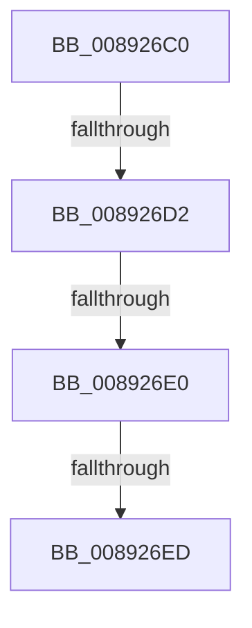

# AlpcpAllocateMessage

- RVA: `0x008926C0`–`0x008926FB` (길이 `59` bytes)
- VA: `0x00000001408926C0`
- 실행 섹션: `PAGE`
- PDB 이름 있음: `예`; PDB Function 태그: `예`
- unwind 정보 RVA: `0x0007DC24`
- 디코드: `13`개 명령, `59/59` bytes 표시
- 미해석 바이트: `0` (있으면 어셈블리에 `.byte`로 보존)

> 이 문서는 커널 이미지의 기계어와 PDB 기호를 분석해 생성했습니다. 4번과 5번은 함수 원형과 자료형을 바이너리 사용 방식에서 추정한 C 해석이며 원본 소스 복구 결과는 아닙니다.

## 1. Dependencies

- 직접 호출 지점: **1**; 고유 호출 대상: **1**
- 직접 호출자로 확인된 함수: **4**
- RIP 상대 이미지 참조: **1**

### Outgoing calls
- `0x008926F4` → [ExAllocateFromPagedLookasideList](../../text/3F/ExAllocateFromPagedLookasideList_function_003FB730.md) (function, `0x003FB730`)

### Direct callers
- [AlpcpCreateReserve](AlpcpCreateReserve_function_00892318.md) at `0x008923E1`
- [AlpcpFormatConnectionRequest](../92/AlpcpFormatConnectionRequest_function_00922A40.md) at `0x00922A8F`
- [AlpcpSendLegacySynchronousRequest](../92/AlpcpSendLegacySynchronousRequest_function_0092376C.md) at `0x00923D1D`
- [AlpcpCreateClientPort](../92/AlpcpCreateClientPort_function_009270AC.md) at `0x009273E5`

### Static image references
- `0x008926ED` → RVA `0x00E27180` (`.data`; read)

## 2. Other-region calls and transfers

- 다른 실행 섹션으로 향하는 call: **1**
  - `0x008926F4` → [ExAllocateFromPagedLookasideList](../../text/3F/ExAllocateFromPagedLookasideList_function_003FB730.md) (`PAGE` → `.text`)
- call이 아닌 외부 분기/꼬리 이동: **3**
  - `0x008926CC` → [sub_008928D9 + 0x2B](Unknown_function_008928D9.md) (`tail-transfer`)
  - `0x008926DA` → [sub_008928D9 + 0x1](Unknown_function_008928D9.md) (`tail-transfer`)
  - `0x008926E7` → [sub_008928D9 + 0x1](Unknown_function_008928D9.md) (`tail-transfer`)

## 3. Assembly (complete function range)

```asm
008926C0  41 56                           push r14
008926C2  48 83 EC 30                     sub rsp, 0x30
008926C6  4C 8B F1                        mov r14, rcx
008926C9  48 85 D2                        test rdx, rdx
008926CC  0F 85 32 02 00 00               jne 0x140892904
008926D2  BA 48 03 00 00                  mov edx, 0x348
008926D7  45 85 C0                        test r8d, r8d
008926DA  0F 85 FA 01 00 00               jne 0x1408928da
008926E0  48 81 FA 48 03 00 00            cmp rdx, 0x348
008926E7  0F 87 ED 01 00 00               ja 0x1408928da
008926ED  48 8D 0D 8C 4A 59 00            lea rcx, [rip + 0x594a8c]
008926F4  E8 37 90 B6 FF                  call 0x1403fb730
008926F9  B2 02                           mov dl, 2
```

## 4. C-style interpretation (structured pseudocode)

```c
__int64 __fastcall AlpcpAllocateMessage(__int64 a1, __int64 a2, int a3)
{
    __int64 result;
    __int64 v_rsp;

    v_rsp = (v_rsp) - (48);
    result = ExAllocateFromPagedLookasideList(v_rip + 5851788, 840, a3, a4);
    return result;
}
```

## 5. (Beta) C Style

```c
int64_t AlpcpAllocateMessage(int64_t Arg1, int64_t Arg2, int32_t Arg3)
{
    int64_t result;
    int64_t local_rsp;

    local_rsp = (local_rsp) - (48);
    result = ExAllocateFromPagedLookasideList(v_rip + 5851788, 840, Arg3, a4);
    return result;
}
```

## 6. Execution-region graph

[열기: 2D/3D 그래프와 함수 탐색 컨트롤 패널](../../../control-panel.html?section=page&rva=0x008926C0&view=graph)

- 2D 그래프는 위에서 아래로 흐르고, 3D 그래프는 빈 공간을 드래그해 회전합니다. Shift+드래그는 이동, 휠은 확대·축소, 함수 노드 선택은 대상 보고서 이동입니다.

### Static fallback


