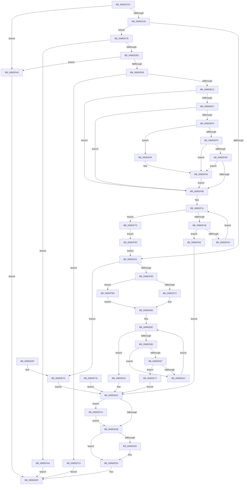

# AlpcpCaptureHandleAttributeInternal

- RVA: `0x00892CDC`–`0x00892FDC` (길이 `768` bytes)
- VA: `0x0000000140892CDC`
- 실행 섹션: `PAGE`
- PDB 이름 있음: `예`; PDB Function 태그: `아니요`
- unwind 정보 RVA: `0x0007DD98`
- 디코드: `191`개 명령, `768/768` bytes 표시
- 미해석 바이트: `0` (있으면 어셈블리에 `.byte`로 보존)

> 이 문서는 커널 이미지의 기계어와 PDB 기호를 분석해 생성했습니다. 4번과 5번은 함수 원형과 자료형을 바이너리 사용 방식에서 추정한 C 해석이며 원본 소스 복구 결과는 아닙니다.

## 1. Dependencies

- 직접 호출 지점: **7**; 고유 호출 대상: **7**
- 직접 호출자로 확인된 함수: **2**
- RIP 상대 이미지 참조: **4**

### Outgoing calls
- `0x00892D48` → [AlpcpAllocateBlob](AlpcpAllocateBlob_function_008925B0.md) (function, `0x008925B0`)
- `0x00892D61` → [memset](../../text/6C/memset_function_006C6C40.md) (function, `0x006C6C40`)
- `0x00892DDC` → [ObCaptureObjectStateForDuplication](ObCaptureObjectStateForDuplication_function_00893684.md) (function, `0x00893684`)
- `0x00892E58` → [ExFreePoolWithTag](../../poolcode/B8/ExFreePoolWithTag_function_00B82870.md) (function, `0x00B82870`)
- `0x00892EAB` → [ExAllocatePool2](../../poolcode/B8/ExAllocatePool2_function_00B820F0.md) (function, `0x00B820F0`)
- `0x00892F5F` → [ExRaiseDatatypeMisalignment](ExRaiseDatatypeMisalignment_function_00899FD0.md) (function, `0x00899FD0`)
- `0x00892FD2` → [AlpcpDereferenceBlobEx](../88/AlpcpDereferenceBlobEx_function_0088AF00.md) (function, `0x0088AF00`)

### Direct callers
- [AlpcpCaptureHandleAttribute](AlpcpCaptureHandleAttribute_function_0089335C.md) at `0x0089339C`
- [AlpcpCaptureHandleAttribute32](../AB/AlpcpCaptureHandleAttribute32_function_00AB8238.md) at `0x00AB8270`

### Static image references
- `0x00892D41` → RVA `0x00001510` (`.rdata`; read)
- `0x00892E06` → RVA `0x00FC6E4C` (`ALMOSTRO`; read)
- `0x00892E12` → RVA `0x00FC7800` (`ALMOSTRO`; read)
- `0x00892FB4` → RVA `0x00FC6AB0` (`ALMOSTRO`; read)

## 2. Other-region calls and transfers

- 다른 실행 섹션으로 향하는 call: **3**
  - `0x00892D61` → [memset](../../text/6C/memset_function_006C6C40.md) (`PAGE` → `.text`)
  - `0x00892E58` → [ExFreePoolWithTag](../../poolcode/B8/ExFreePoolWithTag_function_00B82870.md) (`PAGE` → `POOLCODE`)
  - `0x00892EAB` → [ExAllocatePool2](../../poolcode/B8/ExAllocatePool2_function_00B820F0.md) (`PAGE` → `POOLCODE`)
- 별도 외부 분기/꼬리 이동을 확인하지 못했습니다.

## 3. Assembly (complete function range)

```asm
00892CDC  48 89 54 24 10                  mov qword ptr [rsp + 0x10], rdx
00892CE1  53                              push rbx
00892CE2  56                              push rsi
00892CE3  57                              push rdi
00892CE4  41 54                           push r12
00892CE6  41 55                           push r13
00892CE8  41 56                           push r14
00892CEA  41 57                           push r15
00892CEC  48 83 EC 70                     sub rsp, 0x70
00892CF0  4C 8B F9                        mov r15, rcx
00892CF3  65 48 8B 04 25 88 01 00 00      mov rax, qword ptr gs:[0x188]
00892CFC  44 8A A0 32 02 00 00            mov r12b, byte ptr [rax + 0x232]
00892D03  44 88 A4 24 B0 00 00 00         mov byte ptr [rsp + 0xb0], r12b
00892D0B  8B 01                           mov eax, dword ptr [rcx]
00892D0D  A9 FF FF F0 FF                  test eax, 0xfff0ffff
00892D12  0F 85 88 02 00 00               jne 0x140892fa0
00892D18  BE 01 00 00 00                  mov esi, 1
00892D1D  33 FF                           xor edi, edi
00892D1F  48 89 7C 24 48                  mov qword ptr [rsp + 0x48], rdi
00892D24  45 33 F6                        xor r14d, r14d
00892D27  0F BA E0 12                     bt eax, 0x12
00892D2B  0F 82 4D 01 00 00               jb 0x140892e7e
00892D31  8B C6                           mov eax, esi
00892D33  48 8D 1C 40                     lea rbx, [rax + rax*2]
00892D37  48 C1 E3 04                     shl rbx, 4
00892D3B  45 33 C0                        xor r8d, r8d
00892D3E  48 8B D3                        mov rdx, rbx
00892D41  48 8D 0D C8 E7 76 FF            lea rcx, [rip - 0x891838]
00892D48  E8 63 F8 FF FF                  call 0x1408925b0
00892D4D  48 8B F8                        mov rdi, rax
00892D50  48 85 C0                        test rax, rax
00892D53  0F 84 17 01 00 00               je 0x140892e70
00892D59  4C 8B C3                        mov r8, rbx
00892D5C  33 D2                           xor edx, edx
00892D5E  48 8B C8                        mov rcx, rax
00892D61  E8 DA 3E E3 FF                  call 0x1406c6c40
00892D66  89 77 04                        mov dword ptr [rdi + 4], esi
00892D69  45 84 E4                        test r12b, r12b
00892D6C  0F 84 42 02 00 00               je 0x140892fb4
00892D72  65 48 8B 04 25 88 01 00 00      mov rax, qword ptr gs:[0x188]
00892D7B  4C 8B A8 B8 00 00 00            mov r13, qword ptr [rax + 0xb8]
00892D82  33 DB                           xor ebx, ebx
00892D84  45 33 E4                        xor r12d, r12d
00892D87  44 3B E6                        cmp r12d, esi
00892D8A  0F 83 A4 00 00 00               jae 0x140892e34
00892D90  4B 8D 14 64                     lea rdx, [r12 + r12*2]
00892D94  4B 8D 04 64                     lea rax, [r12 + r12*2]
00892D98  48 C1 E0 04                     shl rax, 4
00892D9C  48 89 84 24 C0 00 00 00         mov qword ptr [rsp + 0xc0], rax
00892DA4  48 83 C0 08                     add rax, 8
00892DA8  48 03 C7                        add rax, rdi
00892DAB  45 8B 0C D7                     mov r9d, dword ptr [r15 + rdx*8]
00892DAF  41 81 E1 00 00 01 00            and r9d, 0x10000
00892DB6  41 0F BA E9 12                  bts r9d, 0x12
00892DBB  41 C1 E9 0F                     shr r9d, 0xf
00892DBF  48 89 44 24 28                  mov qword ptr [rsp + 0x28], rax
00892DC4  8A 84 24 B0 00 00 00            mov al, byte ptr [rsp + 0xb0]
00892DCB  88 44 24 20                     mov byte ptr [rsp + 0x20], al
00892DCF  45 8B 44 D7 14                  mov r8d, dword ptr [r15 + rdx*8 + 0x14]
00892DD4  49 8B 54 D7 08                  mov rdx, qword ptr [r15 + rdx*8 + 8]
00892DD9  49 8B CD                        mov rcx, r13
00892DDC  E8 A3 08 00 00                  call 0x140893684
00892DE1  8B D8                           mov ebx, eax
00892DE3  85 C0                           test eax, eax
00892DE5  78 45                           js 0x140892e2c
00892DE7  4C 8B 84 24 C0 00 00 00         mov r8, qword ptr [rsp + 0xc0]
00892DEF  49 8B 54 38 18                  mov rdx, qword ptr [r8 + rdi + 0x18]
00892DF4  48 8D 4A D0                     lea rcx, [rdx - 0x30]
00892DF8  48 C1 E9 08                     shr rcx, 8
00892DFC  0F B6 C1                        movzx eax, cl
00892DFF  0F B6 4A E8                     movzx ecx, byte ptr [rdx - 0x18]
00892E03  48 33 C1                        xor rax, rcx
00892E06  8B 0D 40 40 73 00               mov ecx, dword ptr [rip + 0x734040]
00892E0C  0F B6 D1                        movzx edx, cl
00892E0F  48 33 C2                        xor rax, rdx
00892E12  48 8D 0D E7 49 73 00            lea rcx, [rip + 0x7349e7]
00892E19  48 8B 04 C1                     mov rax, qword ptr [rcx + rax*8]
00892E1D  8B 48 44                        mov ecx, dword ptr [rax + 0x44]
00892E20  41 89 0C 38                     mov dword ptr [r8 + rdi], ecx
00892E24  F7 C1 FD 0F 00 00               test ecx, 0xffd
00892E2A  74 4B                           je 0x140892e77
00892E2C  41 FF C4                        inc r12d
00892E2F  E9 53 FF FF FF                  jmp 0x140892d87
00892E34  48 8B 84 24 B8 00 00 00         mov rax, qword ptr [rsp + 0xb8]
00892E3C  48 89 78 30                     mov qword ptr [rax + 0x30], rdi
00892E40  33 FF                           xor edi, edi
00892E42  48 85 FF                        test rdi, rdi
00892E45  0F 85 7F 01 00 00               jne 0x140892fca
00892E4B  4D 85 F6                        test r14, r14
00892E4E  74 0D                           je 0x140892e5d
00892E50  BA 4C 70 63 48                  mov edx, 0x4863704c
00892E55  49 8B CE                        mov rcx, r14
00892E58  E8 13 FA 2E 00                  call 0x140b82870
00892E5D  8B C3                           mov eax, ebx
00892E5F  48 83 C4 70                     add rsp, 0x70
00892E63  41 5F                           pop r15
00892E65  41 5E                           pop r14
00892E67  41 5D                           pop r13
00892E69  41 5C                           pop r12
00892E6B  5F                              pop rdi
00892E6C  5E                              pop rsi
00892E6D  5B                              pop rbx
00892E6E  C3                              ret
00892E6F  CC                              int3
00892E70  BB 9A 00 00 C0                  mov ebx, 0xc000009a
00892E75  EB CB                           jmp 0x140892e42
00892E77  BB 22 00 00 C0                  mov ebx, 0xc0000022
00892E7C  EB C4                           jmp 0x140892e42
00892E7E  8B 71 10                        mov esi, dword ptr [rcx + 0x10]
00892E81  81 FE 00 02 00 00               cmp esi, 0x200
00892E87  0F 87 1D 01 00 00               ja 0x140892faa
00892E8D  83 FE 01                        cmp esi, 1
00892E90  0F 86 0A 01 00 00               jbe 0x140892fa0
00892E96  8B DE                           mov ebx, esi
00892E98  48 8D 14 76                     lea rdx, [rsi + rsi*2]
00892E9C  48 C1 E2 03                     shl rdx, 3
00892EA0  B9 40 00 00 00                  mov ecx, 0x40
00892EA5  41 B8 4C 70 63 48               mov r8d, 0x4863704c
00892EAB  E8 40 F2 2E 00                  call 0x140b820f0
00892EB0  4C 8B F0                        mov r14, rax
00892EB3  48 89 84 24 C8 00 00 00         mov qword ptr [rsp + 0xc8], rax
00892EBB  48 85 C0                        test rax, rax
00892EBE  0F 84 FC 00 00 00               je 0x140892fc0
00892EC4  4D 8B 57 08                     mov r10, qword ptr [r15 + 8]
00892EC8  65 48 8B 04 25 88 01 00 00      mov rax, qword ptr gs:[0x188]
00892ED1  48 89 44 24 50                  mov qword ptr [rsp + 0x50], rax
00892ED6  8A 80 32 02 00 00               mov al, byte ptr [rax + 0x232]
00892EDC  88 84 24 C0 00 00 00            mov byte ptr [rsp + 0xc0], al
00892EE3  84 C0                           test al, al
00892EE5  74 27                           je 0x140892f0e
00892EE7  48 C1 E3 04                     shl rbx, 4
00892EEB  48 85 DB                        test rbx, rbx
00892EEE  74 1E                           je 0x140892f0e
00892EF0  41 F6 C2 03                     test r10b, 3
00892EF4  75 69                           jne 0x140892f5f
00892EF6  4A 8D 04 13                     lea rax, [rbx + r10]
00892EFA  48 B9 00 00 FF FF FF 7F 00 00   movabs rcx, 0x7fffffff0000
00892F04  48 3B C1                        cmp rax, rcx
00892F07  77 5B                           ja 0x140892f64
00892F09  49 3B C2                        cmp rax, r10
00892F0C  72 56                           jb 0x140892f64
00892F0E  45 33 C9                        xor r9d, r9d
00892F11  44 89 4C 24 34                  mov dword ptr [rsp + 0x34], r9d
00892F16  44 3B CE                        cmp r9d, esi
00892F19  73 5B                           jae 0x140892f76
00892F1B  45 8B C1                        mov r8d, r9d
00892F1E  4B 8D 04 49                     lea rax, [r9 + r9*2]
00892F22  49 8D 14 C6                     lea rdx, [r14 + rax*8]
00892F26  48 89 54 24 58                  mov qword ptr [rsp + 0x58], rdx
00892F2B  49 C1 E0 04                     shl r8, 4
00892F2F  4D 03 C2                        add r8, r10
00892F32  4C 89 44 24 60                  mov qword ptr [rsp + 0x60], r8
00892F37  41 8B 08                        mov ecx, dword ptr [r8]
00892F3A  89 0A                           mov dword ptr [rdx], ecx
00892F3C  41 8B 40 04                     mov eax, dword ptr [r8 + 4]
00892F40  48 89 42 08                     mov qword ptr [rdx + 8], rax
00892F44  41 8B 40 08                     mov eax, dword ptr [r8 + 8]
00892F48  89 42 10                        mov dword ptr [rdx + 0x10], eax
00892F4B  41 8B 40 0C                     mov eax, dword ptr [r8 + 0xc]
00892F4F  89 42 14                        mov dword ptr [rdx + 0x14], eax
00892F52  F7 C1 FF FF F4 FF               test ecx, 0xfff4ffff
00892F58  75 0E                           jne 0x140892f68
00892F5A  41 FF C1                        inc r9d
00892F5D  EB B2                           jmp 0x140892f11
00892F5F  E8 6C 70 00 00                  call 0x140899fd0
00892F64  8A 01                           mov al, byte ptr [rcx]
00892F66  EB A6                           jmp 0x140892f0e
00892F68  BB 0D 00 00 C0                  mov ebx, 0xc000000d
00892F6D  89 5C 24 38                     mov dword ptr [rsp + 0x38], ebx
00892F71  E9 CC FE FF FF                  jmp 0x140892e42
00892F76  EB 18                           jmp 0x140892f90
00892F78  8B D8                           mov ebx, eax
00892F7A  89 44 24 38                     mov dword ptr [rsp + 0x38], eax
00892F7E  4C 8B B4 24 C8 00 00 00         mov r14, qword ptr [rsp + 0xc8]
00892F86  48 8B 7C 24 48                  mov rdi, qword ptr [rsp + 0x48]
00892F8B  E9 B2 FE FF FF                  jmp 0x140892e42
00892F90  4D 8B FE                        mov r15, r14
00892F93  44 8A A4 24 B0 00 00 00         mov r12b, byte ptr [rsp + 0xb0]
00892F9B  E9 91 FD FF FF                  jmp 0x140892d31
00892FA0  B8 0D 00 00 C0                  mov eax, 0xc000000d
00892FA5  E9 B5 FE FF FF                  jmp 0x140892e5f
00892FAA  B8 22 07 00 C0                  mov eax, 0xc0000722
00892FAF  E9 AB FE FF FF                  jmp 0x140892e5f
00892FB4  4C 8B 2D F5 3A 73 00            mov r13, qword ptr [rip + 0x733af5]
00892FBB  E9 C2 FD FF FF                  jmp 0x140892d82
00892FC0  B8 17 00 00 C0                  mov eax, 0xc0000017
00892FC5  E9 95 FE FF FF                  jmp 0x140892e5f
00892FCA  BA 01 00 00 00                  mov edx, 1
00892FCF  48 8B CF                        mov rcx, rdi
00892FD2  E8 29 7F FF FF                  call 0x14088af00
00892FD7  E9 6F FE FF FF                  jmp 0x140892e4b
```

## 4. C-style interpretation (structured pseudocode)

```c
__int64 __fastcall AlpcpCaptureHandleAttributeInternal(__int64 a1, __int64 a2, int a3)
{
    __int64 result;
    __int64 v_r12;
    __int64 v_r14;
    __int64 v_rbx;
    __int64 v_rdi;
    __int64 v_rsp;
    unsigned __int64 v_stack_m60;
    unsigned __int64 v_stack_m80;
    unsigned __int8 v_stack_m88;
    unsigned __int64 v_stack_p10;
    unsigned __int64 v_stack_p18;
    unsigned int v_stack_p34;
    unsigned int v_stack_p38;
    unsigned __int64 v_stack_p48;
    unsigned __int64 v_stack_p50;
    unsigned __int64 v_stack_p58;
    unsigned __int64 v_stack_p60;
    unsigned __int8 v_stack_p8;
    unsigned __int8 v_stack_pB0;
    unsigned __int8 v_stack_pC0;
    unsigned __int64 v_stack_pC8;

    v_stack_p10 = a2;
    v_rsp = (v_rsp) - (112);
    v_stack_p8 = (unsigned __int8)(*(unsigned __int8 *)(*(unsigned __int64 *)(gs_base + (0 + 392)) + 562));
    if ((((unsigned int)((unsigned int)(*(unsigned int *)(a1)))) & (0xFFF0FFFFULL)) != 0) goto loc_00892FA0;
    v_rdi = 0;
    v_stack_m60 = 0;
    v_r14 = 0;
    if (condition_is_below) goto loc_00892E7E;
loc_00892D31:
    v_rbx = (1 + 1 * 2) << (4);
    a3 = 0;
    result = AlpcpAllocateBlob(v_rip - 8984632, v_rbx, a3, a4);
    if (result == 0) goto loc_00892E70;
    a2 = 0;
    result = memset(result, a2, v_rbx, a4);
    *(unsigned int *)(result + 4) = 1;
    if ((unsigned __int8)(*(unsigned __int8 *)(*(unsigned __int64 *)(gs_base + (0 + 392)) + 562)) == 0) goto loc_00892FB4;
loc_00892D82:
    v_rbx = 0;
    v_r12 = 0;
loc_00892D87:
    if (0 >= 1) goto loc_00892E34;
    result = (v_r12 + v_r12 * 2) << (4);
    v_stack_p18 = result;
    result = (result) + (8);
    result = (result) + (result);
    a4 = (unsigned int)(((unsigned int)(*(unsigned int *)(a1 + v_r12 + v_r12 * 2 * 8))) & (0x10000ULL));
    a4 = (unsigned int)((a4) >> (15));
    v_stack_m80 = result;
    v_stack_m88 = (unsigned __int8)(v_stack_p8);
    result = ObCaptureObjectStateForDuplication(*(unsigned __int64 *)(*(unsigned __int64 *)(gs_base + (0 + 392)) + 184), *(unsigned __int64 *)(a1 + v_r12 + v_r12 * 2 * 8 + 8), (unsigned int)(*(unsigned int *)(a1 + v_r12 + v_r12 * 2 * 8 + 20)), a4);
    if (sign_flag) goto loc_00892E2C;
    a1 = (*(unsigned __int64 *)(v_stack_p18 + result * 1 + 24) - 48) >> (8);
    result = ((unsigned __int8)(a1)) ^ (*(unsigned __int8 *)(*(unsigned __int64 *)(v_stack_p18 + result * 1 + 24) - 24));
    result = (result) ^ ((unsigned __int8)((unsigned int)(*(unsigned int *)(v_rip + 7553088))));
    *(unsigned int *)(v_stack_p18 + result * 1) = (unsigned int)((unsigned int)(*(unsigned int *)(*(unsigned __int64 *)(v_rip + 7555559 + result * 8) + 68)));
    if ((((unsigned int)((unsigned int)(*(unsigned int *)(*(unsigned __int64 *)(v_rip + 7555559 + result * 8) + 68)))) & (0xFFDULL)) == 0) goto loc_00892E77;
loc_00892E2C:
    v_r12 = (unsigned int)((v_r12) + 1);
    goto loc_00892D87;
loc_00892E34:
    *(unsigned __int64 *)(v_stack_p10 + 48) = result;
    v_rdi = 0;
loc_00892E42:
    if (0 != 0) goto loc_00892FCA;
loc_00892E4B:
    result = v_stack_p10;
    if (0 != 0) {
        a2 = 0x4863704CULL;
        a1 = 0;
        result = ExFreePoolWithTag(a1, a2, v_stack_p18, a4);
    }
loc_00892E5F:
    v_rsp = (v_rsp) + (112);
    return (unsigned int)((unsigned int)((unsigned int)((unsigned int)(result))));
loc_00892E70:
    goto loc_00892E42;
loc_00892E77:
    goto loc_00892E42;
loc_00892E7E:
    if (((unsigned int)((unsigned int)(*(unsigned int *)(a1 + 16)))) > 512) goto loc_00892FAA;
    if (((unsigned int)((unsigned int)(*(unsigned int *)(a1 + 16)))) <= 1) goto loc_00892FA0;
    a2 = ((unsigned int)(*(unsigned int *)(a1 + 16)) + (unsigned int)(*(unsigned int *)(a1 + 16)) * 2) << (3);
    result = ExAllocatePool2(64, a2, (unsigned int)(0x4863704CULL), a4);
    v_stack_pC8 = result;
    if (result == 0) goto loc_00892FC0;
    v_stack_p50 = *(unsigned __int64 *)(gs_base + (0 + 392));
    v_stack_pC0 = (unsigned __int8)(*(unsigned __int8 *)(*(unsigned __int64 *)(gs_base + (0 + 392)) + 562));
    if ((unsigned __int8)(*(unsigned __int8 *)(*(unsigned __int64 *)(gs_base + (0 + 392)) + 562)) == 0) goto loc_00892F0E;
    v_rbx = ((unsigned int)((unsigned int)((unsigned int)(*(unsigned int *)(a1 + 16))))) << (4);
    if (v_rbx == 0) goto loc_00892F0E;
    if ((((unsigned __int8)(*(unsigned __int64 *)(a1 + 8))) & (3)) != 0) goto loc_00892F5F;
    if ((v_rbx + *(unsigned __int64 *)(a1 + 8) * 1) > 64) goto loc_00892F64;
    if ((v_rbx + *(unsigned __int64 *)(a1 + 8) * 1) < (*(unsigned __int64 *)(a1 + 8))) goto loc_00892F64;
loc_00892F0E:
    a4 = 0;
loc_00892F11:
    v_stack_p34 = 0;
    if (0 >= ((unsigned int)((unsigned int)(*(unsigned int *)(a1 + 16))))) goto loc_00892F76;
    v_stack_p58 = result + a4 + a4 * 2 * 8;
    a3 = (0) << (4);
    a3 = (a3) + (*(unsigned __int64 *)(a1 + 8));
    v_stack_p60 = a3;
    *(unsigned int *)(result + a4 + a4 * 2 * 8) = (unsigned int)((unsigned int)(*(unsigned int *)(a3)));
    *(unsigned __int64 *)(result + a4 + a4 * 2 * 8 + 8) = (unsigned int)(*(unsigned int *)(a3 + 4));
    *(unsigned int *)(result + a4 + a4 * 2 * 8 + 16) = (unsigned int)((unsigned int)(*(unsigned int *)(a3 + 8)));
    *(unsigned int *)(result + a4 + a4 * 2 * 8 + 20) = (unsigned int)((unsigned int)(*(unsigned int *)(a3 + 12)));
    if ((((unsigned int)((unsigned int)(*(unsigned int *)(a3)))) & (0xFFF4FFFFULL)) != 0) goto loc_00892F68;
    a4 = (unsigned int)((a4) + 1);
    goto loc_00892F11;
loc_00892F5F:
    result = ExRaiseDatatypeMisalignment((unsigned int)(*(unsigned int *)(a3)), result + a4 + a4 * 2 * 8, a3, a4);
loc_00892F64:
    goto loc_00892F0E;
loc_00892F68:
    v_stack_p38 = (unsigned int)((unsigned int)(0xC000000DULL));
    goto loc_00892E42;
loc_00892F76:
    goto loc_00892F90;
loc_00892F90:
    goto loc_00892D31;
loc_00892FA0:
    goto loc_00892E5F;
loc_00892FAA:
    goto loc_00892E5F;
loc_00892FB4:
    goto loc_00892D82;
loc_00892FC0:
    goto loc_00892E5F;
loc_00892FCA:
    result = AlpcpDereferenceBlobEx(0, 1, a3, a4);
    goto loc_00892E4B;
}
```

## 5. (Beta) C Style

```c
int64_t AlpcpCaptureHandleAttributeInternal(void *Arg1, int64_t Arg2, int32_t Arg3)
{
    uint8_t *arg1 = (uint8_t *)Arg1;

    int64_t result;
    int64_t local_r12;
    int64_t local_r14;
    int64_t local_rbx;
    int64_t local_rdi;
    int64_t local_rsp;
    uint64_t v_stack_m60;
    uint64_t v_stack_m80;
    uint8_t v_stack_m88;
    uint64_t v_stack_p10;
    uint64_t v_stack_p18;
    uint32_t v_stack_p34;
    uint32_t v_stack_p38;
    uint64_t v_stack_p48;
    uint64_t v_stack_p50;
    uint64_t v_stack_p58;
    uint64_t v_stack_p60;
    uint8_t v_stack_p8;
    uint8_t v_stack_pB0;
    uint8_t v_stack_pC0;
    uint64_t v_stack_pC8;

    v_stack_p10 = Arg2;
    local_rsp = (local_rsp) - (112);
    v_stack_p8 = (uint8_t)(*(uint8_t *)(*(uint64_t *)(gs_base + (0 + 0x188)) + 0x232));
    if ((((uint32_t)((uint32_t)(*(uint32_t *)(arg1)))) & (0xFFF0FFFFULL)) != 0) goto loc_00892FA0;
    local_rdi = 0;
    v_stack_m60 = 0;
    local_r14 = 0;
    if (condition_is_below) goto loc_00892E7E;
loc_00892D31:
    local_rbx = (1 + 1 * 2) << (4);
    Arg3 = 0;
    result = AlpcpAllocateBlob(v_rip - 8984632, local_rbx, Arg3, a4);
    if (result == 0) goto loc_00892E70;
    Arg2 = 0;
    result = memset(result, Arg2, local_rbx, a4);
    *(uint32_t *)(result + 0x4) = 1;
    if ((uint8_t)(*(uint8_t *)(*(uint64_t *)(gs_base + (0 + 0x188)) + 0x232)) == 0) goto loc_00892FB4;
loc_00892D82:
    local_rbx = 0;
    local_r12 = 0;
loc_00892D87:
    if (0 >= 1) goto loc_00892E34;
    result = (local_r12 + local_r12 * 2) << (4);
    v_stack_p18 = result;
    result = (result) + (8);
    result = (result) + (result);
    a4 = (uint32_t)(((uint32_t)(*(uint32_t *)(arg1 + local_r12 + local_r12 * 2 * 8))) & (0x10000ULL));
    a4 = (uint32_t)((a4) >> (15));
    v_stack_m80 = result;
    v_stack_m88 = (uint8_t)(v_stack_p8);
    result = ObCaptureObjectStateForDuplication(*(uint64_t *)(*(uint64_t *)(gs_base + (0 + 0x188)) + 0xB8), *(uint64_t *)(arg1 + local_r12 + local_r12 * 2 * 8 + 0x8), (uint32_t)(*(uint32_t *)(arg1 + local_r12 + local_r12 * 2 * 8 + 0x14)), a4);
    if (sign_flag) goto loc_00892E2C;
    Arg1 = (*(uint64_t *)(v_stack_p18 + result * 1 + 0x18) - 48) >> (8);
    result = ((uint8_t)(Arg1)) ^ (*(uint8_t *)(*(uint64_t *)(v_stack_p18 + result * 1 + 0x18) - 0x18));
    result = (result) ^ ((uint8_t)((uint32_t)(*(uint32_t *)(v_rip + 0x734040))));
    *(uint32_t *)(v_stack_p18 + result * 1) = (uint32_t)((uint32_t)(*(uint32_t *)(*(uint64_t *)(v_rip + 0x7349E7 + result * 8) + 0x44)));
    if ((((uint32_t)((uint32_t)(*(uint32_t *)(*(uint64_t *)(v_rip + 0x7349E7 + result * 8) + 0x44)))) & (0xFFDULL)) == 0) goto loc_00892E77;
loc_00892E2C:
    local_r12 = (uint32_t)((local_r12) + 1);
    goto loc_00892D87;
loc_00892E34:
    *(uint64_t *)(v_stack_p10 + 0x30) = result;
    local_rdi = 0;
loc_00892E42:
    if (0 != 0) goto loc_00892FCA;
loc_00892E4B:
    result = v_stack_p10;
    if (0 != 0) {
        Arg2 = 0x4863704CULL;
        Arg1 = 0;
        result = ExFreePoolWithTag(Arg1, Arg2, v_stack_p18, a4);
    }
loc_00892E5F:
    local_rsp = (local_rsp) + (112);
    return (uint32_t)((uint32_t)((uint32_t)((uint32_t)(result))));
loc_00892E70:
    goto loc_00892E42;
loc_00892E77:
    goto loc_00892E42;
loc_00892E7E:
    if (((uint32_t)((uint32_t)(*(uint32_t *)(arg1 + 0x10)))) > 512) goto loc_00892FAA;
    if (((uint32_t)((uint32_t)(*(uint32_t *)(arg1 + 0x10)))) <= 1) goto loc_00892FA0;
    Arg2 = ((uint32_t)(*(uint32_t *)(arg1 + 0x10)) + (uint32_t)(*(uint32_t *)(arg1 + 0x10)) * 2) << (3);
    result = ExAllocatePool2(64, Arg2, (uint32_t)(0x4863704CULL), a4);
    v_stack_pC8 = result;
    if (result == 0) goto loc_00892FC0;
    v_stack_p50 = *(uint64_t *)(gs_base + (0 + 0x188));
    v_stack_pC0 = (uint8_t)(*(uint8_t *)(*(uint64_t *)(gs_base + (0 + 0x188)) + 0x232));
    if ((uint8_t)(*(uint8_t *)(*(uint64_t *)(gs_base + (0 + 0x188)) + 0x232)) == 0) goto loc_00892F0E;
    local_rbx = ((uint32_t)((uint32_t)((uint32_t)(*(uint32_t *)(arg1 + 0x10))))) << (4);
    if (local_rbx == 0) goto loc_00892F0E;
    if ((((uint8_t)(*(uint64_t *)(arg1 + 0x8))) & (3)) != 0) goto loc_00892F5F;
    if ((local_rbx + *(uint64_t *)(arg1 + 0x8) * 1) > 64) goto loc_00892F64;
    if ((local_rbx + *(uint64_t *)(arg1 + 0x8) * 1) < (*(uint64_t *)(arg1 + 0x8))) goto loc_00892F64;
loc_00892F0E:
    a4 = 0;
loc_00892F11:
    v_stack_p34 = 0;
    if (0 >= ((uint32_t)((uint32_t)(*(uint32_t *)(arg1 + 0x10))))) goto loc_00892F76;
    v_stack_p58 = result + a4 + a4 * 2 * 8;
    Arg3 = (0) << (4);
    Arg3 = (Arg3) + (*(uint64_t *)(arg1 + 0x8));
    v_stack_p60 = Arg3;
    *(uint32_t *)(result + a4 + a4 * 2 * 8) = (uint32_t)((uint32_t)(*(uint32_t *)(Arg3)));
    *(uint64_t *)(result + a4 + a4 * 2 * 8 + 0x8) = (uint32_t)(*(uint32_t *)(Arg3 + 0x4));
    *(uint32_t *)(result + a4 + a4 * 2 * 8 + 0x10) = (uint32_t)((uint32_t)(*(uint32_t *)(Arg3 + 0x8)));
    *(uint32_t *)(result + a4 + a4 * 2 * 8 + 0x14) = (uint32_t)((uint32_t)(*(uint32_t *)(Arg3 + 0xC)));
    if ((((uint32_t)((uint32_t)(*(uint32_t *)(Arg3)))) & (0xFFF4FFFFULL)) != 0) goto loc_00892F68;
    a4 = (uint32_t)((a4) + 1);
    goto loc_00892F11;
loc_00892F5F:
    result = ExRaiseDatatypeMisalignment((uint32_t)(*(uint32_t *)(Arg3)), result + a4 + a4 * 2 * 8, Arg3, a4);
loc_00892F64:
    goto loc_00892F0E;
loc_00892F68:
    v_stack_p38 = (uint32_t)((uint32_t)(0xC000000DULL));
    goto loc_00892E42;
loc_00892F76:
    goto loc_00892F90;
loc_00892F90:
    goto loc_00892D31;
loc_00892FA0:
    goto loc_00892E5F;
loc_00892FAA:
    goto loc_00892E5F;
loc_00892FB4:
    goto loc_00892D82;
loc_00892FC0:
    goto loc_00892E5F;
loc_00892FCA:
    result = AlpcpDereferenceBlobEx(0, 1, Arg3, a4);
    goto loc_00892E4B;
}
```

### 관측된 메모리 오프셋

구조체 형식이 확인되지 않은 접근은 인자 기준의 오프셋으로만 기록했습니다.

| 기준 인자 | 오프셋 표현 | 폭 (bit) | 접근 |
|---|---:|---:|---|
| `Arg1` | `+ 0x0` | `32` | `R` |
| `Arg1` | `+ 0x8` | `64` | `R` |
| `Arg1` | `+ 0x10` | `32` | `R` |

## 6. Execution-region graph

[열기: 2D/3D 그래프와 함수 탐색 컨트롤 패널](../../../control-panel.html?section=page&rva=0x00892CDC&view=graph)

- 2D 그래프는 위에서 아래로 흐르고, 3D 그래프는 빈 공간을 드래그해 회전합니다. Shift+드래그는 이동, 휠은 확대·축소, 함수 노드 선택은 대상 보고서 이동입니다.

### Static fallback


