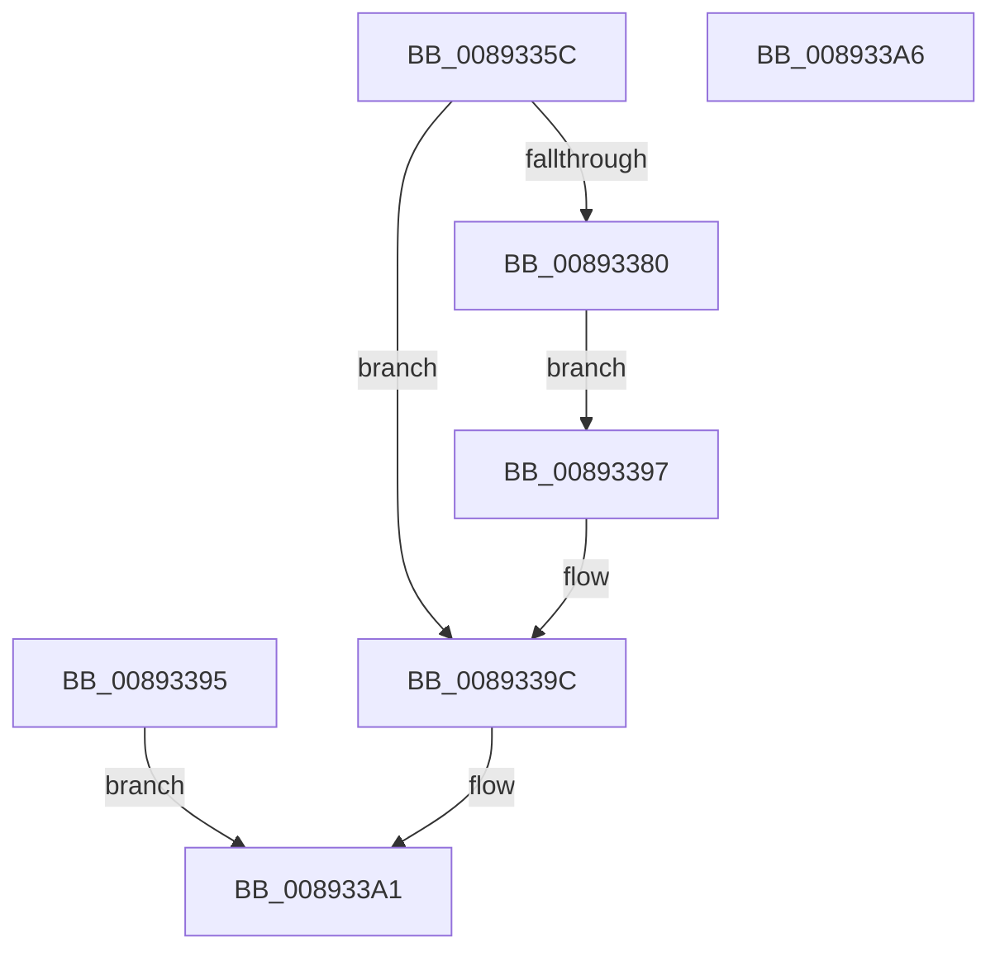

# AlpcpCaptureHandleAttribute

- RVA: `0x0089335C`–`0x008933A7` (길이 `75` bytes)
- VA: `0x000000014089335C`
- 실행 섹션: `PAGE`
- PDB 이름 있음: `예`; PDB Function 태그: `아니요`
- unwind 정보 RVA: `0x0007DE14`
- 디코드: `19`개 명령, `75/75` bytes 표시
- 미해석 바이트: `0` (있으면 어셈블리에 `.byte`로 보존)

> 이 문서는 커널 이미지의 기계어와 PDB 기호를 분석해 생성했습니다. 4번과 5번은 함수 원형과 자료형을 바이너리 사용 방식에서 추정한 C 해석이며 원본 소스 복구 결과는 아닙니다.

## 1. Dependencies

- 직접 호출 지점: **1**; 고유 호출 대상: **1**
- 직접 호출자로 확인된 함수: **1**
- RIP 상대 이미지 참조: **0**

### Outgoing calls
- `0x0089339C` → [AlpcpCaptureHandleAttributeInternal](AlpcpCaptureHandleAttributeInternal_function_00892CDC.md) (function, `0x00892CDC`)

### Direct callers
- [AlpcpCaptureAttributes](../88/AlpcpCaptureAttributes_function_0088CD20.md) at `0x0088D184`

### Static image references
- 디코드된 RIP-relative 메모리 참조가 없습니다.

## 2. Other-region calls and transfers

- 다른 실행 섹션으로 향하는 call: **0**
- 별도 외부 분기/꼬리 이동을 확인하지 못했습니다.

## 3. Assembly (complete function range)

```asm
0089335C  48 83 EC 58                     sub rsp, 0x58
00893360  33 C0                           xor eax, eax
00893362  0F 57 C0                        xorps xmm0, xmm0
00893365  0F 11 44 24 30                  movups xmmword ptr [rsp + 0x30], xmm0
0089336A  89 44 24 40                     mov dword ptr [rsp + 0x40], eax
0089336E  65 48 8B 04 25 88 01 00 00      mov rax, qword ptr gs:[0x188]
00893377  80 B8 32 02 00 00 00            cmp byte ptr [rax + 0x232], 0
0089337E  74 1C                           je 0x14089339c
00893380  0F 10 01                        movups xmm0, xmmword ptr [rcx]
00893383  0F 11 44 24 30                  movups xmmword ptr [rsp + 0x30], xmm0
00893388  F2 0F 10 49 10                  movsd xmm1, qword ptr [rcx + 0x10]
0089338D  F2 0F 11 4C 24 40               movsd qword ptr [rsp + 0x40], xmm1
00893393  EB 02                           jmp 0x140893397
00893395  EB 0A                           jmp 0x1408933a1
00893397  48 8D 4C 24 30                  lea rcx, [rsp + 0x30]
0089339C  E8 3B F9 FF FF                  call 0x140892cdc
008933A1  48 83 C4 58                     add rsp, 0x58
008933A5  C3                              ret
008933A6  CC                              int3
```

## 4. C-style interpretation (structured pseudocode)

```c
__int64 __fastcall AlpcpCaptureHandleAttribute(__int64 a1)
{
    __int64 result;
    __int64 v_rsp;
    unsigned int v_stack_m18;
    unsigned __int64 v_stack_m28;

    v_rsp = (v_rsp) - (88);
    result = 0;
    v_stack_m28 = v_xmm0;
    v_stack_m18 = 0;
    if ((*(unsigned __int8 *)(*(unsigned __int64 *)(gs_base + (0 + 392)) + 562)) == 0) goto loc_0089339C;
    v_stack_m28 = v_xmm0;
    v_stack_m18 = v_xmm1;
    goto loc_00893397;
loc_00893397:
loc_0089339C:
    result = AlpcpCaptureHandleAttributeInternal(v_stack_m28, a2, a3, a4);
loc_008933A1:
    v_rsp = (v_rsp) + (88);
    return result;
}
```

## 5. (Beta) C Style

```c
int64_t AlpcpCaptureHandleAttribute(void *Arg1)
{
    uint8_t *arg1 = (uint8_t *)Arg1;

    int64_t result;
    int64_t local_rsp;
    uint32_t v_stack_m18;
    uint64_t v_stack_m28;

    local_rsp = (local_rsp) - (88);
    result = 0;
    v_stack_m28 = v_xmm0;
    v_stack_m18 = 0;
    if ((*(uint8_t *)(*(uint64_t *)(gs_base + (0 + 0x188)) + 0x232)) == 0) goto loc_0089339C;
    v_stack_m28 = v_xmm0;
    v_stack_m18 = v_xmm1;
    goto loc_00893397;
loc_00893397:
loc_0089339C:
    result = AlpcpCaptureHandleAttributeInternal(v_stack_m28, a2, a3, a4);
loc_008933A1:
    local_rsp = (local_rsp) + (88);
    return result;
}
```

### 관측된 메모리 오프셋

구조체 형식이 확인되지 않은 접근은 인자 기준의 오프셋으로만 기록했습니다.

| 기준 인자 | 오프셋 표현 | 폭 (bit) | 접근 |
|---|---:|---:|---|
| `Arg1` | `+ 0x0` | `128` | `R` |
| `Arg1` | `+ 0x10` | `64` | `R` |

## 6. Execution-region graph

[열기: 2D/3D 그래프와 함수 탐색 컨트롤 패널](../../../control-panel.html?section=page&rva=0x0089335C&view=graph)

- 2D 그래프는 위에서 아래로 흐르고, 3D 그래프는 빈 공간을 드래그해 회전합니다. Shift+드래그는 이동, 휠은 확대·축소, 함수 노드 선택은 대상 보고서 이동입니다.

### Static fallback


