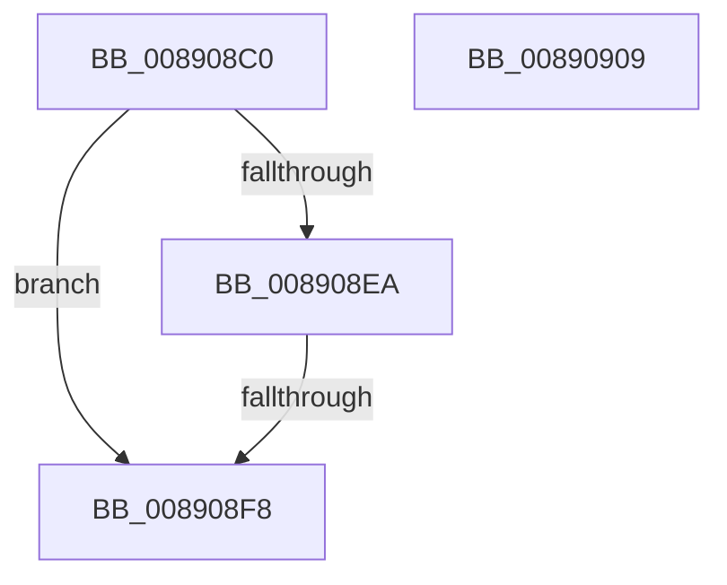

# AlpcpCaptureSecurityAttributeInternal

- RVA: `0x008908C0`–`0x0089090A` (길이 `74` bytes)
- VA: `0x00000001408908C0`
- 실행 섹션: `PAGE`
- PDB 이름 있음: `예`; PDB Function 태그: `예`
- unwind 정보 RVA: `0x0007D738`
- 디코드: `28`개 명령, `74/74` bytes 표시
- 미해석 바이트: `0` (있으면 어셈블리에 `.byte`로 보존)

> 이 문서는 커널 이미지의 기계어와 PDB 기호를 분석해 생성했습니다. 4번과 5번은 함수 원형과 자료형을 바이너리 사용 방식에서 추정한 C 해석이며 원본 소스 복구 결과는 아닙니다.

## 1. Dependencies

- 직접 호출 지점: **0**; 고유 호출 대상: **0**
- 직접 호출자로 확인된 함수: **2**
- RIP 상대 이미지 참조: **0**

### Outgoing calls
- 직접 디코드된 call 명령이 없습니다.

### Direct callers
- [AlpcpCaptureSecurityAttribute](AlpcpCaptureSecurityAttribute_function_00890540.md) at `0x00890817`
- [AlpcpCaptureSecurityAttribute32](../A2/AlpcpCaptureSecurityAttribute32_function_00A20924.md) at `0x00A209AB`

### Static image references
- 디코드된 RIP-relative 메모리 참조가 없습니다.

## 2. Other-region calls and transfers

- 다른 실행 섹션으로 향하는 call: **0**
- call이 아닌 외부 분기/꼬리 이동: **1**
  - `0x008908F6` → [sub_00890964 + 0x1](Unknown_function_00890964.md) (`tail-transfer`)

## 3. Assembly (complete function range)

```asm
008908C0  40 53                           push rbx
008908C2  56                              push rsi
008908C3  57                              push rdi
008908C4  41 54                           push r12
008908C6  41 56                           push r14
008908C8  48 83 EC 40                     sub rsp, 0x40
008908CC  45 33 E4                        xor r12d, r12d
008908CF  49 8B F1                        mov rsi, r9
008908D2  41 8B DC                        mov ebx, r12d
008908D5  4D 8B C8                        mov r9, r8
008908D8  48 89 5C 24 30                  mov qword ptr [rsp + 0x30], rbx
008908DD  8B FA                           mov edi, edx
008908DF  4C 8B F1                        mov r14, rcx
008908E2  F7 C2 FF FF FC FF               test edx, 0xfffcffff
008908E8  75 0E                           jne 0x1408908f8
008908EA  8B C2                           mov eax, edx
008908EC  25 00 00 03 00                  and eax, 0x30000
008908F1  3D 00 00 03 00                  cmp eax, 0x30000
008908F6  75 6D                           jne 0x140890965
008908F8  B8 0D 00 00 C0                  mov eax, 0xc000000d
008908FD  48 83 C4 40                     add rsp, 0x40
00890901  41 5E                           pop r14
00890903  41 5C                           pop r12
00890905  5F                              pop rdi
00890906  5E                              pop rsi
00890907  5B                              pop rbx
00890908  C3                              ret
00890909  CC                              int3
```

## 4. C-style interpretation (structured pseudocode)

```c
__int64 __fastcall AlpcpCaptureSecurityAttributeInternal(__int64 a1, int a2, __int64 a3, __int64 a4)
{
    __int64 result;
    __int64 v_r12;
    __int64 v_rsp;
    unsigned __int64 v_stack_m38;

    v_rsp = (v_rsp) - (64);
    v_r12 = 0;
    v_stack_m38 = 0;
    if (((a2) & (0xFFFCFFFFULL)) != 0) goto loc_008908F8;
    result = (unsigned int)(((unsigned int)(a2)) & (0x30000ULL));
loc_008908F8:
    v_rsp = (v_rsp) + (64);
    return (unsigned int)(0xC000000DULL);
}
```

## 5. (Beta) C Style

```c
int64_t AlpcpCaptureSecurityAttributeInternal(int64_t Arg1, int32_t Arg2, int64_t Arg3, int64_t Arg4)
{
    int64_t result;
    int64_t local_r12;
    int64_t local_rsp;
    uint64_t v_stack_m38;

    local_rsp = (local_rsp) - (64);
    local_r12 = 0;
    v_stack_m38 = 0;
    if (((Arg2) & (0xFFFCFFFFULL)) != 0) goto loc_008908F8;
    result = (uint32_t)(((uint32_t)(Arg2)) & (0x30000ULL));
loc_008908F8:
    local_rsp = (local_rsp) + (64);
    return (uint32_t)(0xC000000DULL);
}
```

## 6. Execution-region graph

[열기: 2D/3D 그래프와 함수 탐색 컨트롤 패널](../../../control-panel.html?section=page&rva=0x008908C0&view=graph)

- 2D 그래프는 위에서 아래로 흐르고, 3D 그래프는 빈 공간을 드래그해 회전합니다. Shift+드래그는 이동, 휠은 확대·축소, 함수 노드 선택은 대상 보고서 이동입니다.

### Static fallback


