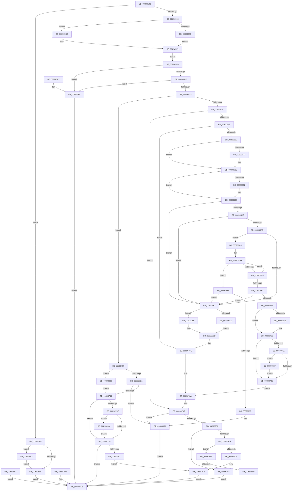

# AlpcpCaptureSecurityAttribute

- RVA: `0x00890540`–`0x008908AE` (길이 `878` bytes)
- VA: `0x0000000140890540`
- 실행 섹션: `PAGE`
- PDB 이름 있음: `예`; PDB Function 태그: `예`
- unwind 정보 RVA: `0x0007D6E4`
- 디코드: `225`개 명령, `878/878` bytes 표시
- 미해석 바이트: `0` (있으면 어셈블리에 `.byte`로 보존)

> 이 문서는 커널 이미지의 기계어와 PDB 기호를 분석해 생성했습니다. 4번과 5번은 함수 원형과 자료형을 바이너리 사용 방식에서 추정한 C 해석이며 원본 소스 복구 결과는 아닙니다.

## 1. Dependencies

- 직접 호출 지점: **15**; 고유 호출 대상: **12**
- 직접 호출자로 확인된 함수: **1**
- RIP 상대 이미지 참조: **1**

### Outgoing calls
- `0x008905D2` → [RtlCopyVolatileMemory](../../text/6B/RtlCopyVolatileMemory_function_006BC9D0.md) (function, `0x006BC9D0`)
- `0x00890660` → [KeAbPreAcquire](../../text/21/KeAbPreAcquire_function_00210230.md) (function, `0x00210230`)
- `0x00890682` → [ExfAcquirePushLockSharedEx](../../text/21/ExfAcquirePushLockSharedEx_function_0021044C.md) (function, `0x0021044C`)
- `0x008906FE` → [ExfReleasePushLockShared](../../text/26/ExfReleasePushLockShared_function_00263440.md) (function, `0x00263440`)
- `0x00890706` → [KeAbPostRelease](../../text/2E/KeAbPostRelease_function_002E1600.md) (function, `0x002E1600`)
- `0x00890763` → [AlpcpCreateSecurityContext](AlpcpCreateSecurityContext_function_00890D94.md) (function, `0x00890D94`)
- `0x00890788` → [ExfReleasePushLockShared](../../text/26/ExfReleasePushLockShared_function_00263440.md) (function, `0x00263440`)
- `0x00890790` → [KeAbPostRelease](../../text/2E/KeAbPostRelease_function_002E1600.md) (function, `0x002E1600`)
- `0x008907DF` → [_security_check_cookie](../../text/6A/_security_check_cookie_function_006AC640.md) (function, `0x006AC640`)
- `0x00890817` → [AlpcpCaptureSecurityAttributeInternal](AlpcpCaptureSecurityAttributeInternal_function_008908C0.md) (function, `0x008908C0`)
- `0x00890827` → [ExfAcquireReleasePushLockExclusive](../../text/41/ExfAcquireReleasePushLockExclusive_function_00419C2C.md) (function, `0x00419C2C`)
- `0x0089084A` → [KeBugCheckEx](../../text/4F/KeBugCheckEx_function_004FD660.md) (function, `0x004FD660`)
- `0x00890870` → [AlpcpDereferenceBlobEx](../88/AlpcpDereferenceBlobEx_function_0088AF00.md) (function, `0x0088AF00`)
- `0x00890882` → [AlpcpDeleteBlob](../88/AlpcpDeleteBlob_function_0088A11C.md) (function, `0x0088A11C`)
- `0x00890897` → [AlpcpDereferenceBlobEx](../88/AlpcpDereferenceBlobEx_function_0088AF00.md) (function, `0x0088AF00`)

### Direct callers
- [AlpcpCaptureAttributes](../88/AlpcpCaptureAttributes_function_0088CD20.md) at `0x0088CFE9`

### Static image references
- `0x00890553` → RVA `0x00E0A740` (`.data`; read)

## 2. Other-region calls and transfers

- 다른 실행 섹션으로 향하는 call: **10**
  - `0x008905D2` → [RtlCopyVolatileMemory](../../text/6B/RtlCopyVolatileMemory_function_006BC9D0.md) (`PAGE` → `.text`)
  - `0x00890660` → [KeAbPreAcquire](../../text/21/KeAbPreAcquire_function_00210230.md) (`PAGE` → `.text`)
  - `0x00890682` → [ExfAcquirePushLockSharedEx](../../text/21/ExfAcquirePushLockSharedEx_function_0021044C.md) (`PAGE` → `.text`)
  - `0x008906FE` → [ExfReleasePushLockShared](../../text/26/ExfReleasePushLockShared_function_00263440.md) (`PAGE` → `.text`)
  - `0x00890706` → [KeAbPostRelease](../../text/2E/KeAbPostRelease_function_002E1600.md) (`PAGE` → `.text`)
  - `0x00890788` → [ExfReleasePushLockShared](../../text/26/ExfReleasePushLockShared_function_00263440.md) (`PAGE` → `.text`)
  - `0x00890790` → [KeAbPostRelease](../../text/2E/KeAbPostRelease_function_002E1600.md) (`PAGE` → `.text`)
  - `0x008907DF` → [_security_check_cookie](../../text/6A/_security_check_cookie_function_006AC640.md) (`PAGE` → `.text`)
  - `0x00890827` → [ExfAcquireReleasePushLockExclusive](../../text/41/ExfAcquireReleasePushLockExclusive_function_00419C2C.md) (`PAGE` → `.text`)
  - `0x0089084A` → [KeBugCheckEx](../../text/4F/KeBugCheckEx_function_004FD660.md) (`PAGE` → `.text`)
- call이 아닌 외부 분기/꼬리 이동: **2**
  - `0x00890889` → [sub_00B193E8](../B1/Unknown_function_00B193E8.md) (`tail-transfer`)
  - `0x0089089D` → [sub_00B193E8](../B1/Unknown_function_00B193E8.md) (`tail-transfer`)

## 3. Assembly (complete function range)

```asm
00890540  40 53                           push rbx
00890542  56                              push rsi
00890543  57                              push rdi
00890544  41 54                           push r12
00890546  41 55                           push r13
00890548  41 56                           push r14
0089054A  41 57                           push r15
0089054C  48 81 EC 80 00 00 00            sub rsp, 0x80
00890553  48 8B 05 E6 A1 57 00            mov rax, qword ptr [rip + 0x57a1e6]
0089055A  48 33 C4                        xor rax, rsp
0089055D  48 89 44 24 70                  mov qword ptr [rsp + 0x70], rax
00890562  4D 8B F0                        mov r14, r8
00890565  4C 89 44 24 48                  mov qword ptr [rsp + 0x48], r8
0089056A  48 8B F2                        mov rsi, rdx
0089056D  4C 8B E9                        mov r13, rcx
00890570  33 FF                           xor edi, edi
00890572  48 89 7C 24 38                  mov qword ptr [rsp + 0x38], rdi
00890577  33 C0                           xor eax, eax
00890579  48 89 44 24 60                  mov qword ptr [rsp + 0x60], rax
0089057E  89 44 24 68                     mov dword ptr [rsp + 0x68], eax
00890582  65 48 8B 04 25 88 01 00 00      mov rax, qword ptr gs:[0x188]
0089058B  40 38 B8 32 02 00 00            cmp byte ptr [rax + 0x232], dil
00890592  0F 84 67 02 00 00               je 0x1408907ff
00890598  8B 02                           mov eax, dword ptr [rdx]
0089059A  89 44 24 30                     mov dword ptr [rsp + 0x30], eax
0089059E  48 8B 42 10                     mov rax, qword ptr [rdx + 0x10]
008905A2  48 89 44 24 38                  mov qword ptr [rsp + 0x38], rax
008905A7  48 8B 42 08                     mov rax, qword ptr [rdx + 8]
008905AB  48 89 44 24 58                  mov qword ptr [rsp + 0x58], rax
008905B0  48 8B D0                        mov rdx, rax
008905B3  48 85 C0                        test rax, rax
008905B6  74 21                           je 0x1408905d9
008905B8  48 B8 00 00 FF FF FF 7F 00 00   movabs rax, 0x7fffffff0000
008905C2  48 3B D0                        cmp rdx, rax
008905C5  48 0F 43 D0                     cmovae rdx, rax
008905C9  44 8D 47 0C                     lea r8d, [rdi + 0xc]
008905CD  48 8D 4C 24 60                  lea rcx, [rsp + 0x60]
008905D2  E8 F9 C3 E2 FF                  call 0x1406bc9d0
008905D7  EB 18                           jmp 0x1408905f1
008905D9  F2 0F 10 81 04 01 00 00         movsd xmm0, qword ptr [rcx + 0x104]
008905E1  F2 0F 11 44 24 60               movsd qword ptr [rsp + 0x60], xmm0
008905E7  8B 81 0C 01 00 00               mov eax, dword ptr [rcx + 0x10c]
008905ED  89 44 24 68                     mov dword ptr [rsp + 0x68], eax
008905F1  EB 07                           jmp 0x1408905fa
008905F3  8B F8                           mov edi, eax
008905F5  E9 DB 01 00 00                  jmp 0x1408907d5
008905FA  48 8B DF                        mov rbx, rdi
008905FD  48 89 5C 24 40                  mov qword ptr [rsp + 0x40], rbx
00890602  8B 4C 24 30                     mov ecx, dword ptr [rsp + 0x30]
00890606  F7 C1 FF FF FC FF               test ecx, 0xfffcffff
0089060C  0F 85 E6 01 00 00               jne 0x1408907f8
00890612  8B C1                           mov eax, ecx
00890614  25 00 00 03 00                  and eax, 0x30000
00890619  3D 00 00 03 00                  cmp eax, 0x30000
0089061E  0F 84 D4 01 00 00               je 0x1408907f8
00890624  48 83 7C 24 38 FE               cmp qword ptr [rsp + 0x38], -2
0089062A  0F 84 00 01 00 00               je 0x140890730
00890630  49 8B 45 10                     mov rax, qword ptr [r13 + 0x10]
00890634  4C 8B C7                        mov r8, rdi
00890637  48 8B D7                        mov rdx, rdi
0089063A  48 85 C0                        test rax, rax
0089063D  0F 84 64 01 00 00               je 0x1408907a7
00890643  48 8D 58 28                     lea rbx, [rax + 0x28]
00890647  48 85 DB                        test rbx, rbx
0089064A  0F 84 4E 01 00 00               je 0x14089079e
00890650  4C 8B 64 24 38                  mov r12, qword ptr [rsp + 0x38]
00890655  49 83 C4 F0                     add r12, -0x10
00890659  4C 8D 7B 08                     lea r15, [rbx + 8]
0089065D  49 8B CF                        mov rcx, r15
00890660  E8 CB FB 97 FF                  call 0x140210230
00890665  4C 8B F0                        mov r14, rax
00890668  33 C0                           xor eax, eax
0089066A  41 B8 11 00 00 00               mov r8d, 0x11
00890670  F0 4D 0F B1 07                  lock cmpxchg qword ptr [r15], r8
00890675  74 16                           je 0x14089068d
00890677  4D 8B CF                        mov r9, r15
0089067A  4D 8B C6                        mov r8, r14
0089067D  33 D2                           xor edx, edx
0089067F  49 8B CF                        mov rcx, r15
00890682  E8 C5 FD 97 FF                  call 0x14021044c
00890687  41 B8 11 00 00 00               mov r8d, 0x11
0089068D  4D 85 F6                        test r14, r14
00890690  74 05                           je 0x140890697
00890692  41 C6 46 0A 01                  mov byte ptr [r14 + 0xa], 1
00890697  41 8B CC                        mov ecx, r12d
0089069A  48 3B 4B 10                     cmp rcx, qword ptr [rbx + 0x10]
0089069E  73 12                           jae 0x1408906b2
008906A0  48 8B 03                        mov rax, qword ptr [rbx]
008906A3  48 8B 1C C8                     mov rbx, qword ptr [rax + rcx*8]
008906A7  48 85 DB                        test rbx, rbx
008906AA  74 06                           je 0x1408906b2
008906AC  80 7B E1 03                     cmp byte ptr [rbx - 0x1f], 3
008906B0  74 13                           je 0x1408906c5
008906B2  49 8B C0                        mov rax, r8
008906B5  F0 49 0F B1 3F                  lock cmpxchg qword ptr [r15], rdi
008906BA  0F 85 C5 00 00 00               jne 0x140890785
008906C0  E9 C8 00 00 00                  jmp 0x14089078d
008906C5  0F 0D 4B E8                     prefetchw byte ptr [rbx - 0x18]
008906C9  48 8B 43 E8                     mov rax, qword ptr [rbx - 0x18]
008906CD  48 85 C0                        test rax, rax
008906D0  0F 8E 5B 01 00 00               jle 0x140890831
008906D6  48 8B D0                        mov rdx, rax
008906D9  48 8D 48 01                     lea rcx, [rax + 1]
008906DD  F0 48 0F B1 4B E8               lock cmpxchg qword ptr [rbx - 0x18], rcx
008906E3  48 3B C2                        cmp rax, rdx
008906E6  75 E5                           jne 0x1408906cd
008906E8  48 8D 48 01                     lea rcx, [rax + 1]
008906EC  48 85 C9                        test rcx, rcx
008906EF  74 C1                           je 0x1408906b2
008906F1  49 8B C0                        mov rax, r8
008906F4  F0 49 0F B1 3F                  lock cmpxchg qword ptr [r15], rdi
008906F9  74 08                           je 0x140890703
008906FB  49 8B CF                        mov rcx, r15
008906FE  E8 3D 2D 9D FF                  call 0x140263440
00890703  49 8B CF                        mov rcx, r15
00890706  E8 F5 0E A5 FF                  call 0x1402e1600
0089070B  F6 43 E0 04                     test byte ptr [rbx - 0x20], 4
0089070F  74 14                           je 0x140890725
00890711  48 8D 4B F0                     lea rcx, [rbx - 0x10]
00890715  F0 83 0C 24 00                  lock or dword ptr [rsp], 0
0089071A  48 8B 01                        mov rax, qword ptr [rcx]
0089071D  A8 01                           test al, 1
0089071F  0F 85 02 01 00 00               jne 0x140890827
00890725  8B 4C 24 30                     mov ecx, dword ptr [rsp + 0x30]
00890729  4C 8B 74 24 48                  mov r14, qword ptr [rsp + 0x48]
0089072E  EB 71                           jmp 0x1408907a1
00890730  0F BA E1 11                     bt ecx, 0x11
00890734  0F 82 E6 00 00 00               jb 0x140890820
0089073A  0F BA E1 10                     bt ecx, 0x10
0089073E  0F 82 0C 01 00 00               jb 0x140890850
00890744  65 48 8B 14 25 88 01 00 00      mov rdx, qword ptr gs:[0x188]
0089074D  48 8D 44 24 40                  lea rax, [rsp + 0x40]
00890752  48 89 44 24 20                  mov qword ptr [rsp + 0x20], rax
00890757  4C 8D 4C 24 60                  lea r9, [rsp + 0x60]
0089075C  44 0F B6 C3                     movzx r8d, bl
00890760  49 8B CD                        mov rcx, r13
00890763  E8 2C 06 00 00                  call 0x140890d94
00890768  8B F8                           mov edi, eax
0089076A  85 C0                           test eax, eax
0089076C  78 11                           js 0x14089077f
0089076E  48 8B 44 24 40                  mov rax, qword ptr [rsp + 0x40]
00890773  49 89 46 20                     mov qword ptr [r14 + 0x20], rax
00890777  84 DB                           test bl, bl
00890779  0F 85 DB 00 00 00               jne 0x14089085a
0089077F  85 FF                           test edi, edi
00890781  78 52                           js 0x1408907d5
00890783  EB 43                           jmp 0x1408907c8
00890785  49 8B CF                        mov rcx, r15
00890788  E8 B3 2C 9D FF                  call 0x140263440
0089078D  49 8B CF                        mov rcx, r15
00890790  E8 6B 0E A5 FF                  call 0x1402e1600
00890795  8B 4C 24 30                     mov ecx, dword ptr [rsp + 0x30]
00890799  4C 8B 74 24 48                  mov r14, qword ptr [rsp + 0x48]
0089079E  48 8B DF                        mov rbx, rdi
008907A1  4C 8B C3                        mov r8, rbx
008907A4  48 8B D3                        mov rdx, rbx
008907A7  4D 85 C0                        test r8, r8
008907AA  0F 84 A0 00 00 00               je 0x140890850
008907B0  4C 3B 6A 18                     cmp r13, qword ptr [rdx + 0x18]
008907B4  0F 85 AE 00 00 00               jne 0x140890868
008907BA  0F BA E1 10                     bt ecx, 0x10
008907BE  0F 82 BB 00 00 00               jb 0x14089087f
008907C4  49 89 5E 20                     mov qword ptr [r14 + 0x20], rbx
008907C8  48 8B 44 24 38                  mov rax, qword ptr [rsp + 0x38]
008907CD  48 89 46 10                     mov qword ptr [rsi + 0x10], rax
008907D1  EB 02                           jmp 0x1408907d5
008907D3  8B F8                           mov edi, eax
008907D5  8B C7                           mov eax, edi
008907D7  48 8B 4C 24 70                  mov rcx, qword ptr [rsp + 0x70]
008907DC  48 33 CC                        xor rcx, rsp
008907DF  E8 5C BE E1 FF                  call 0x1406ac640
008907E4  48 81 C4 80 00 00 00            add rsp, 0x80
008907EB  41 5F                           pop r15
008907ED  41 5E                           pop r14
008907EF  41 5D                           pop r13
008907F1  41 5C                           pop r12
008907F3  5F                              pop rdi
008907F4  5E                              pop rsi
008907F5  5B                              pop rbx
008907F6  C3                              ret
008907F7  CC                              int3
008907F8  BF 0D 00 00 C0                  mov edi, 0xc000000d
008907FD  EB D6                           jmp 0x1408907d5
008907FF  4C 8B 42 08                     mov r8, qword ptr [rdx + 8]
00890803  4D 85 C0                        test r8, r8
00890806  0F 84 96 00 00 00               je 0x1408908a2
0089080C  4C 8D 4A 10                     lea r9, [rdx + 0x10]
00890810  4C 89 74 24 20                  mov qword ptr [rsp + 0x20], r14
00890815  8B 12                           mov edx, dword ptr [rdx]
00890817  E8 A4 00 00 00                  call 0x1408908c0
0089081C  8B F8                           mov edi, eax
0089081E  EB B5                           jmp 0x1408907d5
00890820  B3 01                           mov bl, 1
00890822  E9 1D FF FF FF                  jmp 0x140890744
00890827  E8 00 94 B8 FF                  call 0x140419c2c
0089082C  E9 F4 FE FF FF                  jmp 0x140890725
00890831  0F 84 7B FE FF FF               je 0x1408906b2
00890837  48 89 44 24 20                  mov qword ptr [rsp + 0x20], rax
0089083C  41 B9 20 00 00 00               mov r9d, 0x20
00890842  4C 8B C3                        mov r8, rbx
00890845  33 D2                           xor edx, edx
00890847  8D 4A 18                        lea ecx, [rdx + 0x18]
0089084A  E8 11 CE C6 FF                  call 0x1404fd660
0089084F  CC                              int3
00890850  BF 08 00 00 C0                  mov edi, 0xc0000008
00890855  E9 7B FF FF FF                  jmp 0x1408907d5
0089085A  48 8B 40 08                     mov rax, qword ptr [rax + 8]
0089085E  48 89 44 24 38                  mov qword ptr [rsp + 0x38], rax
00890863  E9 17 FF FF FF                  jmp 0x14089077f
00890868  BA 01 00 00 00                  mov edx, 1
0089086D  48 8B CB                        mov rcx, rbx
00890870  E8 8B A6 FF FF                  call 0x14088af00
00890875  BF 22 00 00 C0                  mov edi, 0xc0000022
0089087A  E9 56 FF FF FF                  jmp 0x1408907d5
0089087F  48 8B CB                        mov rcx, rbx
00890882  E8 95 98 FF FF                  call 0x14088a11c
00890887  84 C0                           test al, al
00890889  0F 84 59 8B 28 00               je 0x140b193e8
0089088F  BA 01 00 00 00                  mov edx, 1
00890894  48 8B CB                        mov rcx, rbx
00890897  E8 64 A6 FF FF                  call 0x14088af00
0089089C  90                              nop
0089089D  E9 46 8B 28 00                  jmp 0x140b193e8
008908A2  4C 8D 81 04 01 00 00            lea r8, [rcx + 0x104]
008908A9  E9 5E FF FF FF                  jmp 0x14089080c
```

## 4. C-style interpretation (structured pseudocode)

```c
__int64 __fastcall AlpcpCaptureSecurityAttribute(__int64 a1, __int64 a2, __int64 a3)
{
    __int64 result;
    __int64 v_r12;
    __int64 v_rdi;
    __int64 v_rsp;
    unsigned __int64 v_stack_m48;
    unsigned int v_stack_m50;
    unsigned __int64 v_stack_m58;
    unsigned __int64 v_stack_m60;
    unsigned __int64 v_stack_m70;
    unsigned __int64 v_stack_m78;
    unsigned __int64 v_stack_m80;
    unsigned int v_stack_m88;
    unsigned __int64 v_stack_m98;
    unsigned int v_stack_mB8;
    unsigned __int64 v_stack_p20;
    unsigned __int64 v_stack_p38;

    v_rsp = (v_rsp) - (128);
    result = (*(unsigned __int64 *)(v_rip + 5743078)) ^ (v_rsp);
    v_stack_m48 = result;
    v_stack_m70 = a3;
    v_rdi = 0;
    v_stack_m80 = 0;
    result = 0;
    v_stack_m58 = 0;
    v_stack_m50 = 0;
    if ((*(unsigned __int8 *)(*(unsigned __int64 *)(gs_base + (0 + 392)) + 562)) == 0) goto loc_008907FF;
    v_stack_m88 = (unsigned int)((unsigned int)(*(unsigned int *)(a2)));
    v_stack_m80 = *(unsigned __int64 *)(a2 + 16);
    v_stack_m60 = *(unsigned __int64 *)(a2 + 8);
    if (*(unsigned __int64 *)(a2 + 8) == 0) goto loc_008905D9;
    a2 = *(unsigned __int64 *)(a2 + 8);
    if ((*(unsigned __int64 *)(a2 + 8)) >= (*(unsigned __int64 *)(a2 + 8))) { a2 = *(unsigned __int64 *)(a2 + 8); }
    result = RtlCopyVolatileMemory(v_stack_m58, a2, v_rdi + 12, a4);
    goto loc_008905F1;
loc_008905D9:
    v_stack_m58 = v_xmm0;
    v_stack_m50 = (unsigned int)((unsigned int)(*(unsigned int *)(v_stack_m58 + 268)));
loc_008905F1:
    goto loc_008905FA;
loc_008905FA:
    v_stack_m78 = 0;
    if ((((unsigned int)((unsigned int)(v_stack_m88))) & (0xFFFCFFFFULL)) != 0) goto loc_008907F8;
    result = (unsigned int)(((unsigned int)((unsigned int)((unsigned int)(v_stack_m88)))) & (0x30000ULL));
    if (((unsigned int)(result)) == 0x30000ULL) goto loc_008907F8;
    if (v_stack_m80 == -2) goto loc_00890730;
    if (*(unsigned __int64 *)(a1 + 16) == 0) goto loc_008907A7;
    if (*(unsigned __int64 *)(a1 + 16) + 40 == 0) goto loc_0089079E;
    v_r12 = (v_stack_m80) + (-16);
    result = KeAbPreAcquire(*(unsigned __int64 *)(a1 + 16) + 40 + 8, 0, 0, a4);
    result = 0;
    if (!(condition_is_equal)) {
        a4 = *(unsigned __int64 *)(a1 + 16) + 40 + 8;
        a3 = 0;
        a2 = 0;
        a1 = *(unsigned __int64 *)(a1 + 16) + 40 + 8;
        result = ExfAcquirePushLockSharedEx(a1, a2, a3, a4);
        a3 = 17;
    }
    if (result != 0) {
        *(unsigned __int8 *)(result + 10) = 1;
    }
    if (((unsigned int)((unsigned int)(v_r12))) >= (*(unsigned __int64 *)(*(unsigned __int64 *)(a1 + 16) + 40 + 16))) goto loc_008906B2;
    if (*(unsigned __int64 *)(*(unsigned __int64 *)(*(unsigned __int64 *)(a1 + 16) + 40) + (unsigned int)((unsigned int)(v_r12)) * 8) == 0) goto loc_008906B2;
    if ((*(unsigned __int8 *)(*(unsigned __int64 *)(*(unsigned __int64 *)(*(unsigned __int64 *)(a1 + 16) + 40) + (unsigned int)((unsigned int)(v_r12)) * 8) - 31)) == 3) goto loc_008906C5;
loc_008906B2:
    if ((*(unsigned __int8 *)(*(unsigned __int64 *)(*(unsigned __int64 *)(*(unsigned __int64 *)(a1 + 16) + 40) + (unsigned int)((unsigned int)(v_r12)) * 8) - 31)) != 3) goto loc_00890785;
    goto loc_0089078D;
loc_008906C5:
loc_008906CD:
    if (condition_is_less_or_equal) goto loc_00890831;
    if ((*(unsigned __int64 *)(*(unsigned __int64 *)(*(unsigned __int64 *)(*(unsigned __int64 *)(a1 + 16) + 40) + (unsigned int)((unsigned int)(v_r12)) * 8) - 24)) != (*(unsigned __int64 *)(*(unsigned __int64 *)(*(unsigned __int64 *)(*(unsigned __int64 *)(a1 + 16) + 40) + (unsigned int)((unsigned int)(v_r12)) * 8) - 24))) goto loc_008906CD;
    if (*(unsigned __int64 *)(*(unsigned __int64 *)(*(unsigned __int64 *)(*(unsigned __int64 *)(a1 + 16) + 40) + (unsigned int)((unsigned int)(v_r12)) * 8) - 24) + 1 == 0) goto loc_008906B2;
    result = a3;
    if (*(unsigned __int64 *)(*(unsigned __int64 *)(*(unsigned __int64 *)(*(unsigned __int64 *)(a1 + 16) + 40) + (unsigned int)((unsigned int)(v_r12)) * 8) - 24) + 1 != 0) {
        a1 = *(unsigned __int64 *)(a1 + 16) + 40 + 8;
        result = ExfReleasePushLockShared(a1, *(unsigned __int64 *)(*(unsigned __int64 *)(*(unsigned __int64 *)(*(unsigned __int64 *)(a1 + 16) + 40) + (unsigned int)((unsigned int)(v_r12)) * 8) - 24), a3, a4);
    }
    result = KeAbPostRelease(*(unsigned __int64 *)(a1 + 16) + 40 + 8, *(unsigned __int64 *)(*(unsigned __int64 *)(*(unsigned __int64 *)(*(unsigned __int64 *)(a1 + 16) + 40) + (unsigned int)((unsigned int)(v_r12)) * 8) - 24), a3, a4);
    if (((*(unsigned __int8 *)(*(unsigned __int64 *)(*(unsigned __int64 *)(*(unsigned __int64 *)(a1 + 16) + 40) + (unsigned int)((unsigned int)(v_r12)) * 8) - 32)) & (4)) == 0) goto loc_00890725;
    if ((((unsigned __int8)(*(unsigned __int64 *)(*(unsigned __int64 *)(*(unsigned __int64 *)(*(unsigned __int64 *)(a1 + 16) + 40) + (unsigned int)((unsigned int)(v_r12)) * 8) - 16))) & (1)) != 0) goto loc_00890827;
loc_00890725:
    goto loc_008907A1;
loc_00890730:
    if (condition_is_below) goto loc_00890820;
    if (condition_is_below) goto loc_00890850;
loc_00890744:
    v_stack_m98 = v_stack_m78;
    result = AlpcpCreateSecurityContext(a1, *(unsigned __int64 *)(gs_base + (0 + 392)), (unsigned __int8)(*(unsigned __int64 *)(*(unsigned __int64 *)(*(unsigned __int64 *)(a1 + 16) + 40) + (unsigned int)((unsigned int)(v_r12)) * 8)), v_stack_m58);
    if (sign_flag) goto loc_0089077F;
    *(unsigned __int64 *)(v_stack_m70 + 32) = v_stack_m78;
    if ((unsigned __int8)(*(unsigned __int64 *)(*(unsigned __int64 *)(*(unsigned __int64 *)(a1 + 16) + 40) + (unsigned int)((unsigned int)(v_r12)) * 8)) != 0) goto loc_0089085A;
loc_0089077F:
    if (sign_flag) goto loc_008907D5;
    goto loc_008907C8;
loc_00890785:
    result = ExfReleasePushLockShared(*(unsigned __int64 *)(a1 + 16) + 40 + 8, *(unsigned __int64 *)(gs_base + (0 + 392)), (unsigned __int8)(*(unsigned __int64 *)(*(unsigned __int64 *)(*(unsigned __int64 *)(a1 + 16) + 40) + (unsigned int)((unsigned int)(v_r12)) * 8)), v_stack_m58);
loc_0089078D:
    result = KeAbPostRelease(*(unsigned __int64 *)(a1 + 16) + 40 + 8, *(unsigned __int64 *)(gs_base + (0 + 392)), (unsigned __int8)(*(unsigned __int64 *)(*(unsigned __int64 *)(*(unsigned __int64 *)(a1 + 16) + 40) + (unsigned int)((unsigned int)(v_r12)) * 8)), v_stack_m58);
loc_0089079E:
loc_008907A1:
loc_008907A7:
    if ((unsigned int)((unsigned int)(result)) == 0) goto loc_00890850;
    if (a1 != (*(unsigned __int64 *)((unsigned int)((unsigned int)(result)) + 24))) goto loc_00890868;
    if (a1 < (*(unsigned __int64 *)((unsigned int)((unsigned int)(result)) + 24))) goto loc_0089087F;
    *(unsigned __int64 *)(v_stack_m70 + 32) = (unsigned int)((unsigned int)(result));
loc_008907C8:
    *(unsigned __int64 *)(a2 + 16) = v_stack_m80;
    goto loc_008907D5;
loc_008907D5:
    a1 = (v_stack_m48) ^ (v_rsp);
    result = _security_check_cookie(a1, (unsigned int)((unsigned int)(result)), (unsigned int)((unsigned int)(result)), v_stack_m58);
    v_rsp = (v_rsp) + (128);
    return result;
loc_008907F8:
    goto loc_008907D5;
loc_008907FF:
    if (*(unsigned __int64 *)((unsigned int)((unsigned int)(result)) + 8) == 0) goto loc_008908A2;
loc_0089080C:
    v_stack_p20 = v_stack_m70;
    result = AlpcpCaptureSecurityAttributeInternal(a1, (unsigned int)(*(unsigned int *)((unsigned int)((unsigned int)(result)))), *(unsigned __int64 *)((unsigned int)((unsigned int)(result)) + 8), (unsigned int)((unsigned int)(result)) + 16);
    goto loc_008907D5;
loc_00890820:
    goto loc_00890744;
loc_00890827:
    result = ExfAcquireReleasePushLockExclusive(a1, (unsigned int)(*(unsigned int *)((unsigned int)((unsigned int)(result)))), *(unsigned __int64 *)((unsigned int)((unsigned int)(result)) + 8), (unsigned int)((unsigned int)(result)) + 16);
    goto loc_00890725;
loc_00890831:
    if (*(unsigned __int64 *)((unsigned int)((unsigned int)(result)) + 8) == 0) goto loc_008906B2;
    v_stack_p20 = result;
    a2 = 0;
    result = KeBugCheckEx(a2 + 24, a2, 1, 32);
loc_00890850:
    goto loc_008907D5;
loc_0089085A:
    v_stack_p38 = *(unsigned __int64 *)(result + 8);
    goto loc_0089077F;
loc_00890868:
    result = AlpcpDereferenceBlobEx(1, 1, 1, 32);
    goto loc_008907D5;
loc_0089087F:
    result = AlpcpDeleteBlob(1, 1, 1, 32);
    result = AlpcpDereferenceBlobEx(1, 1, 1, 32);
loc_008908A2:
    goto loc_0089080C;
}
```

## 5. (Beta) C Style

```c
int64_t AlpcpCaptureSecurityAttribute(void *Arg1, void *Arg2, void *Arg3)
{
    uint8_t *arg1 = (uint8_t *)Arg1;
    uint8_t *arg2 = (uint8_t *)Arg2;
    uint8_t *arg3 = (uint8_t *)Arg3;

    int64_t result;
    int64_t local_r12;
    int64_t local_rdi;
    int64_t local_rsp;
    uint64_t v_stack_m48;
    uint32_t v_stack_m50;
    uint64_t v_stack_m58;
    uint64_t v_stack_m60;
    uint64_t v_stack_m70;
    uint64_t v_stack_m78;
    uint64_t v_stack_m80;
    uint32_t v_stack_m88;
    uint64_t v_stack_m98;
    uint32_t v_stack_mB8;
    uint64_t v_stack_p20;
    uint64_t v_stack_p38;

    local_rsp = (local_rsp) - (128);
    result = (*(uint64_t *)(v_rip + 0x57A1E6)) ^ (local_rsp);
    v_stack_m48 = result;
    v_stack_m70 = Arg3;
    local_rdi = 0;
    v_stack_m80 = 0;
    result = 0;
    v_stack_m58 = 0;
    v_stack_m50 = 0;
    if ((*(uint8_t *)(*(uint64_t *)(gs_base + (0 + 0x188)) + 0x232)) == 0) goto loc_008907FF;
    v_stack_m88 = (uint32_t)((uint32_t)(*(uint32_t *)(arg2)));
    v_stack_m80 = *(uint64_t *)(arg2 + 0x10);
    v_stack_m60 = *(uint64_t *)(arg2 + 0x8);
    if (*(uint64_t *)(arg2 + 0x8) == 0) goto loc_008905D9;
    Arg2 = *(uint64_t *)(arg2 + 0x8);
    if ((*(uint64_t *)(arg2 + 0x8)) >= (*(uint64_t *)(arg2 + 0x8))) { Arg2 = *(uint64_t *)(arg2 + 0x8); }
    result = RtlCopyVolatileMemory(v_stack_m58, Arg2, local_rdi + 12, a4);
    goto loc_008905F1;
loc_008905D9:
    v_stack_m58 = v_xmm0;
    v_stack_m50 = (uint32_t)((uint32_t)(*(uint32_t *)(v_stack_m58 + 0x10C)));
loc_008905F1:
    goto loc_008905FA;
loc_008905FA:
    v_stack_m78 = 0;
    if ((((uint32_t)((uint32_t)(v_stack_m88))) & (0xFFFCFFFFULL)) != 0) goto loc_008907F8;
    result = (uint32_t)(((uint32_t)((uint32_t)((uint32_t)(v_stack_m88)))) & (0x30000ULL));
    if (((uint32_t)(result)) == 0x30000ULL) goto loc_008907F8;
    if (v_stack_m80 == -2) goto loc_00890730;
    if (*(uint64_t *)(arg1 + 0x10) == 0) goto loc_008907A7;
    if (*(uint64_t *)(arg1 + 0x10) + 40 == 0) goto loc_0089079E;
    local_r12 = (v_stack_m80) + (-16);
    result = KeAbPreAcquire(*(uint64_t *)(arg1 + 0x10) + 40 + 8, 0, 0, a4);
    result = 0;
    if (!(condition_is_equal)) {
        a4 = *(uint64_t *)(arg1 + 0x10) + 40 + 8;
        Arg3 = 0;
        Arg2 = 0;
        Arg1 = *(uint64_t *)(arg1 + 0x10) + 40 + 8;
        result = ExfAcquirePushLockSharedEx(Arg1, Arg2, Arg3, a4);
        Arg3 = 17;
    }
    if (result != 0) {
        *(uint8_t *)(result + 0xA) = 1;
    }
    if (((uint32_t)((uint32_t)(local_r12))) >= (*(uint64_t *)(*(uint64_t *)(arg1 + 0x10) + 0x28 + 0x10))) goto loc_008906B2;
    if (*(uint64_t *)(*(uint64_t *)(*(uint64_t *)(arg1 + 0x10) + 0x28) + (uint32_t)((uint32_t)(local_r12)) * 8) == 0) goto loc_008906B2;
    if ((*(uint8_t *)(*(uint64_t *)(*(uint64_t *)(*(uint64_t *)(arg1 + 0x10) + 0x28) + (uint32_t)((uint32_t)(local_r12)) * 8) - 0x1F)) == 3) goto loc_008906C5;
loc_008906B2:
    if ((*(uint8_t *)(*(uint64_t *)(*(uint64_t *)(*(uint64_t *)(arg1 + 0x10) + 0x28) + (uint32_t)((uint32_t)(local_r12)) * 8) - 0x1F)) != 3) goto loc_00890785;
    goto loc_0089078D;
loc_008906C5:
loc_008906CD:
    if (condition_is_less_or_equal) goto loc_00890831;
    if ((*(uint64_t *)(*(uint64_t *)(*(uint64_t *)(*(uint64_t *)(arg1 + 0x10) + 0x28) + (uint32_t)((uint32_t)(local_r12)) * 8) - 0x18)) != (*(uint64_t *)(*(uint64_t *)(*(uint64_t *)(*(uint64_t *)(arg1 + 0x10) + 0x28) + (uint32_t)((uint32_t)(local_r12)) * 8) - 0x18))) goto loc_008906CD;
    if (*(uint64_t *)(*(uint64_t *)(*(uint64_t *)(*(uint64_t *)(arg1 + 0x10) + 0x28) + (uint32_t)((uint32_t)(local_r12)) * 8) - 0x18) + 1 == 0) goto loc_008906B2;
    result = Arg3;
    if (*(uint64_t *)(*(uint64_t *)(*(uint64_t *)(*(uint64_t *)(arg1 + 0x10) + 0x28) + (uint32_t)((uint32_t)(local_r12)) * 8) - 0x18) + 1 != 0) {
        Arg1 = *(uint64_t *)(arg1 + 0x10) + 40 + 8;
        result = ExfReleasePushLockShared(Arg1, *(uint64_t *)(*(uint64_t *)(*(uint64_t *)(*(uint64_t *)(arg1 + 0x10) + 0x28) + (uint32_t)((uint32_t)(local_r12)) * 8) - 0x18), Arg3, a4);
    }
    result = KeAbPostRelease(*(uint64_t *)(arg1 + 0x10) + 40 + 8, *(uint64_t *)(*(uint64_t *)(*(uint64_t *)(*(uint64_t *)(arg1 + 0x10) + 0x28) + (uint32_t)((uint32_t)(local_r12)) * 8) - 0x18), Arg3, a4);
    if (((*(uint8_t *)(*(uint64_t *)(*(uint64_t *)(*(uint64_t *)(arg1 + 0x10) + 0x28) + (uint32_t)((uint32_t)(local_r12)) * 8) - 0x20)) & (4)) == 0) goto loc_00890725;
    if ((((uint8_t)(*(uint64_t *)(*(uint64_t *)(*(uint64_t *)(*(uint64_t *)(arg1 + 0x10) + 0x28) + (uint32_t)((uint32_t)(local_r12)) * 8) - 0x10))) & (1)) != 0) goto loc_00890827;
loc_00890725:
    goto loc_008907A1;
loc_00890730:
    if (condition_is_below) goto loc_00890820;
    if (condition_is_below) goto loc_00890850;
loc_00890744:
    v_stack_m98 = v_stack_m78;
    result = AlpcpCreateSecurityContext(Arg1, *(uint64_t *)(gs_base + (0 + 0x188)), (uint8_t)(*(uint64_t *)(*(uint64_t *)(*(uint64_t *)(arg1 + 0x10) + 0x28) + (uint32_t)((uint32_t)(local_r12)) * 8)), v_stack_m58);
    if (sign_flag) goto loc_0089077F;
    *(uint64_t *)(v_stack_m70 + 0x20) = v_stack_m78;
    if ((uint8_t)(*(uint64_t *)(*(uint64_t *)(*(uint64_t *)(arg1 + 0x10) + 0x28) + (uint32_t)((uint32_t)(local_r12)) * 8)) != 0) goto loc_0089085A;
loc_0089077F:
    if (sign_flag) goto loc_008907D5;
    goto loc_008907C8;
loc_00890785:
    result = ExfReleasePushLockShared(*(uint64_t *)(arg1 + 0x10) + 40 + 8, *(uint64_t *)(gs_base + (0 + 0x188)), (uint8_t)(*(uint64_t *)(*(uint64_t *)(*(uint64_t *)(arg1 + 0x10) + 0x28) + (uint32_t)((uint32_t)(local_r12)) * 8)), v_stack_m58);
loc_0089078D:
    result = KeAbPostRelease(*(uint64_t *)(arg1 + 0x10) + 40 + 8, *(uint64_t *)(gs_base + (0 + 0x188)), (uint8_t)(*(uint64_t *)(*(uint64_t *)(*(uint64_t *)(arg1 + 0x10) + 0x28) + (uint32_t)((uint32_t)(local_r12)) * 8)), v_stack_m58);
loc_0089079E:
loc_008907A1:
loc_008907A7:
    if ((uint32_t)((uint32_t)(result)) == 0) goto loc_00890850;
    if (Arg1 != (*(uint64_t *)((uint32_t)((uint32_t)(result)) + 0x18))) goto loc_00890868;
    if (Arg1 < (*(uint64_t *)((uint32_t)((uint32_t)(result)) + 0x18))) goto loc_0089087F;
    *(uint64_t *)(v_stack_m70 + 0x20) = (uint32_t)((uint32_t)(result));
loc_008907C8:
    *(uint64_t *)(arg2 + 0x10) = v_stack_m80;
    goto loc_008907D5;
loc_008907D5:
    Arg1 = (v_stack_m48) ^ (local_rsp);
    result = _security_check_cookie(Arg1, (uint32_t)((uint32_t)(result)), (uint32_t)((uint32_t)(result)), v_stack_m58);
    local_rsp = (local_rsp) + (128);
    return result;
loc_008907F8:
    goto loc_008907D5;
loc_008907FF:
    if (*(uint64_t *)((uint32_t)((uint32_t)(result)) + 0x8) == 0) goto loc_008908A2;
loc_0089080C:
    v_stack_p20 = v_stack_m70;
    result = AlpcpCaptureSecurityAttributeInternal(Arg1, (uint32_t)(*(uint32_t *)((uint32_t)((uint32_t)(result)))), *(uint64_t *)((uint32_t)((uint32_t)(result)) + 0x8), (uint32_t)((uint32_t)(result)) + 16);
    goto loc_008907D5;
loc_00890820:
    goto loc_00890744;
loc_00890827:
    result = ExfAcquireReleasePushLockExclusive(Arg1, (uint32_t)(*(uint32_t *)((uint32_t)((uint32_t)(result)))), *(uint64_t *)((uint32_t)((uint32_t)(result)) + 0x8), (uint32_t)((uint32_t)(result)) + 16);
    goto loc_00890725;
loc_00890831:
    if (*(uint64_t *)((uint32_t)((uint32_t)(result)) + 0x8) == 0) goto loc_008906B2;
    v_stack_p20 = result;
    Arg2 = 0;
    result = KeBugCheckEx(Arg2 + 24, Arg2, 1, 32);
loc_00890850:
    goto loc_008907D5;
loc_0089085A:
    v_stack_p38 = *(uint64_t *)(result + 0x8);
    goto loc_0089077F;
loc_00890868:
    result = AlpcpDereferenceBlobEx(1, 1, 1, 32);
    goto loc_008907D5;
loc_0089087F:
    result = AlpcpDeleteBlob(1, 1, 1, 32);
    result = AlpcpDereferenceBlobEx(1, 1, 1, 32);
loc_008908A2:
    goto loc_0089080C;
}
```

### 관측된 메모리 오프셋

구조체 형식이 확인되지 않은 접근은 인자 기준의 오프셋으로만 기록했습니다.

| 기준 인자 | 오프셋 표현 | 폭 (bit) | 접근 |
|---|---:|---:|---|
| `Arg1` | `+ 0x10` | `64` | `R` |
| `Arg1` | `+ 0x104` | `64` | `R` |
| `Arg1` | `+ 0x10C` | `32` | `R` |
| `Arg2` | `+ 0x0` | `32` | `R` |
| `Arg2` | `+ 0x8` | `64` | `R` |
| `Arg2` | `+ 0x10` | `64` | `R` |
| `Arg2` | `+ 0x10` | `64` | `W` |
| `Arg3` | `+ 0x20` | `64` | `W` |

## 6. Execution-region graph

[열기: 2D/3D 그래프와 함수 탐색 컨트롤 패널](../../../control-panel.html?section=page&rva=0x00890540&view=graph)

- 2D 그래프는 위에서 아래로 흐르고, 3D 그래프는 빈 공간을 드래그해 회전합니다. Shift+드래그는 이동, 휠은 확대·축소, 함수 노드 선택은 대상 보고서 이동입니다.

### Static fallback


