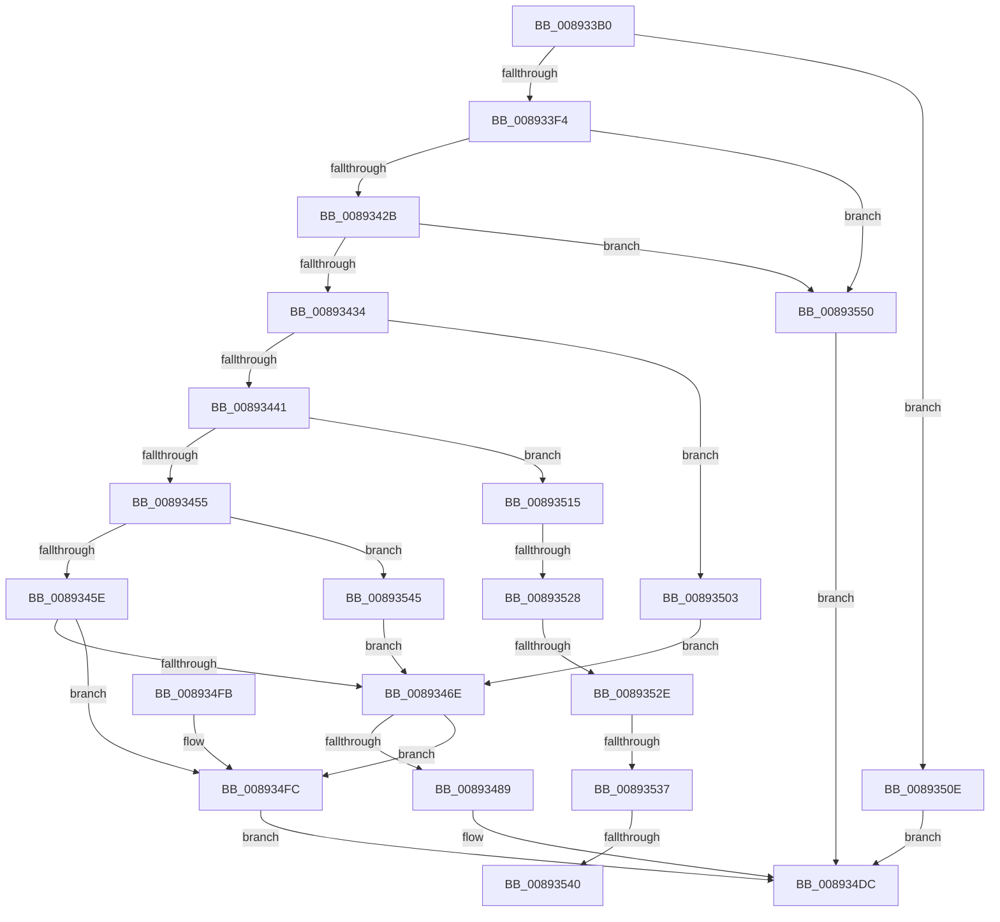

# AlpcpCreateRegion

- RVA: `0x008933B0`–`0x00893557` (길이 `423` bytes)
- VA: `0x00000001408933B0`
- 실행 섹션: `PAGE`
- PDB 이름 있음: `예`; PDB Function 태그: `예`
- unwind 정보 RVA: `0x0007DE44`
- 디코드: `111`개 명령, `423/423` bytes 표시
- 미해석 바이트: `0` (있으면 어셈블리에 `.byte`로 보존)

> 이 문서는 커널 이미지의 기계어와 PDB 기호를 분석해 생성했습니다. 4번과 5번은 함수 원형과 자료형을 바이너리 사용 방식에서 추정한 C 해석이며 원본 소스 복구 결과는 아닙니다.

## 1. Dependencies

- 직접 호출 지점: **3**; 고유 호출 대상: **3**
- 직접 호출자로 확인된 함수: **1**
- RIP 상대 이미지 참조: **3**

### Outgoing calls
- `0x0089347C` → [AlpcpAllocateBlob](AlpcpAllocateBlob_function_008925B0.md) (function, `0x008925B0`)
- `0x00893492` → [memset](../../text/6C/memset_function_006C6C40.md) (function, `0x006C6C40`)
- `0x008934B5` → [AlpcpReferenceBlob](AlpcpReferenceBlob_function_00890110.md) (function, `0x00890110`)

### Direct callers
- [AlpcpCreateSectionView](../88/AlpcpCreateSectionView_function_0088850C.md) at `0x0088855B`

### Static image references
- `0x008933F4` → RVA `0x00FC6CE0` (`ALMOSTRO`; read)
- `0x00893405` → RVA `0x00FC6CDC` (`ALMOSTRO`; read)
- `0x00893471` → RVA `0x00001548` (`.rdata`; read)

## 2. Other-region calls and transfers

- 다른 실행 섹션으로 향하는 call: **1**
  - `0x00893492` → [memset](../../text/6C/memset_function_006C6C40.md) (`PAGE` → `.text`)
- call이 아닌 외부 분기/꼬리 이동: **5**
  - `0x00893522` → [sub_00B1961E + 0x18](../B1/Unknown_function_00B1961E.md) (`tail-transfer`)
  - `0x00893528` → [sub_00B1961E + 0x9](../B1/Unknown_function_00B1961E.md) (`tail-transfer`)
  - `0x00893531` → [sub_00B1961E](../B1/Unknown_function_00B1961E.md) (`tail-transfer`)
  - `0x0089353A` → [sub_00B1961E](../B1/Unknown_function_00B1961E.md) (`tail-transfer`)
  - `0x00893540` → [sub_00B1961E + 0x9](../B1/Unknown_function_00B1961E.md) (`tail-transfer`)

## 3. Assembly (complete function range)

```asm
008933B0  48 8B C4                        mov rax, rsp
008933B3  48 89 58 08                     mov qword ptr [rax + 8], rbx
008933B7  48 89 68 10                     mov qword ptr [rax + 0x10], rbp
008933BB  48 89 70 18                     mov qword ptr [rax + 0x18], rsi
008933BF  48 89 78 20                     mov qword ptr [rax + 0x20], rdi
008933C3  41 54                           push r12
008933C5  41 56                           push r14
008933C7  41 57                           push r15
008933C9  48 83 EC 20                     sub rsp, 0x20
008933CD  65 48 8B 04 25 88 01 00 00      mov rax, qword ptr gs:[0x188]
008933D6  4D 8B F9                        mov r15, r9
008933D9  49 83 21 00                     and qword ptr [r9], 0
008933DD  48 8B DA                        mov rbx, rdx
008933E0  48 8B E9                        mov rbp, rcx
008933E3  4C 8B 90 B8 00 00 00            mov r10, qword ptr [rax + 0xb8]
008933EA  4C 39 51 20                     cmp qword ptr [rcx + 0x20], r10
008933EE  0F 85 1A 01 00 00               jne 0x14089350e
008933F4  8B 0D E6 38 73 00               mov ecx, dword ptr [rip + 0x7338e6]
008933FA  44 8D 61 FF                     lea r12d, [rcx - 1]
008933FE  48 8D 41 FF                     lea rax, [rcx - 1]
00893402  4D 03 E0                        add r12, r8
00893405  8B 0D D1 38 73 00               mov ecx, dword ptr [rip + 0x7338d1]
0089340B  48 F7 D0                        not rax
0089340E  4C 23 E0                        and r12, rax
00893411  8D 51 FF                        lea edx, [rcx - 1]
00893414  48 8D 41 FF                     lea rax, [rcx - 1]
00893418  48 F7 D0                        not rax
0089341B  4E 8D 34 02                     lea r14, [rdx + r8]
0089341F  4C 23 F0                        and r14, rax
00893422  4D 3B E0                        cmp r12, r8
00893425  0F 82 25 01 00 00               jb 0x140893550
0089342B  4D 3B F0                        cmp r14, r8
0089342E  0F 82 1C 01 00 00               jb 0x140893550
00893434  48 8D 7D 38                     lea rdi, [rbp + 0x38]
00893438  48 85 DB                        test rbx, rbx
0089343B  0F 85 C2 00 00 00               jne 0x140893503
00893441  48 8B 0F                        mov rcx, qword ptr [rdi]
00893444  33 D2                           xor edx, edx
00893446  45 33 C9                        xor r9d, r9d
00893449  45 33 C0                        xor r8d, r8d
0089344C  48 3B CF                        cmp rcx, rdi
0089344F  0F 85 C0 00 00 00               jne 0x140893515
00893455  48 85 D2                        test rdx, rdx
00893458  0F 85 E7 00 00 00               jne 0x140893545
0089345E  48 8B 45 08                     mov rax, qword ptr [rbp + 8]
00893462  48 2B C3                        sub rax, rbx
00893465  49 3B C6                        cmp rax, r14
00893468  0F 82 8E 00 00 00               jb 0x1408934fc
0089346E  45 33 C0                        xor r8d, r8d
00893471  48 8D 0D D0 E0 76 FF            lea rcx, [rip - 0x891f30]
00893478  41 8D 50 58                     lea edx, [r8 + 0x58]
0089347C  E8 2F F1 FF FF                  call 0x1408925b0
00893481  48 8B F0                        mov rsi, rax
00893484  48 85 C0                        test rax, rax
00893487  74 73                           je 0x1408934fc
00893489  33 D2                           xor edx, edx
0089348B  48 8B C8                        mov rcx, rax
0089348E  44 8D 42 58                     lea r8d, [rdx + 0x58]
00893492  E8 A9 37 E3 FF                  call 0x1406c6c40
00893497  48 8D 4E 38                     lea rcx, [rsi + 0x38]
0089349B  48 89 49 08                     mov qword ptr [rcx + 8], rcx
0089349F  48 89 09                        mov qword ptr [rcx], rcx
008934A2  48 8B CD                        mov rcx, rbp
008934A5  83 66 30 FE                     and dword ptr [rsi + 0x30], 0xfffffffe
008934A9  48 89 5E 18                     mov qword ptr [rsi + 0x18], rbx
008934AD  4C 89 76 20                     mov qword ptr [rsi + 0x20], r14
008934B1  4C 89 66 28                     mov qword ptr [rsi + 0x28], r12
008934B5  E8 56 CC FF FF                  call 0x140890110
008934BA  48 89 6E 10                     mov qword ptr [rsi + 0x10], rbp
008934BE  48 8B 47 08                     mov rax, qword ptr [rdi + 8]
008934C2  48 89 46 08                     mov qword ptr [rsi + 8], rax
008934C6  48 89 3E                        mov qword ptr [rsi], rdi
008934C9  48 8B 47 08                     mov rax, qword ptr [rdi + 8]
008934CD  49 89 37                        mov qword ptr [r15], rsi
008934D0  48 89 30                        mov qword ptr [rax], rsi
008934D3  48 89 77 08                     mov qword ptr [rdi + 8], rsi
008934D7  FF 45 34                        inc dword ptr [rbp + 0x34]
008934DA  33 C0                           xor eax, eax
008934DC  48 8B 5C 24 40                  mov rbx, qword ptr [rsp + 0x40]
008934E1  48 8B 6C 24 48                  mov rbp, qword ptr [rsp + 0x48]
008934E6  48 8B 74 24 50                  mov rsi, qword ptr [rsp + 0x50]
008934EB  48 8B 7C 24 58                  mov rdi, qword ptr [rsp + 0x58]
008934F0  48 83 C4 20                     add rsp, 0x20
008934F4  41 5F                           pop r15
008934F6  41 5E                           pop r14
008934F8  41 5C                           pop r12
008934FA  C3                              ret
008934FB  CC                              int3
008934FC  B8 9A 00 00 C0                  mov eax, 0xc000009a
00893501  EB D9                           jmp 0x1408934dc
00893503  48 03 DA                        add rbx, rdx
00893506  48 23 D8                        and rbx, rax
00893509  E9 60 FF FF FF                  jmp 0x14089346e
0089350E  B8 22 00 00 C0                  mov eax, 0xc0000022
00893513  EB C7                           jmp 0x1408934dc
00893515  4C 8B 51 18                     mov r10, qword ptr [rcx + 0x18]
00893519  49 8B C2                        mov rax, r10
0089351C  48 2B C3                        sub rax, rbx
0089351F  49 3B C6                        cmp rax, r14
00893522  0F 84 0E 61 28 00               je 0x140b19636
00893528  0F 86 F9 60 28 00               jbe 0x140b19627
0089352E  48 85 D2                        test rdx, rdx
00893531  0F 84 E7 60 28 00               je 0x140b1961e
00893537  4C 3B C8                        cmp r9, rax
0089353A  0F 87 DE 60 28 00               ja 0x140b1961e
00893540  E9 E2 60 28 00                  jmp 0x140b19627
00893545  48 8B FA                        mov rdi, rdx
00893548  49 8B D8                        mov rbx, r8
0089354B  E9 1E FF FF FF                  jmp 0x14089346e
00893550  B8 0D 00 00 C0                  mov eax, 0xc000000d
00893555  EB 85                           jmp 0x1408934dc
```

## 4. C-style interpretation (structured pseudocode)

```c
__int64 __fastcall AlpcpCreateRegion(__int64 a1, __int64 a2, __int64 a3, __int64 a4)
{
    __int64 result;
    __int64 v_r12;
    __int64 v_r14;
    __int64 v_rbx;
    __int64 v_rsp;
    unsigned __int64 v_stack_p10;
    unsigned __int64 v_stack_p18;
    unsigned __int64 v_stack_p20;
    unsigned __int64 v_stack_p8;

    *(unsigned __int64 *)(v_rsp + 8) = v_rbx;
    *(unsigned __int64 *)(v_rsp + 16) = v_rbp;
    *(unsigned __int64 *)(v_rsp + 24) = v_rsi;
    *(unsigned __int64 *)(v_rsp + 32) = v_rdi;
    v_rsp = (v_rsp) - (32);
    if ((*(unsigned __int64 *)(a1 + 32)) != (*(unsigned __int64 *)(*(unsigned __int64 *)(gs_base + (0 + 392)) + 184))) goto loc_0089350E;
    v_r12 = ((unsigned int)(*(unsigned int *)(v_rip + 7551206)) - 1) + (a3);
    result = ~((unsigned int)(*(unsigned int *)(v_rip + 7551206)) - 1);
    v_r12 = (v_r12) & (result);
    result = ~((unsigned int)(*(unsigned int *)(v_rip + 7551185)) - 1);
    v_r14 = ((unsigned int)(*(unsigned int *)(v_rip + 7551185)) - 1 + a3 * 1) & (result);
    if (v_r12 < a3) goto loc_00893550;
    if (v_r14 < a3) goto loc_00893550;
    if (a2 != 0) goto loc_00893503;
    a2 = 0;
    a4 = 0;
    a3 = 0;
    if ((*(unsigned __int64 *)(a1 + 56)) != (a1 + 56)) goto loc_00893515;
    if (0 != 0) goto loc_00893545;
    result = (*(unsigned __int64 *)(a1 + 8)) - (0);
    if (result < v_r14) goto loc_008934FC;
loc_0089346E:
    a3 = 0;
    result = AlpcpAllocateBlob(v_rip - 8986416, a3 + 88, a3, a4);
    if (result == 0) goto loc_008934FC;
    a2 = 0;
    result = memset(result, a2, a2 + 88, a4);
    *(unsigned __int64 *)(result + 56 + 8) = result + 56;
    *(unsigned __int64 *)(result + 56) = result + 56;
    *(unsigned __int64 *)(result + 24) = 0;
    *(unsigned __int64 *)(result + 32) = v_r14;
    *(unsigned __int64 *)(result + 40) = v_r12;
    result = AlpcpReferenceBlob(a1, a2, a2 + 88, a4);
    *(unsigned __int64 *)(result + 16) = a1;
    *(unsigned __int64 *)(result + 8) = *(unsigned __int64 *)(a1 + 56 + 8);
    *(unsigned __int64 *)(result) = a1 + 56;
    *(unsigned __int64 *)(a4) = result;
    *(unsigned __int64 *)(*(unsigned __int64 *)(a1 + 56 + 8)) = result;
    *(unsigned __int64 *)(a1 + 56 + 8) = result;
    result = 0;
loc_008934DC:
    v_rsp = (v_rsp) + (32);
    return result;
loc_008934FC:
    goto loc_008934DC;
loc_00893503:
    v_rbx = (v_stack_p8) + (0);
    v_rbx = (v_rbx) & ((unsigned int)(0xC000009AULL));
    goto loc_0089346E;
loc_0089350E:
    goto loc_008934DC;
loc_00893515:
    result = (*(unsigned __int64 *)(a1 + 24)) - (v_rbx);
loc_00893545:
    goto loc_0089346E;
loc_00893550:
    goto loc_008934DC;
}
```

## 5. (Beta) C Style

```c
int64_t AlpcpCreateRegion(void *Arg1, int64_t Arg2, int64_t Arg3, void *Arg4)
{
    uint8_t *arg1 = (uint8_t *)Arg1;
    uint8_t *arg4 = (uint8_t *)Arg4;

    int64_t result;
    int64_t local_r12;
    int64_t local_r14;
    int64_t local_rbx;
    int64_t local_rsp;
    uint64_t v_stack_p10;
    uint64_t v_stack_p18;
    uint64_t v_stack_p20;
    uint64_t v_stack_p8;

    *(uint64_t *)(local_rsp + 0x8) = local_rbx;
    *(uint64_t *)(local_rsp + 0x10) = local_rbp;
    *(uint64_t *)(local_rsp + 0x18) = local_rsi;
    *(uint64_t *)(local_rsp + 0x20) = local_rdi;
    local_rsp = (local_rsp) - (32);
    if ((*(uint64_t *)(arg1 + 0x20)) != (*(uint64_t *)(*(uint64_t *)(gs_base + (0 + 0x188)) + 0xB8))) goto loc_0089350E;
    local_r12 = ((uint32_t)(*(uint32_t *)(v_rip + 0x7338E6)) - 1) + (Arg3);
    result = ~((uint32_t)(*(uint32_t *)(v_rip + 0x7338E6)) - 1);
    local_r12 = (local_r12) & (result);
    result = ~((uint32_t)(*(uint32_t *)(v_rip + 0x7338D1)) - 1);
    local_r14 = ((uint32_t)(*(uint32_t *)(v_rip + 0x7338D1)) - 1 + Arg3 * 1) & (result);
    if (local_r12 < Arg3) goto loc_00893550;
    if (local_r14 < Arg3) goto loc_00893550;
    if (Arg2 != 0) goto loc_00893503;
    Arg2 = 0;
    Arg4 = 0;
    Arg3 = 0;
    if ((*(uint64_t *)(arg1 + 0x38)) != (Arg1 + 56)) goto loc_00893515;
    if (0 != 0) goto loc_00893545;
    result = (*(uint64_t *)(arg1 + 0x8)) - (0);
    if (result < local_r14) goto loc_008934FC;
loc_0089346E:
    Arg3 = 0;
    result = AlpcpAllocateBlob(v_rip - 8986416, Arg3 + 88, Arg3, Arg4);
    if (result == 0) goto loc_008934FC;
    Arg2 = 0;
    result = memset(result, Arg2, Arg2 + 88, Arg4);
    *(uint64_t *)(result + 0x38 + 0x8) = result + 56;
    *(uint64_t *)(result + 0x38) = result + 56;
    *(uint64_t *)(result + 0x18) = 0;
    *(uint64_t *)(result + 0x20) = local_r14;
    *(uint64_t *)(result + 0x28) = local_r12;
    result = AlpcpReferenceBlob(Arg1, Arg2, Arg2 + 88, Arg4);
    *(void **)(result + 0x10) = Arg1;
    *(uint64_t *)(result + 0x8) = *(uint64_t *)(arg1 + 0x38 + 0x8);
    *(void **)(result) = Arg1 + 56;
    *(uint64_t *)(arg4) = result;
    *(uint64_t *)(*(uint64_t *)(arg1 + 0x38 + 0x8)) = result;
    *(uint64_t *)(arg1 + 0x38 + 0x8) = result;
    result = 0;
loc_008934DC:
    local_rsp = (local_rsp) + (32);
    return result;
loc_008934FC:
    goto loc_008934DC;
loc_00893503:
    local_rbx = (v_stack_p8) + (0);
    local_rbx = (local_rbx) & ((uint32_t)(0xC000009AULL));
    goto loc_0089346E;
loc_0089350E:
    goto loc_008934DC;
loc_00893515:
    result = (*(uint64_t *)(arg1 + 0x18)) - (local_rbx);
loc_00893545:
    goto loc_0089346E;
loc_00893550:
    goto loc_008934DC;
}
```

### 관측된 메모리 오프셋

구조체 형식이 확인되지 않은 접근은 인자 기준의 오프셋으로만 기록했습니다.

| 기준 인자 | 오프셋 표현 | 폭 (bit) | 접근 |
|---|---:|---:|---|
| `Arg1` | `+ 0x0` | `64` | `R` |
| `Arg1` | `+ 0x8` | `64` | `R` |
| `Arg1` | `+ 0x20` | `64` | `R` |
| `Arg1` | `+ 0x34` | `32` | `R/W` |
| `Arg1` | `+ 0x38` | `64` | `R` |
| `Arg4` | `+ 0x0` | `64` | `R/W` |
| `Arg4` | `+ 0x0` | `64` | `W` |

## 6. Execution-region graph

[열기: 2D/3D 그래프와 함수 탐색 컨트롤 패널](../../../control-panel.html?section=page&rva=0x008933B0&view=graph)

- 2D 그래프는 위에서 아래로 흐르고, 3D 그래프는 빈 공간을 드래그해 회전합니다. Shift+드래그는 이동, 휠은 확대·축소, 함수 노드 선택은 대상 보고서 이동입니다.

### Static fallback


