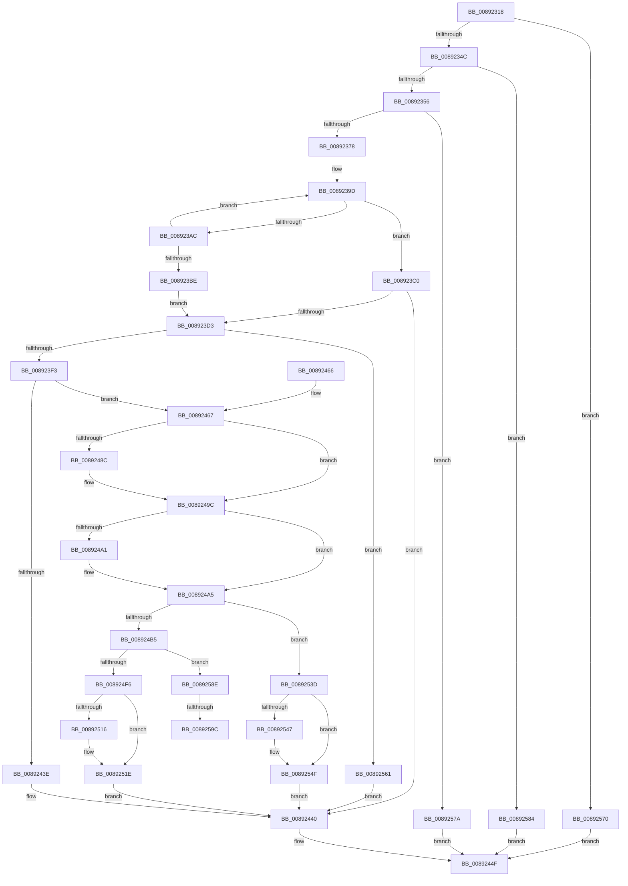

# AlpcpCreateReserve

- RVA: `0x00892318`–`0x008925AA` (길이 `658` bytes)
- VA: `0x0000000140892318`
- 실행 섹션: `PAGE`
- PDB 이름 있음: `예`; PDB Function 태그: `예`
- unwind 정보 RVA: `0x0007DBE8`
- 디코드: `166`개 명령, `658/658` bytes 표시
- 미해석 바이트: `0` (있으면 어셈블리에 `.byte`로 보존)

> 이 문서는 커널 이미지의 기계어와 PDB 기호를 분석해 생성했습니다. 4번과 5번은 함수 원형과 자료형을 바이너리 사용 방식에서 추정한 C 해석이며 원본 소스 복구 결과는 아닙니다.

## 1. Dependencies

- 직접 호출 지점: **22**; 고유 호출 대상: **18**
- 직접 호출자로 확인된 함수: **1**
- RIP 상대 이미지 참조: **1**

### Outgoing calls
- `0x00892367` → [AlpcpAllocateBlob](AlpcpAllocateBlob_function_008925B0.md) (function, `0x008925B0`)
- `0x008923C8` → [PsChargeProcessPagedPoolQuota](PsChargeProcessPagedPoolQuota_function_00891170.md) (function, `0x00891170`)
- `0x008923E1` → [AlpcpAllocateMessage](AlpcpAllocateMessage_function_008926C0.md) (function, `0x008926C0`)
- `0x008923F8` → [ObfReferenceObjectWithTag](../../text/21/ObfReferenceObjectWithTag_function_00210710.md) (function, `0x00210710`)
- `0x0089241C` → [AlpcpCaptureMessageData](AlpcpCaptureMessageData_function_008929A0.md) (function, `0x008929A0`)
- `0x0089242D` → [AlpcpReferenceBlob](AlpcpReferenceBlob_function_00890110.md) (function, `0x00890110`)
- `0x00892435` → [AlpcpUnlockMessage](AlpcpUnlockMessage_function_00897AE0.md) (function, `0x00897AE0`)
- `0x00892448` → [AlpcpDereferenceBlobEx](../88/AlpcpDereferenceBlobEx_function_0088AF00.md) (function, `0x0088AF00`)
- `0x00892476` → [KeAbPreAcquire](../../text/21/KeAbPreAcquire_function_00210230.md) (function, `0x00210230`)
- `0x00892497` → [ExfAcquirePushLockSharedEx](../../text/21/ExfAcquirePushLockSharedEx_function_0021044C.md) (function, `0x0021044C`)
- `0x008924B8` → [AlpcpReferenceBlob](AlpcpReferenceBlob_function_00890110.md) (function, `0x00890110`)
- `0x008924C0` → [AlpcpStartInitialization](AlpcpStartInitialization_function_008920D8.md) (function, `0x008920D8`)
- `0x008924E3` → [AlpcAddHandleTableEntry](AlpcAddHandleTableEntry_function_00892140.md) (function, `0x00892140`)
- `0x008924FC` → [ObfReferenceObject](../../text/20/ObfReferenceObject_function_0020FA20.md) (function, `0x0020FA20`)
- `0x00892507` → [AlpcpInsertResourcePort](../88/AlpcpInsertResourcePort_function_008898DC.md) (function, `0x008898DC`)
- `0x00892519` → [ExfReleasePushLockShared](../../text/26/ExfReleasePushLockShared_function_00263440.md) (function, `0x00263440`)
- `0x00892521` → [KeAbPostRelease](../../text/2E/KeAbPostRelease_function_002E1600.md) (function, `0x002E1600`)
- `0x00892530` → [AlpcpEndInitialization](../A2/AlpcpEndInitialization_function_00A20C78.md) (function, `0x00A20C78`)
- `0x0089254A` → [ExfReleasePushLockShared](../../text/26/ExfReleasePushLockShared_function_00263440.md) (function, `0x00263440`)
- `0x00892552` → [KeAbPostRelease](../../text/2E/KeAbPostRelease_function_002E1600.md) (function, `0x002E1600`)
- `0x00892566` → [AlpcpReleasePagedPoolQuota](../92/AlpcpReleasePagedPoolQuota_function_00922EE8.md) (function, `0x00922EE8`)
- `0x0089259F` → [ExfReleasePushLockShared](../../text/26/ExfReleasePushLockShared_function_00263440.md) (function, `0x00263440`)

### Direct callers
- [NtAlpcCreateResourceReserve](NtAlpcCreateResourceReserve_function_00892BE0.md) at `0x00892C70`

### Static image references
- `0x00892360` → RVA `0x000014D8` (`.rdata`; read)

## 2. Other-region calls and transfers

- 다른 실행 섹션으로 향하는 call: **9**
  - `0x008923F8` → [ObfReferenceObjectWithTag](../../text/21/ObfReferenceObjectWithTag_function_00210710.md) (`PAGE` → `.text`)
  - `0x00892476` → [KeAbPreAcquire](../../text/21/KeAbPreAcquire_function_00210230.md) (`PAGE` → `.text`)
  - `0x00892497` → [ExfAcquirePushLockSharedEx](../../text/21/ExfAcquirePushLockSharedEx_function_0021044C.md) (`PAGE` → `.text`)
  - `0x008924FC` → [ObfReferenceObject](../../text/20/ObfReferenceObject_function_0020FA20.md) (`PAGE` → `.text`)
  - `0x00892519` → [ExfReleasePushLockShared](../../text/26/ExfReleasePushLockShared_function_00263440.md) (`PAGE` → `.text`)
  - `0x00892521` → [KeAbPostRelease](../../text/2E/KeAbPostRelease_function_002E1600.md) (`PAGE` → `.text`)
  - `0x0089254A` → [ExfReleasePushLockShared](../../text/26/ExfReleasePushLockShared_function_00263440.md) (`PAGE` → `.text`)
  - `0x00892552` → [KeAbPostRelease](../../text/2E/KeAbPostRelease_function_002E1600.md) (`PAGE` → `.text`)
  - `0x0089259F` → [ExfReleasePushLockShared](../../text/26/ExfReleasePushLockShared_function_00263440.md) (`PAGE` → `.text`)
- call이 아닌 외부 분기/꼬리 이동: **2**
  - `0x00892596` → [sub_00B194AC](../B1/Unknown_function_00B194AC.md) (`tail-transfer`)
  - `0x008925A5` → [sub_00B194AC](../B1/Unknown_function_00B194AC.md) (`tail-transfer`)

## 3. Assembly (complete function range)

```asm
00892318  48 89 5C 24 08                  mov qword ptr [rsp + 8], rbx
0089231D  48 89 6C 24 18                  mov qword ptr [rsp + 0x18], rbp
00892322  56                              push rsi
00892323  57                              push rdi
00892324  41 54                           push r12
00892326  41 56                           push r14
00892328  41 57                           push r15
0089232A  48 83 EC 30                     sub rsp, 0x30
0089232E  45 33 E4                        xor r12d, r12d
00892331  4D 8B F8                        mov r15, r8
00892334  4C 89 64 24 68                  mov qword ptr [rsp + 0x68], r12
00892339  48 8B EA                        mov rbp, rdx
0089233C  4C 8B F1                        mov r14, rcx
0089233F  48 81 FA D7 FF 00 00            cmp rdx, 0xffd7
00892346  0F 87 24 02 00 00               ja 0x140892570
0089234C  48 83 FA 28                     cmp rdx, 0x28
00892350  0F 82 2E 02 00 00               jb 0x140892584
00892356  41 8D 54 24 30                  lea edx, [r12 + 0x30]
0089235B  45 8D 44 24 01                  lea r8d, [r12 + 1]
00892360  48 8D 0D 71 F1 76 FF            lea rcx, [rip - 0x890e8f]
00892367  E8 44 02 00 00                  call 0x1408925b0
0089236C  48 8B F8                        mov rdi, rax
0089236F  48 85 C0                        test rax, rax
00892372  0F 84 02 02 00 00               je 0x14089257a
00892378  0F 57 C0                        xorps xmm0, xmm0
0089237B  0F 11 00                        movups xmmword ptr [rax], xmm0
0089237E  0F 11 40 10                     movups xmmword ptr [rax + 0x10], xmm0
00892382  0F 11 40 20                     movups xmmword ptr [rax + 0x20], xmm0
00892386  65 48 8B 04 25 88 01 00 00      mov rax, qword ptr gs:[0x188]
0089238F  48 8B B0 B8 00 00 00            mov rsi, qword ptr [rax + 0xb8]
00892396  0F 0D 8E 98 05 00 00            prefetchw byte ptr [rsi + 0x598]
0089239D  48 8B 86 98 05 00 00            mov rax, qword ptr [rsi + 0x598]
008923A4  48 3D 18 03 00 00               cmp rax, 0x318
008923AA  72 14                           jb 0x1408923c0
008923AC  48 8D 88 E8 FC FF FF            lea rcx, [rax - 0x318]
008923B3  F0 48 0F B1 8E 98 05 00 00      lock cmpxchg qword ptr [rsi + 0x598], rcx
008923BC  75 DF                           jne 0x14089239d
008923BE  EB 13                           jmp 0x1408923d3
008923C0  BA 18 03 00 00                  mov edx, 0x318
008923C5  48 8B CE                        mov rcx, rsi
008923C8  E8 A3 ED FF FF                  call 0x140891170
008923CD  8B D8                           mov ebx, eax
008923CF  85 C0                           test eax, eax
008923D1  78 6D                           js 0x140892440
008923D3  41 B8 01 00 00 00               mov r8d, 1
008923D9  48 8D 4C 24 68                  lea rcx, [rsp + 0x68]
008923DE  48 8B D5                        mov rdx, rbp
008923E1  E8 DA 02 00 00                  call 0x1408926c0
008923E6  8B D8                           mov ebx, eax
008923E8  48 8B CE                        mov rcx, rsi
008923EB  85 C0                           test eax, eax
008923ED  0F 88 6E 01 00 00               js 0x140892561
008923F3  BA 41 6C 70 63                  mov edx, 0x63706c41
008923F8  E8 13 E3 97 FF                  call 0x140210710
008923FD  48 8B 5C 24 68                  mov rbx, qword ptr [rsp + 0x68]
00892402  45 33 C0                        xor r8d, r8d
00892405  48 8B D5                        mov rdx, rbp
00892408  48 89 73 30                     mov qword ptr [rbx + 0x30], rsi
0089240C  48 89 5F 18                     mov qword ptr [rdi + 0x18], rbx
00892410  48 89 6F 20                     mov qword ptr [rdi + 0x20], rbp
00892414  48 89 7B 60                     mov qword ptr [rbx + 0x60], rdi
00892418  48 8B 4F 18                     mov rcx, qword ptr [rdi + 0x18]
0089241C  E8 7F 05 00 00                  call 0x1408929a0
00892421  48 8B CF                        mov rcx, rdi
00892424  C7 47 28 01 00 00 00            mov dword ptr [rdi + 0x28], 1
0089242B  8B F0                           mov esi, eax
0089242D  E8 DE DC FF FF                  call 0x140890110
00892432  48 8B CB                        mov rcx, rbx
00892435  E8 A6 56 00 00                  call 0x140897ae0
0089243A  85 F6                           test esi, esi
0089243C  79 29                           jns 0x140892467
0089243E  8B DE                           mov ebx, esi
00892440  BA 01 00 00 00                  mov edx, 1
00892445  48 8B CF                        mov rcx, rdi
00892448  E8 B3 8A FF FF                  call 0x14088af00
0089244D  8B C3                           mov eax, ebx
0089244F  48 8B 5C 24 60                  mov rbx, qword ptr [rsp + 0x60]
00892454  48 8B 6C 24 70                  mov rbp, qword ptr [rsp + 0x70]
00892459  48 83 C4 30                     add rsp, 0x30
0089245D  41 5F                           pop r15
0089245F  41 5E                           pop r14
00892461  41 5C                           pop r12
00892463  5F                              pop rdi
00892464  5E                              pop rsi
00892465  C3                              ret
00892466  CC                              int3
00892467  49 8D 9E 60 01 00 00            lea rbx, [r14 + 0x160]
0089246E  45 33 C0                        xor r8d, r8d
00892471  48 8B CB                        mov rcx, rbx
00892474  33 D2                           xor edx, edx
00892476  E8 B5 DD 97 FF                  call 0x140210230
0089247B  48 8B F0                        mov rsi, rax
0089247E  BD 11 00 00 00                  mov ebp, 0x11
00892483  33 C0                           xor eax, eax
00892485  F0 48 0F B1 2B                  lock cmpxchg qword ptr [rbx], rbp
0089248A  74 10                           je 0x14089249c
0089248C  4C 8B CB                        mov r9, rbx
0089248F  4C 8B C6                        mov r8, rsi
00892492  33 D2                           xor edx, edx
00892494  48 8B CB                        mov rcx, rbx
00892497  E8 B0 DF 97 FF                  call 0x14021044c
0089249C  48 85 F6                        test rsi, rsi
0089249F  74 04                           je 0x1408924a5
008924A1  C6 46 0A 01                     mov byte ptr [rsi + 0xa], 1
008924A5  41 8B 8E A0 01 00 00            mov ecx, dword ptr [r14 + 0x1a0]
008924AC  F6 C1 20                        test cl, 0x20
008924AF  0F 85 88 00 00 00               jne 0x14089253d
008924B5  48 8B CF                        mov rcx, rdi
008924B8  E8 53 DC FF FF                  call 0x140890110
008924BD  48 8B CF                        mov rcx, rdi
008924C0  E8 13 FC FF FF                  call 0x1408920d8
008924C5  49 8B 46 10                     mov rax, qword ptr [r14 + 0x10]
008924C9  48 8D 54 24 78                  lea rdx, [rsp + 0x78]
008924CE  48 83 C0 28                     add rax, 0x28
008924D2  48 89 7C 24 78                  mov qword ptr [rsp + 0x78], rdi
008924D7  48 89 47 08                     mov qword ptr [rdi + 8], rax
008924DB  49 8B 4E 10                     mov rcx, qword ptr [r14 + 0x10]
008924DF  48 83 C1 28                     add rcx, 0x28
008924E3  E8 58 FC FF FF                  call 0x140892140
008924E8  48 89 47 10                     mov qword ptr [rdi + 0x10], rax
008924EC  48 83 F8 FF                     cmp rax, -1
008924F0  0F 84 98 00 00 00               je 0x14089258e
008924F6  49 8B CE                        mov rcx, r14
008924F9  4C 89 37                        mov qword ptr [rdi], r14
008924FC  E8 1F D5 97 FF                  call 0x14020fa20
00892501  48 8B D7                        mov rdx, rdi
00892504  49 8B CE                        mov rcx, r14
00892507  E8 D0 73 FF FF                  call 0x1408898dc
0089250C  48 8B C5                        mov rax, rbp
0089250F  F0 4C 0F B1 23                  lock cmpxchg qword ptr [rbx], r12
00892514  74 08                           je 0x14089251e
00892516  48 8B CB                        mov rcx, rbx
00892519  E8 22 0F 9D FF                  call 0x140263440
0089251E  48 8B CB                        mov rcx, rbx
00892521  E8 DA F0 A4 FF                  call 0x1402e1600
00892526  48 8B 47 10                     mov rax, qword ptr [rdi + 0x10]
0089252A  48 8B CF                        mov rcx, rdi
0089252D  49 89 07                        mov qword ptr [r15], rax
00892530  E8 43 E7 18 00                  call 0x140a20c78
00892535  41 8B DC                        mov ebx, r12d
00892538  E9 03 FF FF FF                  jmp 0x140892440
0089253D  48 8B C5                        mov rax, rbp
00892540  F0 4C 0F B1 23                  lock cmpxchg qword ptr [rbx], r12
00892545  74 08                           je 0x14089254f
00892547  48 8B CB                        mov rcx, rbx
0089254A  E8 F1 0E 9D FF                  call 0x140263440
0089254F  48 8B CB                        mov rcx, rbx
00892552  E8 A9 F0 A4 FF                  call 0x1402e1600
00892557  BB 37 00 00 C0                  mov ebx, 0xc0000037
0089255C  E9 DF FE FF FF                  jmp 0x140892440
00892561  BA 18 03 00 00                  mov edx, 0x318
00892566  E8 7D 09 09 00                  call 0x140922ee8
0089256B  E9 D0 FE FF FF                  jmp 0x140892440
00892570  B8 05 00 00 80                  mov eax, 0x80000005
00892575  E9 D5 FE FF FF                  jmp 0x14089244f
0089257A  B8 9A 00 00 C0                  mov eax, 0xc000009a
0089257F  E9 CB FE FF FF                  jmp 0x14089244f
00892584  B8 0D 00 00 C0                  mov eax, 0xc000000d
00892589  E9 C1 FE FF FF                  jmp 0x14089244f
0089258E  48 8B C5                        mov rax, rbp
00892591  F0 4C 0F B1 23                  lock cmpxchg qword ptr [rbx], r12
00892596  0F 84 10 6F 28 00               je 0x140b194ac
0089259C  48 8B CB                        mov rcx, rbx
0089259F  E8 9C 0E 9D FF                  call 0x140263440
008925A4  90                              nop
008925A5  E9 02 6F 28 00                  jmp 0x140b194ac
```

## 4. C-style interpretation (structured pseudocode)

```c
__int64 __fastcall AlpcpCreateReserve(__int64 a1, __int64 a2, __int64 a3)
{
    __int64 result;
    __int64 v_r12;
    __int64 v_rsp;
    unsigned __int64 v_stack_p10;
    unsigned __int64 v_stack_p18;
    unsigned __int64 v_stack_p78;
    unsigned __int64 v_stack_p8;

    v_stack_p8 = v_rbx;
    v_stack_p18 = v_rbp;
    v_rsp = (v_rsp) - (48);
    v_r12 = 0;
    v_stack_p10 = 0;
    if (a2 > 0xFFD7ULL) goto loc_00892570;
    if (a2 < 40) goto loc_00892584;
    result = AlpcpAllocateBlob(v_rip - 8982159, v_r12 + 48, v_r12 + 1, a4);
    if (result == 0) goto loc_0089257A;
    *(unsigned __int64 *)(result) = v_xmm0;
    *(unsigned __int64 *)(result + 16) = v_xmm0;
    *(unsigned __int64 *)(result + 32) = v_xmm0;
loc_0089239D:
    if ((*(unsigned __int64 *)(*(unsigned __int64 *)(*(unsigned __int64 *)(gs_base + (0 + 392)) + 184) + 1432)) < 792) goto loc_008923C0;
    if ((*(unsigned __int64 *)(*(unsigned __int64 *)(*(unsigned __int64 *)(gs_base + (0 + 392)) + 184) + 1432)) != 792) goto loc_0089239D;
    goto loc_008923D3;
loc_008923C0:
    result = PsChargeProcessPagedPoolQuota(*(unsigned __int64 *)(*(unsigned __int64 *)(gs_base + (0 + 392)) + 184), 792, v_r12 + 1, a4);
    if (sign_flag) goto loc_00892440;
loc_008923D3:
    result = AlpcpAllocateMessage(v_stack_p10, a2, 1, a4);
    if (sign_flag) goto loc_00892561;
    result = ObfReferenceObjectWithTag(*(unsigned __int64 *)(*(unsigned __int64 *)(gs_base + (0 + 392)) + 184), (unsigned int)(0x63706C41ULL), 1, a4);
    a3 = 0;
    *(unsigned __int64 *)(v_stack_p10 + 48) = *(unsigned __int64 *)(*(unsigned __int64 *)(gs_base + (0 + 392)) + 184);
    *(unsigned __int64 *)(result + 24) = v_stack_p10;
    *(unsigned __int64 *)(result + 32) = a2;
    *(unsigned __int64 *)(v_stack_p10 + 96) = result;
    result = AlpcpCaptureMessageData(*(unsigned __int64 *)(result + 24), a2, a3, a4);
    *(unsigned int *)(result + 40) = 1;
    result = AlpcpReferenceBlob(result, a2, a3, a4);
    result = AlpcpUnlockMessage(v_stack_p10, a2, a3, a4);
    if (!sign_flag) goto loc_00892467;
loc_00892440:
    result = AlpcpDereferenceBlobEx(result, 1, a3, a4);
loc_0089244F:
    v_rsp = (v_rsp) + (48);
    return (unsigned int)((unsigned int)((unsigned int)((unsigned int)((unsigned int)((unsigned int)(result))))));
loc_00892467:
    a3 = 0;
    a2 = 0;
    result = KeAbPreAcquire(a1 + 352, a2, a3, a4);
    result = 0;
    if (!(condition_is_equal)) {
        a4 = a1 + 352;
        a3 = 0;
        a2 = 0;
        a1 = a1 + 352;
        result = ExfAcquirePushLockSharedEx(a1, a2, a3, a4);
    }
    if (result != 0) {
        *(unsigned __int8 *)(result + 10) = 1;
    }
    if ((((unsigned __int8)((unsigned int)(*(unsigned int *)(a1 + 416)))) & (32)) != 0) goto loc_0089253D;
    result = AlpcpReferenceBlob(result, a2, a3, a4);
    result = AlpcpStartInitialization(result, a2, a3, a4);
    result = (*(unsigned __int64 *)(a1 + 16)) + (40);
    v_stack_p78 = result;
    *(unsigned __int64 *)(result + 8) = result;
    a1 = (*(unsigned __int64 *)(a1 + 16)) + (40);
    result = AlpcAddHandleTableEntry(a1, v_stack_p78, a3, a4);
    *(unsigned __int64 *)(result + 16) = result;
    if (result == -1) goto loc_0089258E;
    *(unsigned __int64 *)(result) = a1;
    result = ObfReferenceObject(a1, v_stack_p78, a3, a4);
    result = AlpcpInsertResourcePort(a1, result, a3, a4);
    result = 17;
    if (result != -1) {
        a1 = a1 + 352;
        result = ExfReleasePushLockShared(a1, result, a3, a4);
    }
    result = KeAbPostRelease(a1 + 352, result, a3, a4);
    *(unsigned __int64 *)(a3) = *(unsigned __int64 *)(result + 16);
    result = AlpcpEndInitialization(result, result, a3, a4);
    goto loc_00892440;
loc_0089253D:
    result = 17;
    if (result != -1) {
        a1 = 0;
        result = ExfReleasePushLockShared(a1, result, a3, a4);
    }
    result = KeAbPostRelease(0, result, a3, a4);
    goto loc_00892440;
loc_00892561:
    result = AlpcpReleasePagedPoolQuota(0, 792, a3, a4);
    goto loc_00892440;
loc_00892570:
    goto loc_0089244F;
loc_0089257A:
    goto loc_0089244F;
loc_00892584:
    goto loc_0089244F;
loc_0089258E:
    result = ExfReleasePushLockShared((unsigned int)(0xC0000037ULL), 792, a3, a4);
}
```

## 5. (Beta) C Style

```c
int64_t AlpcpCreateReserve(void *Arg1, int64_t Arg2, void *Arg3)
{
    uint8_t *arg1 = (uint8_t *)Arg1;
    uint8_t *arg3 = (uint8_t *)Arg3;

    int64_t result;
    int64_t local_r12;
    int64_t local_rsp;
    uint64_t v_stack_p10;
    uint64_t v_stack_p18;
    uint64_t v_stack_p78;
    uint64_t v_stack_p8;

    v_stack_p8 = local_rbx;
    v_stack_p18 = local_rbp;
    local_rsp = (local_rsp) - (48);
    local_r12 = 0;
    v_stack_p10 = 0;
    if (Arg2 > 0xFFD7ULL) goto loc_00892570;
    if (Arg2 < 40) goto loc_00892584;
    result = AlpcpAllocateBlob(v_rip - 8982159, local_r12 + 48, local_r12 + 1, a4);
    if (result == 0) goto loc_0089257A;
    *(uint64_t *)(result) = v_xmm0;
    *(uint64_t *)(result + 0x10) = v_xmm0;
    *(uint64_t *)(result + 0x20) = v_xmm0;
loc_0089239D:
    if ((*(uint64_t *)(*(uint64_t *)(*(uint64_t *)(gs_base + (0 + 0x188)) + 0xB8) + 0x598)) < 792) goto loc_008923C0;
    if ((*(uint64_t *)(*(uint64_t *)(*(uint64_t *)(gs_base + (0 + 0x188)) + 0xB8) + 0x598)) != 792) goto loc_0089239D;
    goto loc_008923D3;
loc_008923C0:
    result = PsChargeProcessPagedPoolQuota(*(uint64_t *)(*(uint64_t *)(gs_base + (0 + 0x188)) + 0xB8), 792, local_r12 + 1, a4);
    if (sign_flag) goto loc_00892440;
loc_008923D3:
    result = AlpcpAllocateMessage(v_stack_p10, Arg2, 1, a4);
    if (sign_flag) goto loc_00892561;
    result = ObfReferenceObjectWithTag(*(uint64_t *)(*(uint64_t *)(gs_base + (0 + 0x188)) + 0xB8), (uint32_t)(0x63706C41ULL), 1, a4);
    Arg3 = 0;
    *(uint64_t *)(v_stack_p10 + 0x30) = *(uint64_t *)(*(uint64_t *)(gs_base + (0 + 0x188)) + 0xB8);
    *(uint64_t *)(result + 0x18) = v_stack_p10;
    *(uint64_t *)(result + 0x20) = Arg2;
    *(uint64_t *)(v_stack_p10 + 0x60) = result;
    result = AlpcpCaptureMessageData(*(uint64_t *)(result + 0x18), Arg2, Arg3, a4);
    *(uint32_t *)(result + 0x28) = 1;
    result = AlpcpReferenceBlob(result, Arg2, Arg3, a4);
    result = AlpcpUnlockMessage(v_stack_p10, Arg2, Arg3, a4);
    if (!sign_flag) goto loc_00892467;
loc_00892440:
    result = AlpcpDereferenceBlobEx(result, 1, Arg3, a4);
loc_0089244F:
    local_rsp = (local_rsp) + (48);
    return (uint32_t)((uint32_t)((uint32_t)((uint32_t)((uint32_t)((uint32_t)(result))))));
loc_00892467:
    Arg3 = 0;
    Arg2 = 0;
    result = KeAbPreAcquire(Arg1 + 352, Arg2, Arg3, a4);
    result = 0;
    if (!(condition_is_equal)) {
        a4 = Arg1 + 352;
        Arg3 = 0;
        Arg2 = 0;
        Arg1 = Arg1 + 352;
        result = ExfAcquirePushLockSharedEx(Arg1, Arg2, Arg3, a4);
    }
    if (result != 0) {
        *(uint8_t *)(result + 0xA) = 1;
    }
    if ((((uint8_t)((uint32_t)(*(uint32_t *)(arg1 + 0x1A0)))) & (32)) != 0) goto loc_0089253D;
    result = AlpcpReferenceBlob(result, Arg2, Arg3, a4);
    result = AlpcpStartInitialization(result, Arg2, Arg3, a4);
    result = (*(uint64_t *)(arg1 + 0x10)) + (40);
    v_stack_p78 = result;
    *(uint64_t *)(result + 0x8) = result;
    Arg1 = (*(uint64_t *)(arg1 + 0x10)) + (40);
    result = AlpcAddHandleTableEntry(Arg1, v_stack_p78, Arg3, a4);
    *(uint64_t *)(result + 0x10) = result;
    if (result == -1) goto loc_0089258E;
    *(void **)(result) = Arg1;
    result = ObfReferenceObject(Arg1, v_stack_p78, Arg3, a4);
    result = AlpcpInsertResourcePort(Arg1, result, Arg3, a4);
    result = 17;
    if (result != -1) {
        Arg1 = Arg1 + 352;
        result = ExfReleasePushLockShared(Arg1, result, Arg3, a4);
    }
    result = KeAbPostRelease(Arg1 + 352, result, Arg3, a4);
    *(uint64_t *)(arg3) = *(uint64_t *)(result + 0x10);
    result = AlpcpEndInitialization(result, result, Arg3, a4);
    goto loc_00892440;
loc_0089253D:
    result = 17;
    if (result != -1) {
        Arg1 = 0;
        result = ExfReleasePushLockShared(Arg1, result, Arg3, a4);
    }
    result = KeAbPostRelease(0, result, Arg3, a4);
    goto loc_00892440;
loc_00892561:
    result = AlpcpReleasePagedPoolQuota(0, 792, Arg3, a4);
    goto loc_00892440;
loc_00892570:
    goto loc_0089244F;
loc_0089257A:
    goto loc_0089244F;
loc_00892584:
    goto loc_0089244F;
loc_0089258E:
    result = ExfReleasePushLockShared((uint32_t)(0xC0000037ULL), 792, Arg3, a4);
}
```

### 관측된 메모리 오프셋

구조체 형식이 확인되지 않은 접근은 인자 기준의 오프셋으로만 기록했습니다.

| 기준 인자 | 오프셋 표현 | 폭 (bit) | 접근 |
|---|---:|---:|---|
| `Arg1` | `+ 0x0` | `64` | `R` |
| `Arg1` | `+ 0x10` | `64` | `R` |
| `Arg1` | `+ 0x160` | `64` | `R` |
| `Arg1` | `+ 0x1A0` | `32` | `R` |
| `Arg3` | `+ 0x0` | `64` | `W` |

## 6. Execution-region graph

[열기: 2D/3D 그래프와 함수 탐색 컨트롤 패널](../../../control-panel.html?section=page&rva=0x00892318&view=graph)

- 2D 그래프는 위에서 아래로 흐르고, 3D 그래프는 빈 공간을 드래그해 회전합니다. Shift+드래그는 이동, 휠은 확대·축소, 함수 노드 선택은 대상 보고서 이동입니다.

### Static fallback


