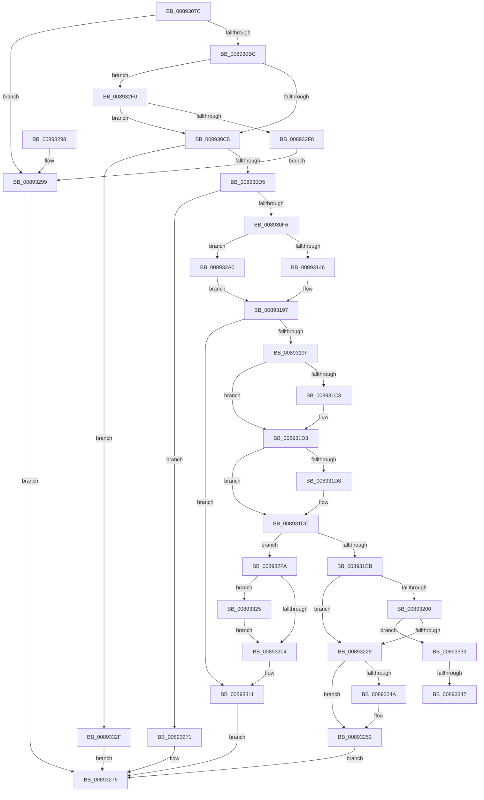

# AlpcpCreateSection

- RVA: `0x0089307C`–`0x00893355` (길이 `729` bytes)
- VA: `0x000000014089307C`
- 실행 섹션: `PAGE`
- PDB 이름 있음: `예`; PDB Function 태그: `예`
- unwind 정보 RVA: `0x0007DDE4`
- 디코드: `180`개 명령, `729/729` bytes 표시
- 미해석 바이트: `0` (있으면 어셈블리에 `.byte`로 보존)

> 이 문서는 커널 이미지의 기계어와 PDB 기호를 분석해 생성했습니다. 4번과 5번은 함수 원형과 자료형을 바이너리 사용 방식에서 추정한 C 해석이며 원본 소스 복구 결과는 아닙니다.

## 1. Dependencies

- 직접 호출 지점: **18**; 고유 호출 대상: **15**
- 직접 호출자로 확인된 함수: **2**
- RIP 상대 이미지 참조: **3**

### Outgoing calls
- `0x008930E5` → [AlpcpAllocateBlob](AlpcpAllocateBlob_function_008925B0.md) (function, `0x008925B0`)
- `0x008930FF` → [memset](../../text/6C/memset_function_006C6C40.md) (function, `0x006C6C40`)
- `0x00893190` → [MmCreateSectionEx](../98/MmCreateSectionEx_function_009839CC.md) (function, `0x009839CC`)
- `0x008931AE` → [KeAbPreAcquire](../../text/21/KeAbPreAcquire_function_00210230.md) (function, `0x00210230`)
- `0x008931CE` → [ExfAcquirePushLockSharedEx](../../text/21/ExfAcquirePushLockSharedEx_function_0021044C.md) (function, `0x0021044C`)
- `0x008931EE` → [AlpcpStartInitialization](AlpcpStartInitialization_function_008920D8.md) (function, `0x008920D8`)
- `0x008931F6` → [AlpcpReferenceBlob](AlpcpReferenceBlob_function_00890110.md) (function, `0x00890110`)
- `0x00893216` → [AlpcAddHandleTableEntry](AlpcAddHandleTableEntry_function_00892140.md) (function, `0x00892140`)
- `0x0089322C` → [ObfReferenceObject](../../text/20/ObfReferenceObject_function_0020FA20.md) (function, `0x0020FA20`)
- `0x0089323B` → [AlpcpInsertResourcePort](../88/AlpcpInsertResourcePort_function_008898DC.md) (function, `0x008898DC`)
- `0x0089324D` → [ExfReleasePushLockShared](../../text/26/ExfReleasePushLockShared_function_00263440.md) (function, `0x00263440`)
- `0x00893255` → [KeAbPostRelease](../../text/2E/KeAbPostRelease_function_002E1600.md) (function, `0x002E1600`)
- `0x0089325D` → [AlpcpEndInitialization](../A2/AlpcpEndInitialization_function_00A20C78.md) (function, `0x00A20C78`)
- `0x008932D9` → [ObReferenceObjectByHandle](../86/ObReferenceObjectByHandle_function_00868DB0.md) (function, `0x00868DB0`)
- `0x00893307` → [KeAbPostRelease](../../text/2E/KeAbPostRelease_function_002E1600.md) (function, `0x002E1600`)
- `0x00893319` → [AlpcpDereferenceBlobEx](../88/AlpcpDereferenceBlobEx_function_0088AF00.md) (function, `0x0088AF00`)
- `0x00893328` → [ExfReleasePushLockShared](../../text/26/ExfReleasePushLockShared_function_00263440.md) (function, `0x00263440`)
- `0x0089334A` → [ExfReleasePushLockShared](../../text/26/ExfReleasePushLockShared_function_00263440.md) (function, `0x00263440`)

### Direct callers
- [NtAlpcCreatePortSection](NtAlpcCreatePortSection_function_00893E60.md) at `0x00893F67`
- [AlpcpMapLegacyPortView](../92/AlpcpMapLegacyPortView_function_00921588.md) at `0x00921688`

### Static image references
- `0x008930DA` → RVA `0x000014A0` (`.rdata`; read)
- `0x00893118` → RVA `0x00FC6CDC` (`ALMOSTRO`; read)
- `0x008932AE` → RVA `0x00FC6BD8` (`ALMOSTRO`; read)

## 2. Other-region calls and transfers

- 다른 실행 섹션으로 향하는 call: **9**
  - `0x008930FF` → [memset](../../text/6C/memset_function_006C6C40.md) (`PAGE` → `.text`)
  - `0x008931AE` → [KeAbPreAcquire](../../text/21/KeAbPreAcquire_function_00210230.md) (`PAGE` → `.text`)
  - `0x008931CE` → [ExfAcquirePushLockSharedEx](../../text/21/ExfAcquirePushLockSharedEx_function_0021044C.md) (`PAGE` → `.text`)
  - `0x0089322C` → [ObfReferenceObject](../../text/20/ObfReferenceObject_function_0020FA20.md) (`PAGE` → `.text`)
  - `0x0089324D` → [ExfReleasePushLockShared](../../text/26/ExfReleasePushLockShared_function_00263440.md) (`PAGE` → `.text`)
  - `0x00893255` → [KeAbPostRelease](../../text/2E/KeAbPostRelease_function_002E1600.md) (`PAGE` → `.text`)
  - `0x00893307` → [KeAbPostRelease](../../text/2E/KeAbPostRelease_function_002E1600.md) (`PAGE` → `.text`)
  - `0x00893328` → [ExfReleasePushLockShared](../../text/26/ExfReleasePushLockShared_function_00263440.md) (`PAGE` → `.text`)
  - `0x0089334A` → [ExfReleasePushLockShared](../../text/26/ExfReleasePushLockShared_function_00263440.md) (`PAGE` → `.text`)
- call이 아닌 외부 분기/꼬리 이동: **2**
  - `0x00893341` → [sub_00B195F6](../B1/Unknown_function_00B195F6.md) (`tail-transfer`)
  - `0x00893350` → [sub_00B195F6](../B1/Unknown_function_00B195F6.md) (`tail-transfer`)

## 3. Assembly (complete function range)

```asm
0089307C  48 8B C4                        mov rax, rsp
0089307F  48 89 58 08                     mov qword ptr [rax + 8], rbx
00893083  48 89 68 10                     mov qword ptr [rax + 0x10], rbp
00893087  48 89 70 18                     mov qword ptr [rax + 0x18], rsi
0089308B  48 89 78 20                     mov qword ptr [rax + 0x20], rdi
0089308F  41 54                           push r12
00893091  41 56                           push r14
00893093  41 57                           push r15
00893095  48 81 EC 80 00 00 00            sub rsp, 0x80
0089309C  4C 8B B4 24 C0 00 00 00         mov r14, qword ptr [rsp + 0xc0]
008930A4  45 33 E4                        xor r12d, r12d
008930A7  0F B6 EA                        movzx ebp, dl
008930AA  49 8B D9                        mov rbx, r9
008930AD  45 8A F8                        mov r15b, r8b
008930B0  48 8B F1                        mov rsi, rcx
008930B3  4D 85 F6                        test r14, r14
008930B6  0F 84 DD 01 00 00               je 0x140893299
008930BC  48 85 DB                        test rbx, rbx
008930BF  0F 85 2B 02 00 00               jne 0x1408932f0
008930C5  F7 81 00 01 00 00 00 00 00 01   test dword ptr [rcx + 0x100], 0x1000000
008930CF  0F 85 5A 02 00 00               jne 0x14089332f
008930D5  BA 48 00 00 00                  mov edx, 0x48
008930DA  48 8D 0D BF E3 76 FF            lea rcx, [rip - 0x891c41]
008930E1  44 8D 42 B9                     lea r8d, [rdx - 0x47]
008930E5  E8 C6 F4 FF FF                  call 0x1408925b0
008930EA  48 8B F8                        mov rdi, rax
008930ED  48 85 C0                        test rax, rax
008930F0  0F 84 7B 01 00 00               je 0x140893271
008930F6  33 D2                           xor edx, edx
008930F8  48 8B C8                        mov rcx, rax
008930FB  44 8D 42 48                     lea r8d, [rdx + 0x48]
008930FF  E8 3C 3B E3 FF                  call 0x1406c6c40
00893104  65 48 8B 04 25 88 01 00 00      mov rax, qword ptr gs:[0x188]
0089310D  48 8B 88 B8 00 00 00            mov rcx, qword ptr [rax + 0xb8]
00893114  48 89 4F 20                     mov qword ptr [rdi + 0x20], rcx
00893118  8B 0D BE 3B 73 00               mov ecx, dword ptr [rip + 0x733bbe]
0089311E  8D 51 FF                        lea edx, [rcx - 1]
00893121  49 03 D6                        add rdx, r14
00893124  48 8D 41 FF                     lea rax, [rcx - 1]
00893128  48 F7 D0                        not rax
0089312B  48 23 D0                        and rdx, rax
0089312E  48 8D 47 38                     lea rax, [rdi + 0x38]
00893132  48 89 57 08                     mov qword ptr [rdi + 8], rdx
00893136  48 89 40 08                     mov qword ptr [rax + 8], rax
0089313A  48 89 00                        mov qword ptr [rax], rax
0089313D  48 85 DB                        test rbx, rbx
00893140  0F 85 5A 01 00 00               jne 0x1408932a0
00893146  8B 4F 30                        mov ecx, dword ptr [rdi + 0x30]
00893149  44 8D 4B 04                     lea r9d, [rbx + 4]
0089314D  4C 8B 47 08                     mov r8, qword ptr [rdi + 8]
00893151  83 C9 01                        or ecx, 1
00893154  44 89 64 24 50                  mov dword ptr [rsp + 0x50], r12d
00893159  8B C5                           mov eax, ebp
0089315B  03 C0                           add eax, eax
0089315D  4C 89 64 24 48                  mov qword ptr [rsp + 0x48], r12
00893162  33 C1                           xor eax, ecx
00893164  44 89 64 24 38                  mov dword ptr [rsp + 0x38], r12d
00893169  83 E0 02                        and eax, 2
0089316C  4C 89 64 24 30                  mov qword ptr [rsp + 0x30], r12
00893171  33 C1                           xor eax, ecx
00893173  4C 89 64 24 28                  mov qword ptr [rsp + 0x28], r12
00893178  0F 57 C0                        xorps xmm0, xmm0
0089317B  89 47 30                        mov dword ptr [rdi + 0x30], eax
0089317E  48 8B CF                        mov rcx, rdi
00893181  C7 44 24 20 00 00 00 08         mov dword ptr [rsp + 0x20], 0x8000000
00893189  33 D2                           xor edx, edx
0089318B  0F 11 44 24 70                  movups xmmword ptr [rsp + 0x70], xmm0
00893190  E8 37 08 0F 00                  call 0x1409839cc
00893195  8B D8                           mov ebx, eax
00893197  85 DB                           test ebx, ebx
00893199  0F 88 72 01 00 00               js 0x140893311
0089319F  48 8D 9E 60 01 00 00            lea rbx, [rsi + 0x160]
008931A6  45 33 C0                        xor r8d, r8d
008931A9  48 8B CB                        mov rcx, rbx
008931AC  33 D2                           xor edx, edx
008931AE  E8 7D D0 97 FF                  call 0x140210230
008931B3  48 8B E8                        mov rbp, rax
008931B6  33 C0                           xor eax, eax
008931B8  44 8D 70 11                     lea r14d, [rax + 0x11]
008931BC  F0 4C 0F B1 33                  lock cmpxchg qword ptr [rbx], r14
008931C1  74 10                           je 0x1408931d3
008931C3  4C 8B CB                        mov r9, rbx
008931C6  4C 8B C5                        mov r8, rbp
008931C9  33 D2                           xor edx, edx
008931CB  48 8B CB                        mov rcx, rbx
008931CE  E8 79 D2 97 FF                  call 0x14021044c
008931D3  48 85 ED                        test rbp, rbp
008931D6  74 04                           je 0x1408931dc
008931D8  C6 45 0A 01                     mov byte ptr [rbp + 0xa], 1
008931DC  8B 8E A0 01 00 00               mov ecx, dword ptr [rsi + 0x1a0]
008931E2  F6 C1 20                        test cl, 0x20
008931E5  0F 85 0F 01 00 00               jne 0x1408932fa
008931EB  48 8B CF                        mov rcx, rdi
008931EE  E8 E5 EE FF FF                  call 0x1408920d8
008931F3  48 8B CF                        mov rcx, rdi
008931F6  E8 15 CF FF FF                  call 0x140890110
008931FB  45 84 FF                        test r15b, r15b
008931FE  74 29                           je 0x140893229
00893200  48 8B 4E 10                     mov rcx, qword ptr [rsi + 0x10]
00893204  48 8D 54 24 60                  lea rdx, [rsp + 0x60]
00893209  48 83 C1 28                     add rcx, 0x28
0089320D  48 89 7C 24 60                  mov qword ptr [rsp + 0x60], rdi
00893212  48 89 4F 10                     mov qword ptr [rdi + 0x10], rcx
00893216  E8 25 EF FF FF                  call 0x140892140
0089321B  48 89 47 18                     mov qword ptr [rdi + 0x18], rax
0089321F  48 83 F8 FF                     cmp rax, -1
00893223  0F 84 10 01 00 00               je 0x140893339
00893229  48 8B CE                        mov rcx, rsi
0089322C  E8 EF C7 97 FF                  call 0x14020fa20
00893231  48 8B D7                        mov rdx, rdi
00893234  48 89 77 28                     mov qword ptr [rdi + 0x28], rsi
00893238  48 8B CE                        mov rcx, rsi
0089323B  E8 9C 66 FF FF                  call 0x1408898dc
00893240  49 8B C6                        mov rax, r14
00893243  F0 4C 0F B1 23                  lock cmpxchg qword ptr [rbx], r12
00893248  74 08                           je 0x140893252
0089324A  48 8B CB                        mov rcx, rbx
0089324D  E8 EE 01 9D FF                  call 0x140263440
00893252  48 8B CB                        mov rcx, rbx
00893255  E8 A6 E3 A4 FF                  call 0x1402e1600
0089325A  48 8B CF                        mov rcx, rdi
0089325D  E8 16 DA 18 00                  call 0x140a20c78
00893262  48 8B 84 24 C8 00 00 00         mov rax, qword ptr [rsp + 0xc8]
0089326A  48 89 38                        mov qword ptr [rax], rdi
0089326D  33 C0                           xor eax, eax
0089326F  EB 05                           jmp 0x140893276
00893271  B8 9A 00 00 C0                  mov eax, 0xc000009a
00893276  4C 8D 9C 24 80 00 00 00         lea r11, [rsp + 0x80]
0089327E  49 8B 5B 20                     mov rbx, qword ptr [r11 + 0x20]
00893282  49 8B 6B 28                     mov rbp, qword ptr [r11 + 0x28]
00893286  49 8B 73 30                     mov rsi, qword ptr [r11 + 0x30]
0089328A  49 8B 7B 38                     mov rdi, qword ptr [r11 + 0x38]
0089328E  49 8B E3                        mov rsp, r11
00893291  41 5F                           pop r15
00893293  41 5E                           pop r14
00893295  41 5C                           pop r12
00893297  C3                              ret
00893298  CC                              int3
00893299  B8 0D 00 00 C0                  mov eax, 0xc000000d
0089329E  EB D6                           jmp 0x140893276
008932A0  65 48 8B 04 25 88 01 00 00      mov rax, qword ptr gs:[0x188]
008932A9  BA 06 00 00 00                  mov edx, 6
008932AE  4C 8B 05 23 39 73 00            mov r8, qword ptr [rip + 0x733923]
008932B5  48 8B CB                        mov rcx, rbx
008932B8  4C 89 64 24 28                  mov qword ptr [rsp + 0x28], r12
008932BD  4C 89 A4 24 C0 00 00 00         mov qword ptr [rsp + 0xc0], r12
008932C5  44 8A 88 32 02 00 00            mov r9b, byte ptr [rax + 0x232]
008932CC  48 8D 84 24 C0 00 00 00         lea rax, [rsp + 0xc0]
008932D4  48 89 44 24 20                  mov qword ptr [rsp + 0x20], rax
008932D9  E8 D2 5A FD FF                  call 0x140868db0
008932DE  8B D8                           mov ebx, eax
008932E0  48 8B 84 24 C0 00 00 00         mov rax, qword ptr [rsp + 0xc0]
008932E8  48 89 07                        mov qword ptr [rdi], rax
008932EB  E9 A7 FE FF FF                  jmp 0x140893197
008932F0  84 D2                           test dl, dl
008932F2  0F 84 CD FD FF FF               je 0x1408930c5
008932F8  EB 9F                           jmp 0x140893299
008932FA  49 8B C6                        mov rax, r14
008932FD  F0 4C 0F B1 23                  lock cmpxchg qword ptr [rbx], r12
00893302  75 21                           jne 0x140893325
00893304  48 8B CB                        mov rcx, rbx
00893307  E8 F4 E2 A4 FF                  call 0x1402e1600
0089330C  BB 37 00 00 C0                  mov ebx, 0xc0000037
00893311  BA 01 00 00 00                  mov edx, 1
00893316  48 8B CF                        mov rcx, rdi
00893319  E8 E2 7B FF FF                  call 0x14088af00
0089331E  8B C3                           mov eax, ebx
00893320  E9 51 FF FF FF                  jmp 0x140893276
00893325  48 8B CB                        mov rcx, rbx
00893328  E8 13 01 9D FF                  call 0x140263440
0089332D  EB D5                           jmp 0x140893304
0089332F  B8 06 07 00 C0                  mov eax, 0xc0000706
00893334  E9 3D FF FF FF                  jmp 0x140893276
00893339  49 8B C6                        mov rax, r14
0089333C  F0 4C 0F B1 23                  lock cmpxchg qword ptr [rbx], r12
00893341  0F 84 AF 62 28 00               je 0x140b195f6
00893347  48 8B CB                        mov rcx, rbx
0089334A  E8 F1 00 9D FF                  call 0x140263440
0089334F  90                              nop
00893350  E9 A1 62 28 00                  jmp 0x140b195f6
```

## 4. C-style interpretation (structured pseudocode)

```c
__int64 __fastcall AlpcpCreateSection(__int64 a1, unsigned __int8 a2, unsigned __int8 a3, __int64 a4, __int64 a5, __int64 a6)
{
    __int64 result;
    __int64 v_r12;
    __int64 v_rsp;
    unsigned __int64 v_stack_m18;
    unsigned __int64 v_stack_m28;
    unsigned __int64 v_stack_m38;
    unsigned int v_stack_m48;
    unsigned __int64 v_stack_m50;
    unsigned __int64 v_stack_m58;
    unsigned int v_stack_m60;
    unsigned __int64 v_stack_m68;
    unsigned __int64 v_stack_m70;
    unsigned int v_stack_m78;
    unsigned __int64 v_stack_p40;

    *(unsigned __int64 *)(v_rsp + 8) = v_rbx;
    *(unsigned __int64 *)(v_rsp + 16) = v_rbp;
    *(unsigned __int64 *)(v_rsp + 24) = v_rsi;
    *(unsigned __int64 *)(v_rsp + 32) = v_rdi;
    v_rsp = (v_rsp) - (128);
    v_r12 = 0;
    if (a5 == 0) goto loc_00893299;
    if (a4 != 0) goto loc_008932F0;
loc_008930C5:
    if (((*(unsigned int *)(a1 + 256)) & (0x1000000ULL)) != 0) goto loc_0089332F;
    result = AlpcpAllocateBlob(v_rip - 8985665, 72, 72 - 71, a4);
    if (result == 0) goto loc_00893271;
    a2 = 0;
    result = memset(result, a2, a2 + 72, a4);
    *(unsigned __int64 *)(result + 32) = *(unsigned __int64 *)(*(unsigned __int64 *)(gs_base + (0 + 392)) + 184);
    a2 = ((unsigned int)(*(unsigned int *)(v_rip + 7551934)) - 1) + (a5);
    result = ~((unsigned int)(*(unsigned int *)(v_rip + 7551934)) - 1);
    a2 = (a2) & (result);
    *(unsigned __int64 *)(result + 8) = a2;
    *(unsigned __int64 *)(result + 56 + 8) = result + 56;
    *(unsigned __int64 *)(result + 56) = result + 56;
    if (a4 != 0) goto loc_008932A0;
    a1 = (unsigned int)(((unsigned int)(*(unsigned int *)(result + 48))) | (1));
    v_stack_m48 = 0;
    result = (unsigned int)(((unsigned int)(a2)) + ((unsigned int)((unsigned int)(a2))));
    v_stack_m50 = 0;
    result = (unsigned int)((result) ^ ((unsigned int)(a1)));
    v_stack_m60 = 0;
    result = (unsigned int)((result) & (2));
    v_stack_m68 = 0;
    result = (unsigned int)((result) ^ ((unsigned int)(a1)));
    v_stack_m70 = 0;
    *(unsigned int *)(result + 48) = (unsigned int)(result);
    v_stack_m78 = 0x8000000ULL;
    a2 = 0;
    v_stack_m28 = v_xmm0;
    result = MmCreateSectionEx(result, a2, *(unsigned __int64 *)(result + 8), a4 + 4);
loc_00893197:
    if (sign_flag) goto loc_00893311;
    a3 = 0;
    a2 = 0;
    result = KeAbPreAcquire(a1 + 352, a2, a3, a4 + 4);
    result = 0;
    if (!(condition_is_equal)) {
        a4 = a1 + 352;
        a3 = 0;
        a2 = 0;
        a1 = a1 + 352;
        result = ExfAcquirePushLockSharedEx(a1, a2, a3, a4);
    }
    if (result != 0) {
        *(unsigned __int8 *)(result + 10) = 1;
    }
    if ((((unsigned __int8)((unsigned int)(*(unsigned int *)(a1 + 416)))) & (32)) != 0) goto loc_008932FA;
    result = AlpcpStartInitialization(result, a2, a3, a4);
    result = AlpcpReferenceBlob(result, a2, a3, a4);
    if (a3 == 0) goto loc_00893229;
    a1 = (*(unsigned __int64 *)(a1 + 16)) + (40);
    v_stack_m38 = result;
    *(unsigned __int64 *)(result + 16) = a1;
    result = AlpcAddHandleTableEntry(a1, v_stack_m38, a3, a4);
    *(unsigned __int64 *)(result + 24) = result;
    if (result == -1) goto loc_00893339;
loc_00893229:
    result = ObfReferenceObject(a1, v_stack_m38, a3, a4);
    *(unsigned __int64 *)(result + 40) = a1;
    result = AlpcpInsertResourcePort(a1, result, a3, a4);
    result = result + 17;
    if (result != -1) {
        a1 = a1 + 352;
        result = ExfReleasePushLockShared(a1, result, a3, a4);
    }
    result = KeAbPostRelease(a1 + 352, result, a3, a4);
    result = AlpcpEndInitialization(result, result, a3, a4);
    *(unsigned __int64 *)(a6) = result;
    result = 0;
    goto loc_00893276;
loc_00893271:
loc_00893276:
    return (unsigned int)(0xC000009AULL);
loc_00893299:
    goto loc_00893276;
loc_008932A0:
    v_stack_m58 = 0;
    v_stack_p40 = 0;
    v_stack_m60 = a5;
    result = ObReferenceObjectByHandle(*(unsigned __int64 *)(v_stack_m18 + 32), 6, *(unsigned __int64 *)(v_rip + 7551267), *(unsigned __int8 *)(*(unsigned __int64 *)(gs_base + (0 + 392)) + 562));
    *(unsigned __int64 *)(*(unsigned __int64 *)(v_stack_m18 + 56)) = a5;
    goto loc_00893197;
loc_008932F0:
    if (6 == 0) goto loc_008930C5;
    goto loc_00893299;
loc_008932FA:
    if (6 != 0) goto loc_00893325;
loc_00893304:
    result = KeAbPostRelease((unsigned int)((unsigned int)(result)), 6, *(unsigned __int64 *)(v_rip + 7551267), *(unsigned __int8 *)(*(unsigned __int64 *)(gs_base + (0 + 392)) + 562));
loc_00893311:
    result = AlpcpDereferenceBlobEx(*(unsigned __int64 *)(v_stack_m18 + 56), 1, *(unsigned __int64 *)(v_rip + 7551267), *(unsigned __int8 *)(*(unsigned __int64 *)(gs_base + (0 + 392)) + 562));
    goto loc_00893276;
loc_00893325:
    result = ExfReleasePushLockShared((unsigned int)(0xC0000037ULL), 1, *(unsigned __int64 *)(v_rip + 7551267), *(unsigned __int8 *)(*(unsigned __int64 *)(gs_base + (0 + 392)) + 562));
    goto loc_00893304;
loc_0089332F:
    goto loc_00893276;
loc_00893339:
    result = ExfReleasePushLockShared((unsigned int)(0xC0000037ULL), 1, *(unsigned __int64 *)(v_rip + 7551267), *(unsigned __int8 *)(*(unsigned __int64 *)(gs_base + (0 + 392)) + 562));
}
```

## 5. (Beta) C Style

```c
int64_t AlpcpCreateSection(void *Arg1, uint8_t Arg2, uint8_t Arg3, int64_t Arg4, int64_t Arg5, void *Arg6)
{
    uint8_t *arg1 = (uint8_t *)Arg1;
    uint8_t *arg6 = (uint8_t *)Arg6;

    int64_t result;
    int64_t local_r12;
    int64_t local_rsp;
    uint64_t v_stack_m18;
    uint64_t v_stack_m28;
    uint64_t v_stack_m38;
    uint32_t v_stack_m48;
    uint64_t v_stack_m50;
    uint64_t v_stack_m58;
    uint32_t v_stack_m60;
    uint64_t v_stack_m68;
    uint64_t v_stack_m70;
    uint32_t v_stack_m78;
    uint64_t v_stack_p40;

    *(uint64_t *)(local_rsp + 0x8) = local_rbx;
    *(uint64_t *)(local_rsp + 0x10) = local_rbp;
    *(uint64_t *)(local_rsp + 0x18) = local_rsi;
    *(uint64_t *)(local_rsp + 0x20) = local_rdi;
    local_rsp = (local_rsp) - (128);
    local_r12 = 0;
    if (Arg5 == 0) goto loc_00893299;
    if (Arg4 != 0) goto loc_008932F0;
loc_008930C5:
    if (((*(uint32_t *)(arg1 + 0x100)) & (0x1000000ULL)) != 0) goto loc_0089332F;
    result = AlpcpAllocateBlob(v_rip - 8985665, 72, 72 - 71, Arg4);
    if (result == 0) goto loc_00893271;
    Arg2 = 0;
    result = memset(result, Arg2, Arg2 + 72, Arg4);
    *(uint64_t *)(result + 0x20) = *(uint64_t *)(*(uint64_t *)(gs_base + (0 + 0x188)) + 0xB8);
    Arg2 = ((uint32_t)(*(uint32_t *)(v_rip + 0x733BBE)) - 1) + (Arg5);
    result = ~((uint32_t)(*(uint32_t *)(v_rip + 0x733BBE)) - 1);
    Arg2 = (Arg2) & (result);
    *(uint64_t *)(result + 0x8) = Arg2;
    *(uint64_t *)(result + 0x38 + 0x8) = result + 56;
    *(uint64_t *)(result + 0x38) = result + 56;
    if (Arg4 != 0) goto loc_008932A0;
    Arg1 = (uint32_t)(((uint32_t)(*(uint32_t *)(result + 0x30))) | (1));
    v_stack_m48 = 0;
    result = (uint32_t)(((uint32_t)(Arg2)) + ((uint32_t)((uint32_t)(Arg2))));
    v_stack_m50 = 0;
    result = (uint32_t)((result) ^ ((uint32_t)(Arg1)));
    v_stack_m60 = 0;
    result = (uint32_t)((result) & (2));
    v_stack_m68 = 0;
    result = (uint32_t)((result) ^ ((uint32_t)(Arg1)));
    v_stack_m70 = 0;
    *(uint32_t *)(result + 0x30) = (uint32_t)(result);
    v_stack_m78 = 0x8000000ULL;
    Arg2 = 0;
    v_stack_m28 = v_xmm0;
    result = MmCreateSectionEx(result, Arg2, *(uint64_t *)(result + 0x8), Arg4 + 4);
loc_00893197:
    if (sign_flag) goto loc_00893311;
    Arg3 = 0;
    Arg2 = 0;
    result = KeAbPreAcquire(Arg1 + 352, Arg2, Arg3, Arg4 + 4);
    result = 0;
    if (!(condition_is_equal)) {
        Arg4 = Arg1 + 352;
        Arg3 = 0;
        Arg2 = 0;
        Arg1 = Arg1 + 352;
        result = ExfAcquirePushLockSharedEx(Arg1, Arg2, Arg3, Arg4);
    }
    if (result != 0) {
        *(uint8_t *)(result + 0xA) = 1;
    }
    if ((((uint8_t)((uint32_t)(*(uint32_t *)(arg1 + 0x1A0)))) & (32)) != 0) goto loc_008932FA;
    result = AlpcpStartInitialization(result, Arg2, Arg3, Arg4);
    result = AlpcpReferenceBlob(result, Arg2, Arg3, Arg4);
    if (Arg3 == 0) goto loc_00893229;
    Arg1 = (*(uint64_t *)(arg1 + 0x10)) + (40);
    v_stack_m38 = result;
    *(void **)(result + 0x10) = Arg1;
    result = AlpcAddHandleTableEntry(Arg1, v_stack_m38, Arg3, Arg4);
    *(uint64_t *)(result + 0x18) = result;
    if (result == -1) goto loc_00893339;
loc_00893229:
    result = ObfReferenceObject(Arg1, v_stack_m38, Arg3, Arg4);
    *(void **)(result + 0x28) = Arg1;
    result = AlpcpInsertResourcePort(Arg1, result, Arg3, Arg4);
    result = result + 17;
    if (result != -1) {
        Arg1 = Arg1 + 352;
        result = ExfReleasePushLockShared(Arg1, result, Arg3, Arg4);
    }
    result = KeAbPostRelease(Arg1 + 352, result, Arg3, Arg4);
    result = AlpcpEndInitialization(result, result, Arg3, Arg4);
    *(uint64_t *)(arg6) = result;
    result = 0;
    goto loc_00893276;
loc_00893271:
loc_00893276:
    return (uint32_t)(0xC000009AULL);
loc_00893299:
    goto loc_00893276;
loc_008932A0:
    v_stack_m58 = 0;
    v_stack_p40 = 0;
    v_stack_m60 = Arg5;
    result = ObReferenceObjectByHandle(*(uint64_t *)(v_stack_m18 + 0x20), 6, *(uint64_t *)(v_rip + 0x733923), *(uint8_t *)(*(uint64_t *)(gs_base + (0 + 0x188)) + 0x232));
    *(uint64_t *)(*(uint64_t *)(v_stack_m18 + 0x38)) = Arg5;
    goto loc_00893197;
loc_008932F0:
    if (6 == 0) goto loc_008930C5;
    goto loc_00893299;
loc_008932FA:
    if (6 != 0) goto loc_00893325;
loc_00893304:
    result = KeAbPostRelease((uint32_t)((uint32_t)(result)), 6, *(uint64_t *)(v_rip + 0x733923), *(uint8_t *)(*(uint64_t *)(gs_base + (0 + 0x188)) + 0x232));
loc_00893311:
    result = AlpcpDereferenceBlobEx(*(uint64_t *)(v_stack_m18 + 0x38), 1, *(uint64_t *)(v_rip + 0x733923), *(uint8_t *)(*(uint64_t *)(gs_base + (0 + 0x188)) + 0x232));
    goto loc_00893276;
loc_00893325:
    result = ExfReleasePushLockShared((uint32_t)(0xC0000037ULL), 1, *(uint64_t *)(v_rip + 0x733923), *(uint8_t *)(*(uint64_t *)(gs_base + (0 + 0x188)) + 0x232));
    goto loc_00893304;
loc_0089332F:
    goto loc_00893276;
loc_00893339:
    result = ExfReleasePushLockShared((uint32_t)(0xC0000037ULL), 1, *(uint64_t *)(v_rip + 0x733923), *(uint8_t *)(*(uint64_t *)(gs_base + (0 + 0x188)) + 0x232));
}
```

### 관측된 메모리 오프셋

구조체 형식이 확인되지 않은 접근은 인자 기준의 오프셋으로만 기록했습니다.

| 기준 인자 | 오프셋 표현 | 폭 (bit) | 접근 |
|---|---:|---:|---|
| `Arg1` | `+ 0x0` | `64` | `R` |
| `Arg1` | `+ 0x10` | `64` | `R` |
| `Arg1` | `+ 0x100` | `32` | `R` |
| `Arg1` | `+ 0x160` | `64` | `R` |
| `Arg1` | `+ 0x1A0` | `32` | `R` |
| `Arg6` | `+ 0x0` | `64` | `W` |

## 6. Execution-region graph

[열기: 2D/3D 그래프와 함수 탐색 컨트롤 패널](../../../control-panel.html?section=page&rva=0x0089307C&view=graph)

- 2D 그래프는 위에서 아래로 흐르고, 3D 그래프는 빈 공간을 드래그해 회전합니다. Shift+드래그는 이동, 휠은 확대·축소, 함수 노드 선택은 대상 보고서 이동입니다.

### Static fallback


